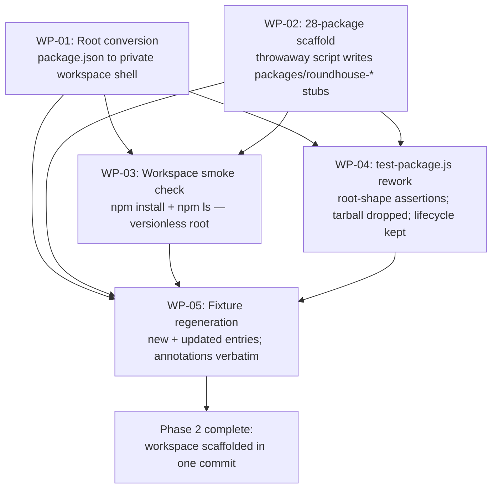

# PLAN-20261019-01: Phase 2 — workspace scaffolding

Last modified: 2026-10-19
Status: Draft

## Objective

Implement Phase 2 of the Roundhouse migration (DEC-20261017-03): convert the
repository root into a private npm-workspace shell and scaffold the 28 empty
package stubs under `packages/`, so Phases 3–5 build on a stable workspace
skeleton. The plan implements SPEC-20261019-01 — the root conversion's
field-level contract, the 28-package derivation rule, the stub formats, and
SCEN-046..051 — and executes the two obligations the spec inherits to this
plan: the versionless-root smoke check (`npm install` + `npm ls`) and the
disposition of the legacy-publish assertions in `scripts/test-package.js`.

The plan artifact follows the full arc (draft → review → commit → push);
implementation is subsequent gated work.

## Scope

### Included

- WP-01: the root conversion, field-level, per the spec's Public contracts.
- WP-02: the 28-package scaffold via a throwaway deterministic script —
  created, run, verified, deleted (the Phase 1 T-11 annotation-applier
  precedent).
- WP-03: the workspace smoke check — `npm install` + `npm ls` at the root,
  run inside the changeset (human-ruled).
- WP-04: the `scripts/test-package.js` rework per the human-ruled
  disposition (rework root-manifest assertions / drop tarball assertions /
  keep lifecycle tests).
- WP-05: the same-changeset fixture regeneration (SCEN-050, SCEN-051),
  absorbing the pre-existing fixture drift recorded in Current-state
  findings.
- Appendix A: the 28 proposed one-line stub descriptions — the Gate 1
  review centerpiece (the stub format's one human-authored field).

### Excluded

- Phase 3+ work: the composer, Core decoupling, the atomic content cutover,
  publishing and CI (DEC-20261017-03 phase ordering).
- Production source moves: `src/` is byte-identical before and after
  (SPEC-20261019-01, Excluded; SCEN-050).
- The detailed capability schema: stubs carry empty `capabilities` and
  `requires` only; the vocabulary and dependency edges are Phase 3
  composer territory (DEC-20261017-02).
- Org-package npm naming: deferred by DEC-20261017-02 (Follow-up); no org
  package is scaffolded.
- Permanent scaffold tooling: the scaffold script is throwaway; nothing
  durable is added to `scripts/`.
- The deprecation ceremony itself: Phase 9 territory (DEC-20261017-03,
  amended); this plan only makes the root unpublishable.
- New decision records: the scaffold mechanism is plan-level execution
  detail; this plan amends nothing.

## Related specifications and decisions

- `SPEC-20261019-01` — Phase 2 workspace scaffolding; primary normative
  source. SCEN-046..051 are this plan's acceptance contracts; the Open
  questions resolutions and the Excluded section assign this plan its two
  inherited obligations.
- `DEC-20261017-01` — Parent decision: composable package architecture.
- `DEC-20261017-02` — Package contract: layout, kinds, naming; the stub
  manifests instantiate it.
- `DEC-20261017-03` — Migration strategy: the Phase 2 definition, the
  changeset-granularity list (one scaffolding commit), and the amended
  deprecation ceremony the root conversion reconciles.
- `SPEC-20261017-01` — Fixture tooling: the generator WP-05 runs and the
  committed fixture whose owner distribution WP-02's script derives from.
- `DEC-20261017-04` — Phase 1 commitments: the fixture's provenance.
- `DEC-20260906-01` — Byte-exact philosophy; precedent for the fixture's
  byte-level determinism requirements.

## Current-state findings

- **Root manifest (verified):** `package.json` carries `name`
  (`@backshopdev/roundhouse`), `version` (`0.6.0`), `description`, `bin`
  (`roundhouse` → `package/roundhouse.js`), `files` (4 entries),
  `publishConfig` (GitHub Packages registry), the five `scripts` (`commit`,
  `sync-roundhouse`, `test-sync`, `test-package`, `test-commit`),
  `license` (`MIT`), and `engines` (`{ "node": ">= 24.0.0" }`). WP-01
  converts exactly this field list.
- **`scripts/test-package.js` assertion groups (verified):**
  - *Root-manifest group:* the optional `--version` release-prep flag and
    its version assertion (lines 17–31), the license assertion (line 51),
    and the lifecycle-hooks-absence assertion (lines 56–57).
  - *Tarball group:* the `npm pack --dry-run --json` setup and `files`
    allowlist (lines 43–50), the packed-set membership and exclusion
    assertions (lines 52–65), and the real-pack install + CLI smoke
    (lines 67–87).
  - *Lifecycle group:* the `init`/`update` tests against temp consumers
    via `package/deploy-roundhouse.js` (lines 89–199).
- **The 28-package derivation instance (verified against the committed
  fixture):** 59 managed entries; 28 distinct package-name owner values
  owning 55 entries; 4 `TODO: <rationale>` markers. The instance matches
  SPEC-20261019-01's Scaffolded package set table exactly.
- **The committed fixture is stale relative to the tree (verified):** the
  fixture was last regenerated at the Phase 1 close (commit `45c5160`).
  The spec changeset (`98f2ef1`) landed tracked-file changes the fixture
  does not reflect: `docs/specs/SPEC-20261019-01.md` (tracked, no `src/`
  counterpart → belongs in the fixture as a root-only-artifact) is absent,
  and the `docs/decisions/DEC-20261017-01/-03/-04` entries carry
  pre-amendment hashes. The Phase 1 byte-equality contract (SCEN-026)
  cannot currently hold against the committed fixture. Observed house
  practice: doc-only changesets defer fixture regeneration to the next
  implementation changeset (the Phase 1 plan-creation and spec changesets
  did not regenerate). WP-05's regeneration absorbs this pre-existing
  drift alongside the scaffold delta; the fixture diff must be reviewed
  with that expectation, not mistaken for scaffold artifacts.
- **Ignore/tracking state relevant to WP-03 and WP-05 (verified):**
  `node_modules/` is gitignored; `package-lock.json` is neither tracked
  nor ignored and does not currently exist. After WP-03's `npm install`,
  the lockfile exists untracked-and-not-ignored, so every subsequent
  generator run emits exactly one expected untracked-path warning
  (exit 0, membership unchanged — SPEC-20261017-01's warning outcome).
  The lockfile stays untracked per the human ruling; no `.gitignore`
  entry is added.
- **Seed-instance boundary (verified):** the docs `index.md`/`template.md`
  files have `src/docs` counterparts and are seed instances — absent from
  the fixture by rule; the SPEC/PLAN/DEC documents have no counterparts
  and are root-only-artifact entries. WP-05's new-entry accounting uses
  this boundary.

## Intended shape

After this plan, the repository root is a private npm-workspace shell
(name, five scripts, and engines preserved verbatim; `private: true` and
`workspaces: ["packages/*"]` gained; the six publish-oriented fields
dropped), 28 member directories under `packages/` each carry the two stub
manifests, the workspace resolves under npm (the versionless root
verified), `scripts/test-package.js` is a workspace-root + lifecycle suite
with the tarball machinery gone, and the committed fixture equals the
regenerated output of the scaffolded tree. `src/` is untouched.

## Work packages

### WP-01: Root conversion

**Description:** Edit the root `package.json` to SPEC-20261019-01's
post-conversion contract: drop `version`, `description`, `bin`, `files`,
`publishConfig`, and `license`; keep `name`, the five `scripts`, and
`engines` verbatim; gain `private: true` and `workspaces: ["packages/*"]`.
The resulting manifest is the spec's pinned JSON block (Public contracts,
Root package.json post-conversion).

**Tasks:**

- T-01: Apply the field-level conversion; the result matches the spec's
  pinned manifest — member order is not normative, the field set is
  (Required).
- T-02: Inspect the converted manifest against the spec's pinned JSON and
  SCEN-046's assertion list; confirm `package/roundhouse.js` and `LICENSE`
  remain untouched root-only artifacts (Required).

**Dependencies:** None. Blocks WP-03 and WP-04.

**Parallelism:** Can run in parallel with WP-02.

**Acceptance criteria:**

- The root manifest carries exactly: `name`, `private`, `workspaces`,
  `scripts` (the five, unchanged values), `engines` (unchanged value) —
  and none of `version`, `description`, `bin`, `files`, `publishConfig`,
  `license` (SCEN-046).
- No other file changes attributable to WP-01.

### WP-02: The 28-package scaffold (throwaway script)

**Description:** Generate the 28 member stubs with a throwaway
deterministic script — created, run, verified, deleted; nothing durable
lands in `scripts/` (the Phase 1 T-11 annotation-applier precedent). The
script reads `references/migration-baseline.json`, extracts the distinct
package-name `intendedPhase5Owner` values (the derivation rule executed
mechanically against the committed fixture — not a hand-copied list),
maps kinds by name (`roundhouse-core` → `core`; `roundhouse-cli` → no
kind; every other member → `capability`), and writes each member's two
stub files at `packages/roundhouse-<subject>/` per the spec's stub
formats, with the one human-authored field — the `description` — taken
from the Gate-1-approved Appendix A values.

**Mechanism note (Gate 1 arbitrates):** this plan proposes the throwaway
script over hand-creation of 56 files: the derivation is mechanical, the
script makes the derivation auditable, and deletion keeps the changeset
free of one-shot tooling. The human may prefer hand-creation; the stub
formats and the derivation rule are Required either way.

**Tasks:**

- T-03: Author the throwaway script (proposed location: `scratch/` —
  gitignored, so it never appears in `git status`; deletion is hygiene).
  Behavior: derive the package set from the fixture; assert the derived
  count is 28 and matches the spec's table; write the 56 stub files with
  two-space-indented, LF-terminated JSON (Required for behavior; Expected
  for internals; Discretion for placement).
- T-04: Run the script; verify the tree against SCEN-047..049: exactly 28
  member directories named `packages/roundhouse-<subject>/`, each holding
  exactly `package.json` + `roundhouse.json`, stub members conforming to
  the formats, no `managed/` or `seed/` directories, no other entries
  under `packages/` (Required).
- T-05: Delete the script; confirm it appears nowhere in the changeset
  (Required).

**Dependencies:** None (writes `packages/*`; independent of the root
manifest). Blocks WP-03 and WP-05; WP-04's T-10 also depends on it.

**Parallelism:** Can run in parallel with WP-01.

**Acceptance criteria:**

- The scaffolded tree matches SCEN-047..049: 28 members, exact file
  pairs, stub conformance, no extra entries.
- Every stub's `description` is the Gate-1-approved Appendix A value;
  every other field is the spec-pinned value.
- The script is deleted; the changeset contains no scaffold tooling.

### WP-03: Workspace smoke check (the versionless-root obligation)

**Description:** Run `npm install` at the root and `npm ls`, verifying the
spec's resolved open question: npm tolerates the versionless private
workspace root. The install runs inside the changeset (human-ruled); its
artifacts stay out of the commit.

**Tasks:**

- T-06: Run `npm install` at the root; confirm exit 0, the 28 workspace
  members resolve, `node_modules/` is created (gitignored), and
  `package-lock.json` is created untracked (Required).
- T-07: Run `npm ls`; confirm exit 0 with no dependency errors
  (Required).

**Blocking contingency:** if `npm install` or `npm ls` fails on the
versionless root, the spec's version resolution is falsified — stop
WP-04/WP-05 and escalate to the human before any further work; the spec's
Open questions resolution would need revisiting (material uncertainty,
not an implementation defect to work around).

**Dependencies:** WP-01 (the workspace declaration), WP-02 (the members
being resolved). Blocks WP-05.

**Parallelism:** None — strictly after WP-01 and WP-02.

**Acceptance criteria:**

- `npm install` exits 0; `npm ls` exits 0 with no dependency errors; any
  npm warnings are recorded in the changeset review.
- `package-lock.json` exists untracked; `node_modules/` exists ignored;
  neither enters the commit.

### WP-04: `scripts/test-package.js` rework (the disposition obligation)

**Description:** Execute the human-ruled disposition (SPEC-20261019-01,
Excluded): the suite becomes a workspace-root + lifecycle suite. The
root-manifest assertions are reworked to assert the new shape; the
tarball assertions are dropped (inapplicable — the fields are gone); the
lifecycle tests are untouched (valid until Phase 6 replaces the deploy
tool). The suite's filename and the `test-package` npm script stay (the
root's `scripts` stay verbatim).

**Tasks:**

- T-08: Rework the root-manifest block: assert `name` is
  `@backshopdev/roundhouse`, `private` is `true`, `workspaces` deep-equals
  `["packages/*"]`, `scripts` deep-equals the five pre-conversion
  scripts, `engines` deep-equals `{ "node": ">= 24.0.0" }`, and none of
  `version`, `description`, `bin`, `files`, `publishConfig`, `license` is
  present (SCEN-046). Drop the `--version` release-prep flag (the version
  field it verifies is gone; the root is no longer released). Keep the
  lifecycle-hooks-absence assertion (still true of the five scripts)
  (Required).
- T-09: Drop the tarball block: the `npm pack --dry-run` setup, the
  packed-set membership and exclusion assertions, and the real-pack
  install + CLI smoke (Required).
- T-10: Add a workspace-members block asserting SCEN-047..049 — the 28
  member directories, the exact file pairs, and both stub formats'
  conformance — giving the stub contracts a durable test home (Expected —
  Gate 1 arbitrates; the alternative is verification by changeset-review
  inspection only).
- T-11: Run the reworked suite and `scripts/test-sync.js`; all green
  (Required).

**Dependencies:** WP-01 (asserts the new shape); T-10 also needs WP-02.

**Parallelism:** T-08/T-09 can proceed while WP-02 runs; the suite-green
run follows WP-02 and WP-03.

**Acceptance criteria:**

- The suite asserts the new root shape (SCEN-046) and no longer
  references `npm pack`, the `files` allowlist, or the `--version` flag.
- The lifecycle tests are byte-identical to their pre-rework state (no
  edits).
- The suite is green; `scripts/test-sync.js` remains green.

### WP-05: Fixture regeneration (same-changeset)

**Description:** Regenerate the committed fixture so it equals the tree at
changeset close (SCEN-050, SCEN-051). The regeneration absorbs both the
scaffold delta and the pre-existing drift recorded in Current-state
findings; annotations carry forward verbatim — none of the new or changed
files are managed.

**Tasks:**

- T-12: Track the 56 new package files (`git add packages/`) so the
  generator inventories them (Required).
- T-13: Run the generator; confirm exit 0 and the expected delta: new
  root-only-artifact entries for the 56 package files plus the
  pre-existing drift entries (`docs/specs/SPEC-20261019-01.md`;
  `docs/plans/PLAN-20261019-01.md` once the plan arc has committed it);
  updated hash/size entries for `package.json` and
  `scripts/test-package.js` (this changeset's WP-01/WP-04 effects) and
  for `docs/decisions/DEC-20261017-01/-03/-04` (the pre-existing
  `98f2ef1` drift); zero annotation changes — all 59 managed
  annotations verbatim; exactly one expected untracked-path warning
  (`package-lock.json`); byte-stable across consecutive runs (Required).
- T-14: Run `scripts/test-migration-baseline.js`; all green — the Phase 1
  fixture assertions (SCEN-026 byte-equality and tree match) are restored
  against the regenerated fixture, which exercises SCEN-050; verify
  SCEN-051's properties on the regenerated fixture (every new stub file
  present; the root `package.json` entry's hash and size match the
  converted file) (Required).

**Dependencies:** WP-01..WP-04 (the tree must be in its changeset-close
state before regeneration).

**Parallelism:** None — strictly last.

**Acceptance criteria:**

- The regenerated fixture equals the tree at changeset close;
  consecutive runs are byte-identical (SCEN-026, SCEN-050).
- All 59 managed annotations carried forward verbatim; zero annotation
  diffs (SCEN-034, SCEN-051).
- The fixture diff contains exactly the expected new and updated entries
  — reviewed with the pre-existing-drift expectation, not mistaken for
  scaffold artifacts.
- `scripts/test-migration-baseline.js` is green.

## Dependencies

- WP-01 and WP-02 are independent of each other; both block WP-03 (the
  workspace declaration and the members it resolves).
- WP-04 depends on WP-01 (and on WP-02 for T-10's member-stub block).
- WP-05 depends on WP-01..WP-04 — the regeneration must see the
  changeset-close tree.
- No external dependencies: Node 24 built-ins only; `npm install` adds no
  dependencies (the root has none); all touched tooling exists.

## Changeset granularity

One commit (human-ruled), matching DEC-20261017-03's granularity list
item "Workspace + package-contract scaffolding (Phases 2)":

| Commit | Work packages | Content |
| --- | --- | --- |
| 1 | WP-01..WP-05 | Converted root manifest, the 56 stub files, the reworked `scripts/test-package.js`, the regenerated fixture |

The plan-creation changeset (this plan + its index row) precedes the
implementation changeset and is separate. The throwaway scaffold script
never enters any commit; the lockfile and `node_modules/` stay out of the
commit (untracked / ignored).

## Change map

| File | Action | Purpose |
| --- | --- | --- |
| `docs/plans/PLAN-20261019-01.md` | Create | This plan (plan-creation changeset) |
| `docs/plans/index.md` | Modify | Add this plan's row (plan-creation changeset) |
| `package.json` | Modify | Root conversion per the spec's field-level contract (WP-01, T-01) |
| `packages/roundhouse-<subject>/package.json` ×28 | Create | Stub manifests per the spec's format (WP-02, T-03) |
| `packages/roundhouse-<subject>/roundhouse.json` ×28 | Create | Stub envelopes per the spec's format (WP-02, T-03) |
| `scripts/test-package.js` | Modify | Root-shape assertions; tarball block dropped; lifecycle untouched (WP-04, T-08..T-10) |
| `references/migration-baseline.json` | Modify | Regenerated at changeset close; absorbs the scaffold delta and the pre-existing drift (WP-05, T-13) |
| `scratch/scaffold-phase2.js` | Create, run, delete | Throwaway scaffold script; gitignored; never committed (WP-02, T-03..T-05) |
| `package-lock.json` | Created by npm, never committed | Untracked per the human ruling (WP-03) |

## Prescriptiveness levels

- **WP-01 — Required:** the spec pins the exact post-conversion manifest;
  no deviation without plan amendment.
- **WP-02 — Required** for the derivation rule, the stub formats, the
  28-package set, and the create-run-verify-delete lifecycle;
  **Expected** for the script's internals and the JSON formatting;
  **Discretion** for the script's placement. The mechanism itself
  (throwaway script vs hand-creation) is the Gate 1 arbitration point.
- **WP-03 — Required:** the smoke check is the spec's inherited
  obligation; the blocking contingency is fixed.
- **WP-04 — Required** for the three-group disposition (rework / drop /
  keep) and the suite-green end state; **Expected** for T-10's
  member-stub block (Gate 1 arbitrates) and assertion style.
- **WP-05 — Required** for the regeneration principle, annotation
  verbatim-ness, and byte stability; **Expected** for the drift-absorption
  bookkeeping (the drift set is pinned in Current-state findings and
  re-verified at execution).

## Scenario traceability matrix

Every SPEC-20261019-01 scenario maps to the work package and task that
implements it. SCEN-047..049's durable test home is T-10's proposed
workspace-members block (Gate 1 arbitrates; the fallback is
changeset-review inspection, noted in the matrix).

| Scenario | Work package | Task | Test location |
| --- | --- | --- | --- |
| SCEN-046 | WP-01, WP-04 | T-01, T-08 | `scripts/test-package.js` (reworked root-manifest block) |
| SCEN-047 | WP-02, WP-04 | T-03, T-04, T-10 | `scripts/test-package.js` (workspace-members block, proposed) + the scaffold script's self-check |
| SCEN-048 | WP-02, WP-04 | T-03, T-04, T-10 | `scripts/test-package.js` (workspace-members block, proposed) + the scaffold script's self-check |
| SCEN-049 | WP-02, WP-04 | T-03, T-04, T-10 | `scripts/test-package.js` (workspace-members block, proposed) + the scaffold script's self-check |
| SCEN-050 | WP-05 | T-13, T-14 | `scripts/test-migration-baseline.js` (SCEN-026 re-green) + the regeneration run |
| SCEN-051 | WP-05 | T-12, T-13 | The regeneration run + changeset review (committed fixture equals regenerated output) |

## Documentation stubs

- [x] Create this plan + its `docs/plans/index.md` row (the plan-creation
  changeset).
- [ ] No new decision records: the scaffold mechanism is plan-level
  execution detail (the Phase 1 T-11 precedent was likewise plan-level);
  if Gate 1 elevates the throwaway-script pattern to durable policy, a DR
  follows.
- [ ] No implementation map: the workspace's architecture documentation
  follows the content-bearing phases.
- [x] Update this plan's `docs/plans/index.md` row status as the plan
  advances (Draft → Ready → In progress → Completed).

## Verification criteria

- [ ] SCEN-046..051 verified per the traceability matrix.
- [ ] **Inherited obligation 1 — the versionless-root smoke check:**
  `npm install` exits 0 at the root with the 28 workspace members
  resolving, and `npm ls` exits 0 with no dependency errors
  (SPEC-20261019-01, Open questions resolution; WP-03).
- [ ] **Inherited obligation 2 — the test-package.js disposition:** the
  root-manifest assertions assert the new root shape, the tarball
  assertions are gone, the lifecycle tests are untouched, and the suite
  is green (SPEC-20261019-01, Excluded; WP-04).
- [ ] The root manifest matches the spec's pinned JSON exactly (SCEN-046).
- [ ] The `packages/` tree matches SCEN-047..049: 28 members, exact file
  pairs, stub conformance, no extra entries.
- [ ] `src/` is byte-identical before and after (SCEN-050).
- [ ] The regenerated fixture is byte-stable, carries all 59 managed
  annotations verbatim, and equals the tree at changeset close; the
  Phase 1 fixture assertions are green again (SCEN-026, SCEN-050,
  SCEN-051).
- [ ] `scripts/test-sync.js` green; no pre-existing test regresses.
- [ ] The changeset is exactly one commit; the throwaway script, the
  lockfile, and `node_modules/` appear nowhere in it.
- [ ] `node .opencode/docs-check.js` passes.
- [ ] `npx --yes markdownlint-cli2@0.23.2` passes on every touched
  Markdown file.

## Readiness

**Score: 7/10 — Draft, pending Gate 1 review.**

The spec is committed and normative; the derivation instance is verified
against the committed fixture; the two inherited obligations have concrete
work packages. The remaining openness is proposal-level, not
specification-level.

Blockers (all resolved by Gate 1 approval):

1. Scaffold-mechanism arbitration: the throwaway deterministic script
   (this plan's proposal) vs hand-creation of the 56 files.
2. Appendix A: the 28 proposed one-line descriptions require human
   approval (the stub format's one human-authored field).
3. T-10's workspace-members test block (SCEN-047..049's durable home) vs
   inspection-only verification.
4. The one-commit granularity confirmation.

Non-blocking: script placement and JSON formatting (Discretion/Expected);
the fixture-drift absorption bookkeeping (pinned in Current-state
findings, re-verified at execution); the expected `package-lock.json`
generator warning.

## Appendix A: Proposed stub descriptions (Gate 1 centerpiece)

The stub format's one human-authored field: a non-empty single-line
`description` per package (SPEC-20261019-01, Per-package package.json
stub). The implementer transcribes the Gate-1-approved values into the
scaffold script's input; nothing is mechanically derived. Kinds are shown
for context — they are spec-pinned, not proposed.

| Package | Kind | Proposed description |
| --- | --- | --- |
| `@backshop/roundhouse-core` | `core` | Core machinery every installation needs: the four agent definitions, the autonomy workflow docs, docs-check, and the unprefixed harness skills. |
| `@backshop/roundhouse-cli` | (none) | Installation tooling: discovers declared Roundhouse packages and runs init, compose, and verify against them. |
| `@backshop/roundhouse-cms-apostrophe` | `capability` | ApostropheCMS patterns: widget and module design, templating, and testing approaches. |
| `@backshop/roundhouse-docs-architecture` | `capability` | Authoring and reviewing architecture documents: context, components, contracts, flows, and diagrams. |
| `@backshop/roundhouse-docs-decision-record` | `capability` | Authoring and reviewing decision records: drivers, alternatives, rationale, and reconsider triggers. |
| `@backshop/roundhouse-docs-general` | `capability` | General documentation quality: docs-as-code discipline, metadata and index conventions, accuracy, and traceability. |
| `@backshop/roundhouse-docs-implementation-map` | `capability` | Authoring and reviewing implementation maps: capability-to-code navigation, key files, and hazards. |
| `@backshop/roundhouse-docs-implementation-plan` | `capability` | Authoring and reviewing implementation plans: work packages, dependencies, change maps, and verification criteria. |
| `@backshop/roundhouse-docs-literature-note` | `capability` | Source notes and summaries: retrieval status, citations, provenance, and derived principles. |
| `@backshop/roundhouse-docs-publish` | `capability` | Publishing repository documentation to external surfaces with source traceability. |
| `@backshop/roundhouse-docs-software-contracts` | `capability` | Human-authored contract guides and generated reference documentation from machine contracts. |
| `@backshop/roundhouse-docs-spec` | `capability` | Authoring and reviewing specifications: scope, terminology, contracts, and Gherkin scenarios with stable IDs. |
| `@backshop/roundhouse-format-html` | `capability` | HTML structure: semantic document outline, ARIA usage, and element semantics. |
| `@backshop/roundhouse-format-json-schema` | `capability` | Authoring and reviewing JSON Schema definitions: structure, validation, and examples. |
| `@backshop/roundhouse-framework-astro` | `capability` | Astro patterns: component islands, content collections, and build optimization. |
| `@backshop/roundhouse-framework-react` | `capability` | React patterns: component design, state management, hooks, and testing approaches. |
| `@backshop/roundhouse-lang-css` | `capability` | CSS and Sass: architecture, responsive design, and maintainability patterns. |
| `@backshop/roundhouse-lang-javascript` | `capability` | JavaScript and TypeScript: language patterns, async, error handling, type system usage, and testing. |
| `@backshop/roundhouse-protocol-openapi` | `capability` | OpenAPI specification conventions: 3.x structure, validation, and best practices. |
| `@backshop/roundhouse-software-accessibility` | `capability` | Accessibility practice: inclusive design, WCAG guidelines, and assistive-technology compatibility. |
| `@backshop/roundhouse-software-architecture` | `capability` | Software architecture practice: boundaries, dependency direction, layering, and modularity. |
| `@backshop/roundhouse-software-compatibility` | `capability` | API compatibility practice: versioning, breaking-change review, and contract diffing. |
| `@backshop/roundhouse-software-contracts` | `capability` | Contract design decisions: when to use contracts, principles, and ownership. |
| `@backshop/roundhouse-software-design` | `capability` | Software design practice: SOLID principles, deep modules, information hiding, and local reasoning. |
| `@backshop/roundhouse-software-discoverability` | `capability` | Search-engine and structured-data discoverability: meta tags, sitemaps, and rich results. |
| `@backshop/roundhouse-software-performance` | `capability` | Web performance practice: Core Web Vitals, loading and runtime performance, and measurement. |
| `@backshop/roundhouse-software-quality` | `capability` | Quality-attribute practice: turning vague goals into observable, measurable requirements. |
| `@backshop/roundhouse-software-testability` | `capability` | Testability practice: testable design, constructor injection, and legacy-code enablement seams. |
