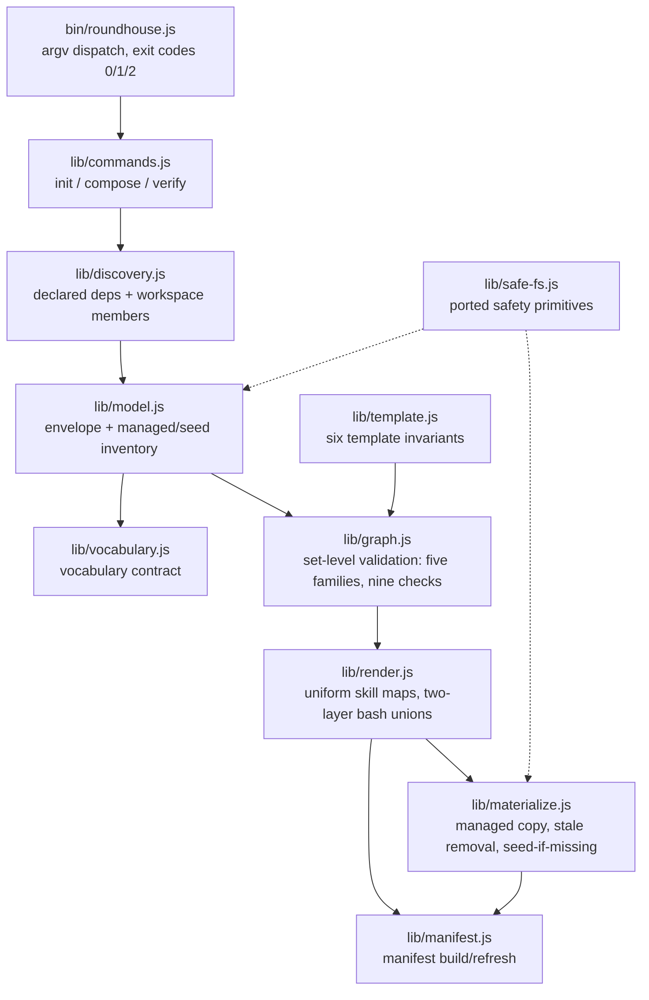

# PLAN-20261019-02: Phase 3 — composer

Last modified: 2026-10-19
Status: Draft

## Objective

Implement Phase 3 of the Roundhouse migration (DEC-20261017-03): build
`@backshop/roundhouse-cli` (`init` / `compose` / `verify`) and test it against
fixture packages, migrating the 28 stub envelopes to the real vocabulary —
still no real content moved. The plan implements SPEC-20261019-02 (committed
at `9a13377`): the `roundhouse.json` vocabulary, the validating renderer, the
rendering model, the manifest schema, the fixture-package format, the
discovery contract, the command semantics, and SCEN-052..066.

The plan artifact follows the full arc (draft → review → commit → push);
implementation is subsequent gated work.

## Scope

### Included

- WP-01: the fixture packages — the enumerated inventory of Appendix A, created
  under `packages/roundhouse-cli/test/fixtures/` per the spec's fixture format.
- WP-02: the composer library modules — discovery, vocabulary validation,
  package-model assembly, graph/ownership validation, template validation,
  rendering, managed/seed materialization, and manifest generation, with the
  safety primitives ported from `package/deploy-roundhouse.js`.
- WP-03: the CLI surface — the `roundhouse` bin, the three commands, exit
  codes 0/1/2, stderr reporting, and the no-npm-wrapping rule.
- WP-04: the test suite — SCEN-052..066 against the fixtures, following the
  `scripts/test-migration-baseline.js` precedent (`node:test`, temp-consumer
  isolation, no real-tree mutation).
- WP-05: the stub-envelope migration — the 28 `roundhouse.json` files move
  from the `capabilities` placeholder to the real vocabulary, with `requires`
  per DEC-20261017-02's dependency rules applied to the actual taxonomy
  (human-ruled Phase 3 scope).
- WP-06: the same-changeset fixture regeneration — the new tracked files and
  the migrated envelopes enter the fixture; the drift absorption accounting.

### Excluded

- Real content moves: `src/` is byte-identical before and after; the Core
  template instantiation is Phase 5 work (SPEC-20261019-02, Excluded) — the
  fixtures carry fixture templates only.
- The composition matrix: Phase 7 territory; the fixture inventory is designed
  for its reuse, but the matrix itself is out of scope.
- Publishing and CI: Phase 9 territory; the CLI package stays `private: true`.
- The org-workflow package: example-only per DEC-20261017-02.
- Agent-prompt content: Phase 4 territory.
- Root manifest changes: the root's five scripts stay verbatim
  (SPEC-20261019-01), so the CLI suite is invoked directly via
  `node packages/roundhouse-cli/test/composer.test.js` — the
  `test-migration-baseline.js` precedent, which likewise has no npm script.
- New decision records: the plan-level leans below are Gate 1 arbitration
  points, not amendment material; if Gate 1 elevates one to durable policy, a
  DR follows.

## Related specifications and decisions

- `SPEC-20261019-02` — Phase 3 composer; primary normative source. SCEN-052..066
  are this plan's acceptance contracts; the vocabulary, rendering model,
  manifest schema, fixture format, discovery contract, and command semantics
  are the implemented behavior.
- `DEC-20261017-01` — Parent decision: the composable architecture whose
  self-hosting requirement the workspace-member discovery rule concretizes.
- `DEC-20261017-02` — Package contract: the dependency rules WP-05 applies to
  the stub envelopes, the strict-ownership rules the graph validator
  enforces, and the artifact classes the materializer implements.
- `DEC-20261017-03` — Migration strategy: the Phase 3 definition, the
  changeset-granularity list ("CLI composer + safety tests using fixtures"),
  and the porting note ("the full primitive set lives in
  `package/deploy-roundhouse.js` and is ported into the composer in Phase 3").
- `SPEC-20261019-01` — Phase 2 scaffolding: the 28 stub envelopes WP-05
  migrates and the CLI package stub the build fills.
- `SPEC-20261017-01` — Fixture tooling: the generator WP-06 runs, the exit-code
  and stderr conventions, and the test-suite precedent WP-04 follows.
- `DEC-20260906-01` — Byte-exact philosophy: precedent for the canonical
  serialization the renderer and manifest emit.
- Current-behavior ground truth: `package/deploy-roundhouse.js` (the safety
  primitives) and `scripts/generate-migration-baseline.js` (the house script
  conventions: banner sections, `run(options)` test seams, `require.main`
  guard, strict argument parsing).

## Current-state findings

- **The CLI stub (verified):** `packages/roundhouse-cli/package.json` carries
  exactly `name`, `version` (`0.0.0`), `private` (`true`), `description`,
  `engines` — no `bin`; `roundhouse.json` carries `contractVersion: 1` and the
  `capabilities: []` / `requires: []` placeholder. WP-03 adds `bin`; WP-05
  migrates the envelope.
- **The 28 stub envelopes (verified):** all carry `capabilities: []` and
  `requires: []`; `kind` is `"core"` for roundhouse-core, `"capability"` for
  the 26 family packages, and absent for roundhouse-cli. No `managed/` or
  `seed/` directories exist anywhere under `packages/` (SPEC-20261019-01).
- **The safety primitives (verified):** `package/deploy-roundhouse.js` exports
  the port set — `lstatIfPresent`, `inside`, `assertSafePath` (per-segment
  symlink and realpath-escape checks), `assertSafeTree`,
  `revalidateMutationPath`, `mkdirSafe`, `copyFileSafe`,
  `collectRelativePaths` (symlink-rejecting tree inventory with POSIX-normalized
  relative paths), `ensureType`, `copyTree`, `copyMissing` — plus the
  `deploy`/`init`/`update` orchestrators whose responsibilities the composer's
  materializer replaces. The primitives are ported, not imported: the legacy
  package stays untouched until Phase 6/8 dispositions it.
- **The house script conventions (verified):** the generator is
  banner-sectioned with deterministic pure functions separated from I/O,
  exports its pipeline steps, accepts injected replacements via `run(options)`,
  guards `main()` behind `require.main`, parses arguments strictly (exit 2),
  and serializes canonically (two-space indent, LF, single trailing newline).
  The CLI modules follow the same shape.
- **The test precedent (verified):** `scripts/test-migration-baseline.js` uses
  `node:test` + `node:assert/strict`, constructs controlled tree states in
  temporary directories under `os.tmpdir()`, never mutates real tracked
  content, and is side-effect-free on failure. WP-04 follows it; the
  integration scenarios build temp consumers (package.json, `node_modules/`
  junctions or copies, workspace shells) there.
- **The root scripts are frozen (verified):** the root `package.json` keeps
  its five scripts verbatim, so no `test-composer` npm script is added; the
  suite runs via direct node invocation.
- **Workspace resolution state (verified):** `node_modules/` exists (gitignored)
  with the 28 members linked from Phase 2's `npm install`;
  `package-lock.json` exists untracked (human-ruled to stay untracked). The
  composer's discovery never enumerates `node_modules` beyond resolving
  declared names (SPEC-20261019-02).
- **Fixture drift since the last regeneration (verified):** the fixture was
  regenerated at `b8fdf36` (the Phase 2 implementation commit). The
  `9a13377` spec changeset changed four tracked files, but only two are
  fixture-visible: `docs/specs/SPEC-20261019-02.md` (new) and
  `docs/decisions/DEC-20261017-02.md` (updated hash) — the two index files
  (`docs/decisions/index.md`, `docs/specs/index.md`) are seed instances
  (tracked `src/docs/` counterparts exist, verified via `git ls-files`) and
  are fixture-invisible. WP-06's regeneration absorbs this drift alongside
  this plan's own delta; the fixture diff must be reviewed with that
  expectation.
- **Index drift resolved in this changeset (verified):**
  `docs/plans/index.md` listed PLAN-20261019-01 as `Draft` although the
  Phase 2 implementation landed at `b8fdf36`; the fix lands here. Because
  docs-check's terminal-archive rule requires a `Completed` plan to live in
  `plans/archive/`, the fix is the full lifecycle move: the plan file moves
  to `docs/plans/archive/PLAN-20261019-01.md` with Status `Completed`, the
  active row is removed, and the archive index gains the row — a working-tree
  rename until the implementation changeset stages it.

## Intended shape

After this plan, `packages/roundhouse-cli/` contains the bin entry, ten lib
modules, the test suite, and the 18-fixture inventory; the 28 stub envelopes
carry the real vocabulary; the fixture equals the regenerated output of the
changeset-close tree; and `src/` is untouched. The composer is a proven tool
against fixtures, ready for Phase 4 (Core decoupling) and Phase 5 (the
cutover that lands the real template and content).

Data flow per command: discovery yields package roots; model assembly turns
roots into candidate models (envelope + managed/seed inventory + resolved
version); vocabulary validates each envelope; template validation gates
rendering; graph validation gates composition; rendering emits the canonical
`opencode.json`; materialization performs the managed/seed writes;
manifest generation emits the canonical `.roundhouse/manifest.json`. All
validation precedes any write (the spec's fail-closed constraint).

## Work packages

### WP-01: The fixture packages

**Description:** Create the 18-fixture inventory of Appendix A under
`packages/roundhouse-cli/test/fixtures/<name>/`, per SPEC-20261019-02's
fixture format: `package.json` named in the reserved `@roundhouse-fixture/`
scope, `roundhouse.json`, optional `managed/` and `seed/` trees, and for
core-kind fixtures an `opencode-template.json`. The three valid fixtures
compose into the happy-path set every integration scenario builds on; the
fifteen violation fixtures each break composition in exactly one way when
composed with (or replacing a member of) the valid set, and are the live test
inputs for SCEN-063's rejection matrix and reviewable test contracts for
Phase 7's composition matrix.

**Tasks:**

- T-01: Create the three valid fixtures (`core`, `alpha`, `beta`) per Appendix
  A, including the core fixture's valid template with the role-driven bash
  entries the two-layer rendering and the bash-collision fixture require
  (Required).
- T-02: Create the fifteen violation fixtures per Appendix A; each violates
  exactly one SCEN-063 row or supplies one side of a set-level violation
  (`cycle-a`/`cycle-b`, `second-core`), and the path-escape row is deliberately
  fixture-free (Appendix A's rationale) (Required).
- T-03: Verify the inventory: every valid fixture conforms to the vocabulary
  and the fixture format; every violation fixture violates exactly its
  Appendix-A-listed rule and nothing else; all fixture names are kebab-case;
  no fixture is publishable (`private: true` where the stub format carries it)
  (Required).

**Dependencies:** None. Blocks WP-04 (the tests consume the fixtures).

**Parallelism:** Can run in parallel with WP-02 and WP-03.

**Acceptance criteria:**

- The 18 fixture directories exist at the pinned location with exactly the
  Appendix-A content; no extra entries under `test/fixtures/`.
- Every valid fixture passes the composer's own vocabulary validation once
  WP-02 lands (T-19's smoke check covers the real envelopes; the fixtures are
  covered by the test suite's happy-path use).

### WP-02: The composer library modules

**Description:** Implement the composer as `packages/roundhouse-cli/lib/`
modules following the generator's conventions: banner-sectioned files,
deterministic pure functions separated from I/O, exported pipeline steps,
`run(options)`-style injection seams, and the `require.main` guard where a
module is directly runnable. The lean's concern list names seven modules; the
work-package description adds managed/seed composition (`lib/materialize.js`);
two further modules complete the ten — `lib/safe-fs.js` (the ported safety
primitives) and `lib/model.js` (the assembly seam between discovery and
validation).

**Tasks:**

- T-04: `lib/safe-fs.js` — port the safety primitives from
  `package/deploy-roundhouse.js`: `lstatIfPresent`, `inside`, `assertSafePath`,
  `assertSafeTree`, `revalidateMutationPath`, `mkdirSafe`, `copyFileSafe`,
  `collectRelativePaths`, `ensureType`. Semantics preserved (per-segment
  symlink/junction rejection, realpath escape rejection, check-adjacent-to-
  mutation); the legacy module itself is untouched (Required).
- T-05: `lib/discovery.js` — the discovery contract: resolve the consumer
  root's declared `dependencies` and `devDependencies` to package roots
  (targeted `node_modules/<name>` resolution, walking npm's resolution only
  for declared names); expand the root's `workspaces` globs to member
  directories (a minimal built-in matcher over literal segments, `*`, and
  `**`); triage each candidate — valid `roundhouse.json` → discovered, absent
  → skipped without error, invalid → fail closed. Never enumerate
  `node_modules` beyond resolving declared names (Required).
- T-06: `lib/vocabulary.js` — the `roundhouse.json` contract: exact member
  set (`kind` optional with the four-value enum, `contractVersion` required
  integer, `skills`/`bash`/`requires` required arrays, no additional members)
  and the contract-version compatibility check — the spec's per-package
  check, owned here and nowhere else (Required).
- T-07: `lib/model.js` — package-model assembly: parse the envelope, inventory
  the `managed/` and `seed/` trees via `collectRelativePaths`, read the
  resolved version from `package.json`, and perform the bidirectional
  declared-versus-actual skill check against the `managed/skills/<id>/SKILL.md`
  convention (Required).
- T-08: `lib/graph.js` — set-level validation over the model set: duplicate
  skill IDs, unresolved requires, requires cycles, the DEC-20261017-02
  dependency rules, duplicate managed paths, the agent-path reservation,
  seed-path collisions, the exactly-one-core rule, and the bash-pattern
  collision against the validated template's role-driven entries — nine
  set-level checks realizing five of the spec's ten fail-closed families
  (duplicate ownership, missing requires, requires cycle, dependency-rule
  violation, bash collision); every rejection names the violating package and
  path (Required).
- T-09: `lib/template.js` — the six template invariants (parse, the
  eight-entry agent map, mode/tuning/permission presence, the wildcard-only
  skill maps, the map-typed bash member, `default_agent`), each violation
  naming the invariant and the offending agent or member (Required).
- T-10: `lib/render.js` — the rendering model: uniform skill maps (the
  deny-all wildcard plus the byte-wise-sorted installed-skill union,
  identical across the four agents), two-layer bash maps (role-driven entries
  verbatim in template order, then the sorted union block excluding patterns
  already present), canonical emission with the template's member order
  preserved (Required).
- T-11: `lib/materialize.js` — managed/seed composition: managed copy with
  update semantics, stale removal strictly by recorded ownership
  (recorded-but-no-longer-owned; never-recorded files untouched; each removal
  logged), seed creation only when missing, never overwriting existing seed
  instances; all writes through the `safe-fs` primitives (Required).
- T-12: `lib/manifest.js` — manifest build and refresh per the spec's schema
  (member orders, byte-wise sorting, per-managed-path source hashes, the
  `composed` block), canonical serialization (Required).

**Dependencies:** T-04 first (the primitives underpin model and materialize);
T-05/T-06/T-07/T-09 follow in parallel; T-08 needs T-07 and T-09; T-10 needs
T-08 and T-09; T-11 needs T-04 and T-07; T-12 needs T-07 and T-10.

**Parallelism:** T-05, T-06, T-07, T-09 run concurrently after T-04; the
graph/render chain and the materialize/manifest chain proceed in parallel
thereafter.

**Acceptance criteria:**

- Every module exports its pure pipeline steps with injection seams; no
  module performs I/O inside its pure functions.
- The ten fail-closed families have exactly one owned location each —
  `vocabulary.js` (the vocabulary-violation and contract-version families),
  `template.js` (the template family), `model.js` (the bidirectional
  skill-content family), `graph.js` (the five set-level families),
  `safe-fs.js`/`materialize.js` (path confinement) — with no duplicated rule
  logic.

### WP-03: The CLI surface

**Description:** The public surface per the spec's Command semantics: the
`roundhouse` bin dispatching to the three command implementations, exit codes
0/1/2 mirroring the fixture generator, stderr reporting for every failure,
removal, creation, and warning, and the no-npm-wrapping rule.

**Tasks:**

- T-13: `lib/commands.js` — the three command implementations orchestrating
  the WP-02 modules in the spec's pipeline order (init: discover → validate →
  manifest → compose → seeds; compose: re-discover → recompute → validate →
  update → stale removal → regenerate → seeds → refresh; verify: read-only
  checks with findings on stderr); each command is a `run(options)`-style
  function returning `{ code, messages }` without exiting, so tests exercise
  commands in-process (Required).
- T-14: `bin/roundhouse.js` — strict argv parsing (any unknown command or
  unexpected argument is a usage error: exit 2, usage text on stderr),
  dispatch to the command implementations, message routing to stderr, exit-code
  mapping, `require.main` guard (Required).
- T-15: `packages/roundhouse-cli/package.json` — add `"bin": { "roundhouse":
  "bin/roundhouse.js" }`; the five existing members unchanged (Required).

**Dependencies:** WP-02 (all modules). Blocks WP-04's integration blocks.

**Parallelism:** T-13/T-14/T-15 proceed together once WP-02's module set is
in place.

**Acceptance criteria:**

- The bin exposes exactly `init`, `compose`, `verify`; exit codes and stderr
  behavior match the spec's Command semantics and SCEN-064/065.
- The package.json carries exactly the five stub members plus `bin`.

### WP-04: The test suite

**Description:** `packages/roundhouse-cli/test/composer.test.js` — the
SCEN-052..066 suite following the `test-migration-baseline.js` precedent:
`node:test` + `node:assert/strict`; `@unit` blocks exercise the exported pure
functions directly, with candidate inputs parsed from the checked-in fixtures
(the SCEN-034 precedent: inputs may be loaded from fixture files; the logic
under test stays in-memory and pure); `@integration` blocks run the bin via
`spawnSync` against temporary consumers under `os.tmpdir()` — package.json,
`node_modules/` junctions or copies for declared dependencies, workspace
shells for member discovery — never mutating real tracked content, and
side-effect-free on failure.

**Tasks:**

- T-16: Implement the suite per the scenario traceability matrix: the happy-
  path integration scenarios (SCEN-052..056) over temp consumers built from
  the valid fixture set; the discovery scenarios (SCEN-057/058) over temp
  consumers with declared and undeclared fixture packages; SCEN-059 as a
  library-level discovery call against the real repository root (never a CLI
  run — no manifest is created in the real repo); the `@unit` blocks for
  SCEN-060..063 (template invariants, rendering, and the fifteen violation
  candidates loaded from the violation fixtures and validated in memory);
  SCEN-064/065 via bin invocation; SCEN-066 via copy-and-mutate (Required).
- T-17: Run the suite green; confirm no real-tree mutation (the temp dirs are
  the only writes) (Required).

**Dependencies:** WP-01 (fixtures), WP-02 (modules), WP-03 (the bin).

**Parallelism:** None — strictly after all three.

**Acceptance criteria:**

- Every SCEN-052..066 scenario has an asserting test at the matrix's location;
  the suite is green.
- The real repository tree is unmutated by the suite (temp-dir isolation
  verified by the suite's own teardown assertions).

### WP-05: The stub-envelope migration

**Description:** Migrate the 28 `roundhouse.json` envelopes from the
`capabilities: []` placeholder to the real vocabulary, applying
DEC-20261017-02's dependency rules to the actual taxonomy. The mapping has
exactly three shapes:

| Shape | Members | `requires` |
| --- | --- | --- |
| Core | `roundhouse-core` | `[]` |
| Tooling (no kind) | `roundhouse-cli` | `[]` |
| Capability | the 23 non-framework/CMS family packages | `["@backshop/roundhouse-core"]` |
| Framework/CMS capability | re-specifies three members of the 26 family packages — `framework-astro`, `framework-react`, `cms-apostrophe` | `["@backshop/roundhouse-core", "@backshop/roundhouse-lang-javascript"]` (DEC-20261017-02's framework/CMS dependency rules, 3 and 4) |

The arithmetic reconciles: 1 core + 1 tooling + 23 + 3 = 28. All 28 gain `skills: []` and `bash: []` (no real content exists yet — skills
and managed content arrive with Phase 5). `requires` entries are written
byte-wise sorted for reviewable diffs. No rule-2 specialization edges exist
in v1's stub set: no current package's guidance assumes another capability
beyond the framework/CMS language rule (the taxonomy's prefix-chain
specializations are not yet separate packages).

**Tasks:**

- T-18: Apply the mapping to the 28 envelopes; two-space-indented, LF-
  terminated JSON matching the stub files' existing formatting (Required).
- T-19: Verify: all 28 envelopes pass the composer's vocabulary validation;
  the library-level discovery call over the real repository root yields
  exactly the 28 members with the expected `requires` (SCEN-059's assertion
  exercised for real) (Required).
- T-20: Rework `scripts/test-package.js`'s workspace-members block to the
  migrated vocabulary — the migration would otherwise fail all 28 envelope
  assertions. The block derives its member set from the committed fixture, so
  the update is mechanical: the `capabilities`/`requires` empty-array
  assertions and the pinned envelope member sets are replaced with the
  migrated shape — `skills` and `bash` deep-equal `[]`; `requires` deep-equals
  the mapping's per-member value (`[]` for the core and CLI members;
  `["@backshop/roundhouse-core"]` for the 23 capability members;
  `[core, lang-javascript]` for the three framework/CMS members); the
  member-set key assertions become `["bash", "contractVersion", "kind",
  "requires", "skills"]` (`kind` absent for the CLI). The member-set
  derivation, the directory/pair assertions, and the package.json assertions
  are unchanged; the reworked suite is green (Required).

**Dependencies:** WP-02 (the validator verifies the migration). The envelopes
can be authored in parallel with WP-02 and verified once T-06 lands.

**Parallelism:** Authoring parallel with WP-02/WP-03; verification after
T-06.

**Acceptance criteria:**

- The 28 envelopes match the mapping table exactly; no other package files
  change.
- The vocabulary validator accepts all 28; discovery yields the 28-member
  set with the expected `requires`.
- The reworked `scripts/test-package.js` is green against the migrated
  envelopes.

### WP-06: Fixture regeneration (same-changeset)

**Description:** Regenerate the committed fixture so it equals the tree at
changeset close (the SCEN-050/051 pattern). The regeneration absorbs the
Phase 3 delta and the pre-existing `9a13377` drift recorded in Current-state
findings; annotations carry forward verbatim — none of the new or changed
files are managed.

**Tasks:**

- T-21: Track the changeset's new and modified files (`git add` the CLI's
  bin/lib/test/fixtures trees and the 28 migrated envelopes) so the generator
  inventories them (Required).
- T-22: Run the generator; confirm exit 0 and the expected delta: new
  root-only-artifact entries for every new file under
  `packages/roundhouse-cli/` (bin, lib, test, fixtures) plus
  `docs/plans/PLAN-20261019-02.md` and the archived
  `docs/plans/archive/PLAN-20261019-01.md`, with the old
  `docs/plans/PLAN-20261019-01.md` entry vanishing with the move; updated
  hash/size entries for the 28 migrated `roundhouse.json` files, the CLI's
  `package.json`, the reworked `scripts/test-package.js`,
  `docs/specs/SPEC-20261019-02.md`, and `docs/decisions/DEC-20261017-02.md`;
  zero annotation changes — all managed annotations verbatim; byte-stable
  across consecutive runs. The three docs index files
  (`docs/decisions/index.md`, `docs/specs/index.md`, `docs/plans/index.md`)
  are seed instances — tracked `src/docs/` counterparts exist — so they are
  fixture-invisible: no entries, no drift (Required).
- T-23: Run `scripts/test-migration-baseline.js`; all green — the Phase 1
  fixture assertions are restored against the regenerated fixture, which
  also asserts `src/` is byte-identical (Required).

**Dependencies:** WP-01..WP-05 (the regeneration must see the changeset-close
tree).

**Parallelism:** None — strictly last.

**Acceptance criteria:**

- The regenerated fixture equals the tree at changeset close; consecutive
  runs are byte-identical.
- All managed annotations carried forward verbatim; zero annotation diffs.
- The fixture diff contains exactly the expected new and updated entries —
  reviewed with the pre-existing-drift expectation, not mistaken for Phase 3
  artifacts.
- `scripts/test-migration-baseline.js` is green.

## Dependencies

- WP-01 is independent; it blocks WP-04.
- WP-02 is the critical path: T-04 → {T-05, T-06, T-07, T-09} → {T-08, T-10,
  T-11, T-12}; it blocks WP-03 and WP-04, and T-19's verification.
- WP-03 depends on WP-02 and blocks WP-04's integration blocks.
- WP-04 depends on WP-01, WP-02, WP-03.
- WP-05's authoring is independent; its verification (T-19) depends on WP-02's
  T-06.
- WP-06 depends on everything (the changeset-close tree).
- No external dependencies: Node 24 built-ins only; no new packages; all
  touched tooling exists.

## Changeset granularity

One commit (human-ruled), matching DEC-20261017-03's granularity list item
"CLI composer + safety tests using fixtures (Phase 3)":

| Commit | Work packages | Content |
| --- | --- | --- |
| 1 | WP-01..WP-06 | The CLI implementation (bin, lib, test, 18 fixtures), the 28 migrated envelopes, the regenerated fixture |

The plan-creation changeset (this plan + its index row) precedes the
implementation changeset and is separate. The lockfile and `node_modules/`
stay out of the commit (untracked / ignored).

## Change map

| File | Action | Purpose |
| --- | --- | --- |
| `docs/plans/PLAN-20261019-02.md` | Create | This plan (plan-creation changeset) |
| `docs/plans/index.md` | Modify | Add this plan's row; remove the archived PLAN-20261019-01 row (plan-creation changeset) |
| `docs/plans/PLAN-20261019-01.md` | Move | Archived to `docs/plans/archive/PLAN-20261019-01.md` with Status `Completed` (plan-creation changeset; the terminal-archive rule) |
| `docs/plans/archive/index.md` | Modify | Add the archived plan's row (plan-creation changeset) |
| `packages/roundhouse-cli/package.json` | Modify | Gain `bin` (WP-03, T-15) |
| `packages/roundhouse-cli/bin/roundhouse.js` | Create | CLI entry: argv dispatch, exit codes (WP-03, T-14) |
| `packages/roundhouse-cli/lib/safe-fs.js` | Create | Ported safety primitives (WP-02, T-04) |
| `packages/roundhouse-cli/lib/discovery.js` | Create | Discovery contract (WP-02, T-05) |
| `packages/roundhouse-cli/lib/vocabulary.js` | Create | Vocabulary validation (WP-02, T-06) |
| `packages/roundhouse-cli/lib/model.js` | Create | Package-model assembly (WP-02, T-07) |
| `packages/roundhouse-cli/lib/graph.js` | Create | Set-level validation (WP-02, T-08) |
| `packages/roundhouse-cli/lib/template.js` | Create | Template invariants (WP-02, T-09) |
| `packages/roundhouse-cli/lib/render.js` | Create | Rendering model (WP-02, T-10) |
| `packages/roundhouse-cli/lib/materialize.js` | Create | Managed/seed composition (WP-02, T-11) |
| `packages/roundhouse-cli/lib/manifest.js` | Create | Manifest build/refresh (WP-02, T-12) |
| `packages/roundhouse-cli/lib/commands.js` | Create | The three command implementations (WP-03, T-13) |
| `packages/roundhouse-cli/test/composer.test.js` | Create | The SCEN-052..066 suite (WP-04, T-16) |
| `packages/roundhouse-cli/test/fixtures/<name>/…` ×18 | Create | The Appendix-A inventory (WP-01, T-01/T-02) |
| `scripts/test-package.js` | Modify | Workspace-members block reworked to the migrated vocabulary (WP-05, T-20) |
| `packages/roundhouse-<subject>/roundhouse.json` ×28 | Modify | Vocabulary migration (WP-05, T-18) |
| `references/migration-baseline.json` | Modify | Regenerated at changeset close (WP-06, T-22) |

No `src/` changes; no root-manifest changes; the legacy
`package/deploy-roundhouse.js` is untouched (the primitives are ported, not
imported).

## Prescriptiveness levels

- **WP-01 — Required** for the fixture location, the `@roundhouse-fixture/`
  scope, the format, and the inventory's violation coverage (one rule per
  fixture); **Expected** for the fixtures' internal content details beyond
  Appendix A's pins (exact skill-file text, seed-file content). Appendix A is
  the Gate 1 centerpiece.
- **WP-02 — Required** for the concern separation (pure functions vs I/O),
  the ten fail-closed families' enforcement, the ported primitives'
  semantics, and the discovery contract's triage rule; **Expected** for the
  exact module filenames and internal function names (the lean's concern list
  is the contract; `safe-fs.js` and `model.js` are plan-level completions of
  it).
- **WP-03 — Required** for the bin path, the three-command surface, exit
  codes, stderr reporting, and the `bin` member; **Expected** for the usage
  text's wording.
- **WP-04 — Required** for scenario coverage per the matrix, the temp-dir
  isolation, and the no-real-tree-mutation rule; **Expected** for the
  single-file organization (splitting into multiple test files is allowed
  with justification) and assertion style.
- **WP-05 — Required** for the three-shape mapping, the sorted `requires`,
  and the empty `skills`/`bash` arrays; no deviation without plan amendment.
- **WP-06 — Required** for the regeneration principle, annotation
  verbatim-ness, and byte stability; **Expected** for the drift-absorption
  bookkeeping (the drift set is pinned in Current-state findings and
  re-verified at execution).

## Scenario traceability matrix

Every SPEC-20261019-02 scenario maps to the work package and task that
implements it. The suite location is
`packages/roundhouse-cli/test/composer.test.js` throughout.

| Scenario | Work package | Task | Test location |
| --- | --- | --- | --- |
| SCEN-052 | WP-02, WP-03, WP-04 | T-11, T-13, T-16 | `test/composer.test.js` (integration: init end-to-end) |
| SCEN-053 | WP-02, WP-03, WP-04 | T-11, T-12, T-13, T-16 | `test/composer.test.js` (integration: compose update) |
| SCEN-054 | WP-02, WP-03, WP-04 | T-11, T-13, T-16 | `test/composer.test.js` (integration: stale removal) |
| SCEN-055 | WP-02, WP-03, WP-04 | T-11, T-13, T-16 | `test/composer.test.js` (integration: seed-if-missing) |
| SCEN-056 | WP-03, WP-04 | T-13, T-16 | `test/composer.test.js` (integration: verify drift classes) |
| SCEN-057 | WP-02, WP-04 | T-05, T-16 | `test/composer.test.js` (integration: declared deps) |
| SCEN-058 | WP-02, WP-04 | T-05, T-16 | `test/composer.test.js` (integration: undeclared package) |
| SCEN-059 | WP-02, WP-04, WP-05 | T-05, T-18, T-16, T-19 | `test/composer.test.js` (library-level discovery over the real root) |
| SCEN-060 | WP-02, WP-04 | T-09, T-16 | `test/composer.test.js` (unit: nine invariant rows) |
| SCEN-061 | WP-02, WP-04 | T-10, T-16 | `test/composer.test.js` (unit: uniform skill maps) |
| SCEN-062 | WP-02, WP-04 | T-10, T-16 | `test/composer.test.js` (unit: two-layer bash maps) |
| SCEN-063 | WP-02, WP-04 | T-06, T-08, T-16 | `test/composer.test.js` (unit: fifteen violation candidates from the fixtures) |
| SCEN-064 | WP-03, WP-04 | T-14, T-16 | `test/composer.test.js` (integration: usage errors) |
| SCEN-065 | WP-03, WP-04 | T-13, T-16 | `test/composer.test.js` (integration: three guard states) |
| SCEN-066 | WP-02, WP-04 | T-05, T-06, T-16 | `test/composer.test.js` (integration: invalid envelope via copy-and-mutate) |

## Documentation stubs

- [x] Create this plan + its `docs/plans/index.md` row (the plan-creation
  changeset).
- [ ] No new decision records: the leans are plan-level; if Gate 1 elevates
  one (for example, the fixture-inventory shape or the module layout) to
  durable policy, a DR follows.
- [ ] No implementation map in this changeset: the composer's implementation
  map describes the as-built state and follows implementation, consistent
  with the house pattern; it is expected alongside the Phase 4 planning arc
  at the earliest.
- [x] Update this plan's `docs/plans/index.md` row status as the plan
  advances (Draft → Ready → In progress → Completed).

## Verification criteria

- [ ] SCEN-052..066 verified per the traceability matrix; the suite
  (`node packages/roundhouse-cli/test/composer.test.js`) is green.
- [ ] The 28 migrated envelopes match the WP-05 mapping exactly and pass the
  composer's vocabulary validation; the library-level discovery call over the
  real root yields the 28-member set with the expected `requires` (SCEN-059).
- [ ] The fixture inventory matches Appendix A: 18 directories, each violating
  exactly its listed rule (violation fixtures) or conforming fully (valid
  fixtures).
- [ ] `src/` is byte-identical before and after (asserted by the regenerated
  fixture's unchanged src-scope entries, SCEN-050's mechanism).
- [ ] `scripts/test-sync.js`, `scripts/test-package.js`, `scripts/test-commit.js`,
  and `scripts/test-migration-baseline.js` all remain green; no pre-existing
  test regresses.
- [ ] The regenerated fixture is byte-stable, carries all managed annotations
  verbatim, and equals the tree at changeset close.
- [ ] The changeset is exactly one commit; the lockfile and `node_modules/`
  appear nowhere in it; no root-manifest changes.
- [ ] `node .opencode/docs-check.js` passes.
- [ ] `npx --yes markdownlint-cli2@0.23.2` passes on every touched Markdown
  file.

## Readiness

**Score: 7/10 — Draft, pending Gate 1 review.**

The spec is committed and normative; the fixture inventory is enumerated from
the scenario requirements; the module layout follows the house conventions
with the ported primitives pinned. The remaining openness is proposal-level,
not specification-level.

Blockers (all resolved by Gate 1 approval):

1. Appendix A: the 18-fixture inventory requires human approval (the plan's
   Gate 1 centerpiece) — including the deliberate fixture-free disposition of
   the path-escape row.
2. The lib module layout: the ten-module pin (the lean's seven concerns plus
   managed/seed composition, `safe-fs.js`, and `model.js`) vs a different
   decomposition.
3. The WP-05 `requires` mapping: the three-shape table (no rule-2 edges beyond
   framework/CMS → language) vs additional specialization edges.
4. The one-commit granularity confirmation.
5. The single-file test organization vs a split suite.

Non-blocking: fixture-internal content details (Expected); usage-text wording
(Expected); the drift-absorption bookkeeping (pinned in Current-state
findings, re-verified at execution); the expected `package-lock.json`
generator warning.

## Appendix A: The fixture inventory (Gate 1 centerpiece)

Eighteen fixture directories under
`packages/roundhouse-cli/test/fixtures/<name>/`, enumerated from the scenario
requirements. Valid fixtures compose into the happy-path set; violation
fixtures each break composition in exactly one way when composed with (or
replacing a member of) the valid set, and are the live SCEN-063 test inputs
(loaded and parsed, validated in memory — the SCEN-034 precedent). Skill IDs
are `fixture-*`; the core fixture's template carries the role-driven bash
entries the two-layer rendering requires, including the `"fixture-locked"`:
`"deny"` entry the bash-collision fixture collides with.

| # | Fixture | Kind | Exercises | Key content |
| --- | --- | --- | --- | --- |
| 1 | `core` | `core` | The happy-path core: valid template, skill + non-skill managed ownership, a seed offer | Valid template (8-entry agent map, wildcard-only skill maps, map-typed bash with role-driven entries incl. `"fixture-locked"`: `"deny"`); `skills: ["fixture-core"]`; `managed/skills/fixture-core/SKILL.md`; `managed/docs/fixture-workflow.md`; `seed/FIXTURE-SEED.md` |
| 2 | `alpha` | `capability` | The happy-path capability: skill + bash contribution + seed offer, requires core | `skills: ["fixture-alpha"]`; `bash: ["fixture-tool *"]`; `requires: ["@roundhouse-fixture/core"]`; `managed/skills/fixture-alpha/SKILL.md`; `seed/FIXTURE-SEED-ALPHA.md` |
| 3 | `beta` | `capability` | The empty-bash and seed-less shapes | `skills: ["fixture-beta"]`; `bash: []`; no `seed/`; `managed/skills/fixture-beta/SKILL.md`; requires core |
| 4 | `dup-skill` | `capability` | SCEN-063 row 1: duplicate skill IDs across two packages | `skills: ["fixture-alpha"]` (collides with `alpha`); otherwise valid |
| 5 | `missing-requires` | `capability` | Row 2: a requires entry resolving to no discovered package | `requires: ["@roundhouse-fixture/absent"]` |
| 6 | `missing-skill-file` | `capability` | Row 3: declared-but-missing skill content | `skills: ["fixture-missing"]`; no `managed/skills/fixture-missing/` |
| 7 | `undeclared-skill-file` | `capability` | Row 4: present-but-undeclared skill content | `managed/skills/fixture-ghost/SKILL.md`; `skills: []` |
| 8 | `dup-managed-path` | `capability` | Row 5: two packages owning the same managed path | `managed/docs/fixture-workflow.md` (collides with `core`'s non-skill managed file); own skill `fixture-duppath` |
| 9 | `agent-path` | `capability` | Row 6: a non-core package declaring a managed path under `.opencode/agents/` | `managed/agents/fixture-agent.md`; own skill `fixture-agent` |
| 10 | `dup-seed` | `capability` | Row 7: two packages offering the same seed path | `seed/FIXTURE-SEED-ALPHA.md` (collides with `alpha`'s); own skill `fixture-dupseed` |
| 11 | `wrong-contract-version` | `capability` | Row 8: a contractVersion other than the CLI's supported version | `contractVersion: 2` |
| 12 | `cycle-a` | `capability` | Row 9 (with `cycle-b`): a requires cycle | `requires: ["@roundhouse-fixture/core", "@roundhouse-fixture/cycle-b"]` |
| 13 | `cycle-b` | `capability` | Row 9 (with `cycle-a`) | `requires: ["@roundhouse-fixture/core", "@roundhouse-fixture/cycle-a"]` |
| 14 | `no-core-requires` | `capability` | Row 10: a capability whose requires omits the core package | `requires: []` |
| 15 | `framework-no-lang` | `capability` | Row 11: a framework package whose requires omits its applicable language package | Name `@roundhouse-fixture/framework-phantom`; `requires: ["@roundhouse-fixture/core"]` |
| 16 | `cms-no-lang` | `capability` | Row 12: a CMS package whose requires omits its applicable language package | Name `@roundhouse-fixture/cms-phantom`; `requires: ["@roundhouse-fixture/core"]` |
| 17 | `bash-collision` | `capability` | Row 13: a package bash pattern colliding with a role-driven non-allow template entry | `bash: ["fixture-locked"]` (collides with the core template's deny entry) |
| 18 | `second-core` | `core` | Row 15: multiple core-kind packages (row 14's zero-core case is set assembly: the valid set minus `core`) | Second core-kind package with its own minimal valid template |

Fixture-free dispositions, deliberate:

- **Row 14 (path escape):** a managed/seed path escaping its consumer root
  cannot arise from a checked-in directory tree (relative paths cannot contain
  `..`); it is exercised in-memory (a crafted candidate path) and at
  integration level via a temp-created junction, following the
  `scripts/test-sync.js` Slice B precedent. No checked-in fixture.
- **SCEN-066's invalid envelope:** copy-and-mutate over a valid fixture in
  temp space, per the spec's fixture format; no checked-in invalid fixture.
- **SCEN-065's guard states:** manifest presence/absence constructed in temp
  consumers over the valid set; no dedicated fixtures.
