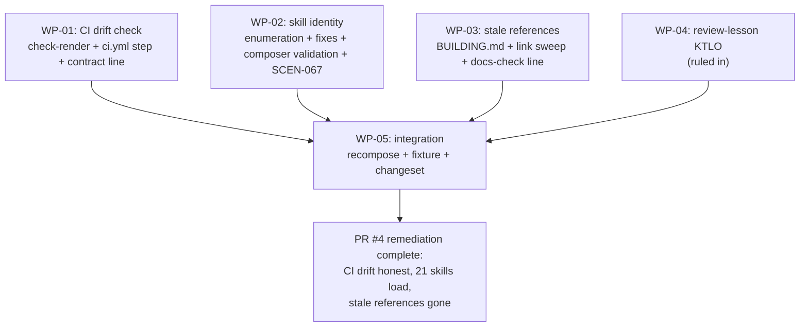

# PLAN-20261021-01: PR #4 review remediation — CI drift honesty, skill identity, stale references

Last modified: 2026-10-21
Status: Ready

## Objective

Remediate the five findings from the Copilot review of PR #4 (branch
`feature/composable-workflow`), whose remediation changeset the human
approved: make CI's committed-artifact drift check honest (F1), enforce and
repair skill frontmatter-vs-directory identity across the packages and the
composer (F2), fix the three stale-reference documentation defects (F3, F4,
F5), and record the review's transferable lesson as a KTLO item. The
remediation is not a migration phase and has no governing specification of
its own — acceptance lives in the per-WP criteria and the finding-to-WP
traceability map below, per the PLAN-20261019-03 precedent for slices
without scenario contracts — with one exception: the composer's skill
identity validation amends SPEC-20261019-02 with a new scenario (SCEN-067),
the spec's first post-SCEN-066 allocation.

The plan artifact follows the full arc (draft → review → commit → push);
implementation is subsequent gated work landing on
`feature/composable-workflow` (PR #4).

## Scope

### Included

- WP-01: the CI committed-artifact drift check (F1) — the `check-render`
  npm script, the `ci.yml` step, and the two-drift-classes contract line in
  the composition documentation.
- WP-02: skill identity (F2) — the authoritative enumeration, the
  frontmatter fixes, the old-ID reference sweep, the composer validation,
  the composer test, and the SPEC-20261019-02 amendment.
- WP-03: the stale-reference doc fixes (F3, F4, F5) — both copies where a
  seed source and a root copy exist.
- WP-04: the review-lesson KTLO item (ruled in — Gate 1, 2026-10-21).
- WP-05: integration — the root recomposition, the fixture regeneration,
  and the changeset file.

### Excluded

- **Phase 7 implementation.** Already planned (PLAN-20261019-05, Ready)
  and Gate-1-approved; this plan's F5 fix deliberately precedes it so its
  residual-`src/` sweep verifies zero.
- **Publishing.** No package publishes; the packages stay private.
- **Composer behavior changes beyond the identity validation.**
  SPEC-20261019-02 is otherwise normative and unchanged; the identity
  validation is the one ruled extension (WP-02).
- **The deprecation ceremony.** Documented, not run (the PLAN-20261019-06
  disposition stands).
- **The migration guide.** Deferred — the external-consumer condition is
  not met.
- **New decision records.** The plan's leans were Gate 1 arbitration
  points, ruled 2026-10-21; no decision records.

## Related specifications and decisions

- `SPEC-20261019-02` — Phase 3 composer: the library WP-02's validation
  extends; the scenario numbering the amendment continues (SCEN-052..066
  allocated; SCEN-067 is next); the fixture/test conventions T-10 follows.
- `DEC-20261017-02` — Package contract: the composed-artifact class (the
  rendered `opencode.json` and `.roundhouse/manifest.json`, both
  committed) whose staleness F1's check guards.
- `DEC-20261017-03` — Migration strategy: the Phase 9 CI shape (thin
  workflow over npm scripts) that WP-01 extends.
- `PLAN-20261019-06` (archived) — the compose-then-verify root cause (its
  T-10 specified and named the conflated design); the `ci.yml` shape
  WP-01 modifies.
- `PLAN-20261019-05` — house plan style precedent; the pending Phase 7
  sweep (its WP-03 T-08) whose zero-residual condition F5's fix serves.
- The PR #4 Copilot review — the five findings this plan remediates; the
  human-approved remediation changeset.

## Current-state findings

- **F1 — the CI drift masking (verified).** `.github/workflows/ci.yml`
  runs `npm run sync-roundhouse -- --mode sync` (L24–25) before
  `npm run check-all` (L26–27), and `scripts/check-all.js` includes
  `check-drift` — the wrapper's `--mode verify` — among its five checks
  (L25). Because compose regenerates the tree before verify runs, CI's
  drift check verifies a freshly rendered, self-consistent tree and can
  never catch drift between the COMMITTED composed artifacts
  (`opencode.json`, `.roundhouse/manifest.json` — both committed) and
  what the packages would render. The root cause is in the archived
  Phase 9 plan itself: PLAN-20261019-06 T-10 specified compose-then-verify
  and called it "making the drift check honest (compose-then-verify)".
  The design conflated two drift classes — (a) working-tree drift (a
  consumer hand-edits a composed artifact) and (b) committed-artifact
  drift (the committed artifacts stale vs the packages) — and the honest
  framing is execution-time state, not exclusive class ownership: what
  matters is what state each check sees at execution time. Verify
  catches working-tree drift locally and also catches committed-artifact
  staleness in a developer's normal pre-commit flow (a meaningful local
  catch); the CI defect is that post-compose verify sees a freshly
  rendered, self-consistent tree, making it vacuous there — only a
  post-compose diff of the committed files detects committed-artifact
  drift in CI. Verify-first cannot work in CI: a fresh
  clone has no `.opencode/` (gitignored), so verify fails on absent
  managed files, not drift. Compose-first is necessary; the missing piece
  is the post-compose committed-artifact diff (`git diff --exit-code --
  opencode.json .roundhouse/manifest.json`) — valid in CI because the
  post-checkout tree is clean, so any diff isolates exactly the
  compose-induced changes; noisy locally, so the check is CI-invoked only
  and must document its clean-tree precondition.
- **F2 — the skill frontmatter identity (verified; the set extended by
  the plan-authoring spot-check).** The investigation confirmed six
  skills whose SKILL.md frontmatter `name:` carries the old pre-rename ID
  while the directory and the package allowlists use the new ID. The
  plan-authoring spot-check enumerated all 60 `^name:` lines across
  `packages/**/managed/skills/**/SKILL.md` and correlated them against
  the live session's available-skills listing: the correlation is exact
  and bidirectional — 21 frontmatter/directory mismatches, all 21 absent
  from the listing, and all 31 listed skills match their directories. The
  frontmatter name is evidently the load/allowlist key, so the mismatched
  skills are denied. The expected full set (T-06 confirms
  authoritatively):

  | # | Package | Skill directory | Frontmatter `name:` | Source |
  | --- | --- | --- | --- | --- |
  | 1 | `roundhouse-backshopdev-planning` | `backshopdev-planning` | `planning-structure` | investigation |
  | 2 | `roundhouse-cms-apostrophe` | `cms-apostrophe` | `apostrophe-cms` | investigation |
  | 3 | `roundhouse-docs-architecture` | `docs-architecture` | `architecture-document` | investigation |
  | 4 | `roundhouse-docs-decision-record` | `docs-decision-record` | `decision-record` | spot-check |
  | 5 | `roundhouse-docs-general` | `docs-general-accuracy` | `repository-accuracy` | spot-check |
  | 6 | `roundhouse-docs-general` | `docs-general-traceability` | `requirements-traceability` | investigation |
  | 7 | `roundhouse-docs-implementation-map` | `docs-implementation-map` | `implementation-map` | investigation |
  | 8 | `roundhouse-docs-implementation-plan` | `docs-implementation-plan` | `implementation-plan` | investigation |
  | 9 | `roundhouse-docs-literature-note` | `docs-literature-note` | `literature-note` | spot-check |
  | 10 | `roundhouse-docs-spec` | `docs-spec` | `specification` | spot-check |
  | 11 | `roundhouse-format-html` | `format-html-semantic` | `semantic-html` | spot-check |
  | 12 | `roundhouse-format-json-schema` | `format-json-schema` | `json-schema` | spot-check |
  | 13 | `roundhouse-framework-astro` | `framework-astro` | `astro` | spot-check |
  | 14 | `roundhouse-framework-react` | `framework-react` | `react` | spot-check |
  | 15 | `roundhouse-protocol-openapi` | `protocol-openapi` | `openapi` | spot-check |
  | 16 | `roundhouse-software-compatibility` | `software-compatibility` | `api-compatibility` | spot-check |
  | 17 | `roundhouse-software-contracts` | `software-contracts` | `contract-design` | spot-check |
  | 18 | `roundhouse-software-discoverability` | `software-discoverability-seo` | `seo-structured-data` | spot-check |
  | 19 | `roundhouse-software-quality` | `software-quality` | `quality-attributes` | spot-check |
  | 20 | `roundhouse-software-testability` | `software-testability` | `design-for-testability` | spot-check |
  | 21 | `roundhouse-software-testability` | `software-testability-legacy-enablement` | `test-enablement` | spot-check |

  The six investigation-confirmed rows are 1, 2, 3, 6, 7, 8; the
  spot-check rows carry the same evidence pattern (each is absent from
  the live listing; each directory ID is the taxonomy's destination ID
  and the frontmatter carries the pre-rename ID). The eight
  `packages/roundhouse-cli/test/fixtures/**/SKILL.md` files match their
  directories — no action (52 package skills + 8 fixtures = the 60
  `name:` lines). The composer does not validate
  frontmatter-name-vs-directory identity — a genuine SPEC-20261019-02
  gap: its scenarios (SCEN-052..066) enumerate the composer's validation
  classes and skill identity is not among them.
- **F3 — the BUILDING.md composed-render contradiction (verified).**
  `packages/roundhouse-core/seed/BUILDING.md` L53 says "Update
  `opencode.json` for your model configurations" — contradicting the
  composed-render rule (the root `opencode.json` is generated; edits
  belong in the owning package's `opencode-template.json` plus
  recomposition). The root `BUILDING.md` is the consumer-owned seed copy
  and carries the same line (L53) — both fixed.
- **F4 — the four-traversal relative-link class (verified; two
  instances).** The class: relative links four traversals deep in
  `packages/roundhouse-core/managed/workflow-docs/autonomy/`, correct
  from the package source but broken from the composed location
  (`.opencode/workflow-docs/autonomy/`), where they escape the repo
  root. Instance 1: `index.md` L35 carries the Docs Index parent link
  targeting `../../../../docs/index.md`; correct: three traversals
  (`../../../docs/index.md`). Instance 2: `principles.md` L61 carries
  the AGENTS.md link targeting `../../../../AGENTS.md`; correct:
  `../../../AGENTS.md`. The composed location is the consumer-facing
  surface; the package-source copies' own relative resolution is not
  the consumer surface. WP-03's sweep covers the class across
  `packages/**/managed` and confirms exactly these two instances.
- **F5 — the docs-check stale `src/` reference (verified).**
  `packages/roundhouse-core/managed/skills/docs-check/SKILL.md` L26 reads
  "From the repository root (`src/`)" — a stale pre-migration reference;
  should read "From the repository root". Phase 7's pending sweep
  (PLAN-20261019-05 WP-03 T-08: no residual `src/` reference in any
  tracked file) would also catch it; fixing it here lets that sweep
  verify zero.
- **The check surface (verified).** The root `package.json` carries the
  five check scripts plus `check-all` (check-contracts, check-deps,
  check-matrix, check-drift, check-pack); `check-all.js` runs its five
  checks never-fail-fast and is unchanged by this plan; `ci.yml` is thin
  (SHA-pinned actions, `npm install`, compose, check-all).
- **The changeset surface (verified).** `.changeset/` carries
  `config.json` and `README.md` and no changeset files yet; the CLI
  package is `@backshop/roundhouse-cli` at `0.0.0`.
- **The fixture's currency (verified).** The committed fixture was
  regenerated at the Phase 9 close (`5297372`); the post-close drift is
  this plan's own files plus (at implementation) the remediation's edits
  (Appendix A pins the delta). The plan-creation changeset does not
  regenerate the fixture (the PLAN-20261019-06 precedent: plan docs ride
  the accumulated drift into the implementation close's regeneration).

## Intended shape

After this plan, CI's compose step is followed by the committed-artifact
diff: a PR whose committed `opencode.json` or `.roundhouse/manifest.json`
is stale vs the packages fails CI with the drifted artifacts named, and
the composition contract documents why (what state each check sees at
execution time; post-compose verify's vacuity in CI). Every skill's
frontmatter `name:` equals its directory
ID; the 21 denied skills load under their directory IDs; the composer
rejects any future mismatch at init and compose with a named error, and
SPEC-20261019-02 carries the invariant as SCEN-067. The three stale
references and both four-traversal link instances are gone from the seed
sources and the root copies. The
review's transferable lesson — trace what state each check sees at
execution time — is captured as a KTLO item (ruled in — Gate 1,
2026-10-21). The
root is recomposed, the fixture regenerated, and the CLI behavior change
recorded in a changeset file.



## Work packages

### WP-01: The CI committed-artifact drift check (F1)

**Description:** Close F1's committed-artifact drift gap: a post-compose
diff of the committed composed artifacts, invoked by CI between compose
and check-all, plus the durable contract line framed around what state
each check sees at execution time and why post-compose verify is vacuous
in CI.

**Tasks:**

- T-01: `scripts/check-render.js` — the post-compose committed-artifact
  diff: `git diff --exit-code -- opencode.json .roundhouse/manifest.json`
  run from the repo root. Exit 0 clean; exit 1 naming the drifted
  committed artifacts on stderr. The header comment documents: the
  execution-time-state framing (what state each check sees — verify
  catches working-tree drift locally and committed-artifact staleness in
  a developer's normal pre-commit flow, while post-compose verify is
  vacuous in CI, which this check closes); the clean-tree
  precondition (valid in CI because the post-checkout tree is clean, so
  any diff isolates exactly the compose-induced changes); the CI-only
  invocation rationale (noisy on a dirty local tree — a developer's
  uncommitted work would fail the check spuriously); and the deliberate
  exclusion from `check-all` (Required).
- T-02: The root `package.json` scripts map gains
  `"check-render": "node scripts/check-render.js"` (Required; the name
  ruled `check-render` — Gate 1, 2026-10-21 — matching the flat
  kebab-case `check-*` convention).
- T-03: `.github/workflows/ci.yml` gains the step between the compose
  step and check-all (Required):

```yaml
- name: Check the committed composed artifacts for drift
  run: npm run check-render
```

- T-04: The durable guard line in the composition contract — framed
  around what state each check sees at execution time rather than
  exclusive drift-class ownership: verify catches working-tree drift
  locally and also catches committed-artifact staleness in a developer's
  normal pre-commit flow; the CI defect is that post-compose verify sees
  a freshly rendered tree, making it vacuous there, so CI composes, then
  diffs the committed composed artifacts — added to
  the root `AGENTIC_WORKFLOW.md` Root Composition section AND the seed
  `packages/roundhouse-core/seed/AGENTIC_WORKFLOW.md` Composing your
  consumer section (the template source consumers inherit) (Required).
- T-05: The AGENTS.md placement — ruled out (Gate 1, 2026-10-21): the
  contract line lives in the AGENTIC_WORKFLOW.md copies only, the
  composition contract's home; the root and seed `AGENTS.md` composition
  paragraphs are not modified (Required; recorded for traceability — no
  task work remains).

**Dependencies:** None. Blocks WP-05 (the fixture absorbs the new files).

**Parallelism:** Independent of WP-02/WP-03/WP-04.

**Acceptance criteria:**

- `npm run check-render` exits 0 on the clean, freshly composed tree and
  exits 1 naming `opencode.json` on the pinned staleness recipe:
  post-compose, append a byte to `opencode.json`, expect exit 1 naming
  `opencode.json`, revert (demonstrated during verification).
- `ci.yml` runs install → compose → check-render → check-all, in order.
- The contract line is present in both AGENTIC_WORKFLOW.md copies; the
  AGENTS.md copies are ruled out (Gate 1, 2026-10-21).
- `check-all.js` and its five checks are unchanged; `check-drift` stays
  in the aggregate (meaningful locally; vacuous in CI but harmless — the
  contract line says why).

### WP-02: Skill identity — enumeration, fixes, composer validation (F2)

**Description:** Close F2: enumerate every frontmatter/directory
mismatch, fix them all, sweep the old IDs' residual references, teach the
composer to reject the invariant's violation, test that rejection, and
amend SPEC-20261019-02 with the invariant.

**Tasks:**

- T-06: The authoritative enumeration — every
  `packages/**/managed/skills/**/SKILL.md` frontmatter `name:` vs its
  directory ID (60 `name:` lines; the eight test-fixture files match
  their directories and are out of scope — 52 package skills + 8
  fixtures). Confirm or correct the 21-row
  expected set in Current-state findings; record any additional mismatch
  (Required).
- T-07: Fix every mismatched frontmatter `name:` to its directory ID (21
  expected) (Required).
- T-08: Sweep for residual references to the old IDs (allowlists, agent
  prompts, docs, composed artifacts). The packages' `roundhouse.json`
  skills arrays already use the new IDs (verified for
  `backshopdev-planning`; T-06 confirms the rest). Live references are
  re-pointed; historical references are left or de-linked per the Phase 8
  precedent (PLAN-20261019-05 WP-03 T-06's re-point-vs-de-link ruling).
  Coordination note: SPEC-20261016-01's five old-ID skill links are
  Phase 7's enumerated sweep target — T-08 covers references outside
  that enumerated set and does not double-fix it (Required).
- T-09: The composer validation in `packages/roundhouse-cli/lib/` —
  during init and compose, assert each discovered skill's SKILL.md
  frontmatter `name:` equals its directory ID; on mismatch exit 1 with a
  clear named error (the package, the skill directory, the frontmatter
  value) and write nothing. The natural home is the existing
  composition-input validation that already asserts the
  declared-vs-actual skill invariants (SCEN-063's outline rows three and
  four); the exact module is the implementer's discretion (Required; the
  timing ruled init and compose — Gate 1, 2026-10-21).
- T-10: The composer test — a temp-consumer fixture with a deliberate
  frontmatter/directory mismatch fails init and compose with the named
  error, following the composer suite's harness precedent
  (`packages/roundhouse-cli/test/composer.test.js`; the SCEN-066
  copy-and-mutate fixture precedent). The compose half's sequence is
  Required: initialize a valid temp consumer first, then mutate the
  installed fixture copy's SKILL.md frontmatter (copy-and-mutate, the
  SCEN-053/054 precedent), then compose — asserting exit 1, the named
  identity error (package, skill directory, frontmatter value), and
  nothing written. Composing without a manifest exits 1 for the wrong
  reason (the SCEN-065 no-manifest guard), so the init-first sequence
  avoids the false pass (Required).
- T-11: The spec amendment — `docs/specs/SPEC-20261019-02.md` gains the
  identity invariant as SCEN-067 (the next number after SCEN-066 —
  confirmed against the spec), placed after SCEN-066, tagged integration
  (the bin-driven temp-consumer class). Its shape: a Scenario Outline
  with a `<command>` column covering init and compose (the SCEN-065
  precedent) — not one scenario with two When steps: a temp consumer
  declaring a fixture package carrying
  `managed/skills/<id>/SKILL.md` whose frontmatter name is not `<id>`
  (via copy-and-mutate); `<command>` runs; exit 1, nothing written; the
  offending package and skill directory named on stderr. The amendment's
  spec-coherence surfaces, one sentence each: the Scenarios preamble's
  allocation sentence extends from "allocates SCEN-052..066" to
  SCEN-052..067; the Constraints fail-closed enumeration (SPEC L120–126)
  gains the identity class; the init and compose Command-semantics
  validation-set enumerations (SPEC L388–390, L396–397) gain the
  identity class; and SCEN-063's Examples table gains the row "a skill
  whose SKILL.md frontmatter name is not its directory ID" — ruled
  (orchestrator, per the accepted finding): the identity validation
  lands in the shared validation pipeline, so the outline's "every
  violation" claim stays true only with the row. If it reads coherently,
  a Branch-truth-rules line tying the
  invariant to the drift-class enumeration (identity is a
  composition-input invariant, distinct from verify's tree-vs-manifest
  drift classes). The spec's Last modified updates (Required).

**Dependencies:** None for T-06..T-08 and T-09..T-11 (the two halves are
mutually independent); all block WP-05.

**Parallelism:** T-06..T-08 and T-09..T-11 proceed in parallel; WP-02 is
independent of WP-01/WP-03/WP-04.

**Acceptance criteria:**

- Zero frontmatter-vs-directory mismatches remain across
  `packages/**/managed/skills/**/SKILL.md` (the 60 `name:` lines
  re-enumerated clean).
- The composer rejects a mismatching fixture at init and compose with
  the named error; the composer suite is green including the new test.
- SPEC-20261019-02 carries SCEN-067; docs-check green.
- No residual live reference to an old skill ID remains outside the
  Phase 7 sweep's enumerated set (historical references excepted per the
  sweep's ruling).

### WP-03: The stale-reference doc fixes (F3, F4, F5)

**Description:** The three verified stale-reference defects — with F4
extended to the four-traversal relative-link class (exactly two
instances) — fixed in both copies where a seed source and a root copy
exist.

**Tasks:**

- T-12: The BUILDING.md fix — both copies
  (`packages/roundhouse-core/seed/BUILDING.md` and the root
  `BUILDING.md`): replace "Update `opencode.json` for your model
  configurations" with the composed-render rule (the root
  `opencode.json` is a composed artifact, never edited directly;
  model/configuration edits belong in the owning package's
  `opencode-template.json` or package content, followed by
  recomposition) (Required; exact wording Expected).
- T-13: The four-traversal relative-link sweep and fixes — the sweep
  across `packages/**/managed` confirms exactly two instances of the
  class, both fixed: the autonomy index parent link
  (`packages/roundhouse-core/managed/workflow-docs/autonomy/index.md`
  L35: `../../../../docs/index.md` → `../../../docs/index.md`) and the
  principles AGENTS.md link
  (`packages/roundhouse-core/managed/workflow-docs/autonomy/principles.md`
  L61: `../../../../AGENTS.md` → `../../../AGENTS.md`), each correct
  from the composed location `.opencode/workflow-docs/autonomy/` (the
  consumer-facing surface; the package-source copies' own relative
  resolution is not the consumer surface) (Required).
- T-14: The docs-check line —
  `packages/roundhouse-core/managed/skills/docs-check/SKILL.md` L26:
  "From the repository root (`src/`)" → "From the repository root"
  (Required).

**Dependencies:** None. Blocks WP-05.

**Parallelism:** Independent of WP-01/WP-02/WP-04.

**Acceptance criteria:**

- Both BUILDING.md copies carry the composed-render rule; both
  four-traversal links resolve from the composed location (path
  arithmetic verified); the sweep confirms no further instances of the
  class across `packages/**/managed`; docs-check green after the fixes.

### WP-04: The review-lesson KTLO item

**Description:** Capture the review's transferable lessons as a durable
KTLO item (ruled in — Gate 1, 2026-10-21).

**Tasks:**

- T-15: Create `ktlo/KTLO-20261021-01.md` from `ktlo/template.md`
  capturing the lessons: trace what state each check sees at execution
  time — any pipeline step that regenerates state before a check runs
  can mask drift (the compose-then-verify masking, F1); the
  two-drift-classes distinction (working-tree vs committed-artifact);
  the conflation's origin in the archived Phase 9 plan's own wording;
  and the docs-check coverage gap the remediation surfaced —
  docs-check's link validation does not reach package `managed/`
  sources (the pre-fix four-traversal parent link in the autonomy index
  passed docs-check despite pointing above the repo root from the
  composed location), so the item notes extending link-validation
  coverage as follow-up work (Required).
- T-16: Add the `ktlo/index.md` row (Required).

**Dependencies:** None. Blocks WP-05.

**Parallelism:** Independent.

**Acceptance criteria:**

- The item exists at the pinned path, follows the template's required
  fields, and is indexed.

### WP-05: Integration

**Description:** The recomposition, the fixture regeneration, and the
changeset file — the changeset-close discipline.

**Tasks:**

- T-17: Recompose the root (`npm run sync-roundhouse -- --mode sync`) —
  the fixed SKILL.md files materialize into `.opencode/skills/`
  (gitignored, untracked) and the committed `.roundhouse/manifest.json`'s
  hash entries update. `opencode.json` is expected unchanged (the skill
  maps render from the packages' `roundhouse.json` skills arrays, not
  the frontmatter); verify and document any difference (Required).
- T-18: Regenerate `references/migration-baseline.json` at changeset
  close (`node scripts/generate-migration-baseline.js`); confirm exit 0,
  byte-stable across consecutive runs, with the delta Appendix A pins
  (Required).
- T-19: Add ONE changeset file — a single multi-package
  `.changeset/*.md` (changesets supports naming many packages in one
  file) — naming `@backshop/roundhouse-cli` (the composer identity
  validation, minor bump) AND the content packages carrying the
  frontmatter fixes (minor bump), per the versioning workflow's rule
  that every behavior-affecting changeset names the affected packages;
  the file name is a descriptive slug (Discretion) (Required).

**Dependencies:** WP-01..WP-04 (the changeset-close tree). Strictly last.

**Parallelism:** None.

**Acceptance criteria:**

- The recomposed manifest matches the fixed files; `check-drift` and the
  new `check-render` both exit 0 on the recomposed tree.
- The regenerated fixture equals the tree at changeset close, is
  byte-stable, and matches Appendix A; `test-migration-baseline.js`
  stays green.
- The changeset file exists and names the ruled packages and bump.

## Dependencies

- WP-01, WP-02, WP-03, WP-04 are mutually parallel; WP-05 is strictly
  last after WP-01..WP-04.
- No external dependencies: Node 24 built-ins only; the composer library
  and the check surface are committed.

## Changeset granularity

**One implementation commit (confirmed — Gate 1, 2026-10-21)**, landing
on `feature/composable-workflow` (PR #4):

| Commit | Work packages | Content |
| --- | --- | --- |
| 1 | WP-01..WP-05 | The check-render script + npm script + ci.yml step, the contract lines, the 21 frontmatter fixes, the composer validation + test, the SCEN-067 amendment, the WP-03 doc fixes, the KTLO item, the recomposed manifest, the regenerated fixture, the changeset file |

The plan-creation changeset (this plan + its `docs/plans/index.md` row)
precedes the implementation changeset and is separate; it is docs-only
and needs no changeset file. The lockfile stays out of the commit
(untracked, human-ruled).

## Change map

| File | Action | Purpose |
| --- | --- | --- |
| `docs/plans/PLAN-20261021-01.md` | Create | This plan (plan-creation changeset) |
| `docs/plans/index.md` | Modify | Add this plan's row (plan-creation changeset) |
| `scripts/check-render.js` | Create | The committed-artifact drift check (WP-01, T-01) |
| `package.json` (root) | Modify | The `check-render` script entry (WP-01, T-02) |
| `.github/workflows/ci.yml` | Modify | The drift step after compose (WP-01, T-03) |
| `AGENTIC_WORKFLOW.md` | Modify | The two-drift-classes contract line (WP-01, T-04) |
| `packages/roundhouse-core/seed/AGENTIC_WORKFLOW.md` | Modify | The same contract line (WP-01, T-04) |
| The 21 `packages/roundhouse-*/managed/skills/*/SKILL.md` files | Modify | Frontmatter `name:` fixes (WP-02, T-07; the Current-state findings table) |
| `packages/roundhouse-cli/lib/<validation module>` | Modify | The identity validation (WP-02, T-09; module at discretion) |
| `packages/roundhouse-cli/test/composer.test.js` (+ fixture) | Modify | The mismatch-rejection test (WP-02, T-10) |
| `docs/specs/SPEC-20261019-02.md` | Modify | SCEN-067 (WP-02, T-11) |
| `packages/roundhouse-core/seed/BUILDING.md` | Modify | F3 (WP-03, T-12) |
| `BUILDING.md` (root) | Modify | F3 (WP-03, T-12) |
| `packages/roundhouse-core/managed/workflow-docs/autonomy/index.md` | Modify | F4 instance 1 (WP-03, T-13) |
| `packages/roundhouse-core/managed/workflow-docs/autonomy/principles.md` | Modify | F4 instance 2 (WP-03, T-13) |
| `packages/roundhouse-core/managed/skills/docs-check/SKILL.md` | Modify | F5 (WP-03, T-14) |
| `ktlo/KTLO-20261021-01.md` | Create | The review lessons (WP-04, T-15) |
| `ktlo/index.md` | Modify | The item's row (WP-04, T-16) |
| `.roundhouse/manifest.json` | Modify | The recomposed hash entries (WP-05, T-17) |
| `references/migration-baseline.json` | Modify | Regenerated at changeset close (WP-05, T-18) |
| `.changeset/<slug>.md` (one multi-package file) | Create | The CLI behavior change and the content-package frontmatter fixes recorded (WP-05, T-19) |

The AGENTS.md copies are ruled out (Gate 1, 2026-10-21): the contract
line lives in the AGENTIC_WORKFLOW.md copies only. No changes to
`check-all.js` or the five existing checks; no publishing; no composer
changes beyond the identity validation.

## Prescriptiveness levels

- **WP-01 — Required** for the diff's exact command shape, the exit
  semantics, the ci.yml step's position, the ruled script name
  (`check-render`), and the contract line's presence in both
  AGENTIC_WORKFLOW.md copies (the AGENTS.md copies ruled out);
  **Expected** for the script's internal structure (the header
  documentation's wording) and the contract line's prose.
- **WP-02 — Required** for the zero-mismatch outcome, the composer's
  fail-closed rejection semantics at init and compose, the test's harness
  precedent, and the SCEN-067 amendment; **Expected** for the
  validation's module placement and error prose, the per-reference
  re-point vs de-link dispositions, and the scenario's exact Gherkin
  wording (the timing — init and compose — and the amendment vehicle —
  SPEC-20261019-02 with SCEN-067 — ruled, Gate 1 2026-10-21).
- **WP-03 — Required** for the three fixes' outcomes and both-copies
  coverage; **Expected** for the BUILDING.md replacement wording.
- **WP-04 — Required** for the item's existence, template conformance,
  and indexing; **Expected** for the lessons' prose shape.
- **WP-05 — Required** for the recomposition, the regeneration principle
  and byte stability, and the changeset file's existence; **Expected**
  for the drift bookkeeping (Appendix A pins the delta, re-verified at
  execution); **Discretion** for the changeset slug (the single
  multi-package file and the minor bumps for the CLI and the content
  packages ruled, Gate 1 2026-10-21).

## Acceptance criteria and traceability

The remediation has no governing specification except the composer
identity invariant (SPEC-20261019-02, amended with SCEN-067); acceptance
lives in the per-WP criteria and the finding-to-WP traceability map, per
the PLAN-20261019-03 precedent for slices without scenario contracts.

| Finding | Work package | Tasks | Verification |
| --- | --- | --- | --- |
| F1 (CI drift masking) | WP-01 | T-01..T-04 | The check-render exit behaviors; the ci.yml order; the contract lines |
| F2 (skill identity) | WP-02 | T-06..T-11 | The zero-mismatch re-enumeration; the composer rejection test; SCEN-067 |
| F3 (BUILDING.md) | WP-03 | T-12 | Both copies carry the composed-render rule |
| F4 (four-traversal links) | WP-03 | T-13 | Both links resolve from the composed location; the sweep confirms two instances |
| F5 (docs-check `src/`) | WP-03 | T-14 | The line fixed; Phase 7's sweep verifies zero |
| Review lesson | WP-04 | T-15..T-16 | The KTLO item + index row |
| Integration | WP-05 | T-17..T-19 | The recomposed manifest; the fixture delta; the changeset file |

## Documentation stubs

- [x] Create this plan + its `docs/plans/index.md` row (the plan-creation
  changeset).
- [ ] Amend SPEC-20261019-02 with SCEN-067 (WP-02, T-11).
- [ ] Add the two-drift-classes contract line to the composition
  documentation (WP-01, T-04/T-05).
- [ ] Create the review-lesson KTLO item + index row (WP-04).
- [ ] No new decision records: the leans were ruled at Gate 1
  (2026-10-21).
- [x] Update this plan's `docs/plans/index.md` row status as the plan
  advances (Draft → Ready → In progress → Completed).

## Verification criteria

- [ ] `npm run check-render` exits 0 on the clean recomposed tree and 1
  on the pinned staleness recipe: post-compose, append a byte to
  `opencode.json`, expect exit 1 naming `opencode.json`, revert.
- [ ] `ci.yml` runs install → compose → check-render → check-all, in
  order, with the step an npm-script invocation (no check logic in
  YAML).
- [ ] `npm run check-all` is green and unchanged (five checks;
  `check-drift` still among them).
- [ ] Zero frontmatter-vs-directory mismatches across
  `packages/**/managed/skills/**/SKILL.md` (the 60 `name:` lines
  re-enumerated).
- [ ] The composer suite is green including the new mismatch-rejection
  test; init and compose both reject with the named error.
- [ ] SPEC-20261019-02 carries SCEN-067; docs-check green.
- [ ] The doc fixes present (both copies where applicable); both
  four-traversal links resolve from the composed location; the sweep
  confirms no further instances; docs-check green.
- [ ] The old-ID sweep (T-08) verified: a grep over the 21 enumerated
  old skill IDs across tracked files returns only the Phase
  7-enumerated set (SPEC-20261016-01's five old-ID links) and ruled
  historical/de-linked occurrences.
- [ ] The recomposed manifest's hash entries match the fixed files;
  `opencode.json` unchanged by the fixes (any difference documented).
- [ ] The regenerated fixture is byte-stable, equals the tree at
  changeset close, and matches Appendix A; `test-migration-baseline.js`
  remains green.
- [ ] The single multi-package changeset file names
  `@backshop/roundhouse-cli` and the content packages carrying the
  frontmatter fixes, each with the ruled minor bump.
- [ ] All suites green: `test-sync.js`, `test-package.js`,
  `test-commit.js`, `test-migration-baseline.js`, the composer suite,
  the matrix suite.
- [ ] The implementation changeset is exactly one commit on
  `feature/composable-workflow`; the lockfile appears nowhere in it.
- [ ] `node .opencode/docs-check.js` passes.
- [ ] `npx --yes markdownlint-cli2@0.23.2` passes on every touched
  Markdown file.

## Readiness

**Score: 8/10 — Ready (Gate 1 approved 2026-10-21; the rulings are
recorded below).**

The five findings are verified live with file-and-line evidence; the F2
set is enumerated to 21 with an exact bidirectional behavioral
correlation; the F1 design resolves the archived plan's own conflation
without breaking verify's local meaning; the integration follows the
established recompose/fixture/changeset discipline.

### Gate 1 rulings (2026-10-21)

Applied in this plan per the SPEC-20261019-01 resolution style:

- [x] All eight arbitration points are ruled (2026-10-21): points 1–7
  accepted as proposed, each per its recorded lean — the `check-render`
  script name; the npm-script invocation (no check logic in YAML); the
  contract line in both AGENTIC_WORKFLOW.md copies only (the AGENTS.md
  copies ruled out); the composer validation at init and compose; the
  SPEC-20261019-02 amendment with SCEN-067; WP-04's KTLO item included,
  carrying the docs-check link-validation coverage lesson; the
  one-commit granularity on `feature/composable-workflow`.
- [x] Point 8 ruled: ONE changeset file — a single multi-package
  `.changeset/*.md` (changesets supports naming many packages in one
  file) — naming `@backshop/roundhouse-cli` (the composer validation,
  minor bump) AND the content packages carrying the frontmatter fixes
  (minor bump), per the versioning workflow's rule that every
  behavior-affecting changeset names the affected packages (the 21
  frontmatter fixes are consumer-visible content changes).
- [x] The plan approved as proposed: the five-WP structure, the 21-row
  expected enumeration, the finding-to-WP traceability map, and
  Appendix A's drift accounting.

Blockers — all resolved:

1. The check-render script name: RESOLVED — `check-render`.
2. YAML step vs npm script: RESOLVED — npm script; the YAML step only
   invokes it.
3. The contract line's placement: RESOLVED — both AGENTIC_WORKFLOW.md
   copies only.
4. The composer validation's timing: RESOLVED — init and compose.
5. The spec amendment vehicle and numbering: RESOLVED — amend
   SPEC-20261019-02 with SCEN-067.
6. WP-04's inclusion: RESOLVED — included, with the docs-check
   link-validation coverage lesson folded in.
7. The one-commit granularity: CONFIRMED.
8. The changeset bump class and scope: RESOLVED — one multi-package
   changeset file naming `@backshop/roundhouse-cli` and the content
   packages carrying the frontmatter fixes, each minor.

Non-blocking: the 21-row table's confirmation by T-06 (corrected if the
enumeration surfaces more); the per-reference re-point vs de-link
dispositions in T-08; the BUILDING.md replacement's exact wording; the
changeset slug; the expected `package-lock.json` generator warning; the
fixture delta's re-verification at execution.

## Appendix A: The expected fixture delta (re-verified at execution)

The regeneration at T-18 transforms the fixture from the Phase 9-close
inventory to the changeset-close inventory. The expected delta:

- **Added (4):** `scripts/check-render.js`; `.changeset/<slug>.md`
  (one multi-package file: the CLI plus the content packages carrying
  the frontmatter fixes); this plan's doc
  (`docs/plans/PLAN-20261021-01.md`, entering per the
  accumulated-drift accounting); `ktlo/KTLO-20261021-01.md`.
- **Updated (36):** the root `package.json`;
  `.github/workflows/ci.yml`; `AGENTIC_WORKFLOW.md`; the seed
  `AGENTIC_WORKFLOW.md`; the 21 SKILL.md files; the composer validation
  module; `composer.test.js`
  (+ any new fixture files); `docs/specs/SPEC-20261019-02.md`; the seed
  `BUILDING.md`; the root `BUILDING.md`; the autonomy `index.md`; the
  autonomy `principles.md`; the
  docs-check `SKILL.md`; `ktlo/index.md`; `docs/plans/index.md` (this
  plan's row); `.roundhouse/manifest.json`
  (the recomposed hash entries).
- **Removed (0):** no tracked path is deleted.
- **Annotations (0):** none expected; verified at execution.
- **The flow:** a single generator run, exit 0, byte-stable across
  consecutive runs; one expected `package-lock.json` untracked-path
  warning.
- **The accumulated-drift check:** the fixture was last regenerated at
  the Phase 9 close (`5297372`); the post-close drift is this plan's doc
  plus the implementation's edits, all accounted above.
