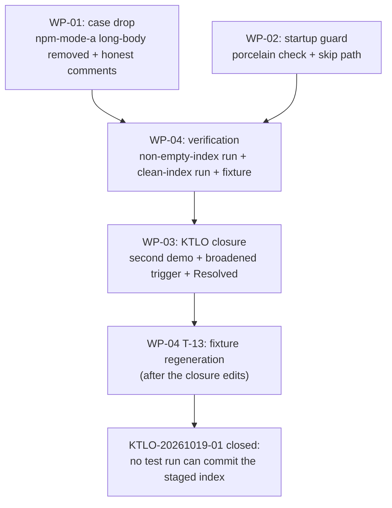

# PLAN-20261021-02: test-commit.js real-commit hazard — case drop and startup guard

Last modified: 2026-10-21
Status: Ready

## Objective

Close KTLO-20261019-01 (High severity): `scripts/test-commit.js`'s
npm-mode-a subtest sends arguments through the shell, and for the inline
multi-line-body case cmd.exe splits the newline-containing argv, the
`--dry-run`/`--dry-run-output` flags are lost, and `scripts/commit.js`
performs a REAL commit in the real repo — demonstrated twice (2026-10-19
commit `7f26922`; 2026-10-21 commit `2c36582`, both remediated by
human-ruled amends). This plan removes the hazardous test case and adds a
fail-safe startup guard, so no SHELL-TRANSPORT path can perform a real
commit against the repo's staged index. Residual path, recorded: the
suite's four direct-mode guard tests (~L347–357 of test-commit.js)
intentionally omit `--dry-run` and rely on `scripts/commit.js`'s
argument validation, which this plan does not change — they are not
shell-transport paths and stay out of scope. No specification governs this
plan (harness maintenance closing a KTLO item); acceptance lives in the
per-WP criteria and the KTLO item's own resolution criterion — a
test-commit.js run with a non-empty index performing no real commit —
per the PLAN-20261019-03 precedent for slices without scenario
contracts.

The plan artifact follows the full arc (draft → review → commit → push);
implementation is subsequent gated work.

## Scope

### Included

- WP-01: remove the hazardous case — the inline multi-line-body
  npm-mode-a subtest (`long-body-with-footers`) dropped from the
  npm-transport case set, with the suite's header and case comments
  updated to reflect the revised coverage honestly.
- WP-02: the startup guard — a read-only repo-index inspection at suite
  startup; when staged entries exist, the shell-transport (runNpm)
  subtests are skipped with a clear per-test skip report and a
  suite-level note, while direct-mode subtests still run.
- WP-03: the KTLO item update and closure — the second demonstration,
  the broadened trigger condition, the chosen fix, and (after
  verification) Status: Resolved per the item's own criteria and the
  house KTLO closure pattern.
- WP-04: verification — the KTLO's criterion as the acceptance test
  (non-empty-index run: no real commit, skips reported), the clean-index
  run with the case-count recount, the standard suite set, and the
  fixture regeneration.

### Excluded

- **Any change to `scripts/commit.js`.** Its real-commit path is its
  job; the guard belongs to the test, not the tool under test.
- **Any change to the npm transport itself.** `runNpm`'s mechanism is
  unchanged; the case set and the guard are the fix.
- **The Phase 7 implementation.** Separate, Ready
  (PLAN-20261019-05).
- **New decision records.** The plan's leans were Gate 1 arbitration
  points, ruled 2026-10-21; no decision records.

## Related specifications and decisions

- `KTLO-20261019-01` — the item this plan closes; its resolution
  criterion ("a test-commit.js run with a non-empty index performing no
  real commit") is the acceptance test.
- `DEC-20260906-01` — the byte-clean commit-output criterion the suite
  verifies; the suite's purpose is unchanged by this plan.
- The house commit procedure (the `git-commit` skill) — the
  `--body-file`/`--message-file` rule that makes the dropped case's
  usage (multi-line inline body through npm) forbidden practice; the
  dropped subtest tested a usage the procedure forbids.
- `PLAN-20261021-01` (archived) — house plan style precedent; the
  2026-10-21 demonstration's context (its close sequence's test-commit
  run fired the hazard).
- `PLAN-20261019-05` — the active-state house plan style.

## Current-state findings

- **The suite's structure (verified).** `scripts/test-commit.js` is a
  plain spawnSync suite (no test framework): 7 CASES × 4 subtests each
  (mode-a, mode-b, npm-mode-a, npm-mode-b) = 28, plus the CRLF
  round-trip, the F1 trailing-newline tolerance, and 4 guard tests =
  34 checks; exit 1 on any failure. Each CASE carries one subject/body
  pair; the `long-body-with-footers` case (L328–335) is the only one
  whose body contains newlines.
- **The hazard's precise mechanism (verified).** `runNpm` (L108–127)
  builds a single command line joined with spaces and spawns it with
  `shell: true`. `shellQuote` (L99–106) escapes quotes, backslashes,
  and shell metacharacters but NOT newlines — its own comment (L102–104)
  states the assumption: "sufficient for the test inputs
  (subjects/bodies/paths) which do not contain newlines". The
  `long-body-with-footers` case violates that documented assumption:
  cmd.exe splits the newline-containing command line into multiple
  statements — the first runs `commit.js` with the `--dry-run`/
  `--dry-run-output` flags lost (a REAL commit against the real repo's
  index), and the trailing body lines execute as standalone shell
  commands. The direct-mode `run()` helper (L78–84) passes an args
  array without a shell — `--dry-run` always survives; safe regardless
  of index state.
- **The two demonstrations (verified).** 2026-10-19: commit `7f26922`
  consumed the staged Phase 4 changeset (correct content, mangled
  test-fixture message; human-ruled amend). 2026-10-21: commit `2c36582`
  consumed the entire staged 45-file remediation changeset during the
  PLAN-20261021-01 close sequence's test-commit run (the failing subtest
  was `npm-mode-a long-body-with-footers`, ENOENT reading the
  never-written dry-run output; human-ruled amend → `db6be0b`). Both
  runs reported 33/34 with the same subtest failing.
- **The header's stale claims (verified).** L37: "All cases use
  --dry-run, so the repository is never mutated" — false for the
  hazardous case (the shell defect defeats the flag). L329–331: the
  long-body case "exercises newline preservation across the shell
  transport for mode-a" — the claim the demonstrations falsified. Both
  comments are updated honestly (WP-01).
- **The house commit procedure (verified).** Every authorized commit
  uses `--body-file`/`--message-file` — single-line path arguments; the
  message bytes never travel through the shell. npm-mode-b's
  `--message-file` case (L209–229) already covers
  multi-line-through-npm via the file transport.
- **No existing git invocations in the suite (verified).** The suite
  spawns only `node` (direct) and `npm` (shell). The guard introduces
  the suite's first git call; the natural pattern is the direct
  spawnSync form (args array, no shell) — the `run()` helper's pattern.
- **The porcelain semantics (verified).** `git status --porcelain`
  lines are `XY <path>`; staged entries are lines whose first (index)
  column is neither a space (unstaged-only), `?` (untracked), nor `!`
  (ignored).
- **The fixture's currency (verified).** `scripts/test-commit.js`,
  `ktlo/KTLO-20261019-01.md`, and `ktlo/index.md` are tracked files
  whose hashes enter `references/migration-baseline.json`; the fixture
  was last regenerated at the `db6be0b` close (Appendix A pins the
  delta).

## Intended shape

After this plan, the suite's npm-transport coverage is honest:
npm-mode-a exercises single-line inline args only (the shellQuote
assumption now enforced by the case set), and multi-line-through-npm
coverage lives in npm-mode-b's `--message-file` file transport, where it
always lived for the house procedure. A startup guard makes the
shell-transport subtests fail-safe: whenever the repo index carries
staged entries, the runNpm subtests are skipped with a clear per-test
report and a suite-level note, while the direct-mode subtests still run
— so the suite stays runnable at changeset close (when the index is
naturally staged) and the hazard class is closed against any future
transport defect. The residual path is recorded: the four direct-mode
guard tests intentionally omit `--dry-run` and rely on
`scripts/commit.js`'s argument validation (unchanged by this plan);
under the guard's indeterminate-index error path they still run —
direct mode, not shell-transport — and are not skipped.
KTLO-20261019-01 is Resolved with its criterion
demonstrated: a non-empty-index run performs no real commit. The
suite's check count goes 34 → 33.

## Work packages

### WP-01: Remove the hazardous case

**Description:** Drop the inline multi-line-body npm-mode-a subtest from
the npm-transport case set and make the suite's commentary honest.
Rationale: the dropped subtest tests a usage the house commit procedure
forbids (multi-line bodies go via `--body-file`); npm-mode-b's
`--message-file` case already covers multi-line-through-npm via the
file transport; direct mode-a retains inline multi-line coverage safely
(no shell).

**Tasks:**

- T-01: Remove the npm-mode-a subtest for the `long-body-with-footers`
  case — the case retains its mode-a, mode-b, and npm-mode-b coverage;
  the npm-transport dispatch skips `testNpmModeA` for that case (the
  dispatch shape — a per-case flag or an npm-mode-a case filter — is the
  implementer's discretion) (Required).
- T-02: Update the suite header (~L26–39) honestly: npm-mode-a coverage
  is single-line inline args only; newline-containing inline args
  through the shell are the KTLO-20261019-01 defect class (flags lost to
  the shell's newline splitting; trailing body lines execute as shell
  commands) and are covered by npm-mode-b's `--message-file` file
  transport instead; qualify the "repository is never mutated" claim
  (true for all retained cases) (Required).
- T-03: Update the long-body case comment (~L328–335) and the
  `shellQuote` comment (~L99–106) to reflect the revised coverage — the
  shellQuote no-newline assumption is now enforced by the case set
  rather than merely documented (Required).

**Dependencies:** None. Blocks WP-04's functional runs.

**Parallelism:** Proceeds together with WP-02 (same file, one changeset).

**Acceptance criteria:**

- The `long-body-with-footers` case has no npm-mode-a subtest; its
  other three subtests remain.
- No suite comment claims shell-transport newline preservation for
  mode-a or unconditional repo non-mutation; the header documents the
  single-line restriction and the KTLO defect class.

### WP-02: The startup guard

**Description:** Defense-in-depth at the transport level: inspect the
repo index read-only at suite startup; when staged entries exist, skip
the shell-transport (runNpm) subtests with a clear per-test skip report
and a suite-level note, while direct-mode subtests still run. Rationale:
keeps the suite runnable at changeset close (when the index is naturally
staged) while making the hazard class fail-safe against any future
transport defect.

**Tasks:**

- T-04: The guard — at suite startup, before the case loop:
  `spawnSync("git", ["status", "--porcelain"], { cwd: repoRoot,
  encoding: "utf8" })` (direct, no shell — the suite's first git
  invocation, following the `run()` helper's pattern). Staged entries
  exist iff any line's index column (first character) is neither a
  space, `?`, nor `!`. On staged entries, set the guard flag and print a
  suite-level note naming KTLO-20261019-01 and the skip rationale. On a
  guard error (spawn failure, non-zero git exit), treat the index state
  as indeterminate and apply the skip path — the fail-safe direction;
  the ruled choice: the direct-mode guard tests still run under the
  error path (they are not shell-transport; `scripts/commit.js`'s
  argument validation protects them — they intentionally omit
  `--dry-run`) (Required; the error-path disposition Expected — ruled,
  Gate 1 2026-10-21).
- T-05: The skip path — when the guard flag is set, every runNpm
  subtest (npm-mode-a AND npm-mode-b — both shell-transport) reports
  `SKIP <transport> <case> (guard: index state <non-empty|indeterminate>)`
  instead of running — the wording is true on both paths (the
  staged-detection path and the git-spawn-failure path share the skip
  mechanism but not the same established fact);
  direct-mode subtests (mode-a, mode-b, CRLF, F1, guards) run
  unchanged (Required).
- T-06: The summary — the final line reports pass/fail/skip counts;
  skips neither pass nor fail; exit 1 only on failures; the guard note
  appears in the summary when skips occurred (Required).

**Dependencies:** None. Blocks WP-04's functional runs.

**Parallelism:** Proceeds together with WP-01 (same file, one changeset).

**Acceptance criteria:**

- With a staged index: the runNpm subtests are skipped with per-test
  reports and the suite-level note; the direct subtests run; exit 0.
- With a clean index: no skips; all subtests run.
- The guard's git invocation is read-only and direct (no shell).

### WP-03: The KTLO item update and closure

**Description:** Bring `ktlo/KTLO-20261019-01.md` current with the
second demonstration and the broadened trigger, record the chosen fix,
and — after WP-04's verification demonstrates the item's own criterion —
set Status: Resolved per the house KTLO closure pattern
(KTLO-20261009-02 precedent).

**Tasks:**

- T-07: The item update — Evidence gains the second demonstration
  (2026-10-21: commit `2c36582` consumed the staged 45-file remediation
  changeset during the PLAN-20261021-01 close sequence's test-commit
  run; human-ruled amend → `db6be0b`); Description/Trigger gain the
  broadened trigger condition (ANY test-commit.js run while the repo
  index is non-empty — the guard is transport-level, so the hazard class
  is not limited to the long-body case); What was tried / Resolution
  criteria gain the chosen fix (case drop + startup guard) and the
  flag-reorder rejection with its reason (the newline splits the command
  line into multiple cmd.exe statements; trailing body lines would still
  execute as shell commands regardless of flag order); Last modified
  updates (Required).
- T-08: The closure — after T-10/T-11 pass, set Status: Active →
  Resolved and add the Resolution section per the house pattern: the
  resolved date, the fix (the dropped case + the startup guard), the
  criterion's demonstration (the non-empty-index run: skips reported,
  no real commit, HEAD and index unchanged), and the residual note
  (npm-transport coverage is exercised in clean-index runs; the four
  direct-mode guard tests intentionally omit `--dry-run` and rely on
  `scripts/commit.js`'s argument validation, unchanged by this plan —
  the recorded residual path) (Required).
- T-09: The index row — `ktlo/index.md`'s KTLO-20261019-01 row updated
  to reflect the resolution and status (Required).

**Dependencies:** T-07 after the WP-01/WP-02 shape is settled; T-08/T-09
after WP-04's T-10/T-11. Blocks WP-04's T-13 (the regeneration must see
the final KTLO state).

**Parallelism:** None internally; the closure is strictly after
verification.

**Acceptance criteria:**

- The item carries both demonstrations, the broadened trigger, the
  chosen fix with the flag-reorder rejection, and — after verification —
  Status: Resolved with a Resolution section per the house pattern.
- The `ktlo/index.md` row reflects the resolution.

### WP-04: Verification and the fixture regeneration

**Description:** The KTLO's own criterion is the acceptance test; plus
the clean-index run with the case-count recount, the standard suite set,
and the fixture regeneration.

**Tasks:**

- T-10: The criterion run — with a NON-EMPTY index (the vehicle ruled:
  the changeset's own staged state at close — Gate 1, 2026-10-21):
  `node scripts/test-commit.js` must (a)
  perform NO real commit — HEAD and the index unchanged, recorded before
  and after the run via the pinned read-only commands: `git rev-parse
  HEAD` for HEAD and a `git ls-files -s` snapshot for the index
  (explicitly NOT `git write-tree`, which writes a tree object); (b)
  report the skips for the runNpm subtests with
  the suite-level guard note; (c) exit 0 (Required).
- T-11: The clean-index run — with a clean index: all remaining subtests
  pass; the case count recounted and reported (34 → 33: the dropped
  npm-mode-a `long-body-with-footers` subtest) (Required).
- T-12: The standard suite set — `node .opencode/docs-check.js`;
  markdownlint on every touched Markdown file; the other house suites as
  applicable to the touched surface (Required).
- T-13: The fixture regeneration — `node
  scripts/generate-migration-baseline.js` after the WP-03 closure edits;
  exit 0, byte-stable across consecutive runs; the delta per Appendix A
  (Required).

**Dependencies:** T-10/T-11 after WP-01+WP-02; T-08/T-09 (WP-03) after
T-10/T-11; T-13 after WP-03.

**Parallelism:** T-10/T-11/T-12 proceed together once the suite changes
land; T-13 is strictly last.

**Acceptance criteria:**

- The criterion run demonstrates the KTLO's resolution criterion
  verbatim: a non-empty-index run performing no real commit.
- The clean-index run is green at the recounted 33 checks.
- The regenerated fixture is byte-stable and matches Appendix A;
  `test-migration-baseline.js` remains green.

## Dependencies

- WP-01 and WP-02 proceed together (same file); both block WP-04's
  T-10..T-12.
- Task-level chain: T-01..T-06 → T-10/T-11/T-12 → T-07 → T-08/T-09 →
  T-13.
- No external dependencies: Node 24 built-ins plus the repo's existing
  git/npm tooling.

## Changeset granularity

**One commit (confirmed — Gate 1, 2026-10-21)**, landing on
`feature/composable-workflow`:

| Commit | Work packages | Content |
| --- | --- | --- |
| 1 | WP-01..WP-04 | The case drop + honest comments, the startup guard, the KTLO item update + closure, the regenerated fixture |

The plan-creation changeset (this plan + its `docs/plans/index.md` row)
precedes the implementation changeset and is separate; it is docs-only
and needs no changeset file. The lockfile stays out of the commit
(untracked, human-ruled).

**The changeset file — ruled none (Gate 1, 2026-10-21):** the changeset
touches root tooling only (`scripts/test-commit.js`, the KTLO item,
`ktlo/index.md`); no workspace-package behavior change, and the
versioning workflow's rule attaches to package-affecting changesets.

## Change map

| File | Action | Purpose |
| --- | --- | --- |
| `docs/plans/PLAN-20261021-02.md` | Create | This plan (plan-creation changeset) |
| `docs/plans/index.md` | Modify | Add this plan's row (plan-creation changeset) |
| `scripts/test-commit.js` | Modify | The case drop + honest comments (WP-01, T-01..T-03); the startup guard (WP-02, T-04..T-06) |
| `ktlo/KTLO-20261019-01.md` | Modify | The second demonstration, the broadened trigger, the closure (WP-03, T-07..T-08) |
| `ktlo/index.md` | Modify | The item's row update (WP-03, T-09) |
| `references/migration-baseline.json` | Modify | Regenerated at close (WP-04, T-13) |

No changes to `scripts/commit.js`; no changes to the npm transport
mechanism; no workspace-package changes.

## Prescriptiveness levels

- **WP-01 — Required** for the subtest's removal (the case's other three
  subtests retained) and the absence of stale coverage claims;
  **Expected** for the dispatch shape and the comment rewording.
- **WP-02 — Required** for the read-only direct-spawn porcelain check,
  the staged-entry test (index column ∉ space/`?`/`!`), the skip path
  covering both runNpm transports, and the skip-aware summary;
  **Expected** for the report wording and the error-path disposition
  (indeterminate → skip, the fail-safe direction).
- **WP-03 — Required** for the second demonstration's recording, the
  broadened trigger, the flag-reorder rejection's reason, and the
  closure's gating on verification; **Expected** for the prose shape
  (the house closure pattern is the contract).
- **WP-04 — Required** for the criterion run's three assertions (no real
  commit, skips reported, exit 0), the clean-index recount, and the
  regeneration's byte stability; **Expected** for the drift bookkeeping
  (Appendix A pins the delta, re-verified at execution).

## Acceptance criteria and traceability

No specification governs this plan; acceptance lives in the per-WP
criteria and the KTLO item's own resolution criterion, per the
PLAN-20261019-03 precedent. The traceability map:

| Hazard class | Work package | Tasks | Verification |
| --- | --- | --- | --- |
| The hazardous case (inline multi-line through npm) | WP-01 | T-01..T-03 | The case set recount; the honest header/comments |
| The hazard class (any future transport defect vs a staged index) | WP-02 | T-04..T-06 | The criterion run's skips + no real commit |
| The item's record | WP-03 | T-07..T-09 | The Resolved status + the index row |
| The item's criterion | WP-04 | T-10..T-13 | The non-empty-index run; the clean-index run; the fixture |

## Documentation stubs

- [x] Create this plan + its `docs/plans/index.md` row (the
  plan-creation changeset).
- [ ] Update `ktlo/KTLO-20261019-01.md` + its `ktlo/index.md` row
  (WP-03; the closure lands in the implementation changeset).
- [ ] No new decision records: the leans were ruled at Gate 1
  (2026-10-21).
- [x] Update this plan's `docs/plans/index.md` row status as the plan
  advances (Draft → Ready → In progress → Completed).

## Verification criteria

- [ ] The criterion run: with a non-empty index, `node
  scripts/test-commit.js` performs NO real commit (HEAD and index
  unchanged, recorded before/after), reports the runNpm skips with the
  suite-level note, and exits 0.
- [ ] The clean-index run: all remaining subtests pass; the recount
  reported (34 → 33).
- [ ] No stale coverage claims remain in the suite's comments (the
  header, the `shellQuote` note, the long-body case note).
- [ ] `ktlo/KTLO-20261019-01.md` Status: Resolved with the Resolution
  section per the house pattern; the `ktlo/index.md` row updated.
- [ ] `node .opencode/docs-check.js` passes.
- [ ] `npx --yes markdownlint-cli2@0.23.2` passes on every touched
  Markdown file.
- [ ] The regenerated fixture is byte-stable, equals the tree at
  changeset close, and matches Appendix A; `test-migration-baseline.js`
  remains green.
- [ ] The changeset is exactly one commit on
  `feature/composable-workflow`; the lockfile appears nowhere in it.

## Readiness

**Score: 8/10 — Ready (Gate 1 approved 2026-10-21; the rulings are
recorded below).**

The hazard's mechanism is verified to the line (the `shellQuote`
no-newline assumption vs the long-body case); both demonstrations are
recorded with their remediations; the fix follows the KTLO item's own
resolution criteria; the acceptance test is the item's criterion
verbatim.

### Gate 1 rulings (2026-10-21)

Applied in this plan per the SPEC-20261019-01 resolution style:

- [x] All five arbitration points are accepted as proposed, each per
  its recorded lean: the WP-01 disposition is the subtest drop
  (convert-to-body-file redundant with npm-mode-b; a sandbox clone
  heavy; flag-reorder REJECTED — the newline splits the command line
  into multiple cmd.exe statements, so trailing body lines would still
  execute as shell commands regardless of flag order); the WP-02 guard
  shape skips the runNpm subtests (a hard refusal would break the close
  sequence's staged-verification order; the case drop alone leaves the
  hazard class open); no changeset file (root tooling only); the
  one-commit granularity on `feature/composable-workflow`; the criterion
  run's vehicle is the changeset's own staged state at close.
- [x] The WP-02 error-path extension accepted as proposed (Expected
  level): a git spawn failure or indeterminate index state applies the
  skip path — the fail-safe direction.
- [x] The plan approved as proposed: the four-WP structure, the
  task-level chain (suite changes → verification → KTLO closure →
  fixture), the traceability map, and Appendix A's drift accounting.

Blockers — all resolved:

1. The WP-01 disposition: RESOLVED — drop the subtest; flag-reorder
   rejected with its mechanism reason.
2. The WP-02 guard shape: RESOLVED — skip the runNpm subtests.
3. The changeset file: RESOLVED — none.
4. The one-commit granularity: CONFIRMED.
5. The criterion run's vehicle: RESOLVED — the changeset's own staged
   state at close.
6. The WP-02 error-path extension: RESOLVED — accepted as proposed
   (Expected).

Non-blocking: the skip-report wording; the guard's porcelain parsing
details; the dispatch shape for the dropped subtest; the fixture delta's
re-verification at execution.

## Appendix A: The expected fixture delta (re-verified at execution)

The regeneration at T-13 transforms the fixture from the `db6be0b`-close
inventory to the changeset-close inventory. The expected delta:

- **Added (1):** this plan's doc (`docs/plans/PLAN-20261021-02.md`,
  entering per the accumulated-drift accounting).
- **Updated (4):** `scripts/test-commit.js` (the case drop + the guard);
  `ktlo/KTLO-20261019-01.md` (the update + closure);
  `ktlo/index.md` (the row); `docs/plans/index.md` (this plan's row).
- **Removed (0):** no tracked path is deleted.
- **Annotations (0):** none expected; verified at execution.
- **The flow:** a single generator run, exit 0, byte-stable across
  consecutive runs; one expected `package-lock.json` untracked-path
  warning.
- **The accumulated-drift check:** the fixture was last regenerated at
  the `db6be0b` close; the post-close drift is this plan's doc plus the
  implementation's edits, all accounted above.
