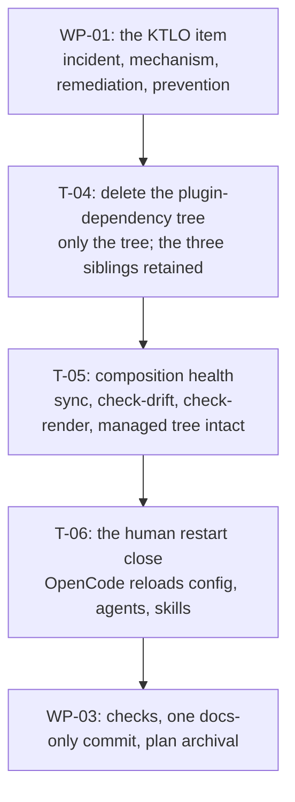

# PLAN-20261026-01: Stray .opencode/node_modules cleanup and the incident KTLO item

Last modified: 2026-10-29
Status: Ready

## Objective

Remove the unused plugin-dependency tree `.opencode/node_modules/` from the
working tree and document the incident in one KTLO item, per the human's
2026-10-26 ruling (the thread picked from the `PLAN-20261023-01`
implementation session), as amended by the 2026-10-29 plan review (rulings
F1/F2 below). The tree is OpenCode's plugin-dependency infrastructure —
identified as such at the 2026-10-29 review; no plugin is in use today, so
the tree is unused, and only the tree is removed while its three
OpenCode-managed siblings are deliberately retained. One compact changeset:
the KTLO item (the incident, the mechanism, the remediation, the prevention
note) + the working-tree deletion + the composition-health verification +
the human restart close. No specification governs this plan (ruled
working-tree-hygiene + KTLO-documentation task); acceptance lives in the
per-WP criteria and the ruled objective, per the `PLAN-20261019-03` /
`PLAN-20261021-04` precedent for slices without scenario contracts.

The plan artifact follows the full arc (draft → review → commit → push);
implementation is subsequent gated work.

## Scope

### Included

- WP-01: the KTLO item — `ktlo/KTLO-20261026-01.md` + its `ktlo/index.md`
  row, per `ktlo/template.md` (the five required fields, the N/A rule).
- WP-02: the cleanup — the working-tree deletion (only the tree; the three
  plugin-infrastructure siblings retained; a qualitative pre-deletion shape
  note for the record), the post-cleanup composition-health verification,
  and the human's empirical restart close.
- WP-03: verification and the close — docs-check, markdownlint, the
  composer-suite spot-check, the one docs-only commit, the plan archival.

### Excluded

- **Any composer behavior change.** The never-recorded-files policy
  (`SPEC-20261019-02`, SCEN-054) is correct and stays — it protects genuine
  consumer files; a stray tree persisting is the policy working as
  designed, not a defect in it.
- **Any verify-warning guard.** A future composer guard (e.g., a verify
  warning on large never-recorded subtrees) is a separate composer
  decision, explicitly out of scope; the KTLO item's prevention note
  records it as a candidate only.
- **The `.gitattributes` policy question** — separately excluded in
  `PLAN-20261023-01`; untouched here.
- **No changeset file.** The implementation changeset is docs-only (the
  versioning workflow's changeset-file rule covers behavior-affecting
  changesets; this one changes no package behavior) — the recent
  docs-only precedents (`PLAN-20261021-02/03/04`).
- **No fixture regeneration.** Fixture-free close — no code and no fixtures
  change.

## Related specifications and decisions

- No specification governs this plan; acceptance lives in the per-WP
  criteria (the `PLAN-20261019-03` precedent).
- `SPEC-20261019-02` (Active) — SCEN-054: the composer's stale-removal rule
  ("stale managed files are removed by recorded ownership ... a consumer
  `.opencode/` file that was never recorded in the manifest is left
  untouched") — the mechanism whose by-design protection is why the stray
  tree persists; ruled correct and unchanged.
- `PLAN-20261023-01` (archived) — the implementation session whose
  leftover-accumulation observation surfaced this thread.
- `ktlo/template.md` — the item skeleton (the five required fields + the
  N/A rule); the resolved items (e.g., `KTLO-20261018-01`) are the pattern.
- The human's 2026-10-26 ruling — the thread-pick, the one-compact-changeset
  shape, the composer-policy-stays ruling, and the guard's out-of-scope
  ruling; the Gate 1 rulings (2026-10-26): the item created-as-Resolved,
  the deletion AUTHORIZED, the archival riding the close commit.
- The human's 2026-10-29 plan-review rulings (F1/F2) — F1: the tree
  identified as OpenCode's plugin-dependency infrastructure (the three
  siblings retained; the origin story corrected; the human restart close
  added); F2: no specific numbers unless necessary (the qualitative shape
  replaces the exact counts; the enumeration task dissolved). Recorded in
  the review-rulings section below.

## Current-state findings

- **The tree is OpenCode's plugin-dependency infrastructure (ruled at the
  2026-10-29 plan review — the siblings prove it; the shape
  implementor-verified during the `PLAN-20261023-01` implementation).**
  `.opencode/node_modules/` is not a bare manual `npm install` leftover —
  the earlier origin guess is withdrawn. Its siblings are OpenCode-managed
  plugin infrastructure: `.opencode/package.json` pins `@opencode-ai/plugin`
  (1.19.3), `.opencode/package-lock.json` locks that dependency tree
  (including `@opencode-ai/sdk`), and `.opencode/.gitignore` is OpenCode's
  generated plugin-dir ignore (it lists the plugin dependency files —
  `node_modules`, `package.json`, `package-lock.json`, `bun.lock` — and
  itself). The repo's own docs treat the pin as maintained infrastructure
  (CONTRIBUTING.md's "OpenCode plugin maintenance" procedure; the seed
  `AGENTIC_WORKFLOW.md`'s restart discipline,
  `packages/roundhouse-core/seed/AGENTIC_WORKFLOW.md`). The qualitative
  shape: a large `node_modules` tree — thousands of files across dozens of
  package directories, including native Windows `.node` binaries; mixed
  line endings. The human ruled: no plugin use now, but near-future
  adoption cannot be ruled out — the pin and lockfile are the recorded
  baseline a future plugin install restores from, so they stay.
- **Why it persists (verified against the spec).** The composer's
  stale-removal policy removes only files the composition record owns
  (SCEN-054); never-recorded consumer files are never touched — by design,
  protecting genuine consumer files. The stray tree persists indefinitely
  and will never normalize on its own.
- **Nothing needs it (implementor-verified; the plugin surface added at the
  2026-10-29 review).** The composer never resolves from there, the skills
  are Markdown, and `docs-check.js` is Node-built-ins-only. The plugin
  surface adds three negative facts: no plugin member is declared in the
  composed `opencode.json`; no `.opencode/plugins/` directory exists; and
  the Core `opencode-template.json` has no plugin member — no active plugin
  consumes the tree today. Zero tracked-file references to the path
  (re-verified 2026-10-29 — the only textual mentions are this plan and its
  index row, which describe the cleanup itself).
- **Zero git content.** `.opencode/` is gitignored (`.gitignore` L22
  `/.opencode/`, plus the global `node_modules/` rule at L10) — the
  deletion is a working-tree-only operation; the changeset's only git
  content is the KTLO documentation.
- **The composition baseline (verified against the committed
  `.roundhouse/manifest.json`, 2026-10-26).** 62 managed files + 28
  recorded seed paths + the composed `opencode.json` — the intact state the
  post-cleanup verification confirms. The never-recorded paths are
  invisible to the composer, so the deletion cannot disturb the
  composition; the checks prove it rather than assume it.
- **The close precedent (verified via git log).** The plan archival rides
  the implementation commit — 139cb1e carried `PLAN-20261023-01`'s move and
  both index updates alongside the fix.
- **The composer-suite invocation (verified).** `node
  packages/roundhouse-cli/test/composer.test.js` — the suite's own header
  documents the command; its scenarios run against temp-space consumers,
  which the working-tree deletion cannot reach.

## Intended shape

After this plan: the unused plugin-dependency tree `.opencode/node_modules/`
is gone from the working tree, while its three OpenCode-managed siblings
(`.opencode/package.json`, `.opencode/package-lock.json`,
`.opencode/.gitignore`) are deliberately retained — the recorded baseline a
future plugin install restores from; the incident (what was found, the
mechanism, the remediation, the prevention) is durably documented in one
KTLO item; the composer's managed tree is verified intact and composition
health is green; and the human restart close confirms OpenCode still loads
config, agents, and skills cleanly. One docs-only commit carries the KTLO
item, its index row, and the plan archival; the deletion itself contributes
zero git content.

The diagram shows the critical path; the Dependencies section carries the
precise partial order (the item authoring and the deletion are
independent).

## Work packages

### WP-01: The KTLO item

**Description:** Author `ktlo/KTLO-20261026-01.md` per `ktlo/template.md`
and add its `ktlo/index.md` row. All five required fields are populated
with no bare N/A.

**Tasks:**

- T-01: Author the item — Status: Resolved at creation (ruled at Gate 1,
  2026-10-26: the remediation is immediate and complete in this
  changeset). Trigger: the 2026-10-26 thread-pick — the
  accumulation surfaced during the `PLAN-20261023-01` implementation.
  Evidence: the plugin-infrastructure identification (the three named
  siblings — the `@opencode-ai/plugin` pin, the lockfile including
  `@opencode-ai/sdk`, OpenCode's generated plugin-dir `.gitignore`), the
  qualitative tree shape (a large `node_modules` tree — thousands of files
  across dozens of package directories, native Windows `.node` binaries,
  mixed line endings), the no-plugin-declared evidence (no plugin member in
  the composed `opencode.json`; no `.opencode/plugins/` directory; no
  plugin member in the Core `opencode-template.json`), the
  zero-tracked-references check, the gitignore facts, and the SCEN-054
  citation. What was tried: the remediation performed in this changeset —
  the working-tree deletion, only the tree, siblings retained (the one
  attempt; it solved it). Resolution criteria: concrete and met by this
  changeset (the tree absent and the three siblings present;
  `check-drift` and `check-render` green; the managed tree intact; the
  human restart close recorded). Description, Impact, Recurrence,
  Procedure, Owner, and History per the template; the History row records
  the 2026-10-26 remediation performed in this same changeset (the house
  closure pattern) and gains the human restart confirmation at T-06
  (Required).
- T-02: Bake the content rulings into the item: the mechanism section
  states the composer's never-recorded policy is correct and stays (strays
  persist by design — the policy protecting genuine consumer files, not a
  defect); the remediation section states the deletion is working-tree-only
  on gitignored content (zero git content in the changeset) and that only
  the tree is deleted — the three plugin-infrastructure siblings are named
  and deliberately retained (the recorded baseline a future plugin install
  restores from); the prevention note is recalibrated per the 2026-10-29
  review ruling (F1): `.opencode/node_modules/` is plugin-infrastructure
  territory, and the composer's never-recorded policy means such trees
  persist by design — if a plugin is adopted, its SDK install belongs
  there, and periodic manual review is the staleness remedy — replacing
  the earlier "do not run `npm install` with cwd under `.opencode/`"
  wording; it also records the future-guard candidate (a verify warning on
  large never-recorded subtrees) as explicitly out of scope — a separate
  composer decision (Required).
- T-03: Add the `ktlo/index.md` row — the bullet-list pattern (title
  linking the new item file, a one-to-two-sentence description, the
  `[project]` tag, the date), the resolved disposition named in the
  description per the resolved-item convention (Required).

**Dependencies:** None — the item's Evidence is authored from the verified
facts; T-04's pre-deletion shape note confirms the expected shape at
execution.

**Parallelism:** Independent of WP-02's T-04/T-05; the item's History gains
its restart line at T-06.

**Acceptance criteria:**

- The item exists, complete per the template (no bare N/A), with the ruled
  status; the index row exists; the content rulings are in the text.

### WP-02: The cleanup

**Description:** The working-tree deletion (only the tree; the siblings'
boundary explicit; a qualitative pre-deletion shape note for the record),
the post-cleanup composition-health verification, and the human's empirical
restart close.

**Tasks:**

- T-04: Delete `.opencode/node_modules/` from the working tree — a
  destructive working-tree operation on gitignored content, AUTHORIZED at
  Gate 1 (2026-10-26); unconditional Required work. The boundary is
  explicit: delete ONLY the tree — nothing else under `.opencode/` is
  touched. The three OpenCode-managed plugin-infrastructure siblings are
  deliberately kept, named: `.opencode/package.json` (pinning
  `@opencode-ai/plugin`), `.opencode/package-lock.json` (locking the plugin
  dependency tree, including `@opencode-ai/sdk`), and `.opencode/.gitignore`
  (OpenCode's generated plugin-dir ignore). Before deleting, record a
  qualitative pre-deletion shape note — a large `node_modules` tree,
  thousands of files across dozens of package directories, native Windows
  `.node` binaries present, mixed line endings — and proceed only on that
  expected shape: the tree leaves no git record (gitignored), so the KTLO
  item is its only durable record (Required).
- T-05: Post-cleanup verification — `npm run sync-roundhouse -- --mode
  sync` (compose unaffected — never-recorded paths are invisible to it;
  expect no unexpected change), `npm run check-drift` (green — this is the
  managed-tree-intact proof: every one of the manifest's 62 managed files
  matches its source and the recorded seeds exist), `npm run check-render`
  (green — the committed manifest is current), plus the direct confirmation
  that the composer's managed tree survived the deletion untouched and the
  three siblings remain (Required).
- T-06: The empirical close — after the deletion and the automated
  verification, the HUMAN restarts OpenCode and confirms config, agent, and
  skill loading, per CONTRIBUTING.md's "OpenCode plugin maintenance"
  procedure (its update-and-restart discipline); the one check no automated
  battery can perform. The confirmation is an acceptance criterion performed
  by the human and is recorded in the KTLO item's History (Required).

**Dependencies:** T-04, then T-05, then T-06, strictly in order.

**Parallelism:** T-04/T-05 independent of WP-01; T-06 after T-05.

**Acceptance criteria:**

- The directory is gone and the three named siblings remain; the
  qualitative shape note is recorded before the deletion; all three
  verification commands pass with no unexpected change; the human has
  restarted OpenCode and confirmed config/agent/skill loading, recorded in
  the item's History.

### WP-03: Verification and the close

**Description:** The checks, the one docs-only commit, and the plan
archival.

**Tasks:**

- T-07: `node .opencode/docs-check.js` — PASS; `npx --yes
  markdownlint-cli2@0.23.2` on the touched Markdown (the KTLO item,
  `ktlo/index.md`, this plan, `docs/plans/index.md`) (Required).
- T-08: The suites spot-check — the composer suite (`node
  packages/roundhouse-cli/test/composer.test.js`) green; its consumers are
  temp-space fixtures, which the working-tree deletion cannot reach. No
  broader battery: no code changed (Required as the spot-check).
- T-09: Plan archival at close — status → Completed; the file moves to
  `docs/plans/archive/`; the row moves from `docs/plans/index.md` to
  `docs/plans/archive/index.md` (Required; rides the close commit — ruled
  at Gate 1, 2026-10-26, per the 139cb1e precedent).
- T-10: The one commit — the KTLO item, the `ktlo/index.md` row, and the
  archival; the deletion contributes zero git content; no changeset file
  (docs-only); the lockfile appears nowhere (Required; executed under the
  normal commit gates).

**Dependencies:** WP-01 and WP-02. Strictly last.

**Parallelism:** None.

**Acceptance criteria:**

- All checks pass; the changeset is exactly one docs-only commit; the plan
  is archived.

## Dependencies

- WP-01's item authoring and WP-02's T-04 (the deletion) are independent;
  the item's Evidence is authored from the verified facts, and T-04's
  pre-deletion shape note confirms the expected shape.
- T-04 → T-05 → T-06 strictly in order; T-06 (the human restart close)
  lands its confirmation in the item's History and precedes WP-03.
- WP-03 depends on WP-01 and WP-02.
- No external dependencies (Node built-ins; nothing installs).

## Changeset granularity

Two changesets on `feature/composable-workflow` (verified current branch):

| Changeset | Work packages | Content |
| --- | --- | --- |
| 1 (plan creation) | — | This plan + its `docs/plans/index.md` row; docs-only, no changeset file |
| 2 (implementation) | WP-01, WP-02, WP-03 | The KTLO item + its `ktlo/index.md` row + the close-time plan archival; the deletion contributes zero git content; no changeset file; fixture-free |

**One implementation commit (ruled — Gate 1, 2026-10-26):** the KTLO item,
its `ktlo/index.md` row, AND the plan's own archival land in the same
commit — the archival rides the implementation commit per the verified
house pattern (139cb1e); no separate archival commit exists. The deletion
contributes zero git content (gitignored); no changeset file (docs-only);
the lockfile appears nowhere.

## Change map

| File | Action | Purpose |
| --- | --- | --- |
| `docs/plans/PLAN-20261026-01.md` | Create | This plan (plan-creation changeset) |
| `docs/plans/index.md` | Modify | Add this plan's row — the active index's first row (plan-creation changeset) |
| `ktlo/KTLO-20261026-01.md` | Create | The incident KTLO item (WP-01, T-01..T-02) |
| `ktlo/index.md` | Modify | Add the item's row (WP-01, T-03) |
| `docs/plans/PLAN-20261026-01.md` | Modify + move | Status → Completed; archived at close (WP-03, T-09) |
| `docs/plans/index.md` | Modify | The active row retires at close (WP-03, T-09) |
| `docs/plans/archive/index.md` | Modify | The archived row lands (WP-03, T-09) |

Working tree only (never git content): `.opencode/node_modules/` — deleted
(WP-02, T-04); its three plugin-infrastructure siblings
(`.opencode/package.json`, `.opencode/package-lock.json`,
`.opencode/.gitignore`) are deliberately retained. No other files; no code;
no package content; no fixtures.

## Prescriptiveness levels

- **WP-01 — Required:** the item's existence and completeness (the five
  required fields, no bare N/A), the status ruling (created-as-Resolved —
  Gate 1, 2026-10-26), and the content rulings (the incident + the
  plugin-infrastructure identification with the three siblings named and
  retained, the policy-stays mechanism, the working-tree-only remediation,
  the recalibrated prevention note with the out-of-scope guard, and the
  human restart close in History). **Expected:** the exact prose; the
  index row's phrasing.
- **WP-02 — Required:** the deletion target (`.opencode/node_modules/` —
  only the tree; the three siblings named and kept; nothing else under
  `.opencode/`); the qualitative shape note recorded before the deletion;
  the three post-cleanup verification commands and their outcomes; the
  human restart close performed by the human and recorded in the item's
  History. **Expected:** the shape note's exact wording.
- **WP-03 — Required:** the check outcomes (docs-check, markdownlint, the
  composer-suite spot-check), the one-commit docs-only granularity, and the
  archival at close. **Expected:** the commit message (it goes through the
  commit gates).

## Acceptance criteria and traceability

No specification governs this plan; acceptance lives in the per-WP
criteria and the ruled objective's posture, per the `PLAN-20261019-03`
precedent. The traceability map:

| Ruled element | Work package | Tasks | Verification |
| --- | --- | --- | --- |
| The incident documented in one KTLO item | WP-01 | T-01..T-03 | The item's fields complete; the index row; docs-check |
| The composer's never-recorded policy stays (no composer change) | Exclusion | — | The composer lib untouched; the composer suite green |
| The stray tree deleted from the working tree | WP-02 | T-04 | The directory absent from the filesystem |
| The three plugin-infrastructure siblings retained | WP-02 | T-04, T-05 | The siblings present post-deletion |
| Composition health verified post-cleanup | WP-02 | T-05 | sync no-op; `check-drift` green; `check-render` green |
| The human restart close (config/agent/skill loading confirmed) | WP-02 | T-06 | The item's History records the human's confirmation |
| One docs-only commit; no changeset file | WP-03 | T-10 | The commit's file list |
| Plan archival at close | WP-03 | T-09 | The archive row; the active row gone |

## Documentation stubs

- [x] Create this plan + its `docs/plans/index.md` row (the plan-creation
  changeset).
- [ ] Create `ktlo/KTLO-20261026-01.md` + its `ktlo/index.md` row (WP-01) —
  the item is the documentation deliverable.
- [ ] No new decision records: the composer-policy-stays ruling and the
  guard's out-of-scope ruling live in the KTLO item; no DEC.
- [x] Update this plan's `docs/plans/index.md` row status as the plan
  advances (Draft → Ready → In progress → Completed) and archive at close.

## Verification criteria

- [ ] `.opencode/node_modules/` no longer exists in the working tree.
- [ ] The KTLO item exists with all five required fields populated (no bare
  N/A) and the ruled status.
- [ ] The item's Evidence carries the plugin-infrastructure identification
  (the three named siblings), the qualitative tree shape, and the
  no-plugin-declared evidence.
- [ ] The three plugin-infrastructure siblings remain in place
  (`.opencode/package.json`, `.opencode/package-lock.json`,
  `.opencode/.gitignore`).
- [ ] The human restart close is done: the human restarted OpenCode and
  confirmed config/agent/skill loading, recorded in the item's History.
- [ ] The `ktlo/index.md` row exists in the bullet-list pattern with the
  `[project]` tag.
- [ ] The composer's managed tree is intact post-cleanup:
  `npm run sync-roundhouse -- --mode sync` changes nothing unexpected,
  `npm run check-drift` green, `npm run check-render` green.
- [ ] The composer lib and `SPEC-20261019-02` are untouched (the
  policy-stays exclusion holds).
- [ ] The composer-suite spot-check is green (`node
  packages/roundhouse-cli/test/composer.test.js`).
- [ ] `node .opencode/docs-check.js` passes; `npx --yes
  markdownlint-cli2@0.23.2` passes on the touched Markdown.
- [ ] The changeset is exactly one docs-only commit; the deletion appears
  nowhere in it; no changeset file; the lockfile appears nowhere in it.
- [ ] The plan is archived at close (status Completed; the row moved from
  the active index to the archive index).

## Readiness

**Score: 10/10 — Ready (Gate 1 approved 2026-10-26; amended and
re-approved by the 2026-10-29 plan review — both rulings recorded
below).**

The facts are verified to the artifact: the plugin-infrastructure
identification (the three named siblings read 2026-10-29 — the
`@opencode-ai/plugin` pin, the lockfile including `@opencode-ai/sdk`,
OpenCode's generated plugin-dir ignore), the no-plugin-declared surface
(the composed `opencode.json` and the Core template read; the
`.opencode/plugins/` directory absent), the gitignore status
(`.gitignore` read), the persistence mechanism (SCEN-054 read in the
spec), the zero-tracked-references claim (re-verified 2026-10-29 — the
only textual mentions are this plan and its index row), the composition
baseline (the committed manifest read — 62 managed files + 28 seed paths +
the render), the composer-suite invocation (the suite's own header), and
the archival precedent (git log). All three Gate 1 arbitration points are
ruled (2026-10-26), and both 2026-10-29 review rulings are applied. The
former deduction (exact-count reconciliation) dissolves per review ruling
F2: the qualitative shape is sufficient for the record, and the counts the
plan retains (the composition baselines) are the checks' own expectations,
verified against the committed manifest.

### Gate 1 rulings (2026-10-26)

Applied in this plan per the house pattern:

- [x] All three arbitration points are accepted as proposed, each per its
  recorded lean: the KTLO item is created-as-Resolved (the remediation is
  immediate and complete in this changeset); the deletion of
  `.opencode/node_modules/` is AUTHORIZED (the destructive working-tree
  operation on gitignored content proceeds, with the pre-deletion
  enumeration making the record exact); the plan's archival RIDES the
  implementation commit — one commit total carrying the KTLO item, its
  index row, and the plan's own archival, per the verified house pattern
  (139cb1e).
- [x] The plan approved as proposed: the one-compact-changeset shape, the
  composer-policy-stays exclusion, the guard's out-of-scope ruling, and
  the per-WP acceptance criteria.

Blockers — all resolved:

1. The KTLO item's initial status: RESOLVED — created-as-Resolved; the
   remediation is immediate and complete in this changeset (2026-10-26).
2. The deletion's explicit authorization: RESOLVED — AUTHORIZED; the
   destructive working-tree deletion proceeds with the pre-deletion
   enumeration recorded first (2026-10-26).
3. The close commit's exact content: RESOLVED — the archival rides the
   implementation commit; one commit total (2026-10-26).

Non-blocking: the item's exact prose; the enumeration's mechanics; the
commit message shape (it goes through the commit gates).

### Plan review rulings (2026-10-29)

The plan review returned two rulings; both are applied throughout this
revision:

- **F1 — plugin infrastructure (the tree's real identity).**
  `.opencode/node_modules/` is OpenCode's plugin-dependency
  infrastructure, not a bare manual `npm install` leftover — the siblings
  prove it: `.opencode/package.json` (pinning `@opencode-ai/plugin`),
  `.opencode/package-lock.json` (locking the tree, including
  `@opencode-ai/sdk`), `.opencode/.gitignore` (OpenCode's generated
  plugin-dir ignore). Applied: only the tree is deleted and the three
  siblings are RETAINED as OpenCode-managed infrastructure (the pin +
  lockfile are the recorded baseline a future plugin install restores
  from); the origin story is corrected throughout; the deletion's safety
  basis gains the plugin surface (no plugin member declared in the
  composed `opencode.json`; no `.opencode/plugins/` directory; no plugin
  member in the Core template; zero tracked-file references); a NEW
  Required step — the empirical close, the HUMAN restarting OpenCode and
  confirming config/agent/skill loading per CONTRIBUTING.md's
  plugin-maintenance procedure — pinned as an acceptance criterion
  performed by the human and recorded in the KTLO item's History; and the
  prevention note is recalibrated (`.opencode/node_modules/` is
  plugin-infrastructure territory; the never-recorded policy means such
  trees persist by design; a future plugin's SDK install belongs there;
  periodic manual review is the staleness remedy), replacing the
  miscalibrated "do not run `npm install` with cwd under `.opencode/`"
  wording.
- **F2 — no specific numbers unless necessary.** The exact counts leave
  the stray-tree description everywhere (the file count, the top-level
  entry counts, the CRLF count, the exact `.node` binary paths — including
  the index row's description), replaced by the qualitative shape: "a
  large `node_modules` tree — thousands of files across dozens of package
  directories, including native Windows `.node` binaries; mixed line
  endings." The pre-deletion exact-count enumeration task dissolves into
  the deletion task as a qualitative pre-deletion shape note (the deletion
  becomes T-04; the verification and the new empirical close follow as
  T-05/T-06). The composition baselines (62 managed + 28 seeds + the
  composed render) stay — they are the checks' own expectations. The
  readiness deduction tied to count-reconciliation dissolves; the score is
  re-rated 10/10 above.

Where the Gate 1 record above mentions the pre-deletion enumeration, F2
supersedes it: the enumeration task is dissolved; the deletion
authorization carries unchanged.

## The close (the established pattern)

Fixture-free: no fixture regeneration step exists (no code, no fixtures —
the `PLAN-20261021-03` ruling's pattern). The close is stage → docs-check
→ markdownlint → commit under the normal gates, with the plan archival
inside the implementation changeset (ruled — Gate 1, 2026-10-26). The
deletion never enters the commit (gitignored); the lockfile never enters
the commit.
