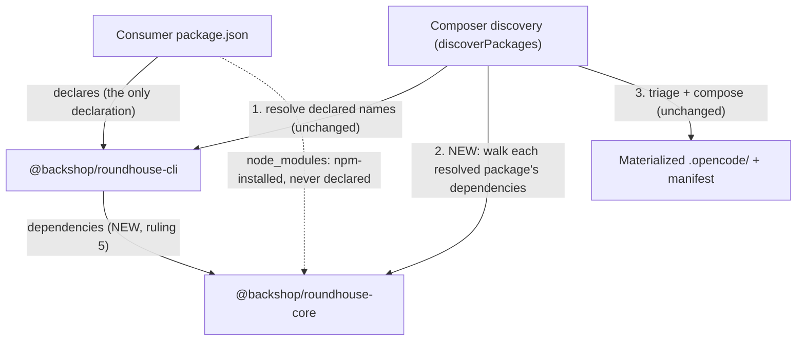

# PLAN-20261112-01: The npm publishing model — one-command base, public packages, manual publish

Last modified: 2026-11-12
Status: Ready

## Objective

Implements DEC-20261112-01 (the npm publishing model, Active — the
authority for intent). Its Follow-up list is this plan's seed. The
ruled model: all 33 packages publish publicly under the `@backshop`
scope with independent Changesets-driven versions; the base workflow is
CLI + Core wired as a hard dependency so `npm install
@backshop/roundhouse-cli` lands the complete base in one command; the
31 capability packages are à-la-carte add-ons; consumer-authored
content is a first-class third path; publishing is a manual maintainer
`changeset publish` with accumulate-and-cut batching; the legacy
`@backshopdev/roundhouse` package is deprecated, not replaced.

The plan's load-bearing fact, resolved by investigation before
drafting (see Current-state findings): **composer discovery is
direct-only** — it does not walk a declared package's own
dependencies. The hard dependency alone therefore cannot compose Core
at a consumer that declares only the CLI; a composer behavior change
(the transitive discovery walk) is required, plus the SPEC-20261019-02
amendment and test updates. WP-01 is shaped by that finding.

The plan artifact follows the full arc (draft → review → commit →
push); implementation is subsequent gated work.

## Scope

### Included

- WP-01: the transitive discovery walk (composer behavior change),
  the SPEC-20261019-02 amendment (SCEN-057/058 re-pin, SCEN-059 count
  fix, new transitive scenario), and the composer/matrix test updates.
- WP-02: the 33 publishability flips (`private: true` removed from
  every member `package.json`; the root stays `private: true`) and the
  `.changeset/config.json` `access` flip to `"public"`.
- WP-03: the CLI→Core hard-dependency wiring (ruling 5) and this
  changeset's changeset file naming `@backshop/roundhouse-cli`.
- WP-04: check-pack's revival — reversing PLAN-20261023-01 T-15's four
  surfaces.
- WP-05: the README's `## Packaging` section with the ruled model.
- WP-06: the ruled-in housekeeping riders (Gate 1, 2026-11-12: the
  root lockfile tracked, the scratch README fix, the docs-check alias,
  the DEC-20261017-03 pointer note).
- WP-07: the verification battery and the one-commit close.
- The post-changeset maintainer flow (org verification, first release,
  legacy deprecation) documented in this plan as exact commands —
  performed by the maintainer AFTER the changeset, never by agents.

### Excluded

- The actual first publish, the `@backshop` org creation, and the
  deprecation execution — maintainer acts, documented not performed.
- Any npm-registry interaction by agents.
- CI-automated publish (DEC-20261112-01 Alternative C — rejected for
  now, trivially additive later).
- Executing the first version PR (`changeset version` + publish) —
  that is the maintainer's manual flow, not this changeset.
- Managed-content recomposition — this plan touches no content
  package's `managed/` tree (discovery is CLI lib code), so no
  recompose is expected (fixture-free close).

## Related specifications and decisions

- DEC-20261112-01: The npm publishing model (the authority; this plan
  implements its Follow-up list and resolves its discovery-semantics
  assumption)
- SPEC-20261019-02: The composer contract (SCEN-054, SCEN-057..059,
  SCEN-066; amendment in WP-01)
- DEC-20261017-01: Composable package architecture (the 33-package
  decomposition this model publishes)
- DEC-20261017-03: Migration strategy (legacy softening per ruling 7;
  the superseded two-package install sketch, WP-06 rider)
- PLAN-20261023-01: The check-pack deferral (T-15) this plan reverses
- PLAN-20261021-04: The README Packaging placeholder this plan fills

## Current-state findings

### The load-bearing finding: discovery is direct-only

- **Finding (b) of the two anticipated outcomes: discovery does NOT
  walk transitive dependencies.** `discoverPackages`
  (`packages/roundhouse-cli/lib/discovery.js:287-392`) collects
  declared names solely from the consumer's own `package.json`
  (`collectDeclaredNames`, discovery.js:110-128; consumed in step 2 of
  the pipeline, discovery.js:316-335). After resolving each declared
  name to a candidate root (targeted upward `node_modules` walk,
  discovery.js:180-189), the pipeline triages candidates and never
  reads a resolved package's own dependency fields. There is no
  recursion anywhere in the module.
- **The matrix suite confirms direct-only is the pinned behavior:**
  every matrix consumer declares its chosen members directly
  (`buildConsumer` writes all chosen member names into `dependencies`
  and junctions each into `node_modules/@backshop/`;
  `packages/roundhouse-cli/test/composition-matrix.test.js:97-113`).
  No consumer scenario declares one package and receives another
  transitively.
- **Consequence for DEC-20261112-01 (its Assumptions clause resolves
  FALSE as written):** the record assumed "if discovery is
  declaration-driven, the hard dependency *is* the declaration"
  (DEC-20261112-01 Assumptions). That conflates the CLI's declaration
  of Core with the consumer's declaration. Under the ruled consumer
  story the consumer's manifest declares only `@backshop/
  roundhouse-cli`; npm installs Core into the consumer's
  `node_modules` as the CLI's hard dependency, but the consumer's
  manifest never names it — so SCEN-058 ("an undeclared node_modules
  package is never discovered", SPEC-20261019-02:537-546) keeps Core
  undiscovered, and a CLI-only install composes nothing: the
  empty-scaffold failure mode DEC-20261112-01 ruling 5 exists to kill.
  WP-01 is therefore a composer behavior change: after resolving the
  declared names, walk each resolved package's own `dependencies`
  transitively through the same targeted resolution.
- **SCEN-057 pins the direct-only semantics as written** ("a temporary
  consumer whose package.json declares fixture packages … each
  declared package … is discovered", SPEC-20261019-02:526-535) — the
  amendment must re-pin "declared" as *reachable through the consumer's
  declaration graph* while preserving SCEN-058's protective intent (a
  package merely co-located in `node_modules`, reachable through no
  declaration, is still never discovered).

### The wiring surface

- `packages/roundhouse-cli/package.json` has no `dependencies` field
  (lines 1-17); its `files` allowlist is `["bin", "lib",
  "roundhouse.json"]`.
- All 33 workspace members are `private: true` at `0.0.0` (enumerated
  2026-11-12: 33 members, 33 private). The root `package.json` is
  `private: true` and must remain so (standard workspace practice; the
  root never publishes).
- `.changeset/config.json`: `access: "restricted"`,
  `updateInternalDependencies: "patch"`, `ignore: []`. Two changeset
  files are pending: `fix-canonical-lf-ingestion.md`,
  `fix-skill-frontmatter-identity.md` — they become the first version
  PR's content together with this plan's dependency changeset.
- Changesets' `updateInternalDependencies: "patch"` rewrites the CLI's
  Core range at every Core bump and forces a CLI patch release
  alongside it — the hard dependency costs no manual version
  coordination (DEC-20261112-01 Rationale).

### check-pack's deferral surfaces (PLAN-20261023-01 T-15, all four located)

- `scripts/check-all.js`: the `CHECKS` array holds four checks
  (check-contracts, check-deps, check-matrix, check-drift — check-pack
  absent); the header carries the deferral comment
  ("check-pack is deliberately not part of this aggregate … it returns
  to the CHECKS array below when the publishing model lands"); the
  summary line reads "all four checks green".
- `scripts/check-render.js:27-30`: the header references the deferral
  ("check-pack's deferral from that aggregate is PLAN-20261023-01
  T-15").
- The standalone `npm run check-pack` script survives in root
  `package.json` (the npm script itself stayed).
- check-pack's own contracts still hold: `EXPECTED_MEMBERS = 33`
  (scripts/check-pack.js:28); the CLI's contract allowlist is
  `["bin", "lib", "roundhouse.json"]` (scripts/check-pack.js:36). The
  CLI gaining a `dependencies` field does not affect the contract:
  `package.json` is npm's mandatory inclusion and is already
  special-cased in `isAllowed` (scripts/check-pack.js:44-47) —
  npm-mandatory inclusion, already in the contract.
- Revival caveat carried honestly: the deferral's rationale was
  check-pack's unproven Linux behavior in CI (PLAN-20261023-01:174-179
  — it was deferred from the aggregate before any Linux run). Reviving
  it into `check-all` re-exposes CI to that behavior; the first
  post-revival CI run is the proof. Arbitration point 7 — ruled
  (2026-11-12): revive, with the first post-revival CI run as the
  Linux proof and re-defer only on failure.

### Documentation surfaces

- README.md:32-34: `## Packaging` is a one-line placeholder
  ("Packaging and distribution details will be documented here once
  the npm publishing tooling is in place.").
- SPEC-20261019-02:555 (SCEN-059): the stale "exactly the 28 workspace
  members" count — the actual member count is 33 (the code-side
  assertion was bumped 28→33 by PLAN-20261019-04 T-14; only the spec
  text is stale).
- DEC-20261017-03:305-309: the superseded two-package install sketch
  (`npm install -D @backshop/roundhouse-cli
  @backshop/roundhouse-core ...`) in the 2026-10-19 amendment —
  Alternative A's shape, superseded by DEC-20261112-01 ruling 5.
- scratch/README.md:5: the stale "`update`" command mention ("not
  managed or overwritten by `update`") — the composer surface is
  init/compose/verify.
- Root `package.json` has no `docs-check` script; the engine exists at
  `.opencode/docs-check.js`.
- Root `package-lock.json` exists but is untracked (`git status`:
  `?? package-lock.json`).

### Baseline

- Branch `feature/composable-workflow`; `docs-check` PASS and
  markdownlint 0 issues across 262 files (2026-11-12, pre-change).
- Plan ID `PLAN-20261112-01` is free in `docs/plans/index.md` (the
  active table is empty; only the template and archive rows exist).

## Intended shape

The consumer-facing delivery graph and the discovery change:



- The composer gains one behavior: the declared-name resolution loop
  becomes a worklist. A resolved candidate that is a readable package
  contributes its own `dependencies` names to the same resolution;
  cycle-safe via the existing realpath dedupe; the fail-closed posture
  and warning semantics are unchanged.
- The publishing model lands as manifest/config text: 33
  publishability flips, the `access` flip, the CLI dependency wiring,
  and the changeset file.
- The verification and documentation surfaces realign: check-pack
  returns to the aggregate, and the README describes the ruled model.
- The maintainer flow is documented, not automated: org verification,
  `changeset version` + publish + tags, and the legacy deprecation.

## Work packages

### WP-01: The transitive discovery walk (the composer behavior change)

**Description:** Extend `discoverPackages` so that a declared package
contributes its own production dependencies to the discovery
resolution — making the one-command base composable — and amend
SPEC-20261019-02's discovery semantics to match.

**Tasks:**

- T-01: In `packages/roundhouse-cli/lib/discovery.js`, extend the
  step-2 loop into a worklist: for each declared name, resolve as
  today; additionally, when the resolved candidate is a readable
  `package.json`, enqueue its `dependencies` names (production only —
  `npm install <pkg>` never installs a dependency's devDependencies,
  so the walked graph matches npm's real install graph; ruled at
  Gate 1, 2026-11-12) for the same `resolveDeclaredName` resolution
  from the consumer root. The walk is ungated: it traverses the
  consumer's full npm production graph, probing each resolved
  candidate (deliberate breadth; functionally harmless in this family
  — the CLI's only dependency is Core, content packages declare
  none). Termination is by a NEW name-level enqueue-once set (a
  finite name set terminates the worklist); the EXISTING
  seen-realpath dedupe continues handling distinct names resolving to
  the same candidate root. Fail-closed boundary pinned: malformed or
  unparseable THIRD-PARTY manifests encountered by the walk are
  warn-and-skip (the unresolvable-name precedent, discovery.js:330-
  333); fail-closed remains for the consumer's own manifest and for
  candidates carrying `roundhouse.json`; an unresolvable transitive
  name warns, never fails; name validation applies to transitive
  names identically. Header comment updated to describe the
  declaration-graph walk, the ungated breadth, and the boundary.
  (Required — the behavior and the pinned semantics.)
- T-02: Amend `docs/specs/SPEC-20261019-02.md` at the vocabulary
  level: define "declaration-graph reachable" ONCE in the Terminology
  glossary (the natural home) — a package is reachable when it is a
  declared dependency of the consumer, or a declared `dependencies`
  entry of a reachable package; re-pin the glossary's Discovered-set
  row accordingly; note that the other pinned sites (the overview,
  the init command semantics, SCEN-059's phrasing, the Branch truth
  summary) carry the definition via the glossary rather than each
  being re-edited — verify during implementation that no site
  contradicts the glossary definition. SCEN-057 re-pinned to
  "declared, or declaration-graph reachable through a declared
  package's `dependencies`"; SCEN-058 re-pinned to "not reachable
  through the consumer's declaration graph is never discovered" (a
  transitive hard dep IS discovered; a package merely co-located in
  `node_modules` is not). The amendment states the walk's posture
  (contract-visible behavior): third-party manifest defects
  encountered by the walk warn-and-skip; the consumer's own manifest
  and `roundhouse.json`-carrying candidates fail closed. SCEN-059's
  stale count "28 workspace members" → "33". Add a new integration
  scenario, `SCEN-076` (stable ID ruled at Gate 1, 2026-11-12; the
  SCEN-074/075 amendment precedent): a temporary consumer whose
  package.json declares only the CLI; npm-like `node_modules`
  contains the CLI and its hard-dep Core; init discovers and composes
  both, with Core's content present. Also in this amendment:
  `docs/decisions/DEC-20261017-02.md` gains a pointer note at its
  Package discovery section's direct-only description (~L464-470) —
  the guidance is superseded by this plan's declaration-graph walk
  (SCEN-076), per the house superseded-guidance pointer pattern.
  (Required)
- T-03: Test updates: the composer suite
  (`packages/roundhouse-cli/test/composer.test.js`) gains the
  transitive-discovery cases — a one-declaration consumer receives its
  hard dep; a non-dependency package co-located in `node_modules`
  stays undiscovered (SCEN-058's amendment-form regression); a
  dependency cycle terminates; an unresolvable transitive name warns;
  the direct-only behavior is gone. The matrix suite
  (`composition-matrix.test.js`) gains a consumer scenario declaring
  ONLY `@backshop/roundhouse-cli` and asserting Core's content
  composes (the one-command base invariant, SCEN-076). (Required)

**Dependencies:** None for the walk and the spec amendment itself;
the new matrix scenario (T-03's one-command-base case) requires
T-06's wiring to exist first — the junctioned real CLI package's
`package.json` must already carry the Core dependency for the walk
to enqueue Core — so that scenario's green check happens after T-06
in the same changeset, not within WP-01 standalone.

**Parallelism:** Independent of WP-02/WP-03/WP-05; ships in the same
changeset.

### WP-02: The publishability flips and the changesets access config

**Description:** Make all 33 members publishable and flip changesets
to public scoped publishing.

**Tasks:**

- T-04: Remove `"private": true` from all 33 member `package.json`
  files. The root `package.json` keeps `"private": true` (standard
  workspace practice; the root never publishes). **No version bump is
  warranted:** every member is at `0.0.0` and the flip enables
  publishing — it is not a content change; the first version PR
  (maintainer flow) assigns the first real versions. Pin this
  reasoning so the flip does not drift into a version touch.
  (Required)
- T-05: `.changeset/config.json`: `access: "restricted"` →
  `"public"` (scoped packages publish publicly only with this flip).
  (Required)

**Dependencies:** None.

**Parallelism:** Can run in parallel with WP-01.

### WP-03: The hard-dependency wiring and the changeset file

**Description:** Rule 5's mechanism: the CLI declares Core so one
`npm install @backshop/roundhouse-cli` lands the complete base.

**Tasks:**

- T-06: `packages/roundhouse-cli/package.json` gains
  `"dependencies": { "@backshop/roundhouse-core": "^0.0.0" }`.
  Range-form rationale (ruled at Gate 1, 2026-11-12): `^0.0.0` is
  changesets-native — `updateInternalDependencies: "patch"` rewrites
  the range to `^<new Core version>` and forces a CLI patch at every
  Core bump. The 0.x semver wrinkle is noted and accepted: `^0.0.0`
  matches only `0.0.0` exactly (caret on 0.0.x pins the patch digit),
  but the propagation makes the wrinkle inert — no range ever needs to
  accept a version it was not rewritten for. Alternatives rejected:
  an exact pin (more brittle for no gain under the same propagation)
  and `workspace:^` (workspace protocol needs publish tooling to
  replace it; not worth it for the manual flow). (Required)
- T-07: New changeset file in `.changeset/` (the name ruled at
  Gate 1, 2026-11-12: `wired-core-hard-dependency.md`): patch
  bump for `@backshop/roundhouse-cli` whose description states the
  behavior-affecting change — the CLI declares Core as a hard
  dependency and discovery now walks declared packages' dependencies,
  so `npm install @backshop/roundhouse-cli` lands the composable
  base. The dependency-graph change is versioning-relevant per the
  versioning workflow's rule; the publishability flips and the access
  flip warrant no changesets (no version content; pinned at T-04).
  (Required)

**Dependencies:** WP-01 (the walk makes the wiring's consumer story
true), WP-02 (publishable shape).

**Parallelism:** With WP-04/WP-05.

### WP-04: check-pack's revival (reversing PLAN-20261023-01 T-15)

**Description:** check-pack returns to the aggregate now that the
publishing model it verifies against has landed.

**Tasks:**

- T-08: `scripts/check-all.js`: add check-pack back to the `CHECKS`
  array (five checks again); replace the header's deferral comment
  with the revival note (check-pack verifies the publishability shape
  per DEC-20261112-01; the standalone npm script precedent stands);
  the count prose goes to five with the revival — line 7 ("Runs the
  four checks in sequence" → five), line 9 ("exits 0 only when all
  four pass" → five), and line 61 ("all four checks green" → all
  five). (Required)
- T-09: `scripts/check-render.js`: restore the header comment — drop
  the "check-pack's deferral from that aggregate is PLAN-20261023-01
  T-15" clause (lines 27-30), keeping the CI-only exclusion rationale
  itself intact, and fix line 28's adjacent count prose ("whose four
  checks run locally and in CI alike" → five). (Required)
- T-10: Verify check-pack's contracts still hold post-wiring and
  post-flip: 33 members; the CLI's files allowlist unaffected (the
  `dependencies` field lives inside `package.json`, npm's mandatory
  inclusion, already special-cased — no contract edit); run
  `npm run check-pack` locally and record the result in verification.
  (Required)

**Dependencies:** WP-03 (the wiring must exist for the contract check
to be meaningful).

**Parallelism:** With WP-05.

### WP-05: The README's Packaging section

**Description:** Replace the placeholder with the ruled model,
consumer-facing.

**Tasks:**

- T-11: `README.md` `## Packaging`: replace the placeholder with the
  ruled model per DEC-20261112-01 ruling 2/3/4/5 — the one-command
  base (`npm install @backshop/roundhouse-cli`), capability add-ons à
  la carte (`npm install @backshop/<capability>`), consumer-authored
  custom content as the first-class third path (SCEN-054's intended
  use), the compose flow (`npx roundhouse init` / `compose`), and the
  commit model: consumers commit dependency declarations
  (`package.json`) and the composition record (`.roundhouse/
  manifest.json` + `opencode.json`) — never `node_modules/` or the
  materialized `.opencode/`; teammates install and compose.
  Sequencing (ruled at Gate 1, 2026-11-12): the content lands in this
  changeset describing the model, with an honest note that the
  packages become installable at the first publish — the maintainer's
  separate manual act (this plan's post-changeset flow documents it).
  (Required)

**Dependencies:** None (describes the model; independent of the code
order).

**Parallelism:** Can run in parallel with WP-01..WP-04.

### WP-06: Housekeeping riders (ruled in at Gate 1, 2026-11-12)

**Description:** Four small riders the DEC review surfaced; all four
ruled in at Gate 1, 2026-11-12, each per its recorded lean.

**Tasks:**

- T-12: The untracked root `package-lock.json` (ruled at Gate 1,
  2026-11-12: START TRACKING): with the CLI gaining a real dependency,
  the workspace gains a real graph; `npm install` at root regenerates
  the lockfile post-wiring; committing it is standard workspace
  practice (reproducible installs for the workspace itself). The
  alternative — delete and gitignore — is the ruled-out disposition.
  Run `npm install` at root, verify the CLI→Core link appears, commit
  the lockfile in this changeset. (Ruled in) Maintenance note (ruled
  F1): the tracked lockfile must be refreshed (`npm install` at root)
  after EVERY future `changeset version` run — `@changesets/cli`
  3.0.3 has no lockfile integration — not just the first.
- T-13: scratch/README.md:5: replace the stale "`update`" mention with
  the real surface (the directory "is not managed or overwritten by
  `compose`" — or reworded to name no command). One-line fix.
  (Ruled in)
- T-14: Root `package.json` gains a `"docs-check": "node
  .opencode/docs-check.js"` script alias (micro; the engine exists,
  the alias normalizes the invocation with the other npm scripts).
  (Ruled in)
- T-15: DEC-20261017-03:305-309: append a pointer note to the
  2026-10-19 amendment text — the two-package replacement-command
  sketch is superseded by DEC-20261112-01 ruling 5 (the one-command
  base; the two-package install is no longer the consumer path). The
  pointer note over record-only (ruled), so a future reader of the
  amendment does not resurrect Alternative A's shape. (Ruled in)

**Dependencies:** WP-03 for T-12's regeneration (the graph must exist
first); T-13/T-14/T-15 are independent.

**Parallelism:** With WP-05.

### WP-07: Verification and the close

**Description:** The verification battery and the single-commit close.

**Tasks:**

- T-16: Run the battery: the composer suite and the matrix suite
  (including the new transitive consumer scenario); test-sync,
  test-package, and test-commit (clean index); docs-check;
  markdownlint; check-render; check-drift; check-all (five checks
  post-revival). No recompose is expected — no content package's
  `managed/` tree changes (discovery is CLI lib code; the root
  composition includes zero CLI files). (Required)
- T-17: The close: one commit on `feature/composable-workflow` via the
  canonical commit flow, the changeset file included; fixture-free
  close; plan archival at close (move to `docs/plans/archive/`, the
  index row moves with it). (Required)

**Dependencies:** WP-01..WP-06 all complete.

## Dependencies

- WP-03 depends on WP-01 (the walk) and WP-02 (the publishable shape).
- WP-04's contract verification depends on WP-03.
- WP-06's T-12 depends on WP-03 (lockfile regeneration post-wiring).
- WP-07 depends on all.
- No managed-content dependency anywhere: no recompose in the close.

## Changeset granularity

One commit on `feature/composable-workflow` containing: the discovery
walk, the spec amendment, the test updates, the 33 flips, the access
flip, the wiring, the changeset file (naming `@backshop/roundhouse-cli`,
patch), the check-pack revival, the README section, and the ruled-in
riders. The changeset file is the changeset's only version-relevant
member. No fixture regeneration; no recompose; plan archival at close.

## Change map

| File | Action | Purpose |
| --- | --- | --- |
| `packages/roundhouse-cli/lib/discovery.js` | Modify | The transitive declaration-graph walk + header comment (WP-01, T-01) |
| `docs/specs/SPEC-20261019-02.md` | Modify | The vocabulary-level re-pin (the glossary term + the Discovered-set row + the no-contradiction sweep), SCEN-057/058, SCEN-059 count 28→33, SCEN-076 added (WP-01, T-02) |
| `docs/decisions/DEC-20261017-02.md` | Modify | The superseded-guidance pointer note at the Package discovery section (WP-01, T-02) |
| `packages/roundhouse-cli/test/composer.test.js` | Modify | Transitive-discovery cases (WP-01, T-03) |
| `packages/roundhouse-cli/test/composition-matrix.test.js` | Modify | The one-command-base consumer scenario (WP-01, T-03) |
| `packages/*/package.json` (all 33 members) | Modify | `private: true` removed (WP-02, T-04) |
| `.changeset/config.json` | Modify | `access` restricted → public (WP-02, T-05) |
| `packages/roundhouse-cli/package.json` | Modify | The Core hard dependency, `^0.0.0` (WP-03, T-06) |
| `.changeset/wired-core-hard-dependency.md` | Create | The CLI patch changeset, name ruled (WP-03, T-07) |
| `scripts/check-all.js` | Modify | check-pack returns; header/summary restored, five checks (WP-04, T-08) |
| `scripts/check-render.js` | Modify | The deferral clause comment restored (WP-04, T-09) |
| `README.md` | Modify | The Packaging section with the ruled model (WP-05, T-11) |
| `package-lock.json` | Modify/Create | Tracked at root, regenerated post-wiring (WP-06, T-12 — ruled in) |
| `scratch/README.md` | Modify | The stale `update` mention (WP-06, T-13 — ruled in) |
| `package.json` (root) | Modify | The docs-check alias (WP-06, T-14 — ruled in) |
| `docs/decisions/DEC-20261017-03.md` | Modify | The supersession pointer note (WP-06, T-15 — ruled in) |
| `docs/plans/PLAN-20261112-01.md` | Create | This plan (pre-plan work, committed in the same changeset) |
| `docs/plans/index.md` | Modify | This plan's row (pre-plan work, committed in the same changeset) |

## Prescriptiveness levels

- **Required:** WP-01's walk behavior and its spec/test alignment
  (including the ruled dependencies-only transitive pin and the
  SCEN-076 stable ID); WP-02's flips and access config; WP-03's wiring
  (`^0.0.0`, ruled), its changeset file (`wired-core-hard-dependency.md`,
  ruled), and the ruled deprecation timing and message; WP-04's
  revival scope (ruled: the re-defer-on-failure disposition); WP-05's
  section content per the ruling (the sequencing ruled); the ruled-in
  riders (WP-06); WP-07's battery and close discipline.
- **Expected:** Nothing currently — the one Expected item (the
  dependencies-only pin) was ruled Required at Gate 1, 2026-11-12.
- **Discretion:** The README's exact prose (content pinned, wording
  free); the composer/matrix test-case specifics within the pinned
  scenarios.

## Acceptance criteria and traceability

| Scenario | Work package | Task | Test location |
| --- | --- | --- | --- |
| SCEN-057 (amended: declaration-graph reach) | WP-01 | T-01, T-03 | `packages/roundhouse-cli/test/composer.test.js` |
| SCEN-058 (amended: unreachably-co-located stays undiscovered) | WP-01 | T-01, T-03 | `packages/roundhouse-cli/test/composer.test.js` |
| SCEN-059 (count 28→33 in spec text) | WP-01 | T-02 | Spec text (code assertion already 33; composer suite real-root case) |
| SCEN-076 (new: the one-command base composes) | WP-01 | T-03 | `packages/roundhouse-cli/test/composition-matrix.test.js` |

Non-scenario acceptance rows:

| Acceptance criterion | Work package | Task | Verification |
| --- | --- | --- | --- |
| All 33 members publishable; root stays private | WP-02 | T-04 | Manifest/JSON inspection + check-pack (33 members) |
| `access: "public"` in changesets config | WP-02 | T-05 | Config inspection |
| CLI declares Core `^0.0.0` | WP-03 | T-06 | Manifest inspection |
| A changeset file names `@backshop/roundhouse-cli` (patch) | WP-03 | T-07 | File presence + content check |
| check-pack in the aggregate; header/summary restored | WP-04 | T-08, T-09 | check-all runs five checks; source inspection |
| check-pack contracts hold post-wiring | WP-04 | T-10 | `npm run check-pack` PASS |
| README Packaging describes the ruled model | WP-05 | T-11 | docs-check + content review |
| Riders per the Gate 1 rulings | WP-06 | T-12..T-15 | Per-rider checks |

## Documentation stubs

- [ ] SPEC-20261019-02: the discovery-semantics amendment (T-02) —
  in-changeset.
- [ ] DEC-20261112-01: at close, mark the Follow-up list items
  implemented by this plan and resolve the Assumptions'
  discovery-semantics clause (the investigation's finding: direct-only
  before, declaration-graph walk after) — in-changeset or at close per
  house pattern.
- [ ] DEC-20261017-03: the supersession pointer note (T-15, ruled
  in).
- [ ] DEC-20261017-02: the superseded-guidance pointer note (T-02) —
  in-changeset.
- [ ] README.md: the Packaging section (T-11) — in-changeset.
- [ ] scratch/README.md: the command mention fix (T-13, ruled in).

## Verification criteria

- [ ] SCEN-076 passes: a consumer declaring only the CLI composes
  Core's content (the one-command base).
- [ ] SCEN-058 (amended form) passes: a co-located non-reachable
  package is never discovered.
- [ ] The composer and matrix suites pass; SCEN-059's real-root
  discovery yields the 33-member set.
- [ ] test-sync, test-package, test-commit pass (clean index).
- [ ] check-pack passes locally with 33 members and the untouched
  CLI contract.
- [ ] check-all passes with five checks (post-revival).
- [ ] check-render and check-drift pass.
- [ ] docs-check passes (zero errors); markdownlint passes (zero
  issues).
- [ ] The changeset file exists, names `@backshop/roundhouse-cli`,
  and is a patch.
- [ ] `.changeset/config.json` has `access: "public"`.
- [ ] All 33 members lack `private: true`; the root retains it.
- [ ] The four ruled-in riders (T-12..T-15) are each done.
- [ ] One commit on `feature/composable-workflow`; plan archived at
  close.

## The post-changeset maintainer flow (documented, not agent-performed)

Performed by the maintainer AFTER this changeset lands. Agents touch
no npm registry, never run these commands, and never hold credentials.

### 1. Org verification (blocks the first publish)

- Verify the `@backshop` org exists on npmjs with the maintainer as
  owner (npmjs.com org page, or `npm org ls backshop`).
- If absent: create the org on npmjs.com (free for public packages)
  and transfer/confirm owner rights. Publishing is blocked until
  confirmed (DEC-20261112-01 Assumptions).

### 2. The first release (the manual changesets flow)

```text
npx changeset version      # consumes the pending changeset files at
                           # cut time (the two existing plus this
                           # plan's dependency changeset); bumps
                           # versions, writes changelogs, rewrites
                           # the CLI's Core range
                           # (updateInternalDependencies)
npm install                # REQUIRED: refresh the root lockfile
                           # against the bumped package.jsons —
                           # @changesets/cli 3.0.3 has no lockfile
                           # integration; without this step the
                           # version commit ships a desynced lockfile
                           # and root `npm ci` fails
git add -A && git commit   # the maintainer commits the version bump
npx changeset publish      # publishes all 33 packages, access: public
git push --tags            # the publish-created tags are lightweight;
                           # --follow-tags pushes only annotated tags
                           # and would silently push none
```

The first publish is the mass event the decision anticipates: 33
packages at once, versions assigned by the changeset-file entries
alone — bumps come only from changeset files. The assignment at this
cut: 20 packages bump — the CLI → 0.1.0 (the max-bump rule across
its three changesets) and 19 capability packages → 0.1.0 (the
frontmatter changeset) — while Core and the other 12 capability
packages are named by no changeset file and publish at their current
`0.0.0`, needing no version PR to become installable. The human's
2026-11-12 ruling: the 20/13 split accepted — no additional changeset
files naming Core or the 12 unnamed capabilities; the family
normalizes at the next cut.

### 3. The legacy deprecation (ruled: timing and message, 2026-11-12)

```text
npm deprecate @backshopdev/roundhouse@* "<message>"
```

- Timing (ruled at Gate 1, 2026-11-12: yes): execute alongside the
  first publish — the family becomes installable, the legacy package's
  job is done (DEC-20261112-01 ruling 7 / DEC-20261017-03's softening;
  no known external consumers).
- Message (ruled at Gate 1, 2026-11-12 — this is the
  maintainer-executed text):
  "Deprecated: Roundhouse has moved to the @backshop package family.
  Install the base with: npm install @backshop/roundhouse-cli — see
  the repository README for add-ons and composition."

## Readiness

**Score: 9/10 — Ready (Gate 1 approved 2026-11-12; the rulings are
recorded below).**

The score's one withheld point is the residual uncertainty the rulings
cannot retire in advance: check-pack's first post-revival Linux CI run
(ruling 7 — revive, prove on the first CI run, re-defer only on
failure). Everything else is grounded:

- The load-bearing question is resolved with file+line evidence (see
  Current-state findings) — WP-01's shape is grounded.
- All four T-15 deferral surfaces, both stale doc items, the placeholder,
  and the config surfaces are located; check-pack's contracts verified
  unaffected by the wiring.
- Baseline green: docs-check PASS, markdownlint 0 issues (2026-11-12).
- Plan ID free in the index.
- All seven Gate 1 arbitration points ruled per their recorded leans
  (2026-11-12) — no open design questions remain.

### Gate 1 arbitration points (proposed; all ruled per lean, 2026-11-12)

1. **The WP-01 finding's disposition.** The investigation ruled the
   shape: discovery is direct-only, so WP-01 is a composer behavior
   change + spec amendment + test updates (outcome (b), not the
   shrink-to-pin outcome (a)). Sub-point: the transitive pin — lean
   `dependencies`-only (npm's production install graph); and the new
   scenario's stable ID — lean `SCEN-076`.
2. **The version-range form.** Lean `^0.0.0` (changesets-native; the
   0.0.x caret wrinkle is inert under
   `updateInternalDependencies: "patch"` propagation).
3. **README sequencing.** Lean: the Packaging content lands in this
   changeset describing the model, with the honest
   installable-at-first-publish note; the first publish remains the
   maintainer's separate manual act.
4. **Deprecation execution + message.** Lean: execute alongside the
   first publish; the message draft above, maintainer-approved at
   execution.
5. **Lockfile track vs delete.** Lean: START TRACKING the root
   `package-lock.json` (regenerated post-wiring; standard workspace
   practice).
6. **Riders inclusion.** Lean: all four riders in (T-12 lockfile,
   T-13 scratch fix, T-14 docs-check alias, T-15 DEC-20261017-03
   pointer note).
7. **check-pack revival's Linux exposure.** The deferral's rationale
   (unproven Linux CI behavior) resurfaces on revival. Lean: revive
   (the model now exists to verify against); the first post-revival
   CI run is the proof; re-apply the deferral only if it fails there.

### Gate 1 rulings (2026-11-12)

Applied in this plan per the house pattern:

- [x] All seven arbitration points are accepted as proposed, each per
  its recorded lean: the WP-01 finding's disposition — outcome (b),
  the composer behavior change + spec amendment + test updates, with
  the dependencies-only transitive pin and the `SCEN-076` stable ID;
  the `^0.0.0` version-range form; the README sequencing (the
  Packaging content lands in this changeset with the honest
  installable-at-first-publish note); the deprecation executed
  alongside the first publish with the drafted message as the ruled
  maintainer-executed text; the root `package-lock.json` tracked; all
  four riders in (T-12 lockfile, T-13 scratch fix, T-14 docs-check
  alias, T-15 DEC-20261017-03 pointer note); and check-pack revived
  with the first post-revival CI run as the Linux proof and
  re-defer-on-failure.
- [x] The plan approved as proposed: the seven-WP shape, the
  one-commit granularity on `feature/composable-workflow` with the
  changeset file included, and the fixture-free close.

Blockers — all resolved:

1. The WP-01 finding's disposition: RESOLVED — outcome (b); the
   transitive pin is `dependencies`-only; the new scenario is
   `SCEN-076` (2026-11-12).
2. The version-range form: RESOLVED — `^0.0.0` (2026-11-12).
3. The README sequencing: RESOLVED — the content lands in this
   changeset with the honest note (2026-11-12).
4. The deprecation execution + message: RESOLVED — alongside the
   first publish; the drafted message is the ruled text (2026-11-12).
5. The lockfile disposition: RESOLVED — tracked (2026-11-12).
6. The riders: RESOLVED — all four in (2026-11-12).
7. The check-pack revival: RESOLVED — revived; the first post-revival
   CI run is the proof; re-defer only on failure (2026-11-12).

Non-blocking: the README's exact prose; the composer/matrix
test-case specifics within the pinned scenarios; the changeset
file's exact description text (the bump level and target are ruled).

## The close (the established pattern)

One commit on `feature/composable-workflow` via the canonical commit
flow; the changeset file included; fixture-free close (no fixture
regeneration — no managed-content change); plan archival at close
(this file moves to `docs/plans/archive/` and the index row moves with
it).
