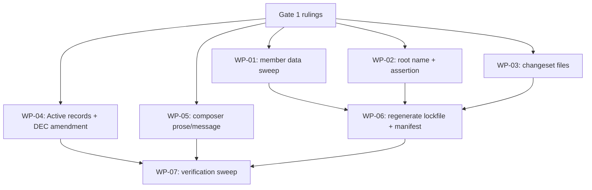

# PLAN-20261113-01: Rename the package family to `@backshopdev/roundhouse-*`

Last modified: 2026-11-13
Status: Ready

## Objective

Rename the 33-package npm family from `@backshop/roundhouse-*` to
`@backshopdev/roundhouse-*`, per the maintainer's 2026-11-13 ruling. The
trigger: the maintainer's npm identity is `backshopdev` (account + GitHub
org); the packages claim `@backshop` — a scope that does not exist on npm
and that the maintainer would have to create as a divergent second
identity. The ruling exercises the third reconsider trigger of
DEC-20261112-01 ("the npm org/scope situation changes"), which is amended
via its own trigger — a trigger-exercise note recording the fired trigger
and the new scope, not a silent rewrite.

The rename is **pre-first-release**: all 33 packages are at `0.0.0` and
nothing has ever been published — the members are already publishable
(the `private: true` flip was implemented by PLAN-20261112-01). npm
does not rename packages and a published scope is frozen permanently —
this is the only cheap moment. The rename changes names only; no
version semantics move.

This plan does not implement a specification scenario set; it is a
mechanical identity correction governed by acceptance criteria
(A1–A9 below), following the PLAN-20261021-04 precedent.

## Scope

### Included

- All 33 member `package.json` names and the CLI's hard-dep declaration.
- All member `roundhouse.json` `requires` entries.
- The three pending changeset files in `.changeset/` (names updated so
  `changeset version` still matches).
- The README Packaging section's name mentions.
- The root `package.json` name (ruled at Gate 1, 2026-11-13: unscoped
  `roundhouse-workspace`) and its one asserting test.
- The Active record set: DEC-20261112-01 (amended via trigger exercise),
  DEC-20261017-01..04, SPEC-20261019-01..03, `docs/decisions/index.md`,
  KTLO-20261112-01/-02.
- SPEC-20261019-01's normative root pins reconciled with the ruled root
  name (T-25: the workspace-root contract rows, the SCEN-046 scenario
  annotation, and the SCEN-046-citing `test-package.js` assertion stay
  aligned in this same changeset).
- The composer's violation-message example and doc comments in
  `packages/roundhouse-cli/lib/vocabulary.js` (no validation-logic
  change — see Current-state findings).
- Test fixtures that scan the real workspace: `composer.test.js` (all
  17 occurrences) and `composition-matrix.test.js` (all 7: 5 slash-form
  including the L102 template literal + the 2 bare scope-dir
  constructions), under the template-literal/scope-dir integration
  constraint (T-26..T-27).
- Regenerated artifacts: `package-lock.json`
  (`npm install --package-lock-only`, junction-safe per
  KTLO-20261112-02) and `.roundhouse/manifest.json` (via
  `npm run sync-roundhouse -- --mode sync`).

### Excluded

- **Archived history** (`docs/plans/archive/*`, `docs/specs/archive/*`):
  11 plan files and 1 spec file carry `@backshop/` mentions; all are
  Completed/Retired/Superseded (verified — see Current-state findings).
  Immutable; untouched.
- **The legacy deprecation execution** (DEC-20261112-01 ruling 7): the
  deprecated package is `@backshopdev/roundhouse` — its name is
  unaffected by this rename. Only the deprecation *message text* needs
  its target corrected (T-11, ruled home: the DEC amendment).
- **Version bumps / changeset-file creation for the rename itself**
  (ruled at Gate 1, 2026-11-13): nothing released exists to version.
- **Managed/seed file content**: no `.opencode/`-materialized content
  names the family (verified — `docs-check.js`, the workflow docs, and
  the skills carry zero `@backshop/` occurrences), so
  `check-drift`/`check-render` materialized content is byte-stable; only
  manifest *names* regenerate.
- **The `backshopdev-planning` skill ID and package directory names**:
  the taxonomy family token inside the package name survives the scope
  change unchanged (`@backshopdev/roundhouse-backshopdev-planning`).

## Related specifications and decisions

- DEC-20261112-01: The npm publishing model — amended by this work
  (third reconsider trigger fired; new scope `@backshopdev`).
- DEC-20261017-01: Composable package architecture (the 33-package
  decomposition being renamed).
- DEC-20261017-02: Package contract (dependency rules — generic
  name-family form, unaffected).
- DEC-20261017-03: Migration strategy (legacy softening; deprecation
  message target).
- DEC-20261017-04: Skill taxonomy (annotations/history; scope mentions
  in Active prose).
- SPEC-20261019-01: Phase 1 implementation spec (member tables,
  directory-naming rule, Gherkin).
- SPEC-20261019-02: Phase 3 composer spec (Composer definition,
  violation table, discovery scenario).
- SPEC-20261019-03: Phase 4 move spec (the 2026-10-19 naming resolution
  constraint — scope component updated; family-token structure
  unchanged).
- KTLO-20261112-02: Windows junction-traversal failure — the
  environment-safe paths for `npm install` (lockfile-only) and the
  matrix suite (console/CI venue).
- KTLO-20261112-01: changesets updateInternalDependencies observation
  (one scope mention).

## Current-state findings

### The contract question — resolved: the scope is NOT contract-encoded

`packages/roundhouse-cli/lib/vocabulary.js` validates package names
**generically**: `isValidPackageName` (lines 81–85) checks only
path-shape; `familyToken` (lines 96–100) derives the taxonomy family
token by stripping a leading `roundhouse-` from the **last** `/`-segment
— the scope is irrelevant (`@roundhouse-fixture/core` is a documented
valid example, line 19). No scope pattern, allowlist, or vocabulary
constant encodes `@backshop`. The SPEC-20261019-02 naming rules
(Public contracts, roundhouse.json vocabulary) likewise carry no pinned
scope — the spec's `@backshop` mentions are all name *examples*.

Therefore the rename is a **data sweep, not a contract change**. The
composer's only scope-dependent artifacts are prose:

- `vocabulary.js` line 128 — the rule-1 violation message's example
  string (`e.g. "@backshop/roundhouse-core"`). `composer.test.js`
  asserts this message with the regex `/must require the core package/`
  (line 797) — the example swap is test-safe.
- `vocabulary.js` lines 19, 92–93 — doc-comment examples.

### The classified `@backshop/` footprint

Class A — **contract-adjacent (composer prose/message):** 4 occurrences
in `vocabulary.js` (above). Zero occurrences in validation logic,
`discovery.js`, `model.js`, `graph.js`, or any `scripts/check-*.js`.

Class B — **data (tracked, must update):**

| Surface | File(s) | Occurrences |
| --- | --- | --- |
| Member names | 33 × `packages/roundhouse-*/package.json` | 34 (CLI name + its `@backshop/roundhouse-core` dep; 32 plain names) |
| Envelope requires | 31 × `packages/roundhouse-*/roundhouse.json` | 34 (`cms-apostrophe`, `framework-astro`, `framework-react` require core + `@backshop/roundhouse-lang-javascript`) |
| Composition record | `.roundhouse/manifest.json` | 34 (`composer` field + 33 `name` entries) — regenerated, not hand-edited |
| Lockfile | `package-lock.json` | 67 (33 `node_modules/@backshop/*` link entries + 33 workspace `name` fields + the CLI's dep) — regenerated |
| Pending changesets | `.changeset/wired-core-hard-dependency.md` | 3 |
| | `.changeset/fix-skill-frontmatter-identity.md` | 20 |
| | `.changeset/fix-canonical-lf-ingestion.md` | 1 |
| README | `README.md` | 7 (6 slash-form: L20 ×3, L37/40/43 + 1 bare scope at L34) |
| Root name | `package.json` (`"@backshopdev/roundhouse"` — the legacy package's exact name; ruled `roundhouse-workspace` at Gate 1, 2026-11-13) | 1 (not `@backshop/`, but included in the identity cleanup) |
| Root-name assertion | `scripts/test-package.js:57-58` | cites SCEN-046 and asserts the root name |
| Real-workspace test fixtures | `packages/roundhouse-cli/test/composer.test.js` | 17 (all forms: member names 570–600, the `/^@backshop\/roundhouse-[a-z0-9-]+$/` match helper 609, a scenario description 795) |
| | `packages/roundhouse-cli/test/composition-matrix.test.js` | 7 (5 slash-form incl. the L102 template literal + 2 bare `@backshop` scope-dir constructions at L109 and L344) |

Class C — **records (Active, must update):** DEC-20261112-01 (12),
DEC-20261017-01 (7), DEC-20261017-02 (8), DEC-20261017-03 (5),
DEC-20261017-04 (2), `docs/decisions/index.md` (3 — the DEC-20261017-01
and DEC-20261112-01 rows), SPEC-20261019-01
(38 — member tables, the "npm name minus the `@backshop/` scope"
directory rule 240–241, Gherkin 350–363), SPEC-20261019-02 (7 —
including L726 ×2), SPEC-20261019-03 (13 — the 2026-10-19
naming-resolution constraint at 115–119), KTLO-20261112-01 (1),
KTLO-20261112-02 (7 — 2 slash-form + 5 backslash-form; treatment per
T-23: the five backslash-form verbatim observed-error quotes are
preserved verbatim with a one-line annotation noting the 2026-11-13
scope rename — only the item's forward-looking guidance text updates).

Class D — **historical archives (untouched):** `docs/plans/archive/`
PLAN-20261018-01 (64), PLAN-20261019-01 (28), PLAN-20261019-02 (4),
PLAN-20261019-03 (5), PLAN-20261019-04 (3), PLAN-20261019-06 (1),
PLAN-20261021-01 (5), PLAN-20261021-04 (5), PLAN-20261023-01 (6),
PLAN-20261112-01 (19); `docs/specs/archive/` SPEC-20261017-01 (1).
Statuses verified: every archived plan is `Completed` (or
`Superseded`/`Archived` templates), the archived spec is `Retired` —
none Active, so no stale-governance risk from leaving them.

### The version-semantics question — resolved

No version bumps anywhere: the rename carries no changeset semantics
(ruled at Gate 1, 2026-11-13). The ruled 20/13 first-release split (PLAN-20261112-01
§2: CLI + 19 capability packages → 0.1.0 via the three pending
changeset files; Core + 12 capabilities → 0.0.0) survives unchanged —
same packages, new names. The three pending changeset files MUST adopt
the new names: `changeset version` and `changeset status` **hard-error**
on a changeset naming a package not in the workspace ("Found changeset
X for package Y which is not in the workspace") — the first release
blocks loudly, not silently, until the names match.

### The deprecation-message question — resolved

The maintainer-executed deprecation text lives only in the archived
PLAN-20261112-01 (§3, lines 660–664: "…moved to the @backshop package
family. Install the base with: npm install @backshop/roundhouse-cli…")
— immutable history. The live, corrected message is carried by the
DEC-20261112-01 amendment (ruled at Gate 1, 2026-11-13).

## Intended shape

A mechanical rename executed as one coherent changeset: names move
everywhere except immutable archives; the composer's validation logic
is untouched; regenerated artifacts (lockfile, manifest) are produced by
their own tools, never hand-edited.

## Work packages

### WP-01: The member data sweep

**Description:** Replace `@backshop/` with `@backshopdev/` in the 33
member `package.json` files (names + the CLI's hard dependency), the
31 `roundhouse.json` envelope `requires` entries, and the two
real-workspace test fixtures. Mechanical, byte-count-preserving except
for the one character.

**Tasks:**

- T-01: Update all 33 member `package.json` `name` fields to
  `@backshopdev/roundhouse-*` (Required).
- T-02: Update the CLI's `dependencies` entry to
  `"@backshopdev/roundhouse-core": "^0.0.0"` (Required).
- T-03: Update the 31 `roundhouse.json` `requires` entries
  (Required).
- T-26: `packages/roundhouse-cli/test/composer.test.js` — all 17
  occurrences, all forms (member names 570–600, the
  `/^@backshop\/roundhouse-[a-z0-9-]+$/` match helper at 609, the
  scenario description at 795) → `@backshopdev/*` (Required).
- T-27: `packages/roundhouse-cli/test/composition-matrix.test.js` —
  all 7 occurrences: the 5 slash-form (including the L102 template
  literal `@backshop/${memberDir}`) plus the 2 bare scope-dir
  constructions at L109 and L344 → `@backshopdev/*` /
  `"@backshopdev"`. Integration constraint: the template literal and
  the paired bare scope dirs must move together — the synthetic
  consumers junction packages into `node_modules/@backshopdev/`, so a
  literal/dirs mismatch stops the junction layout matching the
  declared names (Required).

**Dependencies:** None.

**Parallelism:** Can run in parallel with WP-02..WP-05.

### WP-02: The root name

**Description:** Rename the root `package.json` `name` from
`@backshopdev/roundhouse` (the legacy package's exact name — a visible
collision fossil now that the family lives in the same scope) to the
unscoped `roundhouse-workspace` (ruled at Gate 1, 2026-11-13), and
update its single asserting test.

**Tasks:**

- T-04: Root `package.json` `name` → `"roundhouse-workspace"`
  (Required — ruled at Gate 1, 2026-11-13).
- T-05: `scripts/test-package.js:58` assertion follows the new root
  name (Required).

**Dependencies:** None.

**Parallelism:** Independent.

### WP-03: The pending changeset files

**Description:** Update the three pending changeset files in
`.changeset/` so the renamed packages match them — a mismatching
changeset hard-errors `changeset version`/`changeset status` ("Found
changeset X for package Y which is not in the workspace"), blocking the
first release loudly. No new changeset file is created for the rename
(ruled at Gate 1, 2026-11-13).

**Tasks:**

- T-06: `wired-core-hard-dependency.md`: all 3 occurrences →
  `@backshopdev/*` (Required).
- T-07: `fix-skill-frontmatter-identity.md`: all 20 occurrences →
  `@backshopdev/*` (Required).
- T-08: `fix-canonical-lf-ingestion.md`: the 1 occurrence →
  `@backshopdev/*` (Required).

**Dependencies:** None.

**Parallelism:** Independent.

### WP-04: The Active records and the DEC amendment

**Description:** Sweep the Active record set's name mentions and amend
DEC-20261112-01 via its fired third reconsider trigger.

**Tasks:**

- T-09: DEC-20261112-01 amendment: append a trigger-exercise note
  (house pattern: a dated blockquote like the existing Resolution note)
  recording the fired trigger ("the npm org/scope situation changes"),
  the maintainer's finding (the `@backshop` org does not exist on npm;
  identity coherence with `backshopdev`), and the new scope
  `@backshopdev` (Required).
- T-10: DEC-20261112-01 in-place corrections across ALL sections:
  the Context intro (L12/L14 — the family names), the Decision drivers
  (L44 — public availability), Alternatives A (L66–67) and B (L99),
  Rationale, Consequences, Assumptions (`@backshop` org prerequisite →
  satisfied by identity, not org creation), the Follow-up inventory
  names, and the Related list; plus the fired trigger's own wording
  (L258) gains an "exercised → see amendment" pointer (Required).
- T-11: The corrected legacy-deprecation message lives in the
  amendment: `npm deprecate @backshopdev/roundhouse@*` with the message
  "Deprecated: Roundhouse has moved to the @backshopdev package family.
  Install the base with: npm install @backshopdev/roundhouse-cli — see
  the repository README for add-ons and composition." (Required —
  ruled at Gate 1, 2026-11-13: the DEC amendment is the message's home;
  the archived PLAN-20261112-01 text is immutable.)
- T-12: DEC-20261017-01..04 and `docs/decisions/index.md`: mechanical
  in-place name updates — all occurrences (Required; no per-file
  history notes — the DEC-20261112-01 amendment is the single
  explanation, ruled at Gate 1, 2026-11-13).
- T-13: SPEC-20261019-01 (all 38 occurrences), SPEC-20261019-02 (all
  7 — including L726 ×2), SPEC-20261019-03 (all 13, including the
  2026-10-19 naming-resolution constraint — the family-token structure
  `@backshopdev/roundhouse-backshopdev-<subject>` is preserved; only
  the scope component changes) (Required).
- T-14: KTLO-20261112-01 (the 1 occurrence) and KTLO-20261112-02 (all
  7: the 2 slash-form mentions update; the 5 backslash-form mentions
  are the verbatim observed-error quotes — preserved verbatim with a
  one-line annotation noting the 2026-11-13 scope rename; only the
  item's forward-looking guidance text updates) (Required).
- T-15: README Packaging section: all 7 occurrences — the family-form
  L20 ×3, the bare-scope L34, and the install commands L37/40/43 —
  plus the surrounding prose → `@backshopdev/*` (Required).
- T-25: Reconcile the root-name rename with SPEC-20261019-01's
  normative pins: L105 (the workspace-root contract "named
  `@backshopdev/roundhouse`"), L156 ("Stays; value unchanged"), L172
  (the example), L34 (the phase description's mention), and L336
  (SCEN-046's `Then name is "@backshopdev/roundhouse"` — annotate the
  scenario with the 2026-11-13 rename ruling: the root renamed to
  `roundhouse-workspace`). `scripts/test-package.js:57-58` cites
  SCEN-046 — the SPEC scenario and the assertion stay aligned in this
  same changeset. Folded-lean determination (verified 2026-11-13):
  DEC-20261017-01:11's `@backshopdev/roundhouse` (v0.6.0 at the time of
  this record) describes the **legacy npm package** ("currently ships
  as a single npm package"), whose name is unchanged — left as a
  then-true historical statement, no annotation (Required).

**Dependencies:** None.

**Parallelism:** Can run in parallel with WP-01..WP-03, WP-05.

### WP-05: The composer prose/message touch

**Description:** Update the composer's only scope-dependent prose — no
validation logic changes.

**Tasks:**

- T-16: `vocabulary.js:128` violation-message example →
  `e.g. "@backshopdev/roundhouse-core"` (Required).
- T-17: `vocabulary.js:19,92-93` doc-comment examples → `@backshopdev/*`
  (Required).

**Dependencies:** None.

**Parallelism:** Independent.

### WP-06: Regenerated artifacts

**Description:** Produce the regenerated data artifacts with their own
tools, after WP-01/02/03 land in the working tree.

**Tasks:**

- T-18: `npm install --package-lock-only` (junction-safe per
  KTLO-20261112-02; if the maintainer console is required, note the
  handoff) → lockfile's 33 link entries, workspace `name` fields, CLI
  dep, and root name regenerate (Required).
- T-19: `npm run sync-roundhouse -- --mode sync` →
  `.roundhouse/manifest.json`'s `composer` field and 33 `name` entries
  regenerate; `check-drift`/`check-render` confirm the materialized
  managed-file content is byte-stable (Required).

**Dependencies:** WP-01, WP-02, WP-03.

**Parallelism:** After WP-01..WP-03; independent of WP-04/05.

### WP-07: Verification

**Description:** Execute the approved check battery and the sweep
criterion.

**Tasks:**

- T-20: Composer suite (`node packages/roundhouse-cli/test/composer.test.js`),
  matrix suite (`check-matrix` — junction-blocked in-harness per
  KTLO-20261112-02; run from the maintainer console / CI venue and
  record the outcome), `test-sync`, `test-package`, `test-commit`
  (clean index) (Required).
- T-21: `check-contracts` and `check-deps` (33-member graphs with new
  names), `check-pack`, `check-render`, `check-drift`, `check-all`
  where junction-feasible (Required; matrix member of `check-all`
  noted as console/CI-venue per T-20).
- T-22: `docs-check` + markdownlint on every touched Markdown file
  (Required).
- T-23: Sweep criterion, scope-aware: `rg -n -P '@backshop(?!dev)'`
  over tracked non-archive files returns zero (archives exempt) —
  catching the bare, slash, and backslash forms in one pattern (or the
  documented two-pass equivalent: match `@backshop`, then exclude
  `@backshopdev` matches). KTLO-20261112-02 treatment: the five
  backslash-form verbatim observed-error quotes are preserved verbatim
  with a one-line annotation noting the 2026-11-13 scope rename; only
  forward-looking guidance text updates, so their residual matches are
  expected and dispositioned by the annotation, not swept. The plan
  document itself and its index row contain `@backshop/` strings
  describing the change; per the house pattern they archive in the
  implementation commit and are therefore archive-exempt from the
  sweep (Required).
- T-24: Confirm zero version bumps: all 33 packages remain `0.0.0`, no
  new `.changeset/` file exists, the three pending files' bump levels
  are unchanged (Required).

**Dependencies:** WP-06, WP-04, WP-05.

**Parallelism:** Last.

## Dependencies

- WP-06 depends on WP-01, WP-02, WP-03 (the sweep feeds regeneration).
- WP-07 depends on all prior WPs.
- WP-01..WP-05 are mutually parallel.

## Changeset granularity

One coherent commit (DEC-20261017-03's granularity): the rename is a
single atomic identity correction — a partial rename (data without
records, or records without data) leaves the window broken. **Ruled at
Gate 1 (2026-11-13): no changeset file is created for the rename
itself.** Nothing released exists to version; the rename carries no
version semantics; the three pending changeset files are name-updated —
the version-relevant vehicle — so the ruled 20/13 first-release split
survives unchanged.

## Change map

| File | Action | Purpose |
| --- | --- | --- |
| `packages/roundhouse-*/package.json` (33) | Modify | Member names + CLI hard dep → `@backshopdev/*` |
| `packages/roundhouse-*/roundhouse.json` (31) | Modify | `requires` entries → `@backshopdev/*` |
| `package.json` | Modify | Root name → `roundhouse-workspace` |
| `scripts/test-package.js` | Modify | Root-name assertion follows |
| `.changeset/*.md` (3) | Modify | Changeset package names → `@backshopdev/*` |
| `README.md` | Modify | Packaging names + install commands |
| `docs/decisions/DEC-20261112-01.md` | Modify | Trigger-exercise amendment + in-place corrections |
| `docs/decisions/DEC-20261017-01..04.md`, `index.md` | Modify | Mechanical name sweep |
| `docs/specs/SPEC-20261019-01..03.md` | Modify | Mechanical name sweep + SPEC-20261019-01 root-pin reconciliation (T-25) |
| `ktlo/KTLO-20261112-01.md`, `KTLO-20261112-02.md` | Modify | Family-form mentions |
| `packages/roundhouse-cli/lib/vocabulary.js` | Modify | Message example + doc comments |
| `packages/roundhouse-cli/test/composer.test.js` | Modify | All 17 occurrences (fixture names, match helper, scenario description) → `@backshopdev/*` |
| `packages/roundhouse-cli/test/composition-matrix.test.js` | Modify | All 7 occurrences (5 slash-form incl. the L102 template literal + the paired bare scope dirs L109/L344, moved together) |
| `package-lock.json` | Regenerate | Via `npm install --package-lock-only` |
| `.roundhouse/manifest.json` | Regenerate | Via `sync-roundhouse -- --mode sync` |
| `docs/plans/archive/*`, `docs/specs/archive/*` | Untouched | Immutable history (verified none Active) |

## Prescriptiveness levels

- **Required:** The rename itself (WP-01..WP-07 in full — all five
  Gate 1 arbitration points are ruled per their leans, so T-04, T-11,
  and the T-12 no-per-file-notes style are Required) and the
  zero-version-bump invariant.
- **Expected:** None — every Gate 1 arbitration point is ruled; no
  residual leans remain.
- **Discretion:** None — this plan is deliberately mechanical.

## Acceptance criteria and traceability

| Criterion | Work package | Task | Verification |
| --- | --- | --- | --- |
| A1: All 33 member names, envelopes, and the CLI dep use `@backshopdev/roundhouse-*` | WP-01 | T-01..T-03 | T-23 sweep; check-contracts/check-deps graphs resolve |
| A2: The three pending changeset files match the renamed packages | WP-03 | T-06..T-08 | T-23; a deliberate tripwire — `changeset status`/`version` errors on any unmatched name ("Found changeset X for package Y which is not in the workspace"), so the dry-run passing proves the match |
| A3: The Active record set carries the new scope, with DEC-20261112-01 amended by trigger exercise (not silently rewritten) | WP-04 | T-09..T-14 | T-23; docs-check; amendment note present |
| A4: The corrected deprecation message points at `@backshopdev/*` and lives in the DEC amendment | WP-04 | T-11 | Read-back of the amendment text |
| A5: The composer's validation logic is unchanged; only its message example/doc comments move | WP-05 | T-16..T-17 | Composer suite green; `git diff` shows no logic change |
| A6: Real-workspace test fixtures track the renamed data, with the matrix template literal and bare scope dirs moving together | WP-01/WP-07 | T-26..T-27, T-20 | Composer + matrix suites (matrix at its venue) |
| A7: Regenerated artifacts match the new names; materialized content byte-stable | WP-06 | T-18..T-19 | check-drift + check-render |
| A8: Zero scope-aware `@backshop(?!dev)` matches in tracked non-archive files; zero version bumps | WP-07 | T-23..T-24 | `rg -n -P '@backshop(?!dev)'` sweep; package version read-back |
| A9: SPEC-20261019-01's normative root pins and SCEN-046 are reconciled with the ruled root name; SCEN-046 and the `test-package.js:57-58` assertion stay aligned in the same changeset | WP-02/WP-04 | T-25, T-05 | test-package green; SCEN-046 annotation present |

## Documentation stubs

- [ ] Amend DEC-20261112-01 (T-09..T-11) — the trigger-exercise note is
  the rename's single historical explanation.
- [ ] No new implementation map — no new components; the existing maps'
  name mentions are swept by T-13 where applicable.

## Verification criteria

- [ ] All acceptance criteria A1–A9 verified (T-20..T-27).
- [ ] Composer suite green with the renamed fixtures.
- [ ] Matrix suite green at its venue (console/CI per
  KTLO-20261112-02), or the junction constraint recorded in the packet.
- [ ] `docs-check` passes on all touched Markdown.
- [ ] `check-drift` and `check-render` pass (byte-stable materialized
  content).
- [ ] Lockfile coherent (`npm install --package-lock-only` completed
  without error; root + 33 member names match the tree).
- [ ] Sweep criterion returns zero (T-23, the scope-aware
  `@backshop(?!dev)` pattern).
- [ ] No version bumps; no new changeset file (T-24).

## Readiness

**Score: 9/10 — Ready (Gate 1 approved 2026-11-13; the rulings are
recorded below).**

The load-bearing contract question is resolved with file+line evidence
(the scope is not validation-encoded — see Current-state findings), so
the rename's shape is a data sweep with one prose touch. The score's
one withheld point is the residual uncertainty the rulings cannot
retire in advance: the matrix suite's first post-rename run at its
junction-free venue (console/CI per KTLO-20261112-02) — in-harness
verification cannot execute it.

### Gate 1 rulings (2026-11-13)

Applied in this plan per the house pattern — all five arbitration
points accepted as proposed, each per its recorded lean:

- [x] No changeset file for the rename: pre-first-release, no version
  semantics; the three pending changeset files' name-updates are the
  version-relevant vehicle (T-06..T-08), and the ruled 20/13
  first-release split survives unchanged.
- [x] The root package name: unscoped `roundhouse-workspace` (T-04),
  with the `scripts/test-package.js:58` assertion update as Required
  work (T-05).
- [x] The DEC amendment mechanism: the trigger-exercise note (house
  pattern, not a silent rewrite) recording the fired trigger and the
  new scope (T-09), with the in-place name corrections (T-10).
- [x] The deprecation-message home: the DEC-20261112-01 amendment
  carries the corrected maintainer-executed text (T-11); the archived
  PLAN-20261112-01 text is immutable.
- [x] The fixture-sweep depth: real-workspace fixtures in
  `composer.test.js` and `composition-matrix.test.js` update; synthetic
  `@roundhouse-fixture/*` fixtures stay.

Blockers — all resolved:

1. The rename's changeset semantics: RESOLVED — no changeset file
   (2026-11-13).
2. The root package's name: RESOLVED — `roundhouse-workspace`
   (2026-11-13).
3. The DEC amendment mechanism: RESOLVED — the trigger-exercise note
   (2026-11-13).
4. The corrected deprecation message's home: RESOLVED — the
   DEC-20261112-01 amendment (2026-11-13).
5. The fixture-sweep depth: RESOLVED — real-workspace fixtures track
   the renamed data (2026-11-13).

Non-blocking: the amendment note's exact prose; the README's light
sweep phrasing; the lockfile's regeneration venue if the in-harness
`npm install --package-lock-only` path fails.

### The close (the established pattern)

The plan is Ready; the orchestrator proceeds to implementation under
the normal work/review gates. The rename lands in one commit per the
Changeset granularity section, with the full verification battery
recorded in the implementation packet.
