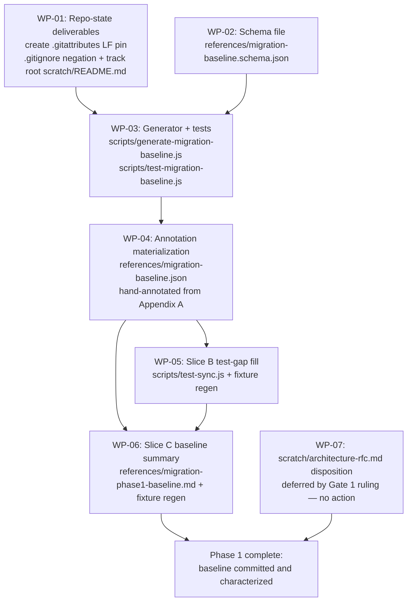

# PLAN-20261018-01: Phase 1 — freeze and characterize current behavior

Last modified: 2026-10-19
Status: Completed

## Objective

Implement Phase 1 of the Roundhouse migration (DEC-20261017-04): freeze and
characterize current behavior so every later phase detects drift against a
known baseline instead of an opaque "current state". The plan implements
SPEC-20261017-01 — the committed baseline fixture
`references/migration-baseline.json`, its Draft 2020-12 schema, the
deterministic generator `scripts/generate-migration-baseline.js`, and the
human-authored `intendedPhase5Owner` annotations — and executes the remaining
Phase 1 commitments: the Slice B test-gap fill in `scripts/test-sync.js`, the
Slice C baseline summary document, and the `scratch/architecture-rfc.md`
disposition (deletion deferred by Gate 1 ruling).

The plan artifact follows the full arc (draft → review → commit → push);
implementation is subsequent gated work.

## Scope

### Included

- Slice A (WP-01..WP-04): repo-state deliverables, schema file, generator
  with its test script, and the annotated committed fixture.
- Slice B (WP-05): symlink/junction and path-escape rejection tests, root
  seed-preservation tests, and the self-hosting verification test in
  `scripts/test-sync.js`.
- Slice C (WP-06): `references/migration-phase1-baseline.md`.
- Cleanup (WP-07): `scratch/architecture-rfc.md` disposition — deletion
  deferred by Gate 1 ruling; the file stays in place.
- Appendix A: the complete proposed `intendedPhase5Owner` mapping for every
  managed path — the Gate 1 review centerpiece.

### Excluded

- Phase 2+ work: workspace scaffolding, the composer, Core decoupling, the
  atomic cutover, publishing and CI (DEC-20261017-03 phase ordering).
- Changes to sync or deploy behavior: the fixture characterizes current
  behavior; it does not modify `scripts/sync-roundhouse.js` or
  `package/deploy-roundhouse.js` (SPEC-20261017-01, Excluded).
- New decision records: DEC-20261017-04 already records the durable Phase 1
  decisions (Core skill extraction, seed-from-start semantics); this plan
  amends nothing.
- An npm script alias for the new test script: considered and left out to
  keep the changeset minimal; tests run via `node scripts/...` directly.
  The human may add an alias at Gate 1.

## Related specifications and decisions

- `SPEC-20261017-01` — Phase 1 migration baseline fixture tooling; primary
  normative source. SCEN-026..045 are this plan's acceptance contracts.
- `DEC-20261017-01` — Parent decision: composable package architecture.
- `DEC-20261017-02` — Package contract: the nature-based skill taxonomy
  (amended 2026-10-18) from which `intendedPhase5Owner` values are mapped
  (Appendix A).
- `DEC-20261017-03` — Migration strategy: phase ordering; the
  `TODO: <rationale>` convention; the risks table containing the Slice B
  test-gap commitment.
- `DEC-20261017-04` — Phase 1 commitments: Slice A/B/C definitions; the
  `scratch/architecture-rfc.md` lifecycle follow-up.
- `DEC-20260906-01` — Byte-exact commit philosophy; precedent for the
  byte-level determinism requirements.

## Current-state findings

- **Managed surface (enumerated once via the allowlisted
  `git ls-files src/.opencode src/opencode.json`):** 59 tracked paths — 4
  agent definitions under `src/.opencode/agents/`, 1 harness tool
  (`src/.opencode/docs-check.js`), 48 skills under `src/.opencode/skills/`,
  5 autonomy workflow docs under `src/.opencode/workflow-docs/autonomy/`,
  and `src/opencode.json`. This enumeration is Appendix A's input.
- The planning brief expected "seed templates" in the managed surface; the
  enumeration shows none. Seed templates live under `src/` outside
  `src/.opencode/` and classify `seed`, which carries no
  `intendedPhase5Owner` annotation (SPEC-20261017-01, Fixture JSON format).
  Appendix A therefore covers exactly the 59 managed paths.
- **Slice B test-gap analysis (supplied from a prior investigation of
  `scripts/test-package.js`; used as-is):** `scripts/test-package.js`
  covers managed junction rejection; source-side junction rejection; nested
  destination junction rejection; unrelated consumer links ignored; managed
  type-conflict repair; dry-run non-mutation; seed preservation (init skips
  existing); managed root must be a directory; stale removal; and that init
  never deploys root LICENSE metadata. `package/deploy-roundhouse.js` has
  the `assertSafePath` primitive ("escapes consumer cwd"), but
  `scripts/test-package.js` has no explicit escape-named tests — direct
  escape coverage is unclear and possibly absent anywhere in the repo.
- DEC-20261017-03's risks table commits Phase 1 Slice B to adding "the
  missing symlink/junction and path-escape rejection tests to
  `scripts/test-sync.js`". Slice B ports/supplements the rejection tests
  into `scripts/test-sync.js` and closes the escape-coverage gap; this plan
  records the gap, implementation closes it.
- **Repo state relevant to WP-01 (verified):** `.gitattributes` does not
  exist and must be created; root `scratch/README.md` exists on disk and is
  untracked; `.gitignore` is tracked and carries the scratch ignore patterns
  with the `!src/scratch/README.md` negation only. CRLF normalization
  warnings were observed on a Windows checkout during the decision-record
  arc (SPEC-20261017-01, Constraints).
- **Repo state relevant to WP-07 (verified):** `scratch/architecture-rfc.md`
  exists on disk and is NOT tracked. The DEC's "deleted in a follow-up
  commit" language presumed a tracked file; deleting an untracked file
  produces no commit content, and empty commits are forbidden. The human
  resolved this at Gate 1 pre-review (2026-10-18) by deferring deletion:
  WP-07 is a disposition record with no commit; see Changeset granularity.
- `references/` exists; `references/migration-baseline.json`,
  `references/migration-baseline.schema.json`, and
  `references/migration-phase1-baseline.md` do not exist yet.
- `scripts/test-sync.js` and `scripts/test-package.js` exist and are
  tracked; the generator and its test script do not exist yet.

## Intended shape

After this plan, the repository carries a committed, byte-pinned baseline
fixture inventorying every tracked path in two scopes (`base: "src"` and
`base: "root"`), a Draft 2020-12 schema that is the machine-checkable
authority for the fixture format, a deterministic no-argument generator that
regenerates the fixture from the tree while carrying human annotations
forward verbatim, a test script asserting SCEN-026..045, an extended
`scripts/test-sync.js` with the Slice B safety and preservation coverage, a
baseline summary document, and `scratch/architecture-rfc.md` left in place
(deletion deferred by Gate 1 ruling). Sync and deploy behavior are
unchanged.

## Work packages

### WP-01: Repo-state deliverables (Slice A)

**Description:** Add the checkout-side byte pin and the root scratch README
tracking so byte-equality guarantees hold under any checkout configuration
and SCEN-030's post-deliverable state holds. No behavior change.

**Tasks:**

- T-01: Create `.gitattributes` with LF pin entries for the fixture and the
  schema, exactly as SPEC-20261017-01's Constraints example:
  `references/migration-baseline.json text eol=lf` and
  `references/migration-baseline.schema.json text eol=lf` (Required).
- T-02: Add `!scratch/README.md` to `.gitignore` after the existing scratch
  ignore patterns (`scratch/*`, `**/scratch/*` — gitignore is
  last-match-wins, so placement matters); leave every other pattern
  unchanged (Required).
- T-03: Track root `scratch/README.md` (`git add scratch/README.md`; content
  unchanged) so it becomes a tracked seed instance like root `AGENTS.md`
  (Required).
- T-04: Verify with `git check-attr text eol --` that both reference paths
  resolve the intended attributes, and that `git status` shows only the
  intended changes (Required).

**Dependencies:** None. Blocks WP-03 (byte-equality scenarios) and WP-04.

**Parallelism:** Can run in parallel with WP-02.

**Acceptance criteria:**

- `.gitattributes` exists with the two LF pin entries; `git check-attr`
  confirms `text` and `eol=lf` for both reference paths.
- `!scratch/README.md` present; all pre-existing ignore patterns unchanged;
  root `scratch/README.md` tracked with unchanged content.
- No other working-tree changes attributable to WP-01.

### WP-02: Schema file (Slice A)

**Description:** Author `references/migration-baseline.schema.json` as a
JSON Schema (Draft 2020-12) document encoding the fixture format from
SPEC-20261017-01's Schema file contract: top-level `schemaVersion` (integer,
currently `1`) and `entries` (array); per-entry `path`, `base`,
`classification`, `sha256`, `sizeBytes`; conditional requirements —
`base: "src"` with `classification: "managed"` requires
`intendedPhase5Owner`; `classification: "seed"` or
`"root-only-artifact"` forbids it; `base: "root"` requires
`classification: "root-only-artifact"`; enum, pattern (`sha256`: 64
lowercase hexadecimal characters), and numeric (`sizeBytes`: integer ≥ 0)
constraints per the field definitions. The schema layer owns
base/classification combination validity; path uniqueness and sort order
remain the generator's own checks (the spec assigns them there explicitly).

**Tasks:**

- T-05: Author the schema file with the conditional requirements above,
  UTF-8 without BOM, LF line endings, single trailing newline (Required).
- T-06: Smoke-validate the schema against a conforming sample entry and
  each SCEN-038 Examples row; full automated coverage lands in WP-03's test
  script (Expected).

**Dependencies:** None. Blocks WP-03.

**Parallelism:** Can run in parallel with WP-01.

**Acceptance criteria:**

- Schema is Draft 2020-12, valid JSON, LF-only, committed at the exact
  spec-mandated path.
- Every SCEN-038 Examples row evaluates to the scenario's `outcome` column
  when run through WP-03's test script.
- The schema does not attempt to express path uniqueness or sort order.

### WP-03: Generator and test script (Slice A)

**Description:** Implement the deterministic generator per
SPEC-20261017-01's Generator behavior contract, plus the test script that
asserts SCEN-026..045. Runtime: Node 24, built-in modules only
(`node:fs`, `node:path`, `node:crypto`, `node:child_process`); no new
dependencies.

**Tasks:**

- T-07: Implement `scripts/generate-migration-baseline.js`: strict no-args
  parsing (any argument → exit 2, usage text on stderr, nothing written,
  mirroring `scripts/sync-roundhouse.js`); tracked-path enumeration via
  `git ls-files`; classification detection rules (fixture file never
  inventoried; `src/.opencode/**` and `src/opencode.json` → managed; other
  tracked `src/` paths → seed; root paths with a `src/` counterpart → seed
  instance, not inventoried; root paths without one → root-only-artifact);
  `sha256`/`sizeBytes` from file content; tracked-symlink and
  tracked-but-absent rejection (exit 1, path on stderr, no write); existing
  fixture input validation (parse, schema, structure, misplaced annotation
  → exit 1, nothing written); annotation merge (carry forward verbatim;
  pending marker `TODO: pending human mapping (new path at generation time)`
  for new managed paths; stale annotations dropped loudly with exit 1 and
  stderr listing); canonical serialization (two-space indent, pinned member
  order, LF only, no BOM, single trailing newline); pre-write validation
  (schema + path uniqueness + sort order); write exactly one file; stderr
  reporting for every dropped annotation, untracked-path warning, and
  failure; exit codes 0/1/2 (Required).
- T-08: Implement `scripts/test-migration-baseline.js` (name Discretion,
  following the `test-sync.js`/`test-package.js` precedent) covering the
  `@unit` scenarios (SCEN-032, SCEN-034, SCEN-035, SCEN-038, SCEN-040,
  SCEN-042) and the `@integration` scenarios (SCEN-026..031, SCEN-033,
  SCEN-036, SCEN-037, SCEN-039, SCEN-041, SCEN-043..045). SCEN-033's
  validation-failure condition is exercised by injection (Discretion on
  mechanism: module-exported validators or a test-only seam). Integration
  scenarios that need controlled tree states (tracked symlink,
  tracked-but-absent path, stale annotation) must construct those states in
  temporary locations or scratch indexes and must never mutate the repo's
  own tracked content (Required).
- T-09: Run the test script; confirm all scenarios green and full
  generation completes within the 5-second quality attribute (Required).

**Dependencies:** WP-01 (byte pin makes byte-equality scenarios meaningful),
WP-02 (schema file is the validation authority). Blocks WP-04.

**Parallelism:** T-07 and T-08 can interleave; the test script needs the
generator's exported seams for the `@unit` scenarios.

**Acceptance criteria:**

- All SCEN-026..045 acceptance contracts pass (SCEN-038 co-owned with
  WP-02's schema).
- Zero silent mutations: every dropped annotation, untracked warning, and
  failure lists paths on stderr.
- No new dependencies; `package.json` dependencies unchanged; Node 24
  built-ins only.

### WP-04: Annotation materialization (Slice A)

**Description:** Produce the committed fixture with the approved ownership
mapping. The generator never synthesizes annotations, so the flow is:
generate with pending markers, hand-apply the human-approved mapping from
Appendix A, regenerate to confirm carry-forward, and obtain human review of
the generated fixture before the Slice A commit.

**Tasks:**

- T-10: Run the generator against the real tree; confirm exit 0 and that
  every managed entry carries the pending marker (Expected).
- T-11: Hand-edit the fixture replacing each pending marker with the
  approved `intendedPhase5Owner` from Appendix A as approved at Gate 1
  (including the four `TODO: <rationale>` values for the unresolved
  owners). This hand edit is the human-authored annotation act the spec
  requires (Required).
- T-12: Rerun the generator; confirm annotations carried forward verbatim
  and output is byte-stable across consecutive runs (SCEN-026, SCEN-034)
  (Required).
- T-13: Submit the generated and annotated fixture for human review; the
  Slice A commit lands only after sign-off (Required — human gate).

**Dependencies:** WP-01, WP-02, WP-03.

**Parallelism:** None — strictly after WP-03.

**Acceptance criteria:**

- Committed fixture: parses, schema-valid, paths sorted and unique, hashes
  and sizes match the tree, exactly one entry per managed path carrying the
  approved `intendedPhase5Owner`, zero generator pending markers (the four
  deliberate `TODO: <rationale>` owners from Appendix A are human-authored
  annotations, not pending markers), no annotation on seed or
  root-only-artifact entries, and the fixture file itself absent from its
  own entries.
- Byte properties: UTF-8 without BOM, LF-only, single trailing newline,
  two-space indent (SCEN-039, SCEN-040).
- Human review of the fixture recorded before the Slice A commit.

### WP-05: Slice B — test-gap fill

**Description:** Extend `scripts/test-sync.js` with the safety and
preservation coverage DEC-20261017-04 Slice B commits, closing the
escape-coverage gap recorded in Current-state findings. The existing
`scripts/test-package.js` primitives remain in place and are referenced
from the baseline summary document.

**Tasks:**

- T-14: Port/supplement symlink/junction rejection tests into
  `scripts/test-sync.js`, mirroring the `scripts/test-package.js` coverage:
  managed junction rejection; source-side junction rejection; nested
  destination junction rejection; unrelated consumer links ignored; managed
  type-conflict repair (Required).
- T-15: Add explicit path-escape rejection tests named for the escape
  contract (`assertSafePath` — "escapes consumer cwd"), closing the named
  coverage gap (Required).
- T-16: Add tests that existing root consumer-owned seed files —
  `AGENTS.md`, `AGENTIC_WORKFLOW.md`, `BUILDING.md`, `TESTING.md`,
  `CONTRIBUTING.md`, `scratch/README.md`, `ktlo/index.md`,
  `ktlo/template.md`, `docs/index.md` — are preserved untouched by sync
  (Required).
- T-17: Add the self-hosting verification test: run the current sync
  tooling against the Roundhouse repo's own root and assert exit 0 with no
  drift (Required).
- T-18: Regenerate the fixture in the same commit; annotations carry
  forward verbatim (SCEN-034) so the committed baseline matches the tree
  (Required).
- T-19: Run `scripts/test-sync.js`, `scripts/test-package.js`, and
  `scripts/test-migration-baseline.js`; all green (Required).

**Dependencies:** WP-04 (the fixture-regeneration task; the test authoring
itself is independent of Slice A).

**Parallelism:** Test authoring (T-14..T-17) could overlap Slice A in
principle; the commit follows the Slice A commit per the granularity table.

**Acceptance criteria:**

- The DEC-20261017-03 risks-table commitment is satisfied: symlink/junction
  and path-escape rejection tests exist in `scripts/test-sync.js`.
- The escape-coverage gap is closed: tests explicitly named for path escape
  exist and pass.
- Seed-preservation and self-hosting tests pass; no drift on the repo's own
  root.
- Existing suite behavior unchanged; fixture regenerated with zero
  annotation changes.

### WP-06: Slice C — baseline summary document

**Description:** Produce `references/migration-phase1-baseline.md`
summarizing the Phase 1 baseline per DEC-20261017-04 Slice C.

**Tasks:**

- T-20: Author the document covering all five DEC-required content areas:
  the captured `src/` inventory and managed/seed/root-only classification;
  which safety tests already existed (the `scripts/test-package.js`
  coverage list in Current-state findings) and which Phase 1 added (WP-05);
  which Phase 1 acceptance criteria are now provably satisfied; which
  DEC-20261017-03 risks remain unmitigated until later phases; and the
  seed-from-start byte-equality record — every repo-root path in the
  seed-from-start list byte-equal to its `src/` source at Phase 1 close,
  with any non-equality recorded as an intentional divergence and resolved
  before Phase 5 begins (Required).
- T-21: Regenerate the fixture in the same commit; the new document is a
  tracked root-only-artifact entry (Required).
- T-22: Run `node .opencode/docs-check.js` and
  `npx --yes markdownlint-cli2@0.23.2` against the new document (Required).

**Dependencies:** WP-04 (fixture exists to summarize), WP-05 (test
inventory: which tests existed vs added).

**Parallelism:** None.

**Acceptance criteria:**

- Document exists at the DEC-specified path and covers all five
  DEC-required content areas.
- Seed-from-start byte-equality verified for every list path present at
  root; divergences (if any) recorded with a resolution plan.
- Fixture regenerated; docs-check and markdownlint pass.

### WP-07: `scratch/architecture-rfc.md` disposition — deferred

**Description:** The human ruled at Gate 1 pre-review (2026-10-18) that
`scratch/architecture-rfc.md` stays in place; deletion is deferred to a
future decision. The DEC-20261017-04 lifecycle language ("deleted after
this record set is approved") stays satisfied in spirit: the disposition
is recorded, the file remains until a future ruling, and no Phase 1 work
touches it. Verified current state: the file exists on disk and is
untracked.

**Tasks:**

- T-23: Record the deferral ruling (this plan and the Changeset
  granularity note); take no action on the file (Required).
- T-24: Confirm `scratch/architecture-rfc.md` remains present and
  untracked, and that no Phase 1 changeset touches it (Required).

**Dependencies:** None.

**Parallelism:** Independent of WP-01..WP-06 (no work to perform).

**Acceptance criteria:**

- `scratch/architecture-rfc.md` remains present in the working tree,
  untracked and unchanged.
- No Phase 1 content touches the file; the deferral is recorded here and
  in the Changeset granularity note.

## Dependencies

- WP-01 and WP-02 are independent of each other; both block WP-03 (WP-01
  for the byte pin behind the byte-equality scenarios, WP-02 for the schema
  the generator validates against).
- WP-03 blocks WP-04; WP-04 blocks WP-05's regeneration task and WP-06.
- WP-05 blocks WP-06 (the baseline summary records which tests Phase 1
  added).
- WP-07 is independent; sequenced last.
- No external dependencies: Node 24 built-ins only, no new packages, and
  all touched tooling already exists in the repo.

## Changeset granularity

Proposed (human adjusts at Gate 1) — three commits:

| Commit | Work packages | Content |
| --- | --- | --- |
| 1 | WP-01..WP-04 (Slice A) | `.gitattributes`, `.gitignore` negation, tracked root `scratch/README.md`, schema, generator, test script, annotated fixture |
| 2 | WP-05 (Slice B) | `scripts/test-sync.js` gap fill + fixture regeneration |
| 3 | WP-06 (Slice C) | baseline summary document + fixture regeneration |

**Resolution note:** the approved brief described WP-07 as "own commit",
but verified current state shows `scratch/architecture-rfc.md` is
untracked — deleting it produces no commit content, and empty commits are
forbidden. The human resolved this at Gate 1 pre-review (2026-10-18) by
deferring the deletion: the file stays in place until a future decision,
WP-07 becomes a disposition record with no commit, and the changeset is
three commits. The DEC's "deleted in a follow-up commit" language stays
satisfied in spirit — the disposition is its own discrete, recorded step.

## Change map

| File | Action | Purpose |
| --- | --- | --- |
| `docs/plans/PLAN-20261018-01.md` | Create | This plan (plan-creation changeset) |
| `docs/plans/index.md` | Modify | Add this plan's row (plan-creation changeset) |
| `docs/decisions/DEC-20261017-02.md` | Modify | Restore `lang-csharp`, `lang-python`, `lang-go`, `lang-rust` as future members of the `lang-*` family (Gate 1 pre-ruling; plan-creation changeset) |
| `.gitattributes` | Create | LF pin for the fixture and the schema (WP-01, T-01) |
| `.gitignore` | Modify | Add `!scratch/README.md` negation; existing patterns unchanged (WP-01, T-02) |
| `scratch/README.md` | Track (git add) | Root copy becomes a tracked seed instance; content unchanged (WP-01, T-03) |
| `references/migration-baseline.schema.json` | Create | Draft 2020-12 schema; machine-checkable authority for the fixture format (WP-02, T-05) |
| `scripts/generate-migration-baseline.js` | Create | Deterministic generator per the Generator behavior contract (WP-03, T-07) |
| `scripts/test-migration-baseline.js` | Create | Test script asserting SCEN-026..045 (WP-03, T-08) |
| `references/migration-baseline.json` | Create, then modify | Generated and hand-annotated in WP-04; regenerated in WP-05 and WP-06 so the committed baseline matches the tree at each commit |
| `scripts/test-sync.js` | Modify | Slice B gap fill: symlink/junction rejection, path-escape rejection, seed preservation, self-hosting verification (WP-05, T-14..T-17) |
| `references/migration-phase1-baseline.md` | Create | Slice C baseline summary (WP-06, T-20) |
| `scratch/architecture-rfc.md` | No action (deferred) | Deletion deferred by Gate 1 ruling; file remains untracked and untouched (WP-07, T-23) |

## Prescriptiveness levels

- **WP-01 — Required:** the spec's Constraints mandate the exact
  deliverables (the pin entries and the negation); no deviation without
  plan amendment.
- **WP-02 — Required:** the schema is the machine-checkable authority;
  Draft 2020-12 and the conditional requirements are fixed by the spec.
- **WP-03 — Required** for the behavior contract (exit codes, detection
  rules, merge semantics, canonical serialization, stderr reporting);
  **Expected** for internal code structure; **Discretion** for the test
  script's name and internal harness style and for the SCEN-033 injection
  mechanism.
- **WP-04 — Required** for the mapping values as approved at Gate 1
  (annotations are human-authored; Appendix A is the proposal until
  approved) and for the zero-pending-marker end state; **Expected** for the
  generate → annotate → regenerate mechanics.
- **WP-05 — Required** for the four coverage areas (DEC-20261017-04 Slice
  B and the DEC-20261017-03 risks-table commitment); **Expected** for test
  structure and style within the existing suite's conventions.
- **WP-06 — Required** for content coverage of the five DEC-required areas
  and the byte-equality record; **Expected** for document structure.
- **WP-07 — Required:** record the deferral; no action on the file; no
  other content touched.

## Scenario traceability matrix

Every SPEC-20261017-01 scenario maps to the work package and task that
implements it. Slice B (WP-05) and Slice C (WP-06) trace directly to
DEC-20261017-04 — the spec explicitly excludes them, so no SCEN IDs exist
for that work; their acceptance lives in the per-WP criteria above. Note
the ordering dependency the brief calls out: the byte-equality scenarios
(SCEN-026, SCEN-039) require WP-01's `.gitattributes` pin to exist first.

| Scenario | Work package | Task | Test location |
| --- | --- | --- | --- |
| SCEN-026 | WP-01, WP-03, WP-04 | T-01, T-08, T-12 | `scripts/test-migration-baseline.js` |
| SCEN-027 | WP-03 | T-08 | `scripts/test-migration-baseline.js` |
| SCEN-028 | WP-03 | T-08 | `scripts/test-migration-baseline.js` |
| SCEN-029 | WP-03 | T-08 | `scripts/test-migration-baseline.js` |
| SCEN-030 | WP-01, WP-03 | T-02, T-08 | `scripts/test-migration-baseline.js` |
| SCEN-031 | WP-03 | T-08 | `scripts/test-migration-baseline.js` |
| SCEN-032 | WP-03 | T-08 | `scripts/test-migration-baseline.js` |
| SCEN-033 | WP-03 | T-08 | `scripts/test-migration-baseline.js` |
| SCEN-034 | WP-03 | T-08 | `scripts/test-migration-baseline.js` |
| SCEN-035 | WP-03 | T-08 | `scripts/test-migration-baseline.js` |
| SCEN-036 | WP-03 | T-08 | `scripts/test-migration-baseline.js` |
| SCEN-037 | WP-03 | T-08 | `scripts/test-migration-baseline.js` |
| SCEN-038 | WP-02, WP-03 | T-05, T-08 | `references/migration-baseline.schema.json` + `scripts/test-migration-baseline.js` |
| SCEN-039 | WP-01, WP-03 | T-01, T-08 | `scripts/test-migration-baseline.js` |
| SCEN-040 | WP-03 | T-08 | `scripts/test-migration-baseline.js` |
| SCEN-041 | WP-03 | T-08 | `scripts/test-migration-baseline.js` |
| SCEN-042 | WP-03 | T-08 | `scripts/test-migration-baseline.js` |
| SCEN-043 | WP-03 | T-08 | `scripts/test-migration-baseline.js` |
| SCEN-044 | WP-03 | T-08 | `scripts/test-migration-baseline.js` |
| SCEN-045 | WP-03 | T-08 | `scripts/test-migration-baseline.js` |

## Documentation stubs

- [x] Create `references/migration-phase1-baseline.md` (WP-06, T-20) — the
  Slice C deliverable itself, not a stub to defer.
- [ ] No new decision records: DEC-20261017-04 already records the durable
  Phase 1 decisions; this plan amends nothing.
- [ ] No implementation map in Phase 1: target-state architecture
  documentation follows later phases.
- [x] Update this plan's `docs/plans/index.md` row status as the plan
  advances (Draft → Ready → In progress → Completed).

## Verification criteria

- [ ] All SCEN-026..045 pass via `scripts/test-migration-baseline.js`.
- [ ] `scripts/test-sync.js` and `scripts/test-package.js` pass with the
  WP-05 additions; no pre-existing test regresses.
- [ ] The self-hosting sync verification exits 0 with no drift.
- [ ] The committed fixture is byte-identical on regeneration and matches
  tree hashes and sizes at each Phase 1 commit.
- [ ] Zero `TODO: pending human mapping` markers in the committed fixture;
  exactly four deliberate `TODO: <rationale>` annotations (Appendix A's
  unresolved owners), each human-approved at Gate 1 and resolved to a
  documented owner before Phase 5 begins (DEC-20261017-03's risks table).
- [ ] `node .opencode/docs-check.js` passes.
- [ ] `npx --yes markdownlint-cli2@0.23.2` passes on every touched Markdown
  file.
- [ ] No new dependencies; Node 24 built-ins only.
- [ ] The commit sequence matches the Changeset granularity table (or the
  human-adjusted equivalent).

## Readiness

**Score: 8/10 — Draft, pending Gate 1 review.**

The 2026-10-18 taxonomy amendment (DEC-20261017-02, the committed mapping
authority) resolved the original appendix's four flagged proposals:
`typescript` folds into `@backshop/roundhouse-lang-javascript`;
`security-privacy` splits into the `software-security` and
`software-privacy` packages (recorded as a `TODO: <rationale>` owner);
`literature-note` maps to `@backshop/roundhouse-docs-literature-note`;
and `src/opencode.json` maps to `@backshop/roundhouse-cli` as the
composed-artifact owner.

Blockers (all resolved by Gate 1 approval):

1. Human review of the reworked Appendix A mapping — including the four
   `TODO: <rationale>` owners (security-privacy, gherkin-testability,
   image-media-delivery, planning-structure); the within-package-split
   direct-annotation categorization is already human-confirmed at Gate 1
   pre-review (2026-10-18).
2. The three-commit granularity requires human confirmation (the WP-07
   deferral ruling already resolves the untracked-file question).
3. WP-04's fixture review is an inherent human gate before the Slice A
   commit.

Non-blocking: test-script naming (Discretion); npm alias deliberately out
of scope; SCEN-033 injection mechanism (Discretion).

## Appendix A: Proposed intendedPhase5Owner mapping

Gate 1 centerpiece. Every managed path (the 59 paths enumerated by
`git ls-files src/.opencode src/opencode.json`) mapped to its proposed
`intendedPhase5Owner` under the nature-based taxonomy amended into
`DEC-20261017-02` on 2026-10-18 — the committed authority for this
mapping. Grouping follows the taxonomy's families; ownership follows the
package-grouping lean below. The implementer transcribes these values by
hand in WP-04 (T-11); the generator never synthesizes them.

**TODO count: 4.** The original appendix's zero-TODO target is superseded
by the taxonomy amendment: four paths are genuinely unresolvable as a
single owner value (a cross-package split, a cross-family split, a
retirement, and a deferred npm naming) and carry `TODO: <rationale>`
values per DEC-20261017-03's convention (Unresolved owners below).

### Mapping principle

- **Nature-based classification.** Skills classify by nature, not topic
  (DEC-20261017-02, Design principles): a software engineering practice
  is `software-*`; a documentation practice is `docs-*`; a data format
  is `format-*`; an interaction convention is `protocol-*`. Ownership is
  declared per package in `roundhouse.json` (strict uniqueness), never
  inferred from name prefixes.
- **Package-grouping lean.** Packages align with family-subject heads: a
  package named for the subject holds that subject's skills
  (`@backshop/roundhouse-software-testability` holds
  `software-testability` + `software-testability-legacy-enablement`;
  `@backshop/roundhouse-docs-general` holds `docs-general` and its
  specializations). The lean is adjustable at authoring time by cohesion;
  the contract enforces only uniqueness.
- **Annotation categorization.** A within-package split — the current
  skill becomes a base + specialization pair inside one package under the
  lean — is annotated with the target package directly; the owner is
  unambiguous. A cross-package split, a retirement, or a deferred npm
  naming is genuinely unresolvable as a single owner value and is
  recorded as `TODO: <rationale>` per DEC-20261017-03's convention. Each
  TODO must resolve to a documented owner before Phase 5 begins
  (DEC-20261017-03's risks table).

The annotation categorization was human-confirmed at Gate 1 pre-review
(2026-10-18).

### Non-skill paths (11)

Core-owned machinery — the four agent definitions, the autonomy workflow
docs, and the docs-check tool (`@backshop/roundhouse-core`):

| Managed path | Proposed intendedPhase5Owner |
| --- | --- |
| `src/.opencode/agents/document-author.md` | `@backshop/roundhouse-core` |
| `src/.opencode/agents/implementor.md` | `@backshop/roundhouse-core` |
| `src/.opencode/agents/orchestrator.md` | `@backshop/roundhouse-core` |
| `src/.opencode/agents/reviewer.md` | `@backshop/roundhouse-core` |
| `src/.opencode/workflow-docs/autonomy/authority-types.md` | `@backshop/roundhouse-core` |
| `src/.opencode/workflow-docs/autonomy/escalation-protocol.md` | `@backshop/roundhouse-core` |
| `src/.opencode/workflow-docs/autonomy/index.md` | `@backshop/roundhouse-core` |
| `src/.opencode/workflow-docs/autonomy/principles.md` | `@backshop/roundhouse-core` |
| `src/.opencode/workflow-docs/autonomy/session-lifetime.md` | `@backshop/roundhouse-core` |
| `src/.opencode/docs-check.js` | `@backshop/roundhouse-core` |

Composed artifact (`@backshop/roundhouse-cli`):

| Managed path | Proposed intendedPhase5Owner |
| --- | --- |
| `src/opencode.json` | `@backshop/roundhouse-cli` |

After Phase 5, `opencode.json` is a composed artifact ("Owned by:
Roundhouse CLI" in DEC-20261017-02's artifact-class table), rendered by
the composer from the installed capability model rather than owned as a
single package's managed file; the CLI is therefore the owner annotation
for the path.

### Core machinery skills (13)

Current names unchanged; Core skills carry no family prefix
(DEC-20261017-02, Families):

| Managed path | Proposed intendedPhase5Owner |
| --- | --- |
| `src/.opencode/skills/architectural-coherence/SKILL.md` | `@backshop/roundhouse-core` |
| `src/.opencode/skills/behavioral-completeness/SKILL.md` | `@backshop/roundhouse-core` |
| `src/.opencode/skills/commit-convention/SKILL.md` | `@backshop/roundhouse-core` |
| `src/.opencode/skills/contract-completeness/SKILL.md` | `@backshop/roundhouse-core` |
| `src/.opencode/skills/decision-quality/SKILL.md` | `@backshop/roundhouse-core` |
| `src/.opencode/skills/docs-check/SKILL.md` | `@backshop/roundhouse-core` |
| `src/.opencode/skills/git-commit/SKILL.md` | `@backshop/roundhouse-core` |
| `src/.opencode/skills/harness/SKILL.md` | `@backshop/roundhouse-core` |
| `src/.opencode/skills/investigation/SKILL.md` | `@backshop/roundhouse-core` |
| `src/.opencode/skills/opencode-configuration/SKILL.md` | `@backshop/roundhouse-core` |
| `src/.opencode/skills/peer/SKILL.md` | `@backshop/roundhouse-core` |
| `src/.opencode/skills/review-findings/SKILL.md` | `@backshop/roundhouse-core` |
| `src/.opencode/skills/security/SKILL.md` | `@backshop/roundhouse-core` |

### Skills by family (31 direct-owner rows)

**`lang-*` (3).**

| Managed path | Proposed intendedPhase5Owner | Note |
| --- | --- | --- |
| `src/.opencode/skills/javascript/SKILL.md` | `@backshop/roundhouse-lang-javascript` | folds into `lang-javascript` |
| `src/.opencode/skills/typescript/SKILL.md` | `@backshop/roundhouse-lang-javascript` | folds into `lang-javascript` |
| `src/.opencode/skills/css-sass/SKILL.md` | `@backshop/roundhouse-lang-css` | within-package split: becomes `lang-css` + `lang-css-sass` |

**`framework-*` (2).**

| Managed path | Proposed intendedPhase5Owner | Note |
| --- | --- | --- |
| `src/.opencode/skills/astro/SKILL.md` | `@backshop/roundhouse-framework-astro` | becomes `framework-astro` |
| `src/.opencode/skills/react/SKILL.md` | `@backshop/roundhouse-framework-react` | becomes `framework-react` |

**`cms-*` (1).**

| Managed path | Proposed intendedPhase5Owner | Note |
| --- | --- | --- |
| `src/.opencode/skills/apostrophe-cms/SKILL.md` | `@backshop/roundhouse-cms-apostrophe` | becomes `cms-apostrophe` |

**`software-*` (10).**

| Managed path | Proposed intendedPhase5Owner | Note |
| --- | --- | --- |
| `src/.opencode/skills/design-for-testability/SKILL.md` | `@backshop/roundhouse-software-testability` | becomes `software-testability` |
| `src/.opencode/skills/test-enablement/SKILL.md` | `@backshop/roundhouse-software-testability` | within-package split: becomes `software-testability-legacy-enablement` |
| `src/.opencode/skills/accessibility/SKILL.md` | `@backshop/roundhouse-software-accessibility` | within-package split: becomes `software-accessibility` + `software-accessibility-web` |
| `src/.opencode/skills/web-performance/SKILL.md` | `@backshop/roundhouse-software-performance` | within-package split: becomes `software-performance` + `software-performance-web` |
| `src/.opencode/skills/seo-structured-data/SKILL.md` | `@backshop/roundhouse-software-discoverability` | within-package split: becomes `software-discoverability-seo` (+ future `software-discoverability-ldjson`) |
| `src/.opencode/skills/contract-design/SKILL.md` | `@backshop/roundhouse-software-contracts` | becomes `software-contracts` |
| `src/.opencode/skills/api-compatibility/SKILL.md` | `@backshop/roundhouse-software-compatibility` | becomes `software-compatibility` |
| `src/.opencode/skills/quality-attributes/SKILL.md` | `@backshop/roundhouse-software-quality` | becomes `software-quality` |
| `src/.opencode/skills/software-architecture/SKILL.md` | `@backshop/roundhouse-software-architecture` | name unchanged |
| `src/.opencode/skills/software-design/SKILL.md` | `@backshop/roundhouse-software-design` | name unchanged |

**`docs-*` (12).**

| Managed path | Proposed intendedPhase5Owner | Note |
| --- | --- | --- |
| `src/.opencode/skills/specification/SKILL.md` | `@backshop/roundhouse-docs-spec` | becomes `docs-spec` |
| `src/.opencode/skills/decision-record/SKILL.md` | `@backshop/roundhouse-docs-decision-record` | becomes `docs-decision-record` |
| `src/.opencode/skills/implementation-plan/SKILL.md` | `@backshop/roundhouse-docs-implementation-plan` | becomes `docs-implementation-plan` |
| `src/.opencode/skills/architecture-document/SKILL.md` | `@backshop/roundhouse-docs-architecture` | becomes `docs-architecture` |
| `src/.opencode/skills/implementation-map/SKILL.md` | `@backshop/roundhouse-docs-implementation-map` | becomes `docs-implementation-map` |
| `src/.opencode/skills/literature-note/SKILL.md` | `@backshop/roundhouse-docs-literature-note` | becomes `docs-literature-note` |
| `src/.opencode/skills/docs-publish/SKILL.md` | `@backshop/roundhouse-docs-publish` | becomes `docs-publish` |
| `src/.opencode/skills/repository-accuracy/SKILL.md` | `@backshop/roundhouse-docs-general` | becomes `docs-general-accuracy` |
| `src/.opencode/skills/requirements-traceability/SKILL.md` | `@backshop/roundhouse-docs-general` | becomes `docs-general-traceability` |
| `src/.opencode/skills/repository-documentation/SKILL.md` | `@backshop/roundhouse-docs-general` | folds into `docs-general` (repo-artifact-system conventions) |
| `src/.opencode/skills/contract-guide/SKILL.md` | `@backshop/roundhouse-docs-software-contracts` | folds into `docs-software-contracts` with `contract-publication` |
| `src/.opencode/skills/contract-publication/SKILL.md` | `@backshop/roundhouse-docs-software-contracts` | folds into `docs-software-contracts` with `contract-guide` |

**`format-*` (2).**

| Managed path | Proposed intendedPhase5Owner | Note |
| --- | --- | --- |
| `src/.opencode/skills/semantic-html/SKILL.md` | `@backshop/roundhouse-format-html` | within-package split: becomes `format-html-semantic` (implies the new `format-html` base) |
| `src/.opencode/skills/json-schema/SKILL.md` | `@backshop/roundhouse-format-json-schema` | becomes `format-json-schema` |

**`protocol-*` (1).**

| Managed path | Proposed intendedPhase5Owner | Note |
| --- | --- | --- |
| `src/.opencode/skills/openapi/SKILL.md` | `@backshop/roundhouse-protocol-openapi` | becomes `protocol-openapi` |

### Unresolved owners — `TODO: <rationale>` (4)

Genuinely unresolvable as a single owner value (cross-package split,
cross-family split, retirement, deferred npm naming); recorded per
DEC-20261017-03's `TODO: <rationale>` convention. Each must resolve to a
documented owner before Phase 5 begins.

| Managed path | Proposed intendedPhase5Owner |
| --- | --- |
| `src/.opencode/skills/security-privacy/SKILL.md` | `TODO: splits into software-security (@backshop/roundhouse-software-security) and software-privacy (@backshop/roundhouse-software-privacy)` |
| `src/.opencode/skills/gherkin-testability/SKILL.md` | `TODO: splits into lang-gherkin (@backshop/roundhouse-lang-gherkin) and software-testing-gherkin (@backshop/roundhouse-software-testing; the specialization shape was blessed at Gate 1 pre-review on 2026-10-18; adding it to DEC-20261017-02's software-* family entry is a recorded follow-up)` |
| `src/.opencode/skills/image-media-delivery/SKILL.md` | `TODO: retired at Phase 5; content distributes into future format-* image skills and software-performance-web` |
| `src/.opencode/skills/planning-structure/SKILL.md` | `TODO: becomes backshopdev-planning in the backshopdev-* family; owning package npm naming deferred (per DEC-20261017-02's explicit deferral)` |

### New skills have no current managed paths

Skills to be authored at Phase 5 or later — `format-markdown`,
`format-json`, `format-html`, `docs-general`, `socratic-interview`,
`backshopdev-testing`, `software-unit-testing`, and the other new and
future-headroom members named in DEC-20261017-02 — have no current
managed paths and appear nowhere above. They enter the fixture via the
generator's pending-marker mechanism when they first appear, per
SPEC-20261017-01's annotation-merge rules. `docs-workflow-backshopdev`
is an example name per the DEC-20261017-02 ruling (illustrative of the
workflow-kind-bearer and org-suffix rules), not a committed managed
path; this appendix deliberately does not map it.

### Deliberate absences

- Seed templates (tracked `src/` paths outside `src/.opencode/` and
  `src/opencode.json`) are absent: they classify `seed`, which carries no
  `intendedPhase5Owner` annotation.
- Root seed instances and root-only artifacts are absent for the same
  reason.
- Future and reserved family members as named in DEC-20261017-02
  (`tool-vite`; `cms-strapi`, `cms-sitecore`, `cms-sanity`;
  `lang-csharp`, `lang-python`, `lang-go`, `lang-rust`;
  `lang-javascript-jest`, `lang-csharp-nunit`; `software-unit-testing`,
  `software-security-redteam`; `software-discoverability-ldjson`;
  `docs-general-readability`; `protocol-rest`; the reserved `domain-*`
  family) have no current skills to map and no current managed paths.
