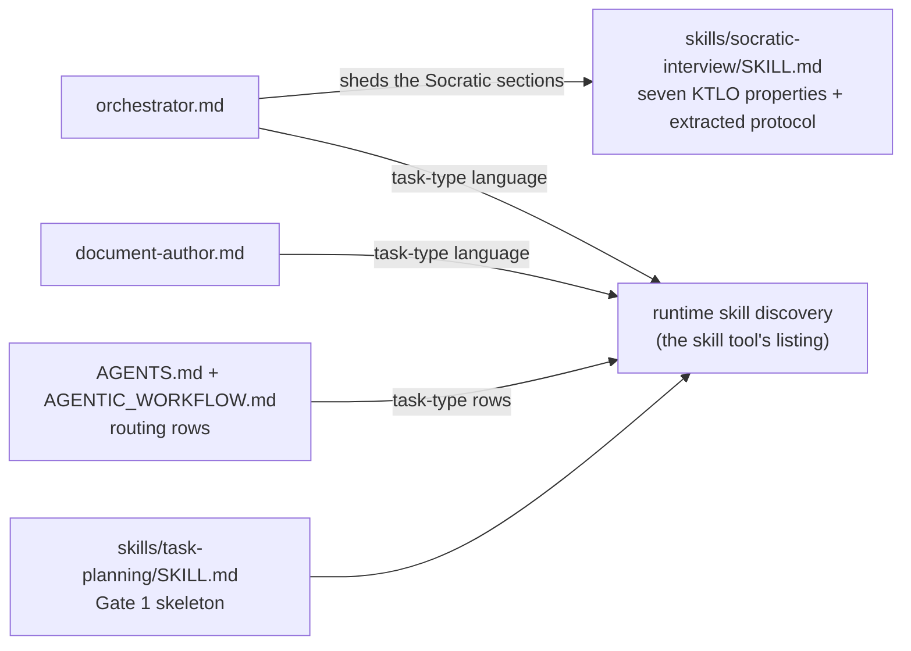

# PLAN-20261019-03: Phase 4 — Core decoupling and skill extraction

Last modified: 2026-10-19
Status: Completed

## Objective

Implement Phase 4 of the Roundhouse migration (DEC-20261017-03): refactor the
Core agent prompts and workflow documents to stop hard-coding optional
extension skill names, extract the Socratic-interview behavior into a new Core
`socratic-interview` skill, and add a Core `task-planning` skill covering the
lightweight Gate 1 plan — so Core remains useful with no extension packages
installed and the Phase 5 atomic cutover lands on package-safe Core. The plan
implements the human co-ruled architecture from the Socratic interview; Phase 4
has no specification — its acceptance lives in the per-WP criteria and the
verification criteria below, per the PLAN-20261018-01 precedent for slices
without scenario contracts.

The plan artifact follows the full arc (draft → review → commit → push);
implementation is subsequent gated work.

## Scope

### Included

- WP-01: the `socratic-interview` skill — the orchestrator prompt's
  Socratic-protocol sections plus the seven style properties from
  KTLO-20261018-01 (its normative Description), authored at
  `src/.opencode/skills/socratic-interview/SKILL.md`; the KTLO item reviewed
  against the skill and closed.
- WP-02: the `task-planning` skill — the lightweight Gate 1 planning skeleton
  (objective; work packages with acceptance criteria; verification criteria;
  the human sign-off gate) as the Core default when no fuller planning
  workflow is installed, at `src/.opencode/skills/task-planning/SKILL.md`.
- WP-03: the agent-prompt decoupling — orchestrator.md and document-author.md
  shed their optional-skill references for task-type descriptions with
  runtime skill discovery (ruled shape (a)); Core-skill references stay
  nameable.
- WP-04: the routing-table decoupling — the `src/AGENTS.md` and
  `src/AGENTIC_WORKFLOW.md` rows naming optional skills become task-type rows
  with discovery guidance.
- WP-05: fixture regeneration and deployment — the hash changes enter the
  fixture, the two new managed entries are annotated `@backshop/roundhouse-core`
  at the gate flow, the DR-03 grep runs with its result recorded, and the
  ruled sync deferral is observed (no root deployment; deployment lands with
  Phase 5/6).

### Excluded

- `src/opencode.json`: Phase 5 template territory (ruled). Consequence,
  stated plainly: between Phase 4 and Phase 5, prompt references to the two
  new skills are gated by the current static skill allowlists, which do not
  list them; the references activate at Phase 5's uniform skill maps. The
  Core skill names are nevertheless correct — Core skills are nameable, and
  the composed maps will allow them.
- Skill renames, splits, and folds: Phase 5 territory — Phase 4 edits
  references, never skill names or skill content other than the two new
  skills.
- The root `AGENTS.md` and `root AGENTIC_WORKFLOW.md` content: consumer-owned
  seed instances; no workflow edits them (the ruled deferral means no sync
  runs; Mode 2 would skip existing files regardless).
- The detailed agent-prompt rewrite of what remains: Phase 4 decouples
  references only; broader prompt rework is not in scope.
- New decision records: the leans below were resolved at the Gate 1 approval
  (2026-10-19, recorded in Readiness).

## Related decisions and inputs

- `DEC-20261017-03` — Migration strategy: the Phase 4 definition (refactor the
  four agent prompts and Core `AGENTS.md` / `AGENTIC_WORKFLOW.md` to stop
  hard-coding optional extension skill names; extract `socratic-interview`;
  add `task-planning`; Core must remain useful with no extension packages),
  the Phase 4/5 changeset separation, and the risk-table grep whose result
  this plan records.
- `DEC-20261017-02` — Package contract: the agent-stability rule ("Core agent
  definitions must reason from assigned / discoverable installed skills and
  must not hard-code optional package names") and the Core-skill list the two
  new skills join.
- `DEC-20261017-04` — Phase 1 commitments: the original `socratic-interview`
  extraction commitment the KTLO item tracks.
- `KTLO-20261018-01` — The seven interview style properties: the normative
  content of the `socratic-interview` skill; its Procedure defines the
  review-and-close flow WP-01 executes.
- `PLAN-20261019-02` — House plan style precedent (per-WP tasks, change map,
  prescriptiveness levels, verification criteria, readiness, Gate 1
  centerpiece appendix).

## Current-state findings

- **The grep-grounded scope (verified — the union of the DR-03 pattern, the
  ruling's manual site enumeration, and the extension's full optional-name
  list, over the four scoped file sets):** every optional-skill reference in
  Core content lives at the twelve sites below — the ruled decision's line
  citations are confirmed, plus three additional grep-grounded sites the
  cited ranges and pattern did not name (`AGENTIC_WORKFLOW.md:39` — ruled in
  scope at Gate 1; `AGENTIC_WORKFLOW.md:171` and
  `escalation-protocol.md:69` — surfaced by the 2026-10-19 review's full-name
  census and ordered into scope at triage):
  - `src/.opencode/agents/orchestrator.md:129` — `planning-structure` (the
    Plan + Gate 1 step).
  - `src/.opencode/agents/document-author.md:71` — `literature-note`;
    `:74` — `planning-structure` (the skill-routing paragraph).
  - `src/AGENTS.md:57-59` — the `planning-structure`, `design-for-testability`,
    and `test-enablement` routing rows.
  - `src/AGENTIC_WORKFLOW.md:39` — `literature-note` in the review-session
    prose example; `:169` — `repository-documentation` row; `:171` —
    `docs-publish` row; `:173` — `planning-structure` row; `:178` —
    `literature-note` row.
  - `src/.opencode/workflow-docs/autonomy/escalation-protocol.md:69` —
    `repository-documentation` in the index-discipline parenthetical (the
    autonomy docs are managed content inside the DR-03 grep scope).
- **The DR-03 grep is necessary but insufficient (verified):** its pattern
  (`react|specification|literature-note|planning-structure|task-planning|socratic-interview|@backshop/`)
  misses `design-for-testability`, `test-enablement`, `repository-documentation`,
  and `docs-publish`, all of which the scope contains. WP-05's acceptance
  check therefore runs the DR-03 pattern as pinned AND an extension whose
  term set is the full list of non-Core skill names — all 35 current skills
  outside DEC-20261017-02's Core list — so no optional name can be missed:

  ```text
  grep -nE 'accessibility|api-compatibility|apostrophe-cms|architecture-document|astro|contract-design|contract-guide|contract-publication|css-sass|decision-record|design-for-testability|docs-publish|gherkin-testability|image-media-delivery|implementation-map|implementation-plan|javascript|json-schema|literature-note|openapi|planning-structure|quality-attributes|react|repository-accuracy|repository-documentation|requirements-traceability|security-privacy|semantic-html|seo-structured-data|software-architecture|software-design|specification|test-enablement|typescript|web-performance' src/.opencode/agents/*.md src/AGENTS.md src/AGENTIC_WORKFLOW.md src/.opencode/workflow-docs/autonomy/*.md
  ```

  Triage expectations over this pattern: the `react` hits in
  `session-lifetime.md` ("reactivates"/"reactivated") and the `specification`
  hit at `AGENTIC_WORKFLOW.md:120` (the common noun) are prose collisions;
  every other pre-Phase-4 hit is a site in Appendix A.
- **Prose collisions are pre-existing and permanent (verified):** the DR-03
  pattern hits `src/.opencode/workflow-docs/autonomy/session-lifetime.md:41,44,253`
  (`react` matching "reactivates"/"reactivated" — core workflow vocabulary)
  and `src/AGENTIC_WORKFLOW.md:120` (`specification` as the common noun).
  Neither is a skill reference; neither file is edited. The acceptance
  criteria triage hits accordingly — DR-03's "any hit blocks Phase 5" is
  applied to skill-reference hits, with prose collisions documented.
- **The untouched agents (verified):** `implementor.md` and `reviewer.md`
  carry zero optional-skill references. `implementor.md:48`'s "Accessibility"
  is a domain principle in the Standing Quality Posture, not a skill
  reference — no edit. The Phase 4 definition names all four agent prompts;
  the grep shows only two require edits.
- **The extraction sources (verified):** the orchestrator's Socratic
  Interview Protocol is lines 37-72 (Opening; the one-question-at-a-time Core
  Questions pool; Synthesis; the opinion-probe stance) — a self-contained
  section. The adjacent Question-vs-Command Protocol (lines 74-86) is gate
  discipline, not interview style, and stays. The orchestrator's other skill
  references (`investigation`, `review-findings`, `commit-convention`) are
  Core and stay.
- **The KTLO item (verified):** KTLO-20261018-01 is `Active`; its seven
  Description properties are the skill's normative content; its Procedure
  steps 3-4 (review against the list, record, close) execute in WP-01. House
  closure mechanics: the item's Status flips to `Resolved`, the
  `ktlo/index.md` line gains a "Resolved: …" summary (the KTLO-20261009-02
  precedent), and the History table gains a row.
- **The skill layout (verified):** `src/.opencode/skills/<name>/SKILL.md` is
  the convention (48 skills today); the house format is YAML frontmatter
  (`name`, `description`) plus an H1 and prose sections (the `investigation`
  skill precedent). The two new skills bring the count to 50.
- **Fixture classification of the touched files (verified):** the two agent
  prompts are managed entries (annotations carry forward verbatim);
  `src/AGENTS.md` and `src/AGENTIC_WORKFLOW.md` are seed entries; the two new
  skill files are new managed entries — the generator assigns the pending
  marker, hand-annotated to `@backshop/roundhouse-core` at the gate flow per
  the established pattern. At Phase 4 execution the most recent regeneration
  will be Phase 3's close (PLAN-20261019-02's WP-06); this plan's
  regeneration then absorbs its own delta plus any drift accumulated by
  then, re-verified at execution.
- **The sync/deploy state (verified):** the root harness copies are deployed
  state — `root .opencode/**` is Mode 1 and gitignored (a sync would
  overwrite the deployed prompts and add the two skills as untracked-ignored
  files, never in any commit or fixture), while root `AGENTS.md` /
  `AGENTIC_WORKFLOW.md` are Mode 2 consumer-owned seeds a sync never
  updates. KTLO-20260829-03 tracks src/root drift generally. The sync
  deferral is ruled (2026-10-19): Phase 4 does not deploy; deployment lands
  with Phase 5/6 (T-10).

## Intended shape

After this plan, Core content describes task types and points at skills by
discovery or Core name: the orchestrator's interview behavior lives in the
`socratic-interview` skill (encoding the seven endorsed properties), planning
decomposition defaults to the `task-planning` skill, the two edited prompts
and both routing tables name no optional skill, and the fixture reflects the
changeset-close tree with the two new managed entries annotated Core.



## Work packages

### WP-01: The `socratic-interview` skill

**Description:** Author the Core skill at
`src/.opencode/skills/socratic-interview/SKILL.md` in the house format,
encoding the seven KTLO-20261018-01 style properties as normative skill text
and absorbing the orchestrator prompt's extracted Socratic material; then
execute the KTLO item's review-and-close procedure.

**Tasks:**

- T-01: Author the skill. Content: frontmatter (`name: socratic-interview`;
  a use-when description covering elicitation interviews — planning, spec,
  and decision interviews); the seven style properties as normative sections
  (free-form conversational Q&A; no question-tool option menus for
  elicitation — reserve the `question` tool for discrete gate decisions;
  one question at a time; reflective playback between turns; the interviewer
  contributes and withdraws; concrete-instance probes; let the human's
  principles do the work); the extracted orchestrator material (the opening
  pattern, the candidate question pool, the synthesis close, the
  opinion-probe stance) (Required).
- T-02: Review the skill against KTLO-20261018-01's seven-property list;
  record the review in the item's History table; flip the item's Status to
  `Resolved`; update the `ktlo/index.md` line with a "Resolved: …" summary
  (the item's Procedure steps 3-4 and the KTLO-20261009-02 index precedent)
  (Required).

**Dependencies:** None. Blocks WP-03 (the orchestrator's pointer assumes the
skill exists).

**Parallelism:** Can run in parallel with WP-02.

**Acceptance criteria:**

- The skill exists at the pinned path in the house format and encodes all
  seven properties; the KTLO review passes and is recorded in the item.
- Every guidance element of the extracted orchestrator section survives in
  the skill (the question pool, the one-at-a-time rule, the playback
  requirement, the opinion-probe stance) — extraction loses nothing.
- The KTLO item is `Resolved` with the index line and History row updated.

### WP-02: The `task-planning` skill

**Description:** Author the Core skill at
`src/.opencode/skills/task-planning/SKILL.md`: the lightweight Gate 1
planning skeleton that is the default when no fuller planning workflow is
installed — deliberately distinct from the org's full planning methodology
arriving in Phase 5.

**Tasks:**

- T-03: Author the skill. Content: frontmatter (`name: task-planning`; a
  use-when description for decomposing an approved objective into a
  lightweight plan); the skeleton — the objective statement, work packages
  with acceptance criteria, verification criteria, and the human sign-off
  gate before implementation; the discovery note — when the skill listing
  reveals a fuller installed planning skill, that skill takes precedence and
  this one stands down; the scope discipline — the skeleton is lightweight by
  design, not a reduced version of a fuller methodology (Required).

**Dependencies:** None. Blocks WP-04 (the routing rows name it as the Core
default).

**Parallelism:** Can run in parallel with WP-01.

**Acceptance criteria:**

- The skill exists at the pinned path in the house format and covers the four
  ruled skeleton elements plus the human sign-off gate.
- The default-when-no-fuller-workflow posture and the Phase 5 distinctness
  are explicit in the skill text.

### WP-03: The agent-prompt decoupling

**Description:** Decouple the two agent prompts that carry optional-skill
references, replacing each with task-type descriptions and runtime discovery
guidance (ruled shape (a)); Core-skill references remain nameable.

**Tasks:**

- T-04: `orchestrator.md` — shed the Socratic Interview Protocol section
  (lines 37-72), replacing it with a pointer in the Review-Findings pattern
  ("Load the `socratic-interview` skill and follow it for human-interview
  elicitations."); decouple the Plan + Gate 1 step's "(use planning-structure)"
  into task-type language naming the Core default (Appendix A, site 2). The
  Question-vs-Command Protocol and all Core-skill references stay (Required).
- T-05: `document-author.md` — decouple the skill-routing paragraph (lines
  70-74): the `harness` and `opencode-configuration` sentences stay; the
  `literature-note` clause and the `planning-structure` mention become
  task-type language with discovery guidance; `commit-convention` stays
  nameable (Appendix A, site 3) (Required).

**Dependencies:** WP-01 (the orchestrator's pointer), WP-02 (the default the
language names).

**Parallelism:** T-04 and T-05 proceed together once both skills exist.

**Acceptance criteria:**

- No optional-skill name remains in either prompt; every removed reference is
  replaced by task-type language with discovery guidance or a Core-skill
  pointer (the Appendix A treatments).
- The prompts' non-reference content (autonomy sections, gates, packets) is
  byte-preserved except at the treated sites.

### WP-04: The routing-table decoupling

**Description:** Decouple the routing tables' optional-skill rows into
task-type rows with discovery guidance, and decouple the workflow document's
prose example and the autonomy document's skill-name parenthetical.

**Tasks:**

- T-06: `src/AGENTS.md` — rows 57-59 become task-type rows: the planning row
  names the Core default (`task-planning`) with discovery guidance; the two
  testability rows become task-type rows (merged into one testability row or
  kept as two — implementation discretion within the task-type-row
  requirement, per the Gate 1 resolution; Appendix A, sites 4-6) (Required).
- T-07: `src/AGENTIC_WORKFLOW.md` — rows 169, 171, 173, 178 become task-type
  rows with discovery guidance (the planning row names the Core default); the
  line-39 prose example drops `literature-note`, keeping the Core examples;
  and `src/.opencode/workflow-docs/autonomy/escalation-protocol.md` — the
  index-discipline parenthetical's skill name becomes task-type/discovery
  language (Appendix A, sites 7-10 and 12) (Required).

**Dependencies:** WP-02 (the Core default the planning rows name).

**Parallelism:** T-06 and T-07 proceed together.

**Acceptance criteria:**

- No optional-skill name remains in either routing table, the line-39 prose,
  or the escalation-protocol parenthetical; each treated row preserves its
  "When"/"Purpose" guidance and gains discovery guidance in the "Load"
  column.
- Core-skill rows in both tables are untouched.

### WP-05: Fixture regeneration, grep verification, and deployment

**Description:** Regenerate the fixture (hash changes + two new annotated
managed entries), run the DR-03 grep and its extension with recorded results,
run the regression suites, and observe the ruled sync deferral.

**Tasks:**

- T-08: Track the two new skill files (`git add`), run the generator, and
  confirm the expected delta: updated hash/size entries for the two managed
  prompts (annotations verbatim) and the two seed docs; new managed entries
  for the two skill files carrying the pending marker (Required).
- T-09: Hand-annotate the two pending markers to `@backshop/roundhouse-core`
  in the fixture; confirm a post-annotation regeneration is byte-identical
  (the merge carries the annotations forward) (Required).
- T-10: Observe the ruled sync deferral (2026-10-19): do not run
  `sync-roundhouse` in this changeset — deployment lands with Phase 5/6 (the
  Phase 5 cutover replaces the deployed root wholesale; Phase 6 replaces the
  sync tooling). Root `AGENTS.md` / `AGENTIC_WORKFLOW.md` are consumer-owned
  seeds a sync never updates; root `.opencode/` is gitignored, so deployed
  files would be untracked-ignored state — never in any commit and never in
  the fixture. The src/root drift this deferral leaves is tracked by the
  existing KTLO item (Required as the decision's observance; no execution).
- T-11: Run the DR-03 grep as pinned and the extension pattern (the full
  35-name non-Core list, pinned in Current-state findings) over the four
  scoped file sets; record both results in this plan's verification criteria;
  triage every hit as eliminated, Core-skill reference, prose collision, or a
  newly surfaced grep-grounded site (escalate for orchestrator ruling)
  (Required).
- T-12: Run `scripts/test-sync.js`, `scripts/test-package.js`,
  `scripts/test-commit.js`, and `scripts/test-migration-baseline.js`; all
  green — the fixture assertions (byte-equality, tree match) hold against the
  regenerated and annotated fixture (Required).

**Dependencies:** WP-01..WP-04 (the content must be in its changeset-close
state); T-12 strictly after T-09.

**Parallelism:** None — strictly last.

**Acceptance criteria:**

- The regenerated fixture equals the tree at changeset close; consecutive
  runs are byte-identical; all managed annotations carried verbatim; the two
  new entries annotated Core.
- Both grep results are recorded with the triage; no optional-skill-reference
  hit remains in the scoped Core content.
- All four suites are green; `src/opencode.json` is untouched.

## Dependencies

- WP-01 and WP-02 are independent; both block WP-03/WP-04 (the pointers and
  defaults they enable).
- WP-03 and WP-04 are independent of each other; both block WP-05.
- WP-05 depends on everything (the changeset-close tree).
- No external dependencies: Node 24 built-ins only; all touched tooling
  exists.

## Changeset granularity

One commit (ruled), matching DEC-20261017-03's granularity list item "Core
decoupling + Socratic skill extraction (Phase 4)":

| Commit | Work packages | Content |
| --- | --- | --- |
| 1 | WP-01..WP-05 | The two new skills, the decoupled prompts, routing tables, and autonomy-doc parenthetical, the closed KTLO item, the regenerated and annotated fixture, and the recorded grep results |

The plan-creation changeset (this plan + its index row) precedes the
implementation changeset and is separate. The lockfile stays out of the
commit (untracked, human-ruled).

## Change map

| File | Action | Purpose |
| --- | --- | --- |
| `docs/plans/PLAN-20261019-03.md` | Create | This plan (plan-creation changeset) |
| `docs/plans/index.md` | Modify | Add this plan's row (plan-creation changeset) |
| `src/.opencode/skills/socratic-interview/SKILL.md` | Create | The interview-style skill (WP-01, T-01) |
| `src/.opencode/skills/task-planning/SKILL.md` | Create | The Gate 1 skeleton skill (WP-02, T-03) |
| `src/.opencode/agents/orchestrator.md` | Modify | Socratic sections shed; pointer + task-type language (WP-03, T-04) |
| `src/.opencode/agents/document-author.md` | Modify | Skill-routing paragraph decoupled (WP-03, T-05) |
| `src/AGENTS.md` | Modify | Rows 57-59 decoupled (WP-04, T-06) |
| `src/AGENTIC_WORKFLOW.md` | Modify | Rows 169/171/173/178 + line 39 decoupled (WP-04, T-07) |
| `src/.opencode/workflow-docs/autonomy/escalation-protocol.md` | Modify | The index-discipline parenthetical decoupled (WP-04, T-07) |
| `ktlo/KTLO-20261018-01.md` | Modify | Status `Resolved`; review recorded in History (WP-01, T-02) |
| `ktlo/index.md` | Modify | The item's line gains the Resolved summary (WP-01, T-02) |
| `references/migration-baseline.json` | Modify | Regenerated + annotated at changeset close (WP-05, T-08/T-09) |

No `src/opencode.json` changes; no root changes of any kind (the ruled sync
deferral — root `.opencode/` is gitignored deployed state, and root
`AGENTS.md`/`AGENTIC_WORKFLOW.md` are consumer-owned); no skill renames.

## Prescriptiveness levels

- **WP-01 — Required** for the skill's path, format, the seven properties as
  normative content, and the KTLO review-and-close flow; **Expected** for the
  prose phrasing of the properties and how much of the orchestrator's
  extracted material is quoted verbatim versus rephrased.
- **WP-02 — Required** for the path, the four skeleton elements, and the
  sign-off gate; **Expected** for the surrounding prose and the discovery
  note's wording.
- **WP-03 — Required** for the treated sites (Appendix A), the
  Core-references-stay rule, and the zero-optional-references outcome;
  **Expected** for the replacement wording patterns (the appendix's
  decoupled forms are proposals).
- **WP-04 — Required** for the treated rows and the zero-optional-references
  outcome; **Expected** for the replacement wording and the merge-or-keep
  choice for the two testability rows (implementation discretion per the
  Gate 1 resolution).
- **WP-05 — Required** for the regeneration, the hand-annotation flow, the
  grep recording, the suite-green end state, and observing the ruled sync
  deferral (no execution); **Expected** for the drift-absorption bookkeeping.

## Acceptance criteria and traceability

Phase 4 has no specification and no scenario IDs; acceptance lives in the
per-WP criteria above, the verification criteria below, and the DR-03 grep
record — per the PLAN-20261018-01 precedent for slices without scenario
contracts. The traceability map is the Appendix A decoupling map: every
grep-grounded site maps to its owning work package and task, and the
out-of-scope dispositions are recorded with their rationale.

## Documentation stubs

- [x] Create this plan + its `docs/plans/index.md` row (the plan-creation
  changeset).
- [x] Close KTLO-20261018-01 in the implementation changeset (WP-01, T-02) —
  the item's own Procedure defines the closure.
- [ ] No new decision records: the leans were resolved at the Gate 1
  approval; if implementation elevates one (for example, the sync deferral or
  the extended grep) to durable policy, a DR follows.
- [x] Update this plan's `docs/plans/index.md` row status as the plan
  advances (Draft → Ready → In progress → Completed).

## Verification criteria

- [ ] The two skills exist at the pinned paths in the house format; the
  `socratic-interview` skill encodes all seven KTLO properties and the
  extracted protocol material with no content loss.
- [ ] KTLO-20261018-01 is `Resolved`: the review is recorded in its History,
  the item's Status is updated, and the `ktlo/index.md` line carries the
  Resolved summary.
- [ ] Zero optional-skill references remain in the four Core content files;
  every Appendix A site is treated per its row; Core-skill references and
  non-reference content are otherwise unchanged.
- [ ] The DR-03 grep runs as pinned and its result is recorded here:
  `<recorded at implementation close>`.
- [ ] The extension grep — the full 35-name non-Core skill list, pinned in
  Current-state findings — runs and its result is recorded here:
  `<recorded at implementation close>`.
- [ ] Every grep hit is triaged: eliminated by this changeset, a Core-skill
  reference, a documented prose collision (`reactivates` in
  session-lifetime.md; `specification` as a common noun), or a newly surfaced
  grep-grounded site escalated for orchestrator ruling. A remaining
  skill-reference hit blocks Phase 5 per DR-03.
- [ ] The regenerated fixture is byte-stable, carries all managed annotations
  verbatim, and annotates the two new entries `@backshop/roundhouse-core`.
- [ ] `scripts/test-sync.js`, `scripts/test-package.js`,
  `scripts/test-commit.js`, and `scripts/test-migration-baseline.js` are all
  green; no pre-existing test regresses. Recorded at implementation close:
  test-sync 117 passed / 4 failed: the 4 failures are Test 28's self-hosting
  verify assertions, the observable consequence of the Gate-1-ruled sync
  deferral (T-10: the src changes are undeployed at the root; the drift is
  real and KTLO-20260829-03-tracked; deployment lands Phase 5/6). Not
  regressions. test-commit 33/34: the single failure is the pre-existing
  `npm-mode-a long-body-with-footers` shell-transport defect tracked as
  KTLO-20261019-01 — not a changeset regression.
- [ ] `src/opencode.json` is byte-identical before and after.
- [ ] The changeset is exactly one commit; the lockfile appears nowhere in it.
- [ ] `node .opencode/docs-check.js` passes.
- [ ] `npx --yes markdownlint-cli2@0.23.2` passes on every touched Markdown
  file.

## Readiness

**Score: 8/10 — Ready (Gate 1 approved 2026-10-19; the rulings and the review
triage are recorded below).**

The scope is grep-grounded and verified against the live tree; the extraction
sources and the KTLO closure mechanics are pinned; the fixture consequences
are mapped; the decoupling map is complete against the full optional-name
census.

### Gate 1 rulings (2026-10-19)

Applied in this plan per the SPEC-20261019-01 resolution style:

- [x] Site 7 (`AGENTIC_WORKFLOW.md:39`) is in scope — confirmed; embodied in
  Appendix A.
- [x] The extended acceptance grep is confirmed — and strengthened by the
  2026-10-19 review triage to the full 35-name non-Core list (Current-state
  findings' pattern block).
- [x] The skill-reference triage reading of DR-03's "any hit blocks Phase 5"
  is confirmed — prose collisions documented; skill-reference hits block.
- [x] The sync is DEFERRED to Phase 5/6 — T-10 observes the deferral; no
  deployment in this changeset.

The 2026-10-19 review triage additionally ordered two census-surfaced sites
into scope (Appendix A sites 11-12) with mechanical remedies.

Blockers — all resolved:

1. Appendix A's replacement-language patterns: approved as proposed, with
   sites 11-12 added at review triage and the merge-or-keep choice for the
   two testability rows left to implementation discretion within the
   task-type-row requirement.
2. The skill-content shape (verbatim vs rephrased balance): approved as
   proposed (Expected within WP-01).
3. The sync decision: RESOLVED — deferred to Phase 5/6 (T-10).
4. The one-commit granularity: confirmed.
5. The extended-grep acceptance check: confirmed and strengthened to the
   full 35-name list.

Non-blocking: the fixture-drift absorption bookkeeping (pinned in
Current-state findings, re-verified at execution); the expected
`package-lock.json` generator warning; the interim allowlist state (ruled
Phase 5 territory, noted in Scope).

## Appendix A: The decoupling map (Gate 1 centerpiece)

Every grep-grounded optional-skill reference in scoped Core content, with its
treatment. Line numbers are the verified pre-edit positions.

| # | Site | Current form | Treatment | WP/Task |
| --- | --- | --- | --- | --- |
| 1 | `orchestrator.md:37-72` | The Socratic Interview Protocol section (Opening; one-at-a-time Core Questions pool; Synthesis; opinion-probe stance) | Extracted whole into the `socratic-interview` skill; the section is replaced by a pointer: load the skill and follow it for human-interview elicitations | WP-01/T-01, WP-03/T-04 |
| 2 | `orchestrator.md:128-129` | "elicit intent (Socratic), draft the plan (use planning-structure)" | "elicit intent (load `socratic-interview`), draft the plan (discover the installed planning skill via the skill listing; Core default `task-planning`)" | WP-03/T-04 |
| 3 | `document-author.md:70-74` | The routing paragraph naming `harness`, `literature-note`, `opencode-configuration`, then "Load `planning-structure` or `commit-convention` only when their process is needed" | `harness`/`opencode-configuration`/`commit-convention` stay (Core); the `literature-note` clause and `planning-structure` mention become task-type language with discovery guidance — for example: "discover the installed skills matching the artifact types your task touches (source notes, planning structure, documentation practice) via the skill listing" | WP-03/T-05 |
| 4 | `AGENTS.md:57` | "Decomposing work into a plan / `planning-structure` skill" | Task-type row: "the installed planning skill (discover via the skill listing; Core default `task-planning`)"; the Purpose cell keeps its guidance | WP-04/T-06 |
| 5 | `AGENTS.md:58` | "Working with testability, constructor injection, or characterization tests / `design-for-testability` skill" | Task-type row with discovery guidance; merge with site 6 or keep separate — implementation discretion within the task-type-row requirement (the Gate 1 resolution) | WP-04/T-06 |
| 6 | `AGENTS.md:59` | "Enabling tests on legacy code where current structure blocks normal testing / `test-enablement` skill" | Task-type row with discovery guidance; merge with site 5 or keep separate — implementation discretion within the task-type-row requirement (the Gate 1 resolution) | WP-04/T-06 |
| 7 | `AGENTIC_WORKFLOW.md:39` | "…at least one relevant domain skill (for example, `harness`, `literature-note`, or `opencode-configuration`)" | Drop `literature-note` from the example list (Core examples remain); the surrounding discovery guidance already covers task-type selection | WP-04/T-07 |
| 8 | `AGENTIC_WORKFLOW.md:169` | "…or contracts / `repository-documentation` skill" | Task-type row with discovery guidance | WP-04/T-07 |
| 9 | `AGENTIC_WORKFLOW.md:173` | "Decomposing work into a plan / `planning-structure` skill" | Task-type row naming the Core default (`task-planning`), matching site 4 | WP-04/T-07 |
| 10 | `AGENTIC_WORKFLOW.md:178` | "Authoring or reviewing literature notes / `literature-note` skill" | Task-type row with discovery guidance | WP-04/T-07 |
| 11 | `AGENTIC_WORKFLOW.md:171` | "Publishing documentation to external surfaces / `docs-publish` skill" | Task-type row with discovery guidance — "the installed documentation-publishing skill (discover via the skill listing)"; the Purpose cell keeps its guidance; `docs-publish` is optional per DEC-20261017-02 (a `docs-*` family skill, absent from the Core list); ordered into scope at the 2026-10-19 review triage | WP-04/T-07 |
| 12 | `escalation-protocol.md:69` | "per index discipline rules (GP02, repository-documentation skill)" | The parenthetical's skill name becomes task-type/discovery language — "(GP02; the installed documentation-practice skill)"; the autonomy docs are managed content inside the DR-03 grep scope; ordered into scope at the 2026-10-19 review triage | WP-04/T-07 |

Out-of-scope dispositions (verified, no edit):

- `implementor.md:48` — "Accessibility" is a Standing Quality Posture domain
  principle, not a skill reference.
- `implementor.md` and `reviewer.md` generally — zero grep hits; no edits.
- `AGENTIC_WORKFLOW.md:120` — `specification` is the common noun ("approved
  plan or specification"), not the skill.
- `session-lifetime.md:41,44,253` — `react` matches "reactivates"/
  "reactivated", core workflow vocabulary, not the framework or a skill.
- `src/opencode.json` — Phase 5 template territory (ruled).

Replacement-language pattern (normative shape, Expected wording): a treated
site names the TASK TYPE it governs, points at runtime discovery ("discover
the installed skill matching this task type via the skill listing"), and —
where a Core skill is the default — names that Core skill explicitly. Core
skills stay nameable; optional skills are never named.
