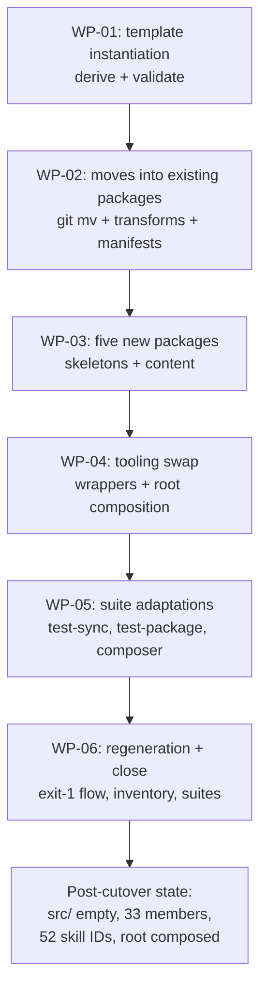

# PLAN-20261019-04: Phase 5+6 — atomic cutover

Last modified: 2026-10-20
Status: Completed

## Objective

Implement the combined Phase 5+6 changeset (DEC-20261017-03): the atomic
source-tree cutover that moves every tracked `src/` path into the package
trees under its taxonomy ID, instantiates the Core template from
`src/opencode.json`, joins the five taxonomy-resolved packages to the
workspace, swaps the legacy tooling for composer-backed wrappers, and leaves
the repository in the post-cutover state — `src/` empty of tracked paths, 33
workspace members, 52 skill directories, the root a self-hosting consumer.
The plan implements SPEC-20261019-03 (committed at `eb3c423`) — the move map,
the rename/transformation tables, the template derivation, the wrapper
contract, and SCEN-067..073 are the acceptance contracts.

The plan artifact follows the full arc (draft → review → commit → push);
implementation is subsequent gated work.

## Scope

### Included

- WP-01: the template instantiation — the derivation, its determinism
  verification, and the composer's validation gate.
- WP-02: the content moves into the 28 existing packages — the byte-
  preserving `git mv` set, the existing-package transformation dispositions
  (three splits, two folds), and the manifests' `skills` arrays.
- WP-03: the five new packages — the skeletons, their content (the two TODO
  splits' authored skills, the planning-structure rename's moved file), and
  the source deletions.
- WP-04: the tooling swap — `scripts/sync-roundhouse.js` and
  `package/deploy-roundhouse.js` (with `package/roundhouse.js`) as thin
  adapters over the composer library, and the root's first self-hosting
  composition run.
- WP-05: the test-suite adaptations — `test-sync.js`, `test-package.js`,
  and the composer suite's discovery count, per the spec's minimal-adaptation
  contract.
- WP-06: the fixture regeneration (the pinned exit-1 annotation-drop flow),
  the post-cutover inventory verification, and the full suite run.

### Excluded

- Phase 7's composition matrix (the representative-partial-composition tests
  and the full-matrix pre-cutover comparison).
- Phase 8's `src/` husk deletion and the residual-reference sweep.
- Phase 9's publishing and CI.
- The org doc-workflow package (example-only per DEC-20261017-02).
- Composer behavior changes: SPEC-20261019-02 is normative and unchanged; the
  wrappers consume the committed library. Any composer defect surfaced during
  the cutover is escalation, not in-changeset modification.
- The root consumer-owned files' content (the root seeds are untouched; the
  root's composed artifacts are the only root changes).
- New decision records: the leans below are Gate 1 arbitration points. The
  DEC-20261017-03 `tooling/` supersession is already flagged in the spec's
  resolved open question — its amendment wave is separate from this plan.

## Related specifications and decisions

- `SPEC-20261019-03` — Phase 5+6 atomic cutover; primary normative source.
  SCEN-067..073 are this plan's acceptance contracts; the move map's
  destination enumeration (ID-preserved 18 / renamed 22 / transformed 8 → 12
  destinations), the template derivation's five rules, the wrapper contract,
  and the post-cutover state are the implemented behavior.
- `DEC-20261017-02` — Package contract: the taxonomy the rename map
  realizes, the artifact classes, and the manifest model.
- `DEC-20261017-03` — Migration strategy: the Phase 5/6 definitions, the
  combined granularity item ("Atomic package-content migration + local
  tooling cutover (Phases 5–6)"), and the managed-overwrite vs
  seed-create-if-missing preservation requirement.
- `SPEC-20261019-02` — Phase 3 composer: the library the wrappers drive
  (discovery, vocabulary, template, render, materialize, manifest, commands)
  and the fixtures/suites WP-05 touches.
- `SPEC-20261017-01` — Fixture tooling: the generator whose stale-annotation
  flow WP-06 exercises, and the byte-equality contracts the regenerated
  fixture must satisfy.
- `SPEC-20261019-01` — Phase 2 scaffolding: the stub formats the five new
  packages instantiate.
- The committed fixture (`references/migration-baseline.json`) — the move
  map's data.

## Current-state findings

- **The tree state (verified):** HEAD is `eb3c423` (the Phase 5+6 spec);
  Phase 4 landed at `22e0670` (the decoupled prompts, the two Core skills);
  Phase 3's composer landed at `00d1e47`. The working tree is clean except
  the known-untracked `package-lock.json`.
- **The fixture's live data (verified):** 89 tracked `src/` entries — 61
  managed (57 named-owner: core 25, the 26 family packages 31, the CLI's
  `src/opencode.json` annotation 1; 4 TODO rationales) and 28 seed. The four
  TODO rationales name the resolutions: security-privacy splits into
  software-security and software-privacy; gherkin-testability splits into
  lang-gherkin and **software-testing-gherkin** (the specialization shape
  blessed at Gate 1 pre-review 2026-10-18, owned by
  `@backshop/roundhouse-software-testing`); image-media-delivery retires;
  planning-structure becomes backshopdev-planning in
  `@backshop/roundhouse-backshopdev-planning` (the npm name ruled
  2026-10-19). The fixture's hashes are current (post-Phase-4 regeneration).
- **Fixture drift since the last regeneration (verified):** the fixture was
  last regenerated at the Phase 4 close (the `22e0670` changeset's WP-06).
  The accumulated non-src drift is three new tracked files the fixture does
  not inventory: `docs/specs/SPEC-20261019-03.md`,
  `ktlo/KTLO-20261019-01.md`, and this plan's doc. `DEC-20261017-02` was
  checked and is fixture-current — its committed SHA-256 equals the fixture's
  recorded hash (the availableTo amendment predates the Phase 4-close
  regeneration). The three docs index files (`docs/specs/index.md`,
  `docs/plans/index.md`, `ktlo/index.md`) are seed instances — tracked
  `src/docs` counterparts — and fixture-invisible. WP-06's regeneration
  absorbs the drift alongside this plan's own delta.
- **The destination arithmetic (verified against the spec's tables):** 52
  destination skill IDs = 18 ID-preserved + 22 renamed + 12 authored from
  the eight transformation dispositions (five splits, two folds, one
  retirement); 39 byte-preserving skill moves, 10 non-skill mirrored moves,
  and 28 seed moves; destination files 62 managed and 28 seed, plus the
  template.
- **The composer library (verified):** `packages/roundhouse-cli/` carries
  `bin/roundhouse.js`, the ten lib modules (commands, discovery, graph,
  manifest, materialize, model, render, safe-fs, template, vocabulary), the
  test suite, and the 18-fixture inventory. `lib/commands.js` exposes the
  init/compose/verify implementations; `lib/safe-fs.js` exports the ported
  primitives the deploy wrapper re-exports.
- **The sync tool's surface (verified):** `scripts/sync-roundhouse.js` takes
  `--mode <sync|verify>` (strict) plus `--src <path>` and `--consumer <path>`
  overrides — the overrides are how `test-sync.js` drives isolated temp
  consumers; the tests copy `src/` into the temp fixture as the source.
  Post-cutover the source is the workspace packages: the `--consumer`
  override keeps its meaning (temp-consumer isolation), the `--src` override
  becomes inert compatibility surface (the spec's wrapper contract pins
  this), and the temp-fixture harness simplifies accordingly.
- **The deploy tool's surface (verified):** `package/deploy-roundhouse.js`
  exports `ROOT_ONLY`, `collectRelativePaths`, `copyMissing`, `deploy`,
  `init`, `update`; `package/roundhouse.js` is the bin (`init` / `update`,
  with `--dry-run`). `test-sync.js` requires the module directly for its
  API-level rejection tests (junction, escape); `test-package.js` drives the
  bin for the lifecycle block and the module for the source-junction test.
- **The suites' contract surface (verified):** `test-sync.js` (1310 lines,
  28 numbered contracts: overwrite, stale removal, verify drift detection,
  seeds, dry-run, rejections, self-hosting verify); `test-package.js`'s
  lifecycle block (fresh init, idempotent skip, update overwrite + seeds,
  dry-run, type conflicts, junction/escape rejections) plus its
  workspace-members block — the Phase 2 stub-coverage block (SCEN-047..049's
  durable test home) whose derivation source is the fixture's managed
  annotations; the cutover consumes that source (the annotations drop, the
  packages enter as root-only artifacts), so the block retires post-cutover
  and its coverage transfers to the composer suite's SCEN-069 assertions
  over the real 33-member set (the coverage continuity per the Phase 2
  plan's durable-test-home commitment); the composer suite asserts
  SCEN-052..066 with SCEN-059 pinning the 28-member discovery count.
- **The root's current state (verified):** `opencode.json` tracked in the
  pre-cutover hand-authored shape; no `.roundhouse/` directory;
  `.opencode/` gitignored deployed state (the Phase 4 deferral left it
  pre-composition); the consumer-owned seed instances (AGENTS.md, the docs
  indexes, ktlo) present and untouched by this plan.

## Intended shape

After this plan, every tracked `src/` path has moved: the packages' `managed/`
trees hold the harness content under its taxonomy IDs, `core/seed/` holds the
consumer scaffolding, the Core template renders the composed `opencode.json`,
the five new packages complete the 33-member workspace, the two legacy tools
are thin adapters over the composer, the root is a self-hosting consumer
(`.roundhouse/manifest.json` committed, `opencode.json` composed), and the
regenerated fixture is the plain inventory of the new tree. `src/` remains as
an empty husk for Phase 8.

## Work packages

The execution sequence (Gate 1 arbitrates): template first (the composer
validates it before anything renders), then the moves into existing packages,
then the new packages, then the wrappers and the root composition, then the
suite adaptations, then the regeneration — the regeneration must see the
changeset-close tree, so it is strictly last.

### WP-01: The template instantiation

**Description:** Produce `packages/roundhouse-core/opencode-template.json`
from `src/opencode.json` per the spec's five derivation rules, and gate it
through the composer's own validator before any further work.

**Tasks:**

- T-01: Derive the template via a throwaway deterministic script — created,
  run, verified, deleted (the Phase 2 scaffold precedent; `scratch/`,
  gitignored). The script reads `src/opencode.json`, applies the five rules
  (verbatim members; skill maps → exactly `{ "*": "deny" }`; the reviewer's
  bare `"deny"` → the `{"*": "deny"}` map with the orchestrator's absent bash
  key staying absent; member order preserved; canonical serialization),
  writes the template, and is run twice to demonstrate byte-identical output
  before deletion (Required for the template's content and determinism;
  Expected for the mechanism).
- T-02: Validate the template through the composer's exported template
  validator — all six invariants pass; any violation blocks the sequence
  (Required).

**Dependencies:** None. Blocks WP-02's completion claim (the cutover is only
whole with the template) and WP-04's composition.

**Parallelism:** Cannot run in parallel with anything that reads
`src/opencode.json`'s pre-move state — strictly first.

**Acceptance criteria:**

- The template exists at the pinned path, passes all six invariants, and the
  double-derivation byte-identity was demonstrated.
- No other file changes attributable to WP-01.

### WP-02: The content moves into existing packages

**Description:** Execute the move map's dispositions whose destinations are
the 28 existing packages: the byte-preserving `git mv` set (history
preservation), the five existing-package transformation dispositions, and
the manifests' `skills` arrays.

**Tasks:**

- T-03: The byte-preserving `git mv` set — 77 operations in five groups:
  the 10 non-skill managed entries (the four agent prompts, `docs-check.js`,
  the five autonomy docs) → `packages/roundhouse-core/managed/` at their
  mirrored paths; the 15 Core skills → `packages/roundhouse-core/managed/skills/<id>/`;
  the 21 existing-package renames → their owners'
  `managed/skills/<destination-id>/` (the rename table minus
  planning-structure); the 3 already-prefixed skills → their owners;
  the 28 seed entries → `packages/roundhouse-core/seed/` at their
  consumer-root-relative paths. Every moved file's bytes equal the fixture's
  recorded content (Required). The docs-general rename moves byte-preserving
  at move time; its destination is then augmented per T-04 (the rename
  table's augmentation note).
- T-04: Author the docs-general destination's dictum content per
  DEC-20261017-02's docs-general entry — the destination ships with the
  taxonomy's defining content, not the raw source text: the dictum that
  documentation gaps are a blocking finding and that docs are first-class
  repo inhabitants updated along with the code, plus the repo-artifact-system
  conventions folded in from `repository-documentation` (metadata, stable
  IDs, index discipline, archive rules, lifecycle status). The source's
  conventions content is the basis; the augmentation is an intentional
  difference for Phase 7's pre-cutover comparison record (Required).
- T-05: The existing-package transformations — the css-sass split
  (authoring `lang-css` and `lang-css-sass` from the source's content), the
  accessibility split (`software-accessibility`,
  `software-accessibility-web`), the web-performance split
  (`software-performance`, `software-performance-web`), the
  javascript+typescript fold (authoring the merged `lang-javascript`), and
  the contract-guide+contract-publication fold (authoring the merged
  `docs-software-contracts`) — each destination authored from its source(s)
  as the basis, each source deleted (Required for the dispositions;
  Expected for the authoring depth: the division follows the skills'
  subject matters, the merge preserves both sources' operative guidance,
  and the review lenses judge coherence).
- T-06: The 28 existing packages' `roundhouse.json` updates — each gains its
  `skills` array per the move map's destination IDs (core: the fifteen Core
  IDs; the family packages: their destination IDs per the tables), `bash`
  stays `[]`, `requires` unchanged; canonical serialization (Required).

**Dependencies:** WP-01 (the cutover is only whole with the template; the
template's creation must precede the moves so `src/opencode.json` is
consumed before `src/` empties). Blocks WP-04.

**Parallelism:** T-03/T-05/T-06 proceed in sequence after WP-01; T-05's five
dispositions are mutually independent.

**Acceptance criteria:**

- Every byte-preserving move lands at its ruled destination with
  fixture-recorded bytes; `git log --follow` shows history preservation for
  the moved paths.
- The five transformation dispositions' destinations exist and their sources
  are deleted; the retirement's path is simply gone.
- The 28 manifests declare their destination skill IDs and pass the
  composer's vocabulary validation.

### WP-03: The five new packages

**Description:** Create the five taxonomy-resolved packages with their
manifests and content, completing the 33-member workspace.

**Tasks:**

- T-07: The five skeletons — `package.json` (name, `0.0.0`, `private: true`,
  the Node 24 engines, the one-line description) and `roundhouse.json`
  (kind `capability`, `contractVersion` 1, the skill IDs per the spec's
  table, `bash: []`, `requires: ["@backshop/roundhouse-core"]`), at
  `packages/roundhouse-software-security/`,
  `packages/roundhouse-software-privacy/`,
  `packages/roundhouse-lang-gherkin/`,
  `packages/roundhouse-software-testing/`,
  `packages/roundhouse-backshopdev-planning/` (Required). The five proposed
  descriptions (Gate 1 arbitrates the wording):
  - `software-security`: "Security practice: threat modeling, auth and authz
    review, secrets handling, and the security review lens."
  - `software-privacy`: "Privacy practice: data lifecycle, privacy
    requirements, and privacy-aware review considerations."
  - `lang-gherkin`: "Gherkin: Given-When-Then structure, scenario
    conventions, and stable-ID acceptance contracts."
  - `software-testing`: "Software testing practice: scenario-based
    acceptance review (the Gherkin testability lens) and testing strategy."
  - `backshopdev-planning`: "BackShopDev's planning methodology: plan
    decomposition, acceptance criteria, and Gate 1 readiness."
- T-08: The new packages' content — `planning-structure`'s `git mv` to
  `packages/roundhouse-backshopdev-planning/managed/skills/backshopdev-planning/SKILL.md`
  (byte-preserving); the security-privacy split (authoring
  `managed/skills/software-security/SKILL.md` and
  `managed/skills/software-privacy/SKILL.md` in their packages from the
  source's content); the gherkin-testability split (authoring
  `managed/skills/lang-gherkin/SKILL.md` and
  `managed/skills/software-testing-gherkin/SKILL.md`); each split's source
  deleted; and the retired `image-media-delivery` path deleted without a
  destination (the retirement disposition) (Required).

**Dependencies:** WP-01 (the sequencing rule). Blocks WP-04.

**Parallelism:** T-07/T-08 proceed together after WP-02.

**Acceptance criteria:**

- The five packages exist per the spec's table; their manifests pass the
  composer's vocabulary validation; discovery (post-WP-04) yields 33.
- The four split-authored skills and the moved backshopdev-planning content
  exist at the managed-path convention locations; the four source paths are
  deleted (the planning-structure rename's source, the two split sources,
  and the retired image-media-delivery path).

### WP-04: The tooling swap and the root composition

**Description:** Replace the two legacy tools (and the legacy bin) with thin
adapters over the composer library, preserving the observable surfaces; then
run the root's first self-hosting composition.

**Tasks:**

- T-09: `scripts/sync-roundhouse.js` → the adapter: `--mode sync` runs the
  composer's init when the root carries no `.roundhouse/manifest.json` and
  compose otherwise (the workspace members as the discovered set, the root
  as consumer); `--mode verify` runs the composer's verify; `--consumer`
  preserved (temp-consumer isolation); `--src` retained as an accepted
  no-op compatibility flag; strict argument parsing and exit codes 0/1/2
  relayed from the composer (Required).
- T-10: `package/deploy-roundhouse.js` → the adapter preserving the exported
  API (`ROOT_ONLY`, `collectRelativePaths`, `copyMissing`, `deploy`, `init`,
  `update`) over the composer's safe-fs primitives and materialization;
  `package/roundhouse.js` → the bin adapter dispatching init/update to the
  composer flow; the src/-based parameters become inert compatibility
  surface (Required).
- T-11: The root's first self-hosting composition — run
  `npm run sync-roundhouse -- --mode sync` at the repo root (init: no
  manifest exists), then a second run (compose) to demonstrate byte
  stability; the outputs are changeset content: the composed root
  `opencode.json` (the rendered shape — uniform skill maps, two-layer bash
  maps), `.roundhouse/manifest.json` (committed), and the composed
  `.opencode/` (gitignored, untracked) (Required).

**Dependencies:** WP-02 and WP-03 (the content must be final). Blocks WP-05
and WP-06.

**Parallelism:** T-09/T-10 proceed together; T-11 strictly after both.

**Acceptance criteria:**

- Both wrappers pass their preserved-surface smoke checks; the composer
  library is the only engine (no duplicated orchestration logic).
- The root is composed: the rendered `opencode.json`, the committed
  manifest, and the composed `.opencode/`; the second run is byte-stable;
  the consumer-owned root seeds are untouched.

### WP-05: The test-suite adaptations

**Description:** Adapt the three affected suites minimally per the spec's
contract — the behavioral contracts hold; the implementation behind them
swaps.

**Tasks:**

- T-12: `scripts/test-sync.js` — the adaptation classes: the temp-fixture
  harness drops its `src/` copy and isolates via `--consumer` (the source is
  the real package set, read-only); the source-relabeled assertions (the
  composed managed set exists at the consumer; the Core seed set's
  create-if-missing behavior); the stale assertions adapt to
  recorded-ownership (consumer-side stale construction; owned-stale coverage
  remains in the composer suite); the missing-source failure test
  (test 11's premise) retires to the composer suite's coverage or adapts to
  a consumer-side equivalent; the rejection contracts (tests 19-26) hold via
  the preserved API; test 28 (self-hosting verify at the real root) works
  post-composition (Required).
- T-13: `scripts/test-package.js` — the lifecycle block's adaptations: the
  bin flows compose from the packages; the seed-content assertions relabel
  to the Core seed set (the Core seed README, not the root package README);
  the `opencode.json` assertions expect the composed render; the stale
  detail follows recorded ownership; the source-junction module test targets
  what the adapter actually reads; the workspace-members block is RETIRED
  post-cutover — its derivation source (the fixture's managed annotations)
  is consumed by the move (the annotations drop; the packages enter as
  root-only artifacts), so the block's derivation yields zero members, and
  SCEN-047..049's durable coverage transfers to the composer suite's
  SCEN-069 assertions over the real 33-member set (the coverage continuity
  per the Phase 2 plan's durable-test-home commitment) (Required).
- T-14: `packages/roundhouse-cli/test/composer.test.js` — SCEN-059's
  discovery count 28 → 33; the fixtures stay valid unchanged (their
  `roundhouse.json` files are untouched by the cutover) (Required).

**Dependencies:** WP-04 (the wrappers the suites exercise).

**Parallelism:** T-12/T-13/T-14 proceed together.

**Acceptance criteria:**

- All three suites are green against the wrappers and the post-cutover
  tree; no behavioral contract was weakened — only relabeled or re-homed,
  with the composer suite carrying the owned-stale coverage.

### WP-06: The fixture regeneration and the changeset-close verification

**Description:** Regenerate the committed fixture through the pinned
annotation-drop flow, verify the post-cutover inventory, and run the full
suite set.

**Tasks:**

- T-15: The fixture regeneration — the first generator run is EXPECTED to
  exit 1, writing the fixture without the 61 dropped managed annotations and
  listing every dropped path on stderr (the stale-annotation flow; the
  annotations' purpose is realized by the move); review the drop list (all
  61, no more, no fewer); the second run exits 0 and is byte-stable
  (Required).
- T-16: The post-cutover inventory verification — `git ls-files` shows no
  `src/` paths; exactly 33 workspace members; 52 skill directories across
  the packages' managed trees; `npm run sync-roundhouse -- --mode verify`
  exits 0 against the composed root (Required).
- T-17: The full suite run — `test-sync.js`, `test-package.js`,
  `test-commit.js`, `test-migration-baseline.js`, and the composer suite all
  green (Required).

**Dependencies:** Everything (the regeneration must see the changeset-close
tree).

**Parallelism:** None — strictly last.

**Acceptance criteria:**

- The regenerated fixture equals the tree at changeset close; the first
  run's exit-1 drop list is exactly the 61 managed annotations; the
  committed fixture carries no `src/` entries and no annotations.
- The inventory matches the post-cutover state; all five suites are green.

## Dependencies

- WP-01 → WP-02 → WP-03 → WP-04 → WP-05 → WP-06 (the execution sequence;
  Gate 1 arbitrates).
- WP-01 is the gate: the template must exist and validate before the moves
  (the cutover is only whole with it, and `src/opencode.json` must be
  consumed before `src/` empties).
- No external dependencies: Node 24 built-ins only; the composer library is
  committed; all touched tooling exists.

## Changeset granularity

One commit (ruled), matching DEC-20261017-03's granularity item "Atomic
package-content migration + local tooling cutover (Phases 5–6)":

| Commit | Work packages | Content |
| --- | --- | --- |
| 1 | WP-01..WP-06 | The template, the moved and transformed content, the five new packages, the wrappers, the root's composed artifacts, the adapted suites, the regenerated fixture |

The plan-creation changeset (this plan + its index row) precedes the
implementation changeset and is separate. The lockfile stays out of the
commit (untracked, human-ruled).

## Change map

| File | Action | Purpose |
| --- | --- | --- |
| `docs/plans/PLAN-20261019-04.md` | Create | This plan (plan-creation changeset) |
| `docs/plans/index.md` | Modify | Add this plan's row; remove the archived PLAN-20261019-03 row (plan-creation changeset) |
| `docs/plans/PLAN-20261019-03.md` | Move | Archived to `docs/plans/archive/PLAN-20261019-03.md` with Status `Completed` (plan-creation changeset; Phase 4 landed at `22e0670` — the Phase 3 plan-creation changeset's lifecycle pattern) |
| `docs/plans/archive/index.md` | Modify | Add the archived plan's row (plan-creation changeset) |
| `packages/roundhouse-core/opencode-template.json` | Create | The template instantiation (WP-01, T-01) |
| `packages/roundhouse-<subject>/managed/**` | Move (git mv) / Create | The 62 managed-destination files: 40 byte-preserving + 12 transformation-authored + 10 mirrored non-skill (WP-02, WP-03) |
| `packages/roundhouse-core/seed/**` | Move (git mv) | The 28 seed files (WP-02, T-03) |
| `src/**` (89 tracked paths) | Delete | The move map's sources: 78 moved away, 10 transformation/retirement deletions, `src/opencode.json` consumed by the derivation (WP-02, WP-03, WP-01) |
| `packages/roundhouse-<subject>/roundhouse.json` ×28 | Modify | The `skills` arrays per the move map (WP-02, T-06) |
| `packages/roundhouse-{software-security,software-privacy,lang-gherkin,software-testing,backshopdev-planning}/{package.json,roundhouse.json}` ×10 | Create | The five new packages (WP-03, T-07) |
| `scripts/sync-roundhouse.js` | Rewrite | The composer adapter (WP-04, T-09) |
| `package/deploy-roundhouse.js` | Rewrite | The composer adapter (WP-04, T-10) |
| `package/roundhouse.js` | Rewrite | The bin adapter (WP-04, T-10) |
| `scripts/test-sync.js` | Modify | The adaptation classes (WP-05, T-12) |
| `scripts/test-package.js` | Modify | The lifecycle adaptations; the workspace-members block retired, its coverage transferring to the composer suite's SCEN-069 (WP-05, T-13) |
| `packages/roundhouse-cli/test/composer.test.js` | Modify | SCEN-059's count 28 → 33 (WP-05, T-14) |
| `opencode.json` (root) | Modify | The composed render (WP-04, T-11) |
| `.roundhouse/manifest.json` | Create | The root's composition record (WP-04, T-11) |
| `references/migration-baseline.json` | Modify | Regenerated through the exit-1 annotation-drop flow (WP-06, T-15) |

No root consumer-owned content changes; no composer library changes; no
`tooling/` directory (the git-history retirement).

## Prescriptiveness levels

- **WP-01 — Required** for the template's content, the five derivation
  rules, and the determinism demonstration; **Expected** for the throwaway-
  script mechanism.
- **WP-02 — Required** for the byte-preserving set, the mirrored/taxonomy
  destination paths, the `git mv` history preservation, the source
  deletions, and the manifests' arrays; **Expected** for the transformation
  authoring's prose depth (the sources as the basis; the division follows
  the subject matters; the merge preserves both sources' operative
  guidance).
- **WP-03 — Required** for the manifests per the spec's table and the
  content dispositions; **Expected** for the five descriptions' wording
  (Gate 1 approves the proposed one-liners) and the split authoring's
  prose.
- **WP-04 — Required** for the preserved surfaces, the adapter thinness,
  the inert `--src` disposition, and the root composition's outputs;
  **Expected** for the wrapper internals.
- **WP-05 — Required** for the contracts holding and the adaptation classes;
  **Expected** for the per-assertion dispositions (the implementer walks
  each suite; the classes above bound the changes).
- **WP-06 — Required** for the two-run regeneration flow, the 61-drop
  review, the inventory, and the suite-green end state; **Expected** for the
  drift bookkeeping (Appendix A pins the expected delta, re-verified at
  execution).

## Scenario traceability matrix

Every SPEC-20261019-03 scenario maps to the work package and task that
implements it.

| Scenario | Work package | Task | Verification location |
| --- | --- | --- | --- |
| SCEN-067 | WP-02, WP-03 | T-03, T-05, T-07, T-08 | The moves' verification + the changeset review |
| SCEN-068 | WP-01 | T-01, T-02 | The derivation's double-run + the composer validator |
| SCEN-069 | WP-03 | T-07, T-08 | The vocabulary validation + the discovery check |
| SCEN-070 | WP-04 | T-09, T-11 | The root composition runs + byte stability |
| SCEN-071 | WP-04, WP-05 | T-09, T-12 | `scripts/test-sync.js` green |
| SCEN-072 | WP-04, WP-05 | T-10, T-13 | `scripts/test-package.js` green |
| SCEN-073 | WP-05, WP-06 | T-14, T-15, T-16, T-17 | The full suite run + the inventory + `--mode verify` |

## Documentation stubs

- [x] Create this plan + its `docs/plans/index.md` row (the plan-creation
  changeset).
- [ ] No new decision records: the leans are plan-level; the DEC-20261017-03
  `tooling/` supersession is already flagged in the spec's resolved open
  question for the DR amendment wave.
- [ ] The composer's implementation map: expected alongside the post-cutover
  documentation pass (Phase 7/8 territory), not in this changeset.
- [x] Update this plan's `docs/plans/index.md` row status as the plan
  advances (Draft → Ready → In progress → Completed).

## Verification criteria

- [ ] SCEN-067..073 verified per the traceability matrix.
- [ ] The template passes all six invariants; the double-derivation
  byte-identity was demonstrated; the throwaway script appears nowhere in
  the changeset.
- [ ] Every byte-preserving move's bytes equal the fixture's recorded
  content; `git log --follow` shows history preservation.
- [ ] The eight transformation dispositions' destinations exist; their
  sources are deleted; the retirement leaves no destination.
- [ ] `src/` carries no tracked paths; exactly 33 workspace members; 52
  skill directories.
- [ ] The root is composed: the rendered `opencode.json`, the committed
  `.roundhouse/manifest.json`, the composed `.opencode/`; the second
  `--mode sync` run is byte-stable; `--mode verify` exits 0.
- [ ] The regenerated fixture: the first run exits 1 with exactly the 61
  dropped annotations listed on stderr; the second run exits 0 and is
  byte-stable; the committed fixture has no `src/` entries and no
  annotations; the delta matches Appendix A.
- [ ] All five suites green: `test-sync.js`, `test-package.js`,
  `test-commit.js`, `test-migration-baseline.js`, the composer suite.
- [ ] The changeset is exactly one commit; the lockfile and the throwaway
  script appear nowhere in it.
- [ ] `node .opencode/docs-check.js` passes.
- [ ] `npx --yes markdownlint-cli2@0.23.2` passes on every touched Markdown
  file.

## Readiness

**Score: 7/10 — Draft, pending Gate 1 review.**

The spec is committed and normative; the fixture data is verified live; the
destination arithmetic reconciles; the wrapper surfaces are pinned from the
actual tooling. The remaining openness is proposal-level.

Blockers (all resolved by Gate 1 approval):

1. The execution sequence (template → moves → new packages → wrappers →
   suites → regeneration).
2. The five proposed package descriptions (WP-03's one-liners).
3. The transformation authoring guidance (the Expected-level prose depth for
   the five splits and two folds).
4. The one-commit granularity confirmation.
5. Appendix A's drift accounting (the expected fixture delta).

Non-blocking: the `--src` inert-flag disposition (pinned by the spec);
the composer-suite SCEN-052 fixture-input note (the fixtures stay valid);
the expected `package-lock.json` generator warning; the exact per-assertion
dispositions in the suite adaptations (Expected).

## Appendix A: The expected fixture delta (Gate 1 centerpiece)

The regeneration at T-15 transforms the fixture from the pre-cutover
inventory to the post-cutover inventory. The expected delta:

- **Removed (89):** every `src/` entry — the 61 managed (whose 61
  annotations drop loudly on the first run) and the 28 seed.
- **Removed (90 actual):** the plan's 89 `src/` entries — the 61 managed
  (whose 61 annotations dropped loudly on the first run) and the 28 seed —
  plus one more: the archived Phase 4 plan's former active path
  (`docs/plans/PLAN-20261019-03.md`), removed by the plan-creation
  changeset's lifecycle move (the archive path appears under Added).
- **Added (135 actual; the plan's expectation of 105 under-counted by the
  30-entry gap documented here):** the 62 managed-destination files under
  `packages/roundhouse-*/managed/` (52 skill files + the 10 mirrored
  non-skill files); the 28 seed files under `packages/roundhouse-core/seed/`;
  `packages/roundhouse-core/opencode-template.json`; the five new packages'
  10 manifest files; the root `.roundhouse/manifest.json`; plus the three
  accumulated non-src additions (`docs/specs/SPEC-20261019-03.md`,
  `ktlo/KTLO-20261019-01.md`, this plan's doc) — the plan's 105 — plus the
  30-entry gap: the **28 former root seed instances** (`AGENTIC_WORKFLOW.md`,
  `AGENTS.md`, `BUILDING.md`, `CONTRIBUTING.md`, `README.md`, `TESTING.md`,
  the 19 `docs/**` files, `ktlo/index.md`, `ktlo/template.md`,
  `scratch/README.md`) whose `src/` counterparts moved away with the cutover,
  reclassifying them from excluded seed instances to root-only artifacts;
  the **archive path** (`docs/plans/archive/PLAN-20261019-03.md`); and
  **`opencode.json` as an add, not the change map's update** — the root file
  had never been tracked (gitignored as the deployed instance of
  `src/opencode.json`), so the composed render enters the fixture as a new
  root-only-artifact entry. The regenerated fixture's total is 330 entries
  (285 before the regeneration: +135 added, −90 removed, 80 updated).
- **Updated (80 actual):** the 28 existing `roundhouse.json` files (skills
  arrays); `scripts/sync-roundhouse.js`, `package/deploy-roundhouse.js`,
  `package/roundhouse.js` (the wrappers); `scripts/test-sync.js`,
  `scripts/test-package.js`,
  `packages/roundhouse-cli/test/composer.test.js` (the adaptations);
  `packages/roundhouse-cli/lib/materialize.js` (the human-ruled ancestor
  type-compatibility amendment); `.gitignore` (the obsolete
  `/opencode.json` ignore entry removed so the composed render can be
  committed); this suite-adaptation and accounting correction; plus hash
  updates the regeneration absorbs for tracked paths whose content changed
  since the fixture's last regeneration (the references and tooling files
  among them). The root `opencode.json` is NOT in this set (it enters as an
  add, above). `DEC-20261017-02` is fixture-current and contributes no
  update.
- **The index files' visibility (corrected):** pre-cutover the three docs
  index files (`docs/specs/index.md`, `docs/plans/index.md`,
  `ktlo/index.md`) were seed instances — tracked `src/docs` counterparts —
  and fixture-invisible. Post-cutover their counterparts moved with the
  cutover, so they inventory as root-only artifacts (within the 330), and
  their index-row changes now enter fixture entries as ordinary hash
  updates.
- **The flow:** the first generator run exits 1 (the 61 stale annotations
  dropped loudly, the fixture written tree-true without them); the second
  run exits 0 and is byte-stable; the committed fixture is the second run's
  output. Two expected untracked-path warnings (`package-lock.json` and the
  husk's `src/opencode.json`).
- **Absorbed drift:** the three accumulated non-src additions above (the
  Phase 5+6 spec, the gate-flow KTLO item, this plan's doc) enter the
  fixture with the regeneration; the index rows are seed instances and
  fixture-invisible.
- **The post-cutover classification:** the fixture's src scope is empty; the
  moved content classifies per the detection rules' honest output
  (root-only-artifacts for the `packages/` paths); the
  `.roundhouse/manifest.json` is the composition authority post-cutover —
  the fixture no longer carries ownership annotations.
