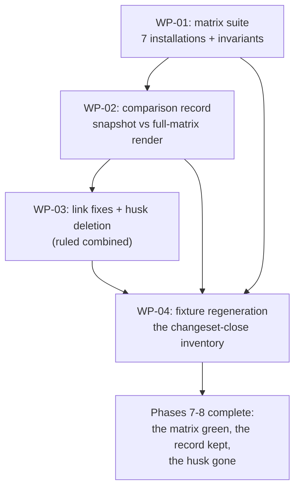

# PLAN-20261019-05: Phase 7 — composition matrix

Last modified: 2026-10-21
Status: Completed

## Objective

Implement Phase 7 of the Roundhouse migration (DEC-20261017-03): the
composition-matrix tests exercising representative installations — not just
the full Roundhouse repository — through the composer's init / compose /
verify, asserting the per-installation invariants, and producing the
pre-migration comparison record whose every difference is documented as the
intentional consequence of the ruled model. The plan implements the ruled
architecture from the Socratic interview; Phase 7 has no specification — its
acceptance lives in the per-WP criteria and the DR-03 invariant mapping
below, per the PLAN-20261019-03 precedent for slices without scenario
contracts.

The plan artifact follows the full arc (draft → review → commit → push);
implementation is subsequent gated work.

## Scope

### Included

- WP-01: the composition-matrix test suite —
  `packages/roundhouse-cli/test/composition-matrix.test.js` — the seven
  installations as test groups, each composing a temp consumer from declared
  dependencies and asserting the invariants.
- WP-02: the pre-migration comparison — the full-matrix composed render vs
  `git show 01cd491:opencode.json`, every difference documented as the
  intentional consequence of the ruled model (the comparison is the record;
  no review gate on the diff).
- WP-03: the Phase 8 content — the residual-reference sweep (the six
  broken docs-check links), the `src/` husk deletion, and the sweep
  verification — ruled into this changeset (the combined Phases 7–8
  grouping, 2026-10-20).
- WP-04: the fixture regeneration — the new files and the sweep's hash
  changes enter the fixture; the accumulated-drift accounting.

### Excluded

- **Phase 8's remainder: none.** The combined grouping ruling (2026-10-20)
  closes both phases in this changeset; no Phase 8 follow-up plan exists.
- Phase 9's publishing and CI.
- Composer behavior changes: SPEC-20261019-02 is normative and unchanged;
  the matrix exercises the committed library. Any composer defect surfaced
  by the matrix is escalation, not in-changeset modification.
- New decision records: the leans below are Gate 1 arbitration points.
- The root's own composition: already the post-cutover state (verified);
  the matrix builds temp consumers, never re-composing the root.

### Dependencies

- `DEC-20261017-03` — Migration strategy: the Phase 7 definition (the
  installation list, the per-installation invariants, the pre-migration
  comparison), the granularity item 5 grouping Phases 7–8, and the
  definition-of-done wording the matrix verifies.
- `DEC-20261017-02` — Package contract: the taxonomy whose families rework
  the DR-03 installation entries (the recorded follow-up), the dependency
  rules the negative tests enforce.
- `SPEC-20261019-02` — Phase 3 composer: the library the matrix drives
  (discovery, vocabulary, graph, template, render, materialize, manifest,
  commands) and the fixture/test conventions the suite follows.
- `SPEC-20261019-03` — Phase 5+6: the post-cutover state the matrix builds
  from (the 33 members, the composed root, the snapshot's provenance).
- `PLAN-20261019-04` (archived) — the cutover's implementation record; the
  wrapper and suite-adaptation context.

## Current-state findings

- **Re-verification note (2026-10-21, archival):** the implementation
  landed at `03bad7b` ("test(matrix): add composition matrix; complete
  Phase 8 sweep", 2026-10-20) and verified green (the matrix suite's
  seven installations, the comparison record, the sweep, the husk
  deletion). Every premise these findings carried at authoring has since
  been superseded by the landed state; the findings below stand as the
  authoring-time record.

- **The post-cutover state (verified):** the cutover landed at `245ad65`
  ("feat(cutover): move src/ into packages; swap tooling to composer") in
  one commit; `01cd491` ("docs(plan): add Phase 5+6 plan; archive Phase 4
  plan") is the verified pre-cutover snapshot commit — the last commit where
  the root `opencode.json` was hand-maintained.
- **The composed root (verified):** `.roundhouse/manifest.json` is committed
  and records the 33 members (the CLI plus 32 content packages) with their
  `skills` arrays, managed paths, and hashes; the `composed` block records
  the rendered `opencode.json`'s and the template's SHA-256. The skills
  arithmetic reconciles: 52 destination IDs (core 15; docs-general 3;
  lang-css, software-accessibility, software-performance, software-testability
  2 each; 26 single-skill packages).
- **The transformation evidence (verified):** every transformation
  destination's hash differs from its source's fixture-recorded hash
  (docs-general, lang-javascript, docs-software-contracts, the four
  split-authored skills, the three existing-package splits' destinations) —
  the authored content landed per the rename table's augmentation and the
  transformation dispositions.
- **The husk state (verified):** `git ls-files src/` returns nothing — no
  tracked `src/` paths. The working tree carries one untracked leftover:
  `src/opencode.json` — the template derivation's source, consumed by the
  cutover but left on disk untracked. The husk deletion (WP-03) removes it
  and the empty directories.
- **The docs-check errors (verified — the sweep's target):** docs-check
  fails with exactly six errors, all in `docs/specs/SPEC-20261016-01.md`:
  one link to `../../src/.opencode/workflow-docs/autonomy/index.md` and five
  links to `../../src/.opencode/skills/<id>/SKILL.md` (git-commit,
  specification, decision-record, implementation-plan,
  repository-documentation) — the cutover emptied `src/`, and five of the
  six target IDs renamed. The sweep re-points the links at the packages'
  post-cutover paths (or de-links where the reference is historical).
- **The composer suite (verified):** `packages/roundhouse-cli/test/composer.test.js`
  asserts SCEN-052..066 — the harness precedent the matrix suite follows
  (temp consumers under `os.tmpdir()`, declared dependencies via
  `node_modules` junctions to the real workspace packages, the composer's
  bin driven via `spawnSync`).
- **The fixture's currency (verified):** the committed fixture was
  regenerated at the cutover close; the post-cutover drift is this plan's
  own files plus (at implementation) the matrix suite, the record document,
  and the sweep's `SPEC-20261016-01` link-fix hash update.
  The untracked `src/opencode.json` is fixture-invisible (untracked paths
  are never inventoried); its deletion has no fixture impact.
- **The root's composition is the full-set instance (verified):** the root
  is composed from the whole workspace — the full-matrix installation's
  temp render must be byte-identical to the root's committed composed
  `opencode.json`, a free cross-check of the matrix's fidelity.

## Intended shape

After this plan, the composition matrix suite green proves the composer's
contract across seven representative installations — from core-only to the
full set — asserting that only installed skills exist and are allowed,
framework/CMS dependencies are enforced, absent optional packages leave no
dead skill names, the Core agents remain loadable in every composition, the
review-skill rules render coherently, and recomposition never overwrites
seeds. The comparison record documents the pre-migration differences as the
ruled model's intentional consequences. If the Phases 7–8 grouping is ruled
combined, `src/` is gone (the husk deleted, the sweep green) and the
definition-of-done's reference condition is closed.

## The seven installations (Gate 1 centerpiece)

DR-03's installation entries name the pre-taxonomy packages; DEC-20261017-02's
recorded follow-up reworks them against the nature-based families. The
reworked mapping (approved at Gate 1, 2026-10-20):

| # | DR-03's entry | Reworked installation (the discovered set) |
| --- | --- | --- |
| 1 | core only | `roundhouse-core` |
| 2 | core + documentation + spec workflow | `roundhouse-core`, `roundhouse-docs-general`, `roundhouse-docs-spec` |
| 3 | core + JavaScript | `roundhouse-core`, `roundhouse-lang-javascript` |
| 4 | core + JavaScript + React | `roundhouse-core`, `roundhouse-lang-javascript`, `roundhouse-framework-react` |
| 5 | core + JavaScript + domain-web + React | `roundhouse-core`, `roundhouse-lang-javascript`, `roundhouse-framework-react`, and the five domain-web successors — `roundhouse-format-html`, `roundhouse-lang-css`, `roundhouse-software-accessibility`, `roundhouse-software-performance`, `roundhouse-software-discoverability` |
| 6 | core + JavaScript + Astro + Apostrophe | `roundhouse-core`, `roundhouse-lang-javascript`, `roundhouse-framework-astro`, `roundhouse-cms-apostrophe` |
| 7 | the full current capability set | all 33 members (the root's own composition — the full-set cross-check) |

The domain-web successors are DEC-20261017-02's dissolution distribution
(semantic-html → format-html-semantic; css-sass → the lang-css pair;
accessibility → the software-accessibility pair; web-performance → the
software-performance pair; seo-structured-data →
software-discoverability-seo) — installation 5 exercises a fuller stack
against them, as the original entry exercised domain-web.

## The per-installation invariants (the assertion mapping)

DR-03's invariant list, mapped to the matrix's assertions per installation:

| DR-03 invariant | The matrix's assertion |
| --- | --- |
| Only installed skills exist and are allowed in the effective `opencode.json` | Each Core agent's rendered skill map equals the byte-wise-sorted union of the installed packages' `skills` arrays — no extra, none missing |
| Framework / CMS dependencies enforced | The negative installations (framework-react alone; cms-apostrophe alone) fail init with the dependency-rule rejection |
| Absent optional packages leave no dead skill names | No skill ID from an absent package appears in any rendered map (asserted beside the union check) |
| Core agents remain loadable | The four agent entries render with their scaffolding (mode, tuning member, permission block) in every installation |
| Review-skill rules coherent | The reviewer's rendered block: the bash map is the deny wildcard plus the union block; the skill map is uniform with the other agents |
| Seed files not overwritten on recomposition | Compose runs twice; the consumer's seed instances are byte-stable and the render is byte-identical |

Every installation runs the composer's init (first) then compose (twice for
the seed invariant) then verify (exit 0) in its temp consumer.

## Work packages

### WP-01: The composition-matrix test suite

**Description:** `packages/roundhouse-cli/test/composition-matrix.test.js` —
the seven installations as test groups, following the composer suite's
harness precedent (temp consumers under `os.tmpdir()`, declared dependencies
via `node_modules` junctions to the real workspace packages, the bin driven
via `spawnSync`, no real-tree mutation).

**Tasks:**

- T-01: The harness and the seven groups — a per-installation builder
  (declares the selected packages in the temp consumer's `package.json`,
  junctions them from the real workspace `packages/` into the consumer's
  `node_modules/`, runs init) and the seven test groups over the reworked
  installation table (Required).
- T-02: The invariant assertions — the six invariant rows above per
  installation, plus the two negative dependency installations
  (framework-react alone; cms-apostrophe alone — each asserted to fail init
  with the dependency-rule rejection named on stderr) (Required).
- T-03: The suite green — all seven groups pass; no real-tree mutation
  (the temp dirs are the only writes) (Required).

**Dependencies:** None (the composer and the post-cutover tree are
committed). Blocks WP-02's render source and WP-04.

**Parallelism:** Independent of WP-02's record drafting; both block WP-04.

**Acceptance criteria:**

- The suite exists at the pinned path, covers all seven installations and
  both negative cases, and is green.
- The full-matrix group's temp render is byte-identical to the root's
  committed composed `opencode.json` (the free cross-check).

### WP-02: The pre-migration comparison and the record

**Description:** The full-matrix composed render vs the pre-cutover
hand-maintained `opencode.json` — every difference documented as the
intentional consequence of the ruled model. The composer's model is the
authority; the comparison is the record; no review gate on the diff.

**Tasks:**

- T-04: The comparison run — capture `git show 01cd491:opencode.json` (the
  verified pre-cutover snapshot) and diff it structurally against the
  full-matrix render (the temp render from installation 7, cross-checked
  byte-identical to the root's committed composed file). Permission note:
  `git show` is not in the author role's bash allowlist — the implementation
  obtains the human's once-approval for the exact command, or the human
  captures the snapshot content into the review (Expected: the approved
  invocation; the fallback: the human supplies the capture) (Required).
- T-05: The record document — `references/migration-phase7-comparison.md`
  (the Phase 1 baseline-summary precedent; indexed in `references/index.md`)
  documenting every difference as the intentional consequence classes: the
  uniform skill maps vs the hand-curated per-agent allow-lists; the bash
  union blocks appended after the role-driven entries; the renamed skill IDs
  (the taxonomy's names); the retired skills' absence
  (image-media-delivery appears in no map); the docs-general augmentation
  (narrative context — the ID renders in both, the content differs
  off-render); plus any instance-level difference the comparison surfaces,
  each with its ruling-class attribution. No difference is left undocumented
  (Required).

**Dependencies:** WP-01 (the render source). Blocks WP-04.

**Parallelism:** T-04/T-05 proceed together once WP-01 is green.

**Acceptance criteria:**

- The record exists at the pinned path, is indexed, and documents every
  surfaced difference with its consequence class; no undocumented difference
  remains between the snapshot and the render.

### WP-03: The residual-reference sweep and the husk deletion

**Description:** The Phase 8 content, ruled into this changeset (the
combined Phases 7–8 grouping, 2026-10-20): the six broken docs-check links
re-pointed or de-linked, the `src/` husk deleted, and the
definition-of-done's reference condition verified.

**Tasks:**

- T-06: The six link fixes in `docs/specs/SPEC-20261016-01.md` — each
  `../../src/.opencode/...` link re-pointed at the content's post-cutover
  package path (the autonomy index; the five skills' renamed destinations)
  or de-linked with the reference made inline where the target is
  historical (Required).
- T-07: The husk deletion — the untracked `src/opencode.json` leftover and
  the empty `src/` directory tree removed from the working tree; no tracked
  path is affected (Required).
- T-08: The sweep verification — a repository-wide reference sweep for
  residual `src/` references (scripts, docs, CI, agent guidance) beyond the
  six fixed links; docs-check green; the definition-of-done's "no scripts,
  docs, CI jobs, or agent guidance still reference `src/`" condition
  asserted (Required).

**Dependencies:** The Gate 1 ruling (the combined grouping). Blocks WP-04
(the regeneration must see the sweep's tracked changes).

**Parallelism:** After WP-01/WP-02; before WP-04.

**Acceptance criteria:**

- docs-check passes with zero errors; no residual `src/` reference remains
  in any tracked file; the husk is gone from the working tree.

### WP-04: The fixture regeneration

**Description:** Regenerate the committed fixture so it equals the tree at
changeset close, absorbing the matrix suite, the record document, and — if
combined — the sweep's hash changes (Appendix A pins the expected delta).

**Tasks:**

- T-09: Track the new files (`git add` the matrix suite, the record
  document, and the sweep's edits), run the generator, and
  confirm exit 0 with the expected delta: the new root-only-artifact entries
  for the matrix suite and the record document; the updated hash/size entry
  for `docs/specs/SPEC-20261016-01.md` and
  `references/index.md`; this plan's doc entering per the accumulated-drift
  accounting; zero annotation changes (the post-cutover fixture carries
  none); byte-stable across consecutive runs; one expected
  `package-lock.json` untracked-path warning (Required).

**Dependencies:** WP-01..WP-03 (the changeset-close tree).

**Parallelism:** None — strictly last.

**Acceptance criteria:**

- The regenerated fixture equals the tree at changeset close; consecutive
  runs are byte-identical; the delta matches Appendix A; the Phase 1 suite
  (`test-migration-baseline.js`) remains green.

## Dependencies

- WP-01 → WP-02 → WP-03 → WP-04.
- WP-01 and WP-02's record drafting overlap safely; WP-04 is strictly last.
- No external dependencies: Node 24 built-ins only; the composer library and
  the post-cutover tree are committed.

## Changeset granularity

**Ruled combined (Gate 1, 2026-10-20).** DEC-20261017-03's granularity item
5 groups "Composition matrix tests + legacy `src/` removal (Phases 7–8)"
into one changeset; SPEC-20261019-03's sequencing had deferred Phase 8's
sweep from the cutover changeset. RESOLVED (Gate 1 ruling, 2026-10-20): the
grouping is combined — one commit carrying the matrix suite, the comparison
record, the sweep's link fixes, and the husk deletion, closing both phases
and the definition-of-done's reference condition. The cutover left the husk
deliberately for this grouping.

| Commit | Work packages | Content |
| --- | --- | --- |
| 1 | WP-01..WP-04 | The matrix suite, the comparison record, the sweep's link fixes, the husk deletion, the regenerated fixture |

The plan-creation changeset (this plan + its index row) precedes the
implementation changeset and is separate. The lockfile stays out of the
commit (untracked, human-ruled).

## Change map

| File | Action | Purpose |
| --- | --- | --- |
| `docs/plans/PLAN-20261019-05.md` | Create | This plan (plan-creation changeset) |
| `docs/plans/index.md` | Modify | Add this plan's row (plan-creation changeset) |
| `packages/roundhouse-cli/test/composition-matrix.test.js` | Create | The matrix suite (WP-01, T-01..T-03) |
| `references/migration-phase7-comparison.md` | Create | The comparison record (WP-02, T-05) |
| `references/index.md` | Modify | Index the record document (WP-02, T-05) |
| `docs/specs/SPEC-20261016-01.md` | Modify | The six link fixes (WP-03, T-06) |
| `src/opencode.json` (untracked) + the `src/` husk | Delete | The husk deletion (WP-03, T-07) |
| `references/migration-baseline.json` | Modify | Regenerated at changeset close (WP-04, T-09) |

No composer library changes; no root consumer-owned content changes.

## Prescriptiveness levels

- **WP-01 — Required** for the suite's path, the seven installations per the
  reworked table, the six invariant assertions, and the two negative
  dependency cases; **Expected** for the harness internals (the builder's
  shape, the assertion style) following the composer-suite precedent.
- **WP-02 — Required** for the snapshot's provenance (`01cd491`), the
  full-matrix render's cross-check, and the record's completeness rule (no
  undocumented difference); **Expected** for the record's prose structure
  and the location (the pinned path is the lean).
- **WP-03 — Required** for the six link fixes' outcomes, the
  husk deletion, and the sweep's zero-residual condition; **Expected** for
  the re-point vs de-link choice per link (the six are enumerated in
  Current-state findings).
- **WP-04 — Required** for the regeneration principle and the byte
  stability; **Expected** for the drift bookkeeping (Appendix A pins the
  expected delta, re-verified at execution).

## Acceptance criteria and traceability

Phase 7 has no specification and no scenario IDs; acceptance lives in the
per-WP criteria, the DR-03 invariant mapping table, and the comparison
record — per the PLAN-20261019-03 precedent for slices without scenario
contracts. The traceability map is the invariant-mapping table: every DR-03
invariant maps to its asserting test class, and the comparison record is the
pre-migration commitment's deliverable.

## Documentation stubs

- [x] Create this plan + its `docs/plans/index.md` row (the plan-creation
  changeset).
- [ ] No new decision records: the leans are plan-level; the DEC-20261017-02
  follow-up (the Phase 7 entries reworked) is fulfilled by the installation
  table, not a DR amendment.
- [x] Update this plan's `docs/plans/index.md` row status as the plan
  advances (Draft → Ready → In progress → Completed).

## Verification criteria

- [ ] The matrix suite is green: all seven installations pass the six
  invariant assertions; both negative dependency installations fail with the
  dependency-rule rejection.
- [ ] The full-matrix temp render is byte-identical to the root's committed
  composed `opencode.json`.
- [ ] The comparison record exists at the pinned path, is indexed, and
  documents every surfaced difference with its consequence class; the
  five ruled classes (the uniform maps, the bash unions, the renamed IDs,
  the retired absence, the docs-general augmentation) are covered.
- [ ] docs-check passes with zero errors; no residual `src/`
  reference remains in any tracked file; the husk (including the untracked
  `src/opencode.json` leftover) is gone.
- [ ] The regenerated fixture is byte-stable, equals the tree at changeset
  close, and matches Appendix A's delta; `test-migration-baseline.js`
  remains green.
- [ ] All suites green: `test-sync.js`, `test-package.js`,
  `test-commit.js`, `test-migration-baseline.js`, the composer suite, and
  the matrix suite.
- [ ] The changeset is exactly one commit; the lockfile appears nowhere in
  it.
- [ ] `node .opencode/docs-check.js` passes.
- [ ] `npx --yes markdownlint-cli2@0.23.2` passes on every touched Markdown
  file.

## Readiness

**Score: 8/10 — Ready (Gate 1 approved 2026-10-20; the ruling is recorded
below).**

The post-cutover state is verified live; the installation mapping reworks
DR-03's entries per the recorded follow-up; the invariants map to concrete
assertions; the sweep's target is enumerated exactly.

### Gate 1 rulings (2026-10-20)

Applied in this plan per the SPEC-20261019-01 resolution style:

- [x] The Phases 7–8 grouping is COMBINED — one commit carries
  WP-01..WP-04, closing both phases per DEC-20261017-03's granularity item
  5; the cutover's husk deferral resolves in this changeset.
- [x] The plan approved as proposed: the reworked seven-installation table
  (including installation 5's domain-web-successor set), the comparison
  record's location and the `git show` permission handling, the one-commit
  granularity, and Appendix A's drift accounting.

Blockers — all resolved:

1. The Phases 7–8 grouping: RESOLVED — combined (2026-10-20).
2. The reworked seven-installation table: approved as proposed.
3. The comparison record's location and the `git show` permission handling:
   approved as proposed.
4. The one-commit granularity: confirmed by the combined ruling.
5. Appendix A's drift accounting: approved as pinned.

Non-blocking: the harness internals (Expected, the composer-suite
precedent); the per-link re-point vs de-link choices (Expected); the
expected `package-lock.json` generator warning; the untracked
`src/opencode.json` leftover's disposition (WP-03's husk deletion).

## Appendix A: The expected fixture delta (Gate 1 centerpiece)

The regeneration at T-09 transforms the fixture from the post-cutover
inventory to the changeset-close inventory. The expected delta:

- **Added (3):** `packages/roundhouse-cli/test/composition-matrix.test.js`;
  `references/migration-phase7-comparison.md`; this plan's doc
  (`docs/plans/PLAN-20261019-05.md`).
- **Updated (2):** `docs/specs/SPEC-20261016-01.md` (the six
  link fixes) and `references/index.md` (the record document's index row).
- **Removed (0):** no tracked path is deleted; the untracked
  `src/opencode.json` leftover's deletion is fixture-invisible (untracked
  paths are never inventoried).
- **Annotations (0):** the post-cutover fixture carries no managed
  annotations; the regeneration is a plain inventory update.
- **The flow:** a single generator run, exit 0, byte-stable across
  consecutive runs; one expected `package-lock.json` untracked-path
  warning.
- **The accumulated-drift check:** the fixture was last regenerated at the
  cutover close (`245ad65`); the post-cutover drift is this plan's doc plus
  the implementation's new files, all accounted above.
