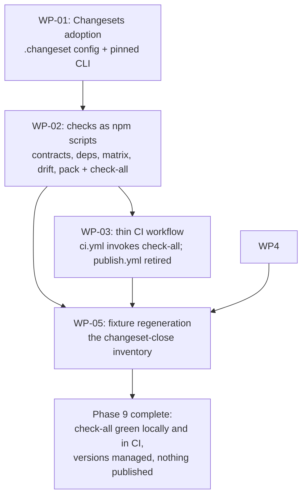

# PLAN-20261019-06: Phase 9 — publishing infrastructure and CI

Last modified: 2026-10-20
Status: Completed

## Objective

Implement Phase 9 of the Roundhouse migration (DEC-20261017-03, as amended):
adopt Changesets for independent workspace versioning, add the CI checks as
deterministic npm scripts fronted by a thin GitHub Actions workflow, prepare
the packages' publishability (the `files` allowlists) while keeping every
package private, document the deferred deprecation ceremony's exact command,
and regenerate the fixture. Publishing itself is a separate future act; the
migration guide is deferred (its external-consumer condition is not met).
The plan implements the ruled architecture from the Socratic interview;
Phase 9 has no specification — its acceptance lives in the per-WP criteria
and the DR-03 check-catalog mapping below, per the PLAN-20261019-03
precedent for slices without scenario contracts.

The plan artifact follows the full arc (draft → review → commit → push);
implementation is subsequent gated work.

## Scope

### Included

- WP-01: Changesets adoption — the `.changeset/` configuration, the
  exactly-pinned `@changesets/cli` root devDependency, and the versioning
  workflow's documentation.
- WP-02: the CI checks as npm scripts — the package-contract validation,
  the workspace dependency validity, the composition matrix, the local root
  drift, and the pack/files-list check per workspace member, plus the
  `check-all` aggregate; and the `files` allowlists that give the pack check
  its contract.
- WP-03: the thin GitHub Actions workflow invoking the check scripts, and
  the legacy `publish.yml`'s disposition.
- WP-04: the deprecation follow-up documentation — the exact
  `npm deprecate` command and its redirect message, documented for the
  future execution.
- WP-05: the fixture regeneration — the new files' hashes and the legacy
  workflow's removal.

### Excluded

- **Publishing.** No package publishes in this phase; every package stays
  `private: true`; `npm publish` is a separate future act under its own
  ruling (the ruled decision 2).
- **The deprecation ceremony's execution.** The `npm deprecate` command is
  documented, not run (the ruled decision 3; DEC-20261017-03's Follow-up
  carries the conditional item).
- **The migration guide.** Deferred — the external-consumer condition is not
  met; the substance lives in the decision records and the Phase 7
  comparison record (the ruled decision 4).
- **Composer behavior changes.** SPEC-20261019-02 is normative and
  unchanged; the check scripts consume the committed library.
- **The `opencode.yml` workflow.** The `/oc` comment-triggered agent runner
  is unrelated to publishing, references nothing the cutover moved, and
  stays untouched.
- **New decision records.** The leans below are Gate 1 arbitration points.

## Related specifications and decisions

- `DEC-20261017-03` — Migration strategy: the Phase 9 definition (as
  amended — the deprecation ceremony softened to at most `npm deprecate`)
  and the granularity item 6 ("Publishing / Changesets / CI migration
  (Phase 9)"); the risk-table row whose mitigation this plan implements
  (the pack/files-list CI check).
- `DEC-20261017-02` — Package contract: the artifact classes the `files`
  allowlists enumerate (managed, seed, the template), the CLI's
  installation-tooling role, and the strict-ownership rules the contract
  check re-verifies.
- `SPEC-20261019-02` — Phase 3 composer: the library the contract and
  dependency checks consume (discovery, vocabulary, model, graph).
- `SPEC-20261019-03` — Phase 5+6: the post-cutover state the checks
  validate (the 33 members, the composed root, the wrapper's verify).
- `KTLO-20260905-02` — The exact-pinning policy: every dependency version
  pinned exactly (no ranges); every update a deliberate act. Governs the
  `@changesets/cli` devDependency.
- `PLAN-20261019-05` — House plan style precedent; the matrix suite the
  CI's composition-matrix check invokes.

## Current-state findings

- **The root manifest (verified):** `package.json` carries the five scripts
  (`commit`, `sync-roundhouse`, `test-sync`, `test-package`, `test-commit`)
  and `engines`; no devDependencies; `private: true`;
  `workspaces: ["packages/*"]`. The new check scripts join the `scripts`
  map; the Changesets devDependency is the first devDependency the repo has
  carried.
- **The legacy publish workflow (verified):** `.github/workflows/publish.yml`
  triggers on `v*` tags, validates the tag against the root `package.json`'s
  version (a field the Phase 2 conversion dropped), runs `test-sync` /
  `test-package` / `npm pack --dry-run`, then `npm publish` to GitHub
  Packages. Every assumption has lapsed: the root is private and
  versionless, the single-package model is dissolved, and the packages are
  the publishable units. The workflow cannot fire meaningfully.
- **The `opencode.yml` workflow (verified):** the `/oc` comment-triggered
  agent runner (anomalyco/opencode/github action, the OPENCODE_API_KEY
  secret). Unrelated to publishing; no `src/` references; untouched.
- **The packages (verified):** 33 workspace members, all `private: true`,
  all at `0.0.0`, none carrying a `files` allowlist. The CLI carries
  `bin` + `lib` + the test area (the 18-fixture inventory and the two test
  suites — repo-only development tooling that must not ship). The content
  packages carry `managed/**` (and core additionally `seed/**` and
  `opencode-template.json`) — the contract-defined content a tarball should
  carry.
- **The composer library (verified):** `packages/roundhouse-cli/lib/`
  exports the discovery, vocabulary, model, and graph validation the
  contract and dependency checks reuse; the sync wrapper's `--mode verify`
  is the local-root-drift check's engine; the matrix suite
  (`packages/roundhouse-cli/test/composition-matrix.test.js`) is the
  composition-matrix check's engine.
- **The pinning policy (verified):** KTLO-20260905-02 pins every dependency
  version exactly and treats every update as deliberate. The Changesets
  devDependency follows it: an exact version, no range.
- **The lockfile (verified):** `package-lock.json` stays untracked (the
  human-ruled Phase 2 disposition). CI therefore runs `npm install`, not
  `npm ci`; the direct dependency is exactly pinned; transitive resolution
  floats under the no-lockfile disposition (an accepted residual risk —
  see Readiness).
- **The fixture's currency (verified):** the committed fixture was
  regenerated at the Phase 7+8 close; the post-close drift is this plan's
  own files plus (at implementation) the new check scripts, the workflow,
  the Changesets config, the `files` allowlists, and the legacy workflow's
  removal (Appendix A pins the delta).

## Intended shape

After this plan, the repository's health is checkable with one command:
`npm run check-all` runs the five checks (the package contracts, the
dependency validity, the composition matrix, the local root drift, the
pack/files-list conformance) locally and in CI, where a thin GitHub Actions
workflow composes the managed tree from the packages (the wrapper's
`--mode sync`) and then invokes the check scripts on PRs and pushes to
`main`. Changesets manages the
workspace's versions (the packages versioned, nothing published). The
legacy publish workflow is retired. The deprecation command is documented
for its future execution.



## Work packages

### WP-01: Changesets adoption

**Description:** Adopt Changesets as the workspace's versioning tool: the
configuration, the exactly-pinned CLI, and the workflow's documentation.
The packages stay private — Changesets versions them; nothing publishes.

**Tasks:**

- T-01: Install `@changesets/cli` as the root devDependency, **pinned
  exactly** per KTLO-20260905-02 (no range; the current stable version
  chosen at implementation and recorded in the changeset review). The
  composer's zero-dependency runtime posture is unaffected — the devDep is
  release tooling at the root, and the published packages carry no
  dependencies (Required).
- T-02: `changeset init` → `.changeset/config.json` committed with:
  `access: "restricted"` (private), `baseBranch: "main"`, `commit: false`,
  `updateInternalDependencies` at its default (moot — the workspace members
  carry no npm dependencies on each other; the dependency edges live in the
  `roundhouse.json` vocabulary), and no `ignore` entries. The
  `.changeset/README.md` init stub stays (the workflow's in-repo explainer)
  (Required).
- T-03: The versioning workflow documented in this plan (the section below)
  — a change lands with a changeset file describing it and its bump;
  `changeset version` consumes the changesets (bumping the private
  packages' versions and writing changelogs); the publish act is the
  separate future ruling and is not wired into CI (Required).

**The versioning workflow (the WP-01 documentation):** every
behavior-affecting changeset lands a `.changeset/*.md` file naming the
affected packages and the bump class; `changeset version` folds them into
the packages' versions and changelogs; the versioned commit precedes any
future publish act. The packages' versions start at `0.0.0`; the first
version bump is a future act under its own approval.

**Dependencies:** None. Blocks WP-02 (the scripts land in the same
manifest).

**Parallelism:** Independent of WP-03/WP-04.

**Acceptance criteria:**

- `.changeset/config.json` and `.changeset/README.md` exist and are
  committed; the devDependency is exactly pinned; `npx changeset status`
  runs clean against the no-changesets state.

### WP-02: The CI checks as npm scripts

**Description:** The DR-03 check catalog as deterministic, locally runnable
npm scripts — each a thin entry over committed engines (the composer
library, the wrapper, the matrix suite) — plus the `files` allowlists that
give the pack check its contract, and the `check-all` aggregate.

**Tasks:**

- T-04: The `files` allowlists — every workspace member's `package.json`
  gains a `files` field enumerating its distributable content: the 32
  content packages `"files": ["roundhouse.json", "managed"]`; core
  additionally `"seed"` and `"opencode-template.json"`; the CLI
  `"files": ["bin", "lib", "roundhouse.json"]` — excluding the test area
  and the 18-fixture inventory (the repo-only development tooling the
  DR-03 risk row guards). `package.json` itself is always included by npm
  and is not listed (Required).
- T-05: `scripts/check-contracts.js` — the package-contract validation:
  the composer's discovery + vocabulary + model validation over the real
  workspace members — every `roundhouse.json` parses and conforms to the
  vocabulary (the member set, the kind enum, `contractVersion`, the three
  arrays), and the bidirectional declared-versus-actual skill check passes
  against each package's `managed/skills/` tree. Exit 0 clean; exit 1 with
  the violations on stderr (Required).
- T-06: `scripts/check-deps.js` — the workspace dependency validity: the
  composer's graph validation over the real set — every `requires` entry
  resolves within the discovered set, the DEC-20261017-02 dependency rules
  hold (every capability requires core; framework/CMS packages require
  their language), no requires cycles, no ownership conflicts (Required).
- T-07: The npm scripts — the root `package.json`'s `scripts` map gains:
  `"check-contracts": "node scripts/check-contracts.js"`,
  `"check-deps": "node scripts/check-deps.js"`,
  `"check-matrix": "node packages/roundhouse-cli/test/composition-matrix.test.js"`,
  `"check-drift": "node scripts/sync-roundhouse.js --mode verify"` — in CI
  this runs after the workflow's compose step (compose-then-verify);
  `"check-pack": "node scripts/check-pack.js"`,
  `"check-all": "node scripts/check-all.js"` (Required; the naming — flat
  kebab-case `check-*` matching the repo's script conventions — Gate 1
  arbitrates).
- T-08: `scripts/check-pack.js` — per workspace member: `npm pack --dry-run
  --json` (private packages pack; only publish refuses), asserting the
  packed `files[]` paths are within the package's declared `files`
  allowlist plus npm's mandatory inclusions (`package.json`), and that the
  contract-required content is present — `roundhouse.json` and `managed/`
  for the content packages; core additionally `seed/` and
  `opencode-template.json`; the CLI `bin/`, `lib/`, and `roundhouse.json`.
  The composed artifacts (`opencode.json`, `.roundhouse/manifest.json`)
  are root-level composition outputs covered by the drift check, not
  package payload — the per-member pack assertion is the allowlist plus
  npm's mandatory inclusions. Exit 0 clean;
  exit 1 listing each violation (Required).
- T-09: `scripts/check-all.js` — the aggregate: runs the five checks in
  sequence, collects each outcome, reports every check's result (never
  fail-fast — CI wants the full picture), exits 0 only when all five pass
  (Required).

**Dependencies:** WP-01 (the manifest the scripts join). Blocks WP-03.

**Parallelism:** T-04..T-09 proceed together after WP-01.

**Acceptance criteria:**

- `npm run check-all` exits 0 locally with all five checks green.
- The pack check's per-package assertions hold for all 33 members; the
  CLI's tarball excludes the test area and the fixtures.
- The contract and dependency checks pass over the real 33-member
  workspace (the composer's validation, not a reimplementation).

### WP-03: The thin GitHub Actions workflow

**Description:** A thin CI workflow invoking the check scripts on PRs and
pushes to `main`, and the legacy publish workflow's disposition.

**Tasks:**

- T-10: `.github/workflows/ci.yml` — `name: CI`; triggers: `pull_request`
  and `push` to `main`; `permissions: contents: read`; one job on
  `ubuntu-latest`: checkout and setup-node pinned by commit SHA (the repo's
  pinning convention, reusing `publish.yml`'s pinned action versions),
  Node 24; `npm install` (no committed lockfile — the human-ruled
  disposition; the direct dependency is exactly pinned, while transitive
  resolution floats — an accepted residual risk);
  `npm run sync-roundhouse -- --mode sync` (the compose step: the wrapper's
  init-when-no-manifest-else-compose materializes the managed tree and the
  rendered `opencode.json` from the packages — in CI the committed manifest
  makes it a compose); `npm run check-all`. The thin widening, stated: the
  workflow composes the managed tree from the packages before checking —
  one composition step beyond pure script invocation, making the drift
  check honest (compose-then-verify); the compose step is itself an
  npm-script invocation, and the checks remain the npm scripts (Required).
- T-11: The legacy `.github/workflows/publish.yml` deleted — its every
  assumption has lapsed (the root is private and versionless; the
  single-package publish model is dissolved); the deprecation ceremony is
  the documented manual command (WP-04), and the future publishing act gets
  its own workflow under its own ruling. The deletion is Gate 1's
  disposition call (delete vs leave dormant — the lean: delete; git
  history preserves it) (Required).

**Dependencies:** WP-02 (the scripts the workflow invokes). Blocks WP-05.

**Parallelism:** T-10/T-11 proceed together.

**Acceptance criteria:**

- `ci.yml` exists, invokes `npm run check-all`, and pins its actions by
  SHA; `publish.yml` is gone (under the lean).
- The workflow's shape is thin-plus-compose: the compose step and the
  checks are npm-script invocations — no check logic in YAML; the npm
  scripts are the single source of the check behavior, locally and in CI.

### WP-04: The deprecation follow-up documentation

**Description:** The deferred deprecation ceremony's exact command and
redirect message, documented for the future execution (not run in this
phase; DEC-20261017-03's Follow-up carries the conditional item).

**Tasks:**

- T-12: Document the command in this plan (the section below): the exact
  `npm deprecate` invocation, its registry context, the redirect message,
  and the execution preconditions (Required).

**The deprecation command (the WP-04 documentation):**

```text
npm deprecate @backshopdev/roundhouse@"<0.7.0" \
  "Deprecated: Roundhouse is now a package family — @backshop/roundhouse-cli (the CLI), @backshop/roundhouse-core (the core machinery), and the @backshop/roundhouse-* capability packages. See the repository's README for the replacement and the migration notes."
```

- **Registry context:** the legacy package published to GitHub Packages
  (`npm.pkg.github.com`, the scope's registry) — the command runs with that
  registry configured for the `@backshopdev` scope and the maintainer's
  auth.
- **The range:** `<0.7.0` covers the published versions — 0.5.1 and 0.6.0
  per the release records (0.5.0 per v0.5.1's changes-since reference) —
  without touching anything newer.
- **The preconditions:** the README's package-family section exists before
  execution (the README advertisement discharges DEC-20261017-03's
  Follow-up item — the redirect message points somewhere real); the
  maintainer's GitHub Packages token; the
  execution is a deliberate human act under its own approval — the plan
  documents, nothing executes.
- **The migration guide:** deferred per the ruled decision 4 — the
  external-consumer condition is not met; the substance lives in
  DEC-20261017-02/03 and the Phase 7 comparison record. DEC-20261017-03's
  Follow-up item stands as the conditional trigger.

**Dependencies:** None.

**Parallelism:** Independent; a documentation task.

**Acceptance criteria:**

- The command, its registry context, the range, the message, and the
  preconditions are documented in this plan; nothing executes.

### WP-05: The fixture regeneration

**Description:** Regenerate the committed fixture so it equals the tree at
changeset close (Appendix A pins the expected delta).

**Tasks:**

- T-13: Track the new files (`git add` the Changesets config, the check
  scripts, the CI workflow), run the generator, and confirm exit 0 with the
  expected delta: the new root-only-artifact entries for the eight new
  files; the updated hash/size entries for the root `package.json` and the
  33 member `package.json` files (the `files` allowlists); the removed
  entry for the deleted `publish.yml`; this plan's doc entering per the
  accumulated-drift accounting; zero annotation changes; byte-stable across
  consecutive runs; one expected `package-lock.json` untracked-path warning
  (Required).

**Dependencies:** WP-01..WP-04 (the changeset-close tree).

**Parallelism:** None — strictly last.

**Acceptance criteria:**

- The regenerated fixture equals the tree at changeset close; consecutive
  runs are byte-identical; the delta matches Appendix A;
  `test-migration-baseline.js` remains green.

## Dependencies

- WP-01 → WP-02 → WP-03 → WP-05; WP-04 is independent (documentation).
- No external dependencies beyond the exactly-pinned Changesets devDep; the
  check scripts consume the committed composer library.

## Changeset granularity

One commit (DEC-20261017-03's granularity item 6: "Publishing / Changesets /
CI migration (Phase 9)"):

| Commit | Work packages | Content |
| --- | --- | --- |
| 1 | WP-01..WP-05 | The Changesets adoption, the check scripts + npm scripts, the `files` allowlists, the CI workflow, the retired publish workflow, the deprecation documentation, the regenerated fixture |

The plan-creation changeset (this plan + its index row) precedes the
implementation changeset and is separate. The lockfile stays out of the
commit (untracked, human-ruled).

## Change map

| File | Action | Purpose |
| --- | --- | --- |
| `docs/plans/PLAN-20261019-06.md` | Create | This plan (plan-creation changeset) |
| `docs/plans/index.md` | Modify | Add this plan's row (plan-creation changeset) |
| `package.json` (root) | Modify | The six check scripts + the exactly-pinned `@changesets/cli` devDependency (WP-01, WP-02) |
| `.changeset/config.json` | Create | The Changesets configuration (WP-01, T-02) |
| `.changeset/README.md` | Create | The init stub (WP-01, T-02) |
| `scripts/check-contracts.js` | Create | The package-contract check (WP-02, T-05) |
| `scripts/check-deps.js` | Create | The dependency-validity check (WP-02, T-06) |
| `scripts/check-pack.js` | Create | The pack/files-list check (WP-02, T-08) |
| `scripts/check-all.js` | Create | The aggregate check (WP-02, T-09) |
| `packages/roundhouse-<subject>/package.json` ×33 | Modify | The `files` allowlists (WP-02, T-04) |
| `.github/workflows/ci.yml` | Create | The thin CI workflow (WP-03, T-10) |
| `.github/workflows/publish.yml` | Delete | The legacy publish workflow retired (WP-03, T-11) |
| `references/migration-baseline.json` | Modify | Regenerated at changeset close (WP-05, T-13) |

No composer library changes; no root consumer-owned content changes; the
`opencode.yml` workflow untouched.

## Prescriptiveness levels

- **WP-01 — Required** for the exactly-pinned devDependency (the KTLO
  policy), the committed config, and the no-publish wiring; **Expected**
  for the config's non-pinned fields at their defaults.
- **WP-02 — Required** for the six npm scripts, the four script files'
  behaviors, the `files` allowlists' per-class shape, and the aggregate's
  no-fail-fast reporting; **Expected** for the scripts' internal structure
  (the composer-library reuse is the contract, not the line-level shape)
  and the check-script naming (Gate 1 arbitrates).
- **WP-03 — Required** for the thin-workflow shape, the SHA-pinned actions,
  the `npm install` step, the compose step, and the `check-all` invocation;
  **Expected** for
  the workflow's cosmetic fields. The `publish.yml` deletion is the Gate 1
  disposition call (the lean: delete).
- **WP-04 — Required** for the command's documentation completeness (the
  invocation, the registry context, the range, the message, the
  preconditions); nothing executes.
- **WP-05 — Required** for the regeneration principle and the byte
  stability; **Expected** for the drift bookkeeping (Appendix A pins the
  expected delta, re-verified at execution).

## Acceptance criteria and traceability

Phase 9 has no specification and no scenario IDs; acceptance lives in the
per-WP criteria and the DR-03 check-catalog mapping — per the
PLAN-20261019-03 precedent. The traceability map: every DR-03 Phase 9 check
maps to its npm script and engine.

| DR-03 check | npm script | Engine |
| --- | --- | --- |
| Package contract validation | `check-contracts` | The composer's discovery + vocabulary + model over the real workspace |
| Workspace dependency validity | `check-deps` | The composer's graph validation (requires resolution, the dependency rules, cycles, ownership) |
| Composition matrix tests | `check-matrix` | The matrix suite (`composition-matrix.test.js`) |
| Local root drift | `check-drift` | The sync wrapper's `--mode verify` (the composer's verify) |
| Package `files` lists | `check-pack` | `npm pack --dry-run --json` per member vs the declared allowlists |
| `npm pack --dry-run` per publishable workspace | `check-pack` | The same script — the per-member pack run IS the files check's input |

## Documentation stubs

- [x] Create this plan + its `docs/plans/index.md` row (the plan-creation
  changeset).
- [ ] No new decision records: the leans are plan-level; the deprecation
  command's documentation lives here and in DEC-20261017-03's Follow-up.
- [x] Update this plan's `docs/plans/index.md` row status as the plan
  advances (Draft → Ready → In progress → Completed).

## Verification criteria

- [ ] `npm run check-all` exits 0 locally: all five checks green.
- [ ] `check-contracts` and `check-deps` pass over the real 33-member
  workspace via the composer's committed validation.
- [ ] `check-pack` passes for all 33 members; the CLI's packed file list
  excludes the test area and the fixtures; every content package's list
  includes `roundhouse.json` and `managed/`.
- [ ] `check-drift` exits 0 — locally against the composed root; in CI
  after the workflow's compose step (compose-then-verify).
- [ ] `check-matrix` (the matrix suite) is green.
- [ ] `.changeset/config.json` committed; the devDependency exactly pinned;
  `npx changeset status` clean.
- [ ] `ci.yml` invokes `npm run check-all` with SHA-pinned actions;
  `publish.yml` deleted (under the lean).
- [ ] The deprecation command documented with its registry context, range,
  message, and preconditions; nothing executed.
- [ ] The regenerated fixture is byte-stable, equals the tree at changeset
  close, and matches Appendix A's delta; `test-migration-baseline.js`
  remains green.
- [ ] All existing suites green: `test-sync.js`, `test-package.js`,
  `test-commit.js`, `test-migration-baseline.js`, the composer suite, the
  matrix suite.
- [ ] The changeset is exactly one commit; the lockfile appears nowhere in
  it.
- [ ] `node .opencode/docs-check.js` passes.
- [ ] `npx --yes markdownlint-cli2@0.23.2` passes on every touched Markdown
  file.

## Readiness

**Score: 7/10 — Draft, pending Gate 1 review.**

The DR-03 check catalog maps 1:1 to deterministic npm scripts over
committed engines; the files-list design follows the contract's artifact
classes; the deprecation command is operationally complete. The remaining
openness is proposal-level.

Blockers (all resolved by Gate 1 approval):

1. The check-script naming (flat kebab-case `check-*` + `check-all`).
2. The `files` allowlists' per-class shape (the content packages vs the
   CLI).
3. The `publish.yml` disposition (delete — the lean — vs leave dormant).
4. The `@changesets/cli` devDependency (the tooling exception to the
   zero-dependency posture, exactly pinned per the KTLO policy).
5. The one-commit granularity confirmation.
6. Appendix A's drift accounting.

Non-blocking: the config's non-pinned fields at their defaults; the
workflow's cosmetic fields; the expected `package-lock.json` generator
warning; the first version bump's timing (a future act); the
CI-determinism consideration — transitive resolution floats under the
no-lockfile disposition (the direct dependency is exactly pinned), and the
human may rule a committed lockfile as a CI-determinism follow-up.

## Appendix A: The expected fixture delta (Gate 1 centerpiece)

The regeneration at T-13 transforms the fixture from the Phase 7+8-close
inventory to the changeset-close inventory. The expected delta:

- **Added (8):** `.changeset/config.json`; `.changeset/README.md`;
  `scripts/check-contracts.js`; `scripts/check-deps.js`;
  `scripts/check-pack.js`; `scripts/check-all.js`;
  `.github/workflows/ci.yml`; this plan's doc
  (`docs/plans/PLAN-20261019-06.md`).
- **Updated (35):** the root `package.json` (the six check scripts + the
  exactly-pinned devDependency), the 33 member `package.json` files (the
  `files` allowlists), and `docs/plans/index.md` (this plan's row).
- **The index files:** the three docs index files are tracked
  root-only-artifact fixture entries (the post-cutover classification);
  only `docs/plans/index.md` drifts in this plan's arc — counted above.
- **The conditional entry:** `DEC-20261017-03.md`'s fixture entry is
  expected current (its 2026-10-19 amendment predates the last
  regeneration); the T-13 drift review verifies and absorbs it if stale.
- **Removed (1):** `.github/workflows/publish.yml` (the retired legacy
  workflow).
- **Annotations (0):** the post-cutover fixture carries no managed
  annotations; the regeneration is a plain inventory update.
- **The flow:** a single generator run, exit 0, byte-stable across
  consecutive runs; one expected `package-lock.json` untracked-path
  warning.
- **The accumulated-drift check:** the fixture was last regenerated at the
  Phase 7+8 close; the post-close drift is this plan's doc plus the
  implementation's new files, all accounted above.
