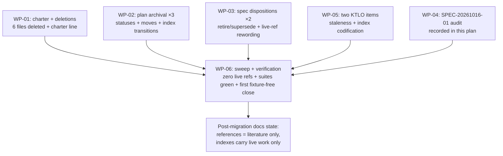

# PLAN-20261021-03: Docs hygiene and retirement — the references charter, the fixture tooling's retirement, plan/spec archivals

Last modified: 2026-10-21
Status: Completed

## Objective

Execute the human-ruled docs-hygiene + retirement changeset (2026-10-21):
codify the `references/` charter (literature notes and their gleanings
ONLY — deleting the four migration artifacts and the two fixture-tooling
scripts the charter displaces), archive three plans and two specs per the
terminal-plan patterns, reword the live references to the retired
tooling, record the SPEC-20261016-01 audit, create the two ruled KTLO
items, and retire the close pattern's fixture-regeneration discipline —
this changeset's close is the first without it. No specification governs
this plan (ruled housekeeping); acceptance lives in the per-WP criteria
per the PLAN-20261019-03 precedent for slices without scenario
contracts.

The plan artifact follows the full arc (draft → review → commit → push);
implementation is subsequent gated work.

## Scope

### Included

- WP-01: the `references/` charter — the charter statement in
  `references/index.md` and the six deletions it rules (the two
  migration records, the two fixture files, the two fixture scripts).
- WP-02: the three plan archivals (PLAN-20261019-05, PLAN-20260903-01,
  PLAN-20260904-01) — statuses, moves, index transitions, and the
  supersession/link re-points.
- WP-03: the two spec dispositions (SPEC-20261017-01 retired,
  SPEC-20260903-01 superseded) and the live-reference rewording the
  sweep surfaces.
- WP-04: the SPEC-20261016-01 audit — read-only diligence recorded in
  this plan; the disposition leans for Gate 1.
- WP-05: the two ruled KTLO items (plan-lifecycle staleness;
  index-row-format codification) + the `ktlo/index.md` rows.
- WP-06: the reference sweep and the integration verification — the
  zero-live-reference confirmation, the suites' greenness without the
  deleted scripts, and the first fixture-regeneration-free close.

### Excluded

- **Workspace-package behavior changes.** None: every behavior-affecting
  edit is root-level (references/, scripts/, docs/, ktlo/, and
  `.gitattributes`); the ONLY package-file edit is
  `packages/roundhouse-cli/test/composer.test.js`'s comment reword —
  comment-only, no API or runtime change.
- **The deprecation ceremony and any future publishing.** Documented
  commands, not work (the PLAN-20261019-06 disposition stands).
- **The Phase 7 comparison record's relocation.** Deleted, not moved —
  the ruled charter gives it no post-migration value.
- **New decision records.** The plan's leans were Gate 1 arbitration
  points, ruled 2026-10-21; no decision records.
- **SPEC-20261016-01 implementation work.** The audit is read-only
  diligence; its disposition is ruled at Gate 1, and any follow-up
  implementation is separate work.

## Related specifications and decisions

- `KTLO-20261019-01` (Resolved) — the KTLO pattern this plan's two new
  items follow (the canonical template, the closure pattern).
- `DEC-20261017-01..04` — the migration's decision records; their
  fixture/tooling mentions are historical records kept per the Phase 8
  precedent (DEC-20261017-04 committed the fixture tooling its Slice A).
- `SPEC-20261017-01` — the fixture tooling's specification; its subject
  is deleted by this changeset (retired, WP-03).
- `SPEC-20261016-01` — the audit target (WP-04).
- `PLAN-20261019-06` (archived) — the Phase 9 record holding the legacy
  package's deprecation command, referenced by PLAN-20260903-01's
  supersession note.
- The PLAN-20261021-01/02 archived precedents — the terminal-plan
  pattern (Status, move, index transitions) this plan applies.

## Current-state findings

- **The migration's landed state (verified).** Phases 1–9 are landed:
  the Phase 7+8 changeset (03bad7b, 2026-10-20 — the matrix suite, the
  comparison record, the sweep, the husk deletion, the fixture
  regeneration), the Phase 9 close (5297372), the PR #4 remediation
  (db6be0b), and the test-commit guard (881b4b1). The external acts
  (the legacy package's deprecation ceremony; future publishing) remain
  documented commands.
- **The `references/` inventory (verified).** 17 literature notes
  (+ one PDF) and four migration artifacts: `migration-baseline.json`
  (344-entry fixture), `migration-baseline.schema.json`,
  `migration-phase1-baseline.md`, `migration-phase7-comparison.md`. The
  index (`references/index.md`) is the literature index; the four
  artifacts are not indexed in it.
- **The fixture tooling's consumption map (verified).**
  `scripts/test-migration-baseline.js` requires
  `scripts/generate-migration-baseline.js` (the only import edge — the
  two are deleted together); no other script, suite, or agent file
  imports either; `package.json` wires NO baseline script (its 12
  scripts verified: commit, sync-roundhouse, test-sync, test-package,
  test-commit, check-contracts, check-deps, check-matrix, check-drift,
  check-pack, check-render, check-all); `check-all.js`'s five checks
  exclude it; the
  workflow docs (root + seed AGENTIC_WORKFLOW.md, AGENTS.md copies) and
  every KTLO item are clean (zero references).
- **The three Active specs' reference map (verified).**
  SPEC-20261019-01 names NO deleted path — its "committed fixture"
  language (SCEN-047/050/051, the derivation rule, the
  same-changeset-regeneration scenario) is conceptual, describing
  landed Phase 2 work whose evidence was the fixture; the heavy
  references are conceptual, not mechanical.
  SPEC-20261019-02 names the fixture generator as the exit-code
  provenance in FIVE instances (L46, L90, L142–143, L158–159,
  L382–383 — the last two normative) — reworded so the 0/1/2 convention
  stands on its own.
  SPEC-20261019-03 L509 names `scripts/test-migration-baseline.js` in
  the definition-of-done suite list — remove it (a deleted script in
  normative text); L90 records the committed fixture as the move
  evidence (historical).
- **The DRs' mentions (verified, historical).** DEC-20261017-03 L232
  (the risk table's annotation-mitigation row) and DEC-20261017-04's
  Slice A commitments (L101–322) reference the fixture tooling as
  history — both DRs are Active decision records whose text records
  past rulings; kept per the Phase 8 precedent (historical mention, no
  re-pointing).
- **The composer suite's dead reference (verified).**
  `packages/roundhouse-cli/test/composer.test.js` L66's comment names
  `test-migration-baseline.js` as the exit-safety-net precedent — a
  live file naming a to-be-deleted script; reworded (WP-03).
- **The archive patterns (verified).** `docs/specs/archive/` exists with
  an index whose table carries a placeholder row ("No archived
  specifications yet") and no archived specs; docs-check enforces
  terminal specs in `specs/archive/` (terminal-archive), no
  active/archive duplication, and reciprocity for mechanical
  "Superseded by:" links (any doc in docs/ carrying
  "Superseded by: X" requires X to carry "Supersedes: <id>"). The plans
  archive's pattern is established (eight entries).
- **The three plan docs' states (verified).** PLAN-20261019-05: Ready,
  unmodified since dd02325, implementation landed 03bad7b (the
  plan-lifecycle lag this changeset closes; no markdown links in the
  doc). PLAN-20260903-01: In progress, shipped v0.5.1 and v0.6.0 per
  the release records (v0.5.0 per v0.5.1's changes-since reference),
  carries one markdown link —
  `[SPEC-20260903-01]` targeting `../specs/SPEC-20260903-01.md` — which must be
  re-pointed to the archive location when both move. PLAN-20260904-01:
  Ready, no links; its target skill (`repository-documentation`) was
  dissolved in the migration; the index conversion landed by other
  means (all current indexes conform to the intended canonical shape);
  the codification never landed.
- **The template scan (verified).** Neither `docs/plans/template.md`
  nor the Core seed copy
  (`packages/roundhouse-core/seed/docs/plans/template.md` — verified to
  exist) codifies a fixture stub or mentions the baseline tooling;
  nothing to update for the close-pattern change (recorded as
  verification, not work).
- **The SPEC-20261016-01 audit (verified — WP-04's record).** Created
  a08aa32, amended 4cbb03d ("defer branch and PR conventions to
  repository guidance"), sweep-link-fixed in 03bad7b; Active; its
  Purpose states the capability is a proposal, "not evidence that the
  capability is implemented". The implementation state is PARTIAL: the
  branch-name and PR conventions landed in `CONTRIBUTING.md` (the
  "Pull request conventions" and "Branch name" sections, including the
  human example PR), but the behavioral flow is not codified in agent
  guidance — the orchestrator's prompt has no beginning-of-work branch
  dialog (SCEN-004's "orchestrator asks at the beginning of work
  whether the collaborator wants a branch"), and the draft/ready
  publication-proposal flow appears in no agent prompt. Disposition
  lean: keep Active (the status honestly describes the un-landed
  behavioral half); the audit's record lives in this plan; the
  remaining implementation path (orchestrator-prompt codification) is a
  separate follow-up candidate (flagged for Gate 1).
- **The KTLO pattern (verified).** The canonical template
  (`ktlo/template.md`) requires the five self-contained fields;
  the resolved-item closure pattern (KTLO-20261009-02) is a Resolution
  section plus a dated History row.

## Intended shape

After this plan, `references/` contains only literature notes and their
gleanings — the charter line codifies the boundary, and the four
migration artifacts plus the two fixture scripts are deleted (no
consumer breaks: the consumption map is empty outside the
self-referential pair). Three plans and two specs are archived per the
terminal patterns (the active indexes carry only live work; the archive
indexes carry the records). The live references to the retired tooling
are reworded; the DRs' historical mentions stand. The two KTLO items
record the process lessons (plan-lifecycle staleness; index-row-format
codification). The close pattern drops the fixture regeneration — this
changeset's close is the first without it, and no template codifies the
old stub.

## Work packages

### WP-01: The references charter and the deletions

**Description:** Codify the ruled boundary and delete everything it
displaces: the two migration records, the two fixture files, and the two
fixture scripts.

**Tasks:**

- T-01: Add the charter statement to `references/index.md` — a one-line
  prose boundary near the top: "This folder contains only literature
  notes and what was gleaned from them; migration-era artifacts were
  retired post-migration (PLAN-20261021-03)." Prose only — docs-check
  does not police `references/` (Required).
- T-02: Delete the six files (Required): `references/migration-phase7-comparison.md`;
  `references/migration-phase1-baseline.md`;
  `references/migration-baseline.json`;
  `references/migration-baseline.schema.json`;
  `scripts/generate-migration-baseline.js`;
  `scripts/test-migration-baseline.js`. The `.gitattributes` cleanup
  rides the deletions: the two stale `eol=lf` lines for the deleted
  fixture files (`.gitattributes` L1–2) are removed outright — ruled,
  not ruled-historical (Required). Rationale (recorded in this
  plan): the records are not durable (no post-migration value); the
  fixture's protective role is redundant with git's own tracking;
  nothing consumes its hashes; the ongoing regeneration role was
  self-perpetuating discipline accreted by plan-copying.

**Dependencies:** None. Blocks WP-06 (the sweep verifies the deletions).

**Parallelism:** Independent of WP-02/WP-03/WP-04/WP-05.

**Acceptance criteria:**

- The six paths are gone from the working tree and the index; the
  charter line is present; `references/` contains only literature
  notes (+ the PDF) and the index.

### WP-02: The three plan archivals

**Description:** The terminal-plan transitions (the
PLAN-20261021-01/02 archived precedent): status, move, active-row
removal, archive-row addition.

**Tasks:**

- T-03: PLAN-20261019-05 (Phase 7 — composition matrix) → Completed:
  status edit, move to `docs/plans/archive/`, active-row removal,
  archive-row addition. The implementation record: landed at 03bad7b
  (2026-10-20) and verified green (the matrix suite's seven
  installations, the comparison record, the sweep, the husk deletion);
  a dated re-verification note is added to the plan doc's
  Current-state findings recording that the implementation landed and
  every premise the plan's findings carried at authoring has since been
  superseded by the landed state (Required).
- T-04: PLAN-20260903-01 (GitHub Packages distribution) → Completed
  with a supersession note: status edit, move, index transitions, the
  spec link re-pointed to
  `../../specs/archive/SPEC-20260903-01.md` (resolving from the doc's
  post-move location `docs/plans/archive/`), and a prose supersession
  note in the doc body — shipped v0.5.1 and v0.6.0 per the release
  records (v0.5.0 per v0.5.1's changes-since reference); superseded by
  the package-family migration (DEC-20261017-01..04); the legacy
  package's deprecation command is documented in the Phase 9 record
  (PLAN-20261019-06). Guard: the note must NOT use the line-start
  `Superseded by: <id>` mechanical format — docs-check regex-enforces
  that form with fatal reciprocity against the named doc — phrase the
  supersession mid-sentence instead (Required).
- T-05: PLAN-20260904-01 (Standardize index.md structure) → Superseded:
  status edit, move, index transitions, and a prose supersession note —
  its target skill (`repository-documentation`) was dissolved in the
  migration; the index conversion landed by other means (all current
  indexes conform to the intended canonical shape); the codification
  never landed (it is WP-05's KTLO-20261021-03's subject) (Required).

**Dependencies:** None for the moves; T-05's supersession note
references WP-05's item (the note may name the item ID — coordinate the
KTLO numbering first). Blocks WP-06.

**Parallelism:** Independent of WP-01/WP-03/WP-04/WP-05 (the note's item
reference coordinated before staging).

**Acceptance criteria:**

- The three docs are in `docs/plans/archive/` with their terminal
  statuses and notes; the active index carries only live rows; the
  archive index carries the three rows; no active/archive duplication
  (docs-check green).

### WP-03: The spec dispositions and the live-reference rewording

**Description:** Retire and archive the two specs; reword the live
references to the retired tooling.

**Tasks:**

- T-06: SPEC-20261017-01 → Retired: status edit, move to
  `docs/specs/archive/`, the active row removed from
  `docs/specs/index.md` (the index transition mirroring WP-02's
  wording), a prose retirement note in the body (the
  fixture tooling was deleted in this changeset; the spec's subject no
  longer exists; the fixture's protective role is redundant with git's
  tracking), an archive-index row, and the placeholder row's removal
  from `docs/specs/archive/index.md`. Its 18 fixture mentions are the
  retirement record's own historical text — kept (Required).
- T-07: SPEC-20260903-01 → Superseded: status edit, move to
  `docs/specs/archive/`, the active row removed from
  `docs/specs/index.md` (mirroring WP-02's wording), a prose
  supersession note in the body (same
  charter as its plan — the v0.5.x single-package lifecycle superseded
  by the package-family migration). Guard: the same mechanical-format
  prohibition as T-04 — no line-start `Superseded by: <id>`; phrase
  mid-sentence — plus an archive-index row (Required).
- T-08: The live-reference rewording (Required): SPEC-20261019-02's
  "fixture generator" provenance instances — ALL FIVE reworded so the
  0/1/2 exit-code convention stands on its own: L46 ("codes 0/1/2
  mirroring the fixture generator", Public contracts), L90 (the
  SPEC-20261017-01 house-precedent line naming the exit codes), L142–143
  ("the `scripts/commit.js` and fixture-generator precedent",
  Constraints), L158–159 ("mirroring the fixture generator", Public
  contracts, normative), L382–383 ("Exit codes mirror the fixture
  generator:", Command semantics, normative) — the ruled intent applies
  to every instance; SPEC-20261019-03 L509 —
  `scripts/test-migration-baseline.js` removed
  from the definition-of-done suite list;
  `packages/roundhouse-cli/test/composer.test.js` L66 — the
  exit-safety-net comment reworded to not name the deleted script.
  (SPEC-20261019-02's SPEC-20261017-01 ID pointers at L190 and L424
  remain valid — historical references to the archived spec's ID.)
- T-09: SPEC-20261019-01's post-migration note (Expected — ruled, Gate
  1 2026-10-21: the short prose note) — that the baseline
  fixture tooling is retired post-migration and the fixture-derived
  artifacts in the spec's scenarios are historical evidence.

**Dependencies:** None. Blocks WP-06.

**Parallelism:** Independent of WP-01/WP-02/WP-04/WP-05.

**Acceptance criteria:**

- Both specs are in `docs/specs/archive/` with terminal statuses,
  notes, and archive rows; the placeholder is gone; docs-check green
  (terminal-archive, no duplication).
- No live normative text names the deleted scripts (the sweep
  confirms).

### WP-04: The SPEC-20261016-01 audit

**Description:** The read-only diligence, recorded here (no file
changes): the implementation state and the ruled disposition
(kept Active — Gate 1, 2026-10-21).

**Tasks:**

- T-10: The audit record (this plan is the record; nothing to edit): —
  the spec is PARTIALLY implemented: the branch-name and PR conventions
  landed in `CONTRIBUTING.md` via the 4cbb03d deferral (the "Pull
  request conventions" and "Branch name" sections, the human example
  PR); the behavioral flow — the beginning-of-work branch dialog
  (SCEN-004), the draft/ready publication-proposal flow, the
  publication-gate contract — is NOT codified in any agent prompt (the
  orchestrator's prompt's branch mentions are amend/push hygiene only).
  The lean: keep Active (the status honestly describes the un-landed
  behavioral half; the spec's self-description already says
  "not evidence that the capability is implemented"); the remaining
  implementation path (orchestrator-prompt codification of the branch
  dialog and the publication flow) is a separate follow-up candidate —
  flagged for the human; NOT folded into WP-05's items (a different
  concern). Disposition ruled (Gate 1, 2026-10-21): keep Active; the
  follow-up is flagged but NOT created as a third KTLO item in this
  changeset (Required).

**Dependencies:** None.

**Parallelism:** Independent; a documentation task.

**Acceptance criteria:**

- The audit's finding and the ruled disposition (kept Active) are
  recorded in this plan; nothing else changes.

### WP-05: The two ruled KTLO items

**Description:** Create the two items from the canonical template
(all required fields populated) and index them.

**Tasks:**

- T-11: `ktlo/KTLO-20261021-02.md` — plan-lifecycle staleness: nothing
  detects "a plan/spec whose implementation landed but whose
  status/location never advanced" (this session caught
  PLAN-20261019-05 four changesets late; the same lag hid the Phase 7+8
  completion behind the session-start context's "Phase 7+8 planned but
  not implemented"). Required fields per the canonical template;
  `[project]` marker (Required).
- T-12: `ktlo/KTLO-20261021-03.md` — index-row-format codification: the
  index shapes are enforced mechanically (docs-check) but codified
  nowhere an agent/human can read them (the PLAN-20260904-01
  codification never landed; its target skill was dissolved); target:
  the docs-general skill gains the index-format codification (the four
  patterns + the canonical column order) (Required).
- T-13: The `ktlo/index.md` rows — one per item, `[project]` markers,
  dated 2026-10-21 (Required).

**Dependencies:** The KTLO numbering must be settled before WP-02's
T-05 note (the supersession note may name the item). Blocks WP-06.

**Parallelism:** Independent of WP-01/WP-03/WP-04.

**Acceptance criteria:**

- Both items exist at the canonical template's required-field bar and
  are indexed; a reader with no prior context can understand each from
  its own content.

### WP-06: The reference sweep and the integration verification

**Description:** The durable verification: zero live references to the
deleted paths, the suites green without the deleted scripts, docs-check
and markdownlint green, and the first fixture-regeneration-free close.

**Tasks:**

- T-14: The live-reference sweep (Required): grep
  "migration-baseline", "generate-migration-baseline",
  "test-migration-baseline", "migration-phase7-comparison",
  "migration-phase1-baseline", and — the PHRASE grep the literal-path
  terms miss — "fixture generator" across the repo; the
  live-vs-historical
  ruling per the Phase 8 precedent — live normative text (Active specs,
  workflow docs, scripts, npm scripts) carries ZERO mentions;
  historical records (the archived plans, the retired spec, the DRs'
  past-ruling text) keep their mentions. The expected live side after
  WP-01..WP-03: zero (the verified consumption map is the baseline).
- T-15: The suites' greenness without the deleted scripts (Required):
  the composer suite, the matrix suite, `test-sync.js`,
  `test-package.js`, `test-commit.js` — each must run green and none
  may import the deleted scripts (the verified import map: only the
  deleted pair referenced each other; composer.test.js's comment is
  reworded in T-08).
- T-16: The close (Required): stage the changeset by explicit path
  (`package-lock.json` never staged), docs-check green, markdownlint
  green on touched files — and NO fixture regeneration step exists:
  `references/migration-baseline.json` is deleted; the
  `test-migration-baseline.js` run is impossible; the close's
  verification narrative records the absence as the retired
  discipline's first exercise (Required).

**Dependencies:** WP-01..WP-05 (the changeset-close tree). Strictly
last.

**Parallelism:** None.

**Acceptance criteria:**

- The sweep is green (zero live references); the suites are green;
  docs-check and markdownlint pass; the close completed with no
  fixture step.

## The close-pattern change (ruled)

Future plans DROP the fixture-regeneration work package. The plan
template (`docs/plans/template.md` and its Core seed copy) carries no
fixture stub to update (verified — the scan in Current-state findings);
the discipline was accreted by plan-copying, not template mandate, so
the retirement needs no template edit — the plans' authors stop copying
the WP. The verification criteria of future plans likewise stop
carrying the fixture/test-migration-baseline items. The KTLO
KTLO-20261021-02 (plan-lifecycle staleness) partially covers the class;
the retirement itself is this plan's act.

## Dependencies

- WP-01..WP-05 are mutually parallel except the two recorded
  coordinations: WP-02 T-05's note may name WP-05's item ID (numbering
  settled first), and WP-06 is strictly last after all.
- No external dependencies: Node 24 built-ins only; the deletions
  remove no live import edge.

## Changeset granularity

**One commit (confirmed — Gate 1, 2026-10-21)**, landing on
`feature/composable-workflow`:

| Commit | Work packages | Content |
| --- | --- | --- |
| 1 | WP-01..WP-06 | The charter + the six deletions, the three plan archivals, the two spec dispositions, the live-reference rewording, the audit record, the two KTLO items, the sweep verification |

The plan-creation changeset (this plan + its `docs/plans/index.md` row)
precedes the implementation changeset and is separate; it is docs-only
and needs no changeset file — and NO fixture regeneration (the plan
doc's and the index row's fixture drift, if the fixture still existed at
implementation close, would be absorbed by the deletions; the discipline
is retired as of this plan's ruling). The lockfile stays out of the
commit (untracked, human-ruled).

**The changeset file — ruled none (Gate 1, 2026-10-21):** the changeset
is root-level deletions and docs; no workspace-package behavior change;
the versioning workflow's rule attaches to package-affecting
changesets.

## Change map

| File | Action | Purpose |
| --- | --- | --- |
| `docs/plans/PLAN-20261021-03.md` | Create | This plan (plan-creation changeset) |
| `docs/plans/index.md` | Modify | Add this plan's row (plan-creation); the three rows removed (WP-02) |
| `docs/plans/archive/index.md` | Modify | The three archive rows (WP-02) |
| `docs/plans/PLAN-20261019-05.md` | Move + Modify | Completed + re-verification note (WP-02, T-03) |
| `docs/plans/PLAN-20260903-01.md` | Move + Modify | Completed + supersession note + link re-point (WP-02, T-04) |
| `docs/plans/PLAN-20260904-01.md` | Move + Modify | Superseded + note (WP-02, T-05) |
| `references/migration-phase7-comparison.md` | Delete | The charter (WP-01, T-02) |
| `references/migration-phase1-baseline.md` | Delete | The charter (WP-01, T-02) |
| `references/migration-baseline.json` | Delete | The charter (WP-01, T-02) |
| `references/migration-baseline.schema.json` | Delete | The charter (WP-01, T-02) |
| `scripts/generate-migration-baseline.js` | Delete | The charter (WP-01, T-02) |
| `scripts/test-migration-baseline.js` | Delete | The charter (WP-01, T-02) |
| `references/index.md` | Modify | The charter statement (WP-01, T-01) |
| `.gitattributes` | Modify | The two stale `eol=lf` lines for the deleted fixture files removed (WP-01, T-02) |
| `docs/specs/SPEC-20261017-01.md` | Move + Modify | Retired + rationale (WP-03, T-06) |
| `docs/specs/index.md` | Modify | The two active rows removed (WP-03, T-06/T-07) |
| `docs/specs/SPEC-20260903-01.md` | Move + Modify | Superseded + note (WP-03, T-07) |
| `docs/specs/archive/index.md` | Modify | The two archive rows; the placeholder removed (WP-03, T-06/T-07) |
| `docs/specs/SPEC-20261019-02.md` | Modify | The exit-code provenance rewording (WP-03, T-08) |
| `docs/specs/SPEC-20261019-03.md` | Modify | The suite list fix + the historical note (WP-03, T-08) |
| `docs/specs/SPEC-20261019-01.md` | Modify | The post-migration note (WP-03, T-09; ruled) |
| `packages/roundhouse-cli/test/composer.test.js` | Modify | The dead-reference comment reword (WP-03, T-08) |
| `ktlo/KTLO-20261021-02.md` | Create | Plan-lifecycle staleness (WP-05, T-11) |
| `ktlo/KTLO-20261021-03.md` | Create | Index-row-format codification (WP-05, T-12) |
| `ktlo/index.md` | Modify | The two rows (WP-05, T-13) |

No workspace-package BEHAVIOR changes (the only package-file edit is
`composer.test.js`'s comment reword — comment-only, no API or runtime
change);
`scripts/commit.js`, the npm scripts, and the check scripts untouched.

## Prescriptiveness levels

- **WP-01 — Required** for the six deletions' exact paths and the
  charter line's presence; **Expected** for the charter line's prose.
- **WP-02 — Required** for the three terminal statuses, the moves, the
  index transitions, and the link re-point; **Expected** for the
  notes' prose and the re-verification note's depth.
- **WP-03 — Required** for the two terminal statuses, the moves, the
  archive-index rows (the placeholder's removal), and the T-08
  rewordings' outcomes; **Expected** for the notes' prose and T-09's
  note depth (the short prose note — ruled, Gate 1 2026-10-21).
- **WP-04 — Required** for the audit's recording and the ruled
  disposition (kept Active — Gate 1, 2026-10-21); the flagged
  follow-up is not created as a third KTLO item in this changeset.
- **WP-05 — Required** for the two items' existence, the canonical
  template's required fields, and the index rows; **Expected** for the
  prose shape.
- **WP-06 — Required** for the sweep's zero-live-reference outcome, the
  suites' greenness, the no-lockfile rule, and the fixture-free close;
  **Expected** for the sweep's command shape.

## Acceptance criteria and traceability

No specification governs this plan; acceptance lives in the per-WP
criteria and the ruled objective's eight items, per the
PLAN-20261019-03 precedent. The traceability map:

| Ruled item | Work package | Tasks | Verification |
| --- | --- | --- | --- |
| 1. The references charter + deletions | WP-01 | T-01, T-02 | The charter line; the six paths gone; the sweep |
| 2. Plan archival ×3 | WP-02 | T-03..T-05 | The statuses/moves/rows; docs-check |
| 3. Spec dispositions ×2 + rewording | WP-03 | T-06..T-09 | The archive rows; the zero-live-reference sweep |
| 4. The SPEC-20261016-01 audit | WP-04 | T-10 | The recorded finding + the Gate 1 ruling |
| 5. Two KTLO items | WP-05 | T-11..T-13 | The items + index rows |
| 6. The close-pattern change | The section above | — | The template scan; the fixture-free close |
| 7. The reference sweep | WP-06 | T-14 | The live-vs-historical map, green |
| 8. The verification narrative | WP-06 | T-15, T-16 | The suites green; the fixture-free close recorded |

## Documentation stubs

- [x] Create this plan + its `docs/plans/index.md` row (the
  plan-creation changeset).
- [ ] Create the two KTLO items + index rows (WP-05; lands in the
  implementation changeset).
- [ ] No new decision records: the leans were ruled at Gate 1
  (2026-10-21).
- [x] Update this plan's `docs/plans/index.md` row status as the plan
  advances (Draft → Ready → In progress → Completed).

## Verification criteria

- [ ] The six deleted paths are gone; `references/` contains only
  literature notes (+ the PDF) and the charter line is present.
- [ ] The three plans and two specs are archived with terminal
  statuses, notes, and archive rows; no active/archive duplication;
  docs-check green.
- [ ] The live-reference sweep is green: zero live normative mentions
  of the deleted paths (the DRs' and archives' historical mentions
  stand).
- [ ] The suites are green without the deleted scripts: the composer
  suite, the matrix suite, `test-sync.js`, `test-package.js`,
  `test-commit.js`.
- [ ] The two KTLO items exist per the canonical template's required
  fields and are indexed.
- [ ] The close completed with NO fixture regeneration step (the first
  fixture-free close; `test-migration-baseline.js` does not run — it is
  deleted).
- [ ] `node .opencode/docs-check.js` passes.
- [ ] `npx --yes markdownlint-cli2@0.23.2` passes on every touched
  Markdown file.
- [ ] The changeset is exactly one commit on
  `feature/composable-workflow`; the lockfile appears nowhere in it.

## Readiness

**Score: 8/10 — Ready (Gate 1 approved 2026-10-21; the rulings are
recorded below).**

The ruled objective is fully evidenced: the consumption map is empty
outside the self-referential script pair; the templates carry no
fixture stub; the archival patterns are established and mechanically
enforced; the audit's implementation-state finding is verified to the
prompt level.

### Gate 1 rulings (2026-10-21)

Applied in this plan per the SPEC-20261019-01 resolution style:

- [x] All six arbitration points are accepted as proposed, each per
  its recorded lean: no changeset file (root-level deletions and docs
  only); SPEC-20261019-01's post-migration note as the short prose
  note; the supersession via prose notes only (no mechanical
  "Superseded by:"/"Supersedes:" reciprocity wiring — an Active
  decision's text stays untouched); SPEC-20261016-01 keeps Active with
  the audit recorded, and the branch-dialog codification follow-up is
  flagged but NOT created as a third KTLO item in this changeset; the
  one-commit granularity on `feature/composable-workflow`; the
  composer.test.js comment reworded (the dead reference goes).
- [x] The close-pattern ruling confirmed: this changeset's close drops
  the fixture-regeneration step — the first such close.
- [x] The plan approved as proposed: the six-WP structure, the
  traceability map against the ruled objective's eight items, and the
  live-vs-historical reference map.

Blockers — all resolved:

1. The changeset file: RESOLVED — none.
2. SPEC-20261019-01's post-migration note depth: RESOLVED — the short
   prose note.
3. The supersession mechanics: RESOLVED — prose notes only.
4. SPEC-20261016-01's disposition: RESOLVED — keep Active; the
   follow-up flagged, not created here.
5. The one-commit granularity: CONFIRMED.
6. The composer.test.js comment: RESOLVED — reworded.
7. The fixture-free close: CONFIRMED (the close-pattern change).

Non-blocking: the charter line's exact prose; the notes' wording; the
KTLO items' prose shape; the sweep's command shape; the
PLAN-20261019-05 re-verification note's depth.
