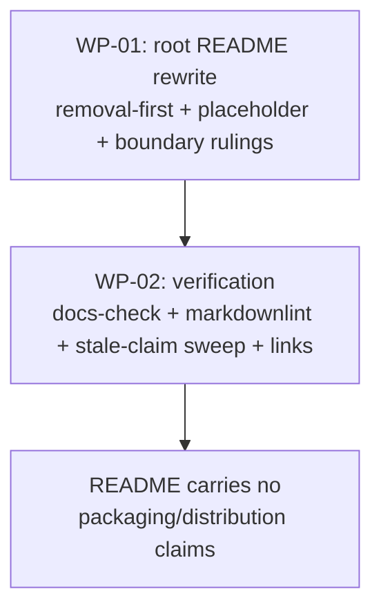

# PLAN-20261021-04: README refresh to the post-migration reality

Last modified: 2026-10-23
Status: Completed

## Objective

Refresh the root `README.md` to the post-migration reality per the
human's 2026-10-22 ruling: remove or correct the stale state info —
including ALL packaging/distribution/publishing details (the dead
GitHub Packages story, the retired release workflow, the npm-metadata
claims, the registry-install command) — replaced at most by a short
placeholder for future packaging details once the npm publishing
tooling is in place (the human expects that tooling to land in this
branch before PR #4 merges; the README makes no promises, no design,
no timeline claims beyond that). The seed README needs NO updates —
the human confirmed it is a clean project placeholder. No
specification governs this plan (ruled docs refresh); acceptance lives
in the per-WP criteria and the stale-claim sweep, per the
PLAN-20261019-03 precedent for slices without scenario contracts.

The plan artifact follows the full arc (draft → review → commit →
push); implementation is subsequent gated work.

## Scope

### Included

- WP-01: the root README rewrite — the removal-first disposition (all
  packaging/distribution/publishing content deleted), the placeholder
  section for future packaging details, and the kept sections'
  boundary rulings (ruled at Gate 1, 2026-10-22 — see Readiness).
- WP-02: verification — docs-check, markdownlint, the stale-claim
  sweep (root README only), and link resolution.

### Excluded

- **The seed README.** The human ruled NO updates — it is a clean
  project placeholder (verified: 15 lines, zero distribution claims);
  `packages/roundhouse-core/seed/README.md` is untouched by this
  changeset.
- **CONTRIBUTING.md, BUILDING.md, TESTING.md, AGENTIC_WORKFLOW.md** —
  recently fixed or out of scope; untouched.
- **Any CI workflow changes.** The CI-failure investigation is a parked
  follow-up; this plan adds NO CI badge or CI-status claim to the
  README.
- **The publishing-model decision.** The human explicitly deferred that
  discussion ("we need to discuss how that's going to work at some
  point"); the README says only what is true — nothing publishes, and
  the placeholder defers the details to the future tooling.
- **The deprecation ceremony's execution.** A documented command in the
  archived Phase 9 record; deliberately unexecuted.
- **New decision records.** The plan's leans were Gate 1 arbitration
  points, ruled 2026-10-22; no decision records.

## Related specifications and decisions

- `PLAN-20261021-03` (archived) — the house plan precedent; the
  fixture-free close pattern it established.
- `PLAN-20261019-06` (archived) — the Phase 9 record: the publishing
  deferral ruling and the documented deprecation command.
- `DEC-20261017-01..04` — the package-family architecture the README's
  kept sections describe.
- The human's 2026-10-22 ruling — the removal-first disposition, the
  placeholder's charter, the seed-README no-change ruling, and the
  npm-publishing-lands-in-this-branch expectation.

## Current-state findings

- **The root README's section map (verified, L1–220).** KEPT (current):
  the Overview (L1–17), "The package family" (L18–36 — see the
  boundary finding below), "Adopting the Template" (L98–115, trimmed
  per T-06), "Workflow at a Glance" / "Skill
  Architecture" (L116–141), "Repository Structure" (L143–152),
  "Guiding Principles" (L153–166), "Key Files" (L168–185, minus the
  stale bits below), "Requirements" (L212–216, light-touch per T-06),
  "Contributing" (L218–220). REMOVED (the
  removal-first disposition): L38–97 ("Installing the private
  package" — the dead `@backshopdev/roundhouse` GitHub Packages story,
  the `src/` template contents, the empty `.npmignore`, the legacy
  `npx @backshopdev/roundhouse init/update` commands, the `.npmrc`
  token configuration, the 404 troubleshooting); L189–210 ("Releasing"
  — the retired tag-validated release workflow, tag protection,
  release environments; `publish.yml` was retired at Phase 9); L186–187
  ("The root README.md is also published as npm package metadata…");
  L183's "published package metadata" phrase; L22–26's
  `npm install -D @backshop/roundhouse-cli …` command block (it cannot
  work today — nothing is on any registry).
- **The docs-layout list is CURRENT (verified — a diligence
  correction).** L111's structured-docs list (`docs/decisions/`,
  `docs/specs/`, `docs/plans/`, `docs/architecture/`,
  `docs/contracts/`, `docs/implementation-maps/`) is accurate — all six
  directories exist with their `index.md` files (docs-check polices
  them). The discretionary extension: `docs/releases/` (carrying
  v0.5.1.md and v0.6.0.md).
- **The package-family boundary (verified — the Gate 1 centerpiece).**
  L18–21's architecture description (the `@backshop/roundhouse-*`
  family, the CLI/Core foundation pair, the 31 capability packages)
  and L28–36's composer commands (`roundhouse init`/`compose`/`verify`
  and what they write) are REAL and CURRENT — workspace packages exist,
  the composer bin works. Only L22–26's registry-install command block
  is dead. The ruling's "removing anything about packaging except
  maybe a placeholder" was arbitrated at Gate 1 (2026-10-22): the lean
  stands — the architecture description and the composer commands
  stay, the install/registry claims go per T-04.
- **The seed README (verified + ruled).** A 15-line project placeholder
  (`# [Project Name]`, Overview/Contributing placeholders) with zero
  distribution claims; the human confirmed NO updates — it is
  untouched by this changeset.
- **The factual posture (the human's ruling + the Phase 9 record).**
  Nothing publishes today: every package is `private: true` at `0.0.0`;
  Changesets manages versioning; publishing to npm is a future concern
  whose tooling is expected to land in this branch before PR #4 merges
  (the README's placeholder defers the details to that tooling);
  publishing to GitHub Packages is "not necessary or appropriate"; the
  legacy `@backshopdev/roundhouse` package's deprecation command is
  documented in the archived Phase 9 record but deliberately
  unexecuted. CI runs the check suite on PRs/pushes to main — and the
  pipelines currently FAIL (reported 2026-10-22); the investigation is
  a parked follow-up; the README carries no CI badge or status claim.
- **The scripts/engines facts (verified).** `package.json`: 12 scripts;
  `engines.node >= 24.0.0`; `private: true`; the exactly-pinned
  `@changesets/cli` devDependency. The composer CLI's requirements:
  OpenCode (the workflow) + Node 24 (the `roundhouse` bin) + Node for
  `markdownlint-cli2` via `npx`.
- **The composition mechanics (verified).** The root `README.md` is
  consumer-owned (the composer created it once; seeds are never
  overwritten) — editing it touches no package content and requires no
  recomposition.
- **The close pattern (verified).** The fixture-free close
  (PLAN-20261021-03's ruling): no fixture regeneration step exists in
  this changeset's close; docs-check and markdownlint are the close's
  checks.

## Intended shape

After this plan, the root README states only post-migration truths and
carries no packaging/distribution/publishing content: the dead
install/release stories are deleted outright, the registry-install
command block is gone, the npm-metadata claims are gone, and a short
placeholder section defers packaging details to the future npm
publishing tooling. The kept sections (the workflow, the structure,
the principles, the key files) stand; the package-family section's
boundary is ruled at Gate 1. The stale-claim sweep is green: zero
occurrences of the dead terms, no CI-status claim, no description of
how npm publishing WILL work.

## Work packages

### WP-01: The root README rewrite

**Description:** The removal-first disposition with the placeholder
section and the boundary rulings.

**Tasks:**

- T-01: Delete L38–97 ("Installing the private package") outright —
  the `@backshopdev/roundhouse` GitHub Packages story, the `src/`
  template contents, the `.npmignore`, the legacy
  `npx @backshopdev/roundhouse init/update` commands, the `.npmrc`
  token configuration, the 404 troubleshooting (Required).
- T-02: Delete L189–210 ("Releasing") outright — the retired
  tag-validated release workflow, tag protection, release environments
  (Required).
- T-03: Delete the npm-metadata claims — L186–187 ("also published as
  npm package metadata") and L183's "published package metadata"
  phrase ("LICENSE — project license") (Required).
- T-04: Delete the registry-install command block (L22–26's
  `npm install -D @backshop/roundhouse-cli …`) — it cannot work today;
  nothing is on any registry (Required).
- T-05: Add the placeholder section — a short "## Packaging" section
  (a sentence or two) stating that packaging and distribution details
  will be documented here once the npm publishing tooling is in place;
  no promises, no design, no timeline claims beyond that (Required;
  the home ruled: its own "## Packaging" section — Gate 1, 2026-10-22).
- T-06: The boundary rulings applied (all three ruled at Gate 1,
  2026-10-22, each per its recorded lean): the package-family section
  keeps the architecture description L18–21 and the composer commands
  L28–36, dropping only the install/registry claims per T-04;
  "Adopting the Template" stays as a trimmed adoption section — the
  stale `npx @backshopdev/roundhouse` steps go, the "What you get"
  list and the composed-engine note stay, the repo-based path
  described as clone/workspace + compose; the "start with just the
  docs" clause is qualified — the supported path is `init` (Required).
  The light-touch rewords ride the boundary rulings: L20's "Roundhouse
  distributes as the `@backshop/roundhouse-*` package family" →
  "Roundhouse is organized as the `@backshop/roundhouse-*` package
  family" (removing the distribution claim while keeping the
  architecture description); the L28 lead-in after the L22–26
  deletion ("Then compose your consumer:" → "Compose your
  consumer:"); L148's "docs/ — durable artifacts: decisions, specs,
  and plans" updated to the verified six-directory layout (decisions,
  specs, plans, architecture, contracts, implementation-maps); and
  L215's "to run the deployment CLI" corrected to the composer /
  `roundhouse`-bin phrasing (per the plan's own scripts/engines
  facts).

**Dependencies:** None. Blocks WP-02.

**Parallelism:** None (single-file work).

**Acceptance criteria:**

- Every packaging/distribution/publishing element is deleted; the
  placeholder states only the deferral; the ruled boundaries are
  applied; no CI badge or status claim exists.

### WP-02: Verification

**Description:** The checks and the sweep (root README only — the seed
README is ruled untouched).

**Tasks:**

- T-07: `node .opencode/docs-check.js` — PASS; `npx --yes
  markdownlint-cli2@0.23.2` on the README — PASS (Required).
- T-08: The stale-claim sweep across the root README (Required) —
  expect ZERO occurrences of: `@backshopdev/roundhouse`;
  `npm.pkg.github.com`; `npm install`; `installing the packages`;
  `deployment`; `src/` template references; the scoped legacy command
  phrase `npx @backshopdev/roundhouse`; "Releasing"; "GitHub
  Packages". Also expect: no CI badge or CI-status claim; no
  description of how npm publishing WILL work (that discussion is
  deferred by the human); the placeholder's deferral sentence as the
  only packaging-adjacent text.
- T-09: Every README link resolves (docs-check's link checks plus the
  manual pass) (Required).

**Dependencies:** WP-01. Strictly last.

**Parallelism:** None.

**Acceptance criteria:**

- All checks pass; the sweep's zero-occurrence expectations hold;
  every link resolves.

## Dependencies

- WP-01 → WP-02.
- No external dependencies.

## Changeset granularity

**One commit (confirmed — Gate 1, 2026-10-22)**, landing on
`feature/composable-workflow`:

| Commit | Work packages | Content |
| --- | --- | --- |
| 1 | WP-01, WP-02 | The root README rewrite (removal-first + placeholder) and the verification |

The changeset is root-docs-only (the seed README is ruled untouched) —
no changeset file, trivially: no package content changes at all. The
plan-creation changeset (this plan + its `docs/plans/index.md` row)
precedes the implementation changeset and is separate; it is docs-only
and needs no changeset file — and no fixture step (the fixture-free
close pattern). The lockfile stays out of the commit (untracked,
human-ruled).

## Change map

| File | Action | Purpose |
| --- | --- | --- |
| `docs/plans/PLAN-20261021-04.md` | Create | This plan (plan-creation changeset) |
| `docs/plans/index.md` | Modify | Add this plan's row — the first active row since the index emptied (plan-creation changeset) |
| `README.md` (root) | Modify | The removal-first rewrite + the placeholder (WP-01, T-01..T-06) |

No other files; no CI workflows; no package content changes (the seed
README is ruled untouched).

## Prescriptiveness levels

- **WP-01 — Required** for the four deletions' exact targets (L38–97,
  L189–210, the npm-metadata claims, the registry-install block), the
  placeholder's existence and its no-promises charter, and the
  absence of any CI claim; **Expected** for the placeholder's prose
  and the kept sections' light touch; the three boundary rulings and
  the placeholder's home are ruled (Gate 1, 2026-10-22 — the leans
  stand).
- **WP-02 — Required** for the checks' outcomes and the sweep's
  zero-occurrence expectations; **Expected** for the sweep's command
  shape.

## Acceptance criteria and traceability

No specification governs this plan; acceptance lives in the per-WP
criteria and the ruled objective's removal-first posture, per the
PLAN-20261019-03 precedent. The traceability map:

| Ruled element | Work package | Tasks | Verification |
| --- | --- | --- | --- |
| "Installing the private package" deleted | WP-01 | T-01 | The sweep's zero occurrences |
| "Releasing" deleted | WP-01 | T-02 | The sweep's zero occurrences |
| The npm-metadata claims deleted | WP-01 | T-03 | The sweep; the Key Files line |
| The registry-install block deleted | WP-01 | T-04 | The sweep's `npm install` expectation |
| The placeholder for future packaging details | WP-01 | T-05 | The deferral sentence; no promises/design/timeline |
| The boundary rulings (family section; adoption; the clause) | WP-01 | T-06 | The ruled shapes applied |
| No CI badge/status claim; no how-npm-publishing-will-work text | WP-01 | T-01..T-06 | The sweep's absence checks |
| Zero stale claims; links resolve | WP-02 | T-07..T-09 | The sweep; docs-check; the link pass |

## Documentation stubs

- [x] Create this plan + its `docs/plans/index.md` row (the
  plan-creation changeset).
- [ ] No new decision records: the leans were ruled at Gate 1
  (2026-10-22); the publishing-model decision is deferred by the human
  and NOT recorded here.
- [x] Update this plan's `docs/plans/index.md` row status as the plan
  advances (Draft → Ready → In progress → Completed).

## Verification criteria

- [ ] The four deletion targets are gone from the root README (the
  install story, the release workflow, the npm-metadata claims, the
  registry-install block).
- [ ] The placeholder section states only the deferral (no promises,
  no design, no timeline claims beyond the tooling's expected
  landing).
- [ ] The ruled boundaries are applied (the family section, the
  adoption section, the clause).
- [ ] The stale-claim sweep's zero-occurrence expectations hold
  (`@backshopdev/roundhouse`, `npm.pkg.github.com`, `npm install`,
  `installing the packages`, `deployment`, `src/` template
  references, the scoped legacy command phrase
  `npx @backshopdev/roundhouse`, "Releasing", "GitHub Packages").
- [ ] No CI badge or CI-status claim; no how-npm-publishing-will-work
  text.
- [ ] The seed README is untouched (verified — the ruled no-change).
- [ ] `node .opencode/docs-check.js` passes.
- [ ] `npx --yes markdownlint-cli2@0.23.2` passes on the touched file.
- [ ] Every README link resolves.
- [ ] The close is fixture-free (no regeneration step exists).
- [ ] The changeset is exactly one commit on
  `feature/composable-workflow`; the lockfile appears nowhere in it.

## Readiness

**Score: 8/10 — Ready (Gate 1 approved 2026-10-22; the rulings are
recorded below).**

The section map is verified to the line and genuinely complete — every
README section is dispositioned (the KEPT list carries "Adopting the
Template" as trimmed per T-06 and "Requirements" as light-touch per
T-06); the removal-first disposition
is pinned to the human's verbatim ruling; the sweep's expectations are
enumerated; the seed-README ruling is recorded as a no-change; the
npm-publishing-lands-in-this-branch expectation is pinned as the
placeholder's charter without promising anything.

### Gate 1 rulings (2026-10-22)

Applied in this plan per the house pattern:

- [x] All five arbitration points are accepted as proposed, each per
  its recorded lean: the package-family section keeps the architecture
  description and the composer commands (only the install/registry
  claims go); "Adopting the Template" stays as a trimmed adoption
  section; the placeholder gets its own "## Packaging" section; the
  "start with just the docs" clause is qualified; the one-commit
  granularity on `feature/composable-workflow` is confirmed.
- [x] The plan approved as proposed: the removal-first disposition,
  the placeholder's no-promises charter, the root-README-only scope
  (the seed README ruled untouched), and the sweep's zero-occurrence
  expectations.

Blockers — all resolved:

1. The package-family section's fate: RESOLVED — the architecture
   description and the composer commands stay; only the
   install/registry claims go (2026-10-22).
2. "Adopting the Template"'s fate: RESOLVED — a trimmed adoption
   section stays.
3. The placeholder's home: RESOLVED — its own "## Packaging" section.
4. The "start with just the docs" clause: RESOLVED — qualified.
5. The one-commit granularity: CONFIRMED.

Non-blocking: the placeholder's exact prose; the kept sections' light
touch; the `docs/releases/` extension of the layout list; the sweep's
command shape.

## The close (the established pattern)

Fixture-free: no regeneration step exists (the PLAN-20261021-03
ruling); the close is stage → docs-check → markdownlint → commit under
the normal gates. The lockfile never enters the commit.
