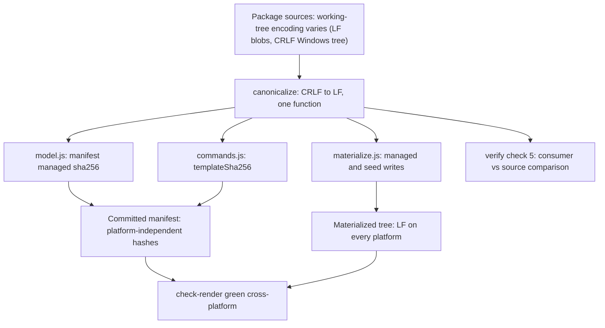

# PLAN-20261023-01: Cross-platform composition determinism — canonical-LF content ingestion

Last modified: 2026-10-23
Status: Completed

## Objective

Fix the cross-platform composition determinism defect that CI caught (the
human ruled option (A), 2026-10-23): the composer normalizes line endings to
LF at content ingestion — canonicalizing every materialized content stream to
UTF-8/LF regardless of the source's working-tree encoding — so
materialization, manifest hashing, and verification are platform-independent,
and the repository's canonical-serialization principle (UTF-8 without BOM, LF)
holds end-to-end. The ultimate criterion: the next CI run on PR #4 is green
(`check-render` passes cross-platform).

Implements SPEC-20261019-02 as amended by this plan's WP-02: the
materialization contract and the manifest hash semantics gain the
canonical-LF rule, and verify's comparison semantics are pinned to the
canonicalized comparison.

The plan artifact follows the full arc (draft → review → commit → push);
implementation is subsequent gated work.

## Scope

### Included

- WP-01: the composer normalization — one canonicalization function applied
  consistently at every content path: managed-source hashing, managed/seed
  materialization writes, the core-template hash, and verify's
  managed-file-vs-source comparison.
- WP-02: the SPEC-20261019-02 amendment — the canonical-LF materialization
  contract, the manifest hash semantics, verify's comparison semantics, the
  Constraints/Determinism surfaces, and the new scenario SCEN-075.
- WP-03: the test updates — the composer suite's normalization scenario
  (SCEN-075's test) plus the byte-equality sweep across the composer suite,
  `test-sync.js`, and `test-package.js`.
- WP-04: the root recompose (the committed manifest's hash regeneration —
  the expected content change, Appendix A), the changeset file, the
  check-pack deferral from the check-all aggregate (ruled in at Gate 1),
  the verification battery, and the CI-green criterion post-push.

### Excluded

- **The npm publishing model discussion.** Deferred by the human; untouched.
- **The CI workflow's overall shape.** Beyond the ruled check-pack deferral,
  ci.yml is untouched — the deferral lives in `check-all.js`'s aggregate,
  not in the workflow file.
- **A `.gitattributes` checkout policy.** The ruling is composer-side
  normalization; once ingestion canonicalizes, the sources' working-tree
  encoding cannot drift the composed artifacts, and a repo-level
  renormalization policy is a separate, unruled concern.
- **The legacy module's disposition.** `package/deploy-roundhouse.js` is
  Phase 6/8 territory; it changes nothing here — its init/update/deploy
  adapters delegate to the composer library (verified) and inherit the fix
  through it. Its `copyMissing` primitive keeps its verbatim-copy contract.
- **The root's seed instances.** Create-if-missing stands: the existing seed
  files (README.md, AGENTS.md, docs/, ktlo/, ...) are never rewritten by
  compose, and seeds carry no manifest hashes — their working-tree encoding
  is irrelevant to the drift.

## Related specifications and decisions

- SPEC-20261019-02 (Active): the Phase 3 composer — the materialization
  contract, the manifest schema and hash semantics, verify's comparison
  semantics, and the command semantics are the amendment surfaces (WP-02).
  Its SCEN-074 amendment (PLAN-20261021-01) is the house amendment precedent
  whose coherence surfaces this plan reuses.
- DEC-20261017-02: the package contract — artifact classes and the manifest
  model the fix operates within.
- DEC-20260906-01: byte-exact commit philosophy — the canonical-serialization
  precedent the fix extends end-to-end (from serialized artifacts to every
  materialized content stream).
- PLAN-20261021-01 (archived): the `check-render` drift check (the F1
  remediation) that caught this defect — the check did exactly its job.
- PLAN-20261019-06 (archived): the versioning workflow's changeset-file rule
  — every behavior-affecting changeset lands a `.changeset/*.md` naming the
  affected packages.
- The human's 2026-10-23 ruling — option (A): composer-side normalization at
  ingestion; the diagnosis is evidence-verified from CI run 39984867639
  (job 120521307090, PR #4).

## Current-state findings

The code-path map (verified against the working tree):

- **Where content is read and hashed.** `model.js` `buildPackageModel`
  (L199–208) reads each managed source via the injectable `deps.readFile`
  (default: raw `fs.readFileSync`) and computes `sha256(content)` on the raw
  bytes — the manifest's `managed[].sha256` entries are raw-working-tree-byte
  hashes. `commands.js` `computeComposition` (L151–166) reads
  `opencode-template.json` raw and computes `templateSha256 = sha256(raw)` —
  the same raw-byte semantics for the composed entry.
- **Where content is written.** `materialize.js` `copyManaged` (L163–184)
  and `createMissingSeeds` (L210–239) copy via `safe-fs.js`'s
  `copyFileSafe` → `fs.copyFileSync` — a verbatim byte copy. No
  normalization exists anywhere in the ingestion path.
- **Where content is compared.** `commands.js` `runVerify` check 5 (L379)
  compares consumer file vs. source file, both raw reads. Check 4 (L354)
  compares the consumer's `opencode.json` against the canonical re-render —
  both sides already canonical (the render is structural JSON serialized
  canonically), so check 4 is platform-stable as-is.
- **The drift mechanism (confirmed in the tree).** The package managed
  sources are CRLF in the Windows working tree (verified byte-scan: 48 of
  the workspace's 62 managed files are CRLF; the git blobs are LF per the
  CI diagnosis — autocrlf checkout conversion, no `.gitattributes` in the
  repo). The Windows-side compose hashes CRLF bytes into the committed
  manifest; Linux CI hashes LF bytes; `check-render`'s post-compose
  `git diff --exit-code -- opencode.json .roundhouse/manifest.json`
  (`scripts/check-render.js` L39–43) flags the manifest drift. The 14
  LF-only files are the recently tooling-written ones — hence the
  diagnosis's "essentially every managed file". `opencode.json` is
  byte-stable cross-platform (structural JSON, canonical LF serialization —
  `render.js` L124–126).
- **The template hash is stable by accident.** `opencode-template.json` is
  LF in the current working tree (verified: zero CRLF matches), so the
  composed entry did not drift in the red run — but nothing guarantees that
  encoding (no `.gitattributes`; a fresh Windows checkout under autocrlf
  would flip the template CRLF and drift `templateSha256` the same way).
  The canonicalization must cover the template read for the determinism to
  be structural rather than accidental.
- **Serialization is already canonical (diligence, ruled constraint 2).**
  `serializeManifest` (`manifest.js` L101–103) and `serializeRendered`
  (`render.js` L124–126) emit two-space JSON with a single `\n` trailing
  newline — no change needed.
- **Seeds carry no hashes.** The manifest records seed paths only
  (`manifest.js` L85); seed encoding never enters the manifest. Normalizing
  seed creation is a consistency ruling — ruled YES at Gate 1 (2026-10-23)
  — not a drift necessity.
- **Verify is currently self-consistent per platform** (CRLF consumer vs
  CRLF source on Windows; LF vs LF on Linux) — which is exactly why the
  drift hid in the manifest alone. Normalizing only at write time would
  move the drift to check-drift on Windows (the LF consumer file vs the
  CRLF working-tree source). Hence the ruled constraint: one
  canonicalization function applied at every content path, not a
  write-time-only transform.
- **The test suites' byte-equality assumptions (the sweep inventory,
  verified by grep):**
  - `packages/roundhouse-cli/test/composer.test.js` — SCEN-052's managed
    comparisons (L195–204) and seed comparisons (L228–237) against fixture
    sources as utf8 strings; SCEN-053's post-mutation managed comparison
    (L254–257) and its recorded-hash-vs-raw-source-hash assertion (L265:
    `afterHash === sha256Of(skillSource)`); SCEN-055's absent-seed
    assertion (L325–329 — passes today, fails on a fresh autocrlf
    checkout). The checked-in fixtures are LF in the current working tree
    (verified: zero CRLF matches), so these pass on this machine today —
    but a fresh autocrlf checkout flips them; the sweep makes the
    expectations canonicalization-aware.
  - `scripts/test-sync.js` — test 12's seed-vs-source comparisons (L426,
    L430 — the Core seed sources ARE CRLF in the working tree, so these
    FAIL post-fix on this machine); test 15's full managed-set and
    seed-set "byte-for-byte" comparisons (L499–540); test 16's
    materialized-orchestrator.md-vs-source comparison (L575–578 — against
    the CRLF source `managed/agents/orchestrator.md`; fails post-fix;
    test 16's sentinel/never-recorded assertions stay test-written and
    unaffected); and test 27's control assertion (L838–841 — the same
    CRLF source as the control proving sync ran; the sweep UPDATES it to
    the canonicalized comparison and must NOT weaken or delete it).
  - `scripts/test-package.js` — the managed-vs-source comparison (L149) and
    the seed comparisons (L152, L195) over the composer-backed adapter
    (`package/deploy-roundhouse.js` delegates init/update to the composer
    library — verified L83–108), so these FAIL post-fix on this machine.
  - `composition-matrix.test.js` — structural JSON assertions and
    within-run hash-stability checks only (verified: no
    source-vs-materialized byte comparison); expected to need NO sweep
    changes (diligence re-check at implementation, T-12).
  - Unaffected by design: the frontmatter-identity regex (`model.js` L155)
    is CRLF-tolerant and stays correct under canonicalized reads; the
    sentinel/never-recorded assertions in both root suites compare
    test-written content, not source copies; `test-commit.js` exercises
    `scripts/commit.js`, which is out of the composer's path.
- **The check chain.** `check-all.js` runs check-contracts, check-deps,
  check-matrix, check-drift, check-pack (never fail-fast internally);
  `ci.yml` runs install → compose → check-render → check-all, and GitHub
  Actions' step-failure semantics are fail-fast — which is why check-all
  never ran in the red run. check-pack's Linux behavior is therefore
  unproven — an exposure the Gate 1 ruling disarms by deferring check-pack
  from the aggregate (WP-04, T-15).
- **The changeset surface.** `.changeset/` carries `config.json`,
  `README.md`, and one precedent changeset file
  (`fix-skill-frontmatter-identity.md`: YAML front matter naming packages
  with bump levels, plus a description paragraph). The versioning
  workflow's rule (PLAN-20261019-06): every behavior-affecting changeset
  lands a `.changeset/*.md` naming the affected packages. This fix changes
  `@backshop/roundhouse-cli`'s behavior — the implementation changeset
  REQUIRES a changeset file naming it, unlike the recent docs-only
  changesets (PLAN-20261021-02/03/04), which needed none.
- **Binary safety (ruled constraint 3).** All package content (managed,
  seed, template) is UTF-8 text; the only binary artifact (the PDF) lives
  in `references/`, outside the packages. CRLF→LF replacement is byte-safe
  for UTF-8 (0x0D/0x0A cannot occur inside multi-byte UTF-8 sequences).
  Ruled at Gate 1 (2026-10-23): the all-text rule stands as stated.

## Intended shape

The composer gains ONE canonicalization function — canonical content is
UTF-8 bytes with CRLF sequences normalized to LF — and every content path
consumes it:

1. **Managed-source hashing (model.js):** the model's `managedFiles[].sha256`
   is computed over the canonicalized source content — the manifest's hashes
   become platform-independent.
2. **Materialization writes (materialize.js):** managed copies and seed
   creations write canonicalized content through the existing confinement
   discipline (the same checks, canonical bytes) — materialized files are LF
   on every platform.
3. **Template hashing (commands.js):** `templateSha256` is computed over the
   canonicalized template content — the composed entry becomes structurally
   platform-independent.
4. **Verify's source comparison (commands.js check 5):** both sides are
   canonicalized before comparison — line-ending-only differences are not
   drift; real content drift still is. Check 4 stays raw byte-equality: the
   composed artifact's canonical form is the contract, and a hand-edit that
   introduces CRLF into `opencode.json` remains drift.

The root recompose then regenerates the committed manifest with LF-content
hashes (the expected changeset content — Appendix A), the suites'
byte-equality expectations update to the normalized contract, and a new
composer-suite scenario proves the fix on ANY platform: a CRLF-encoded
source (written in temp space, checkout-independent) produces
LF-materialized output whose recorded hash equals the canonicalized
content's hash, independent of the source's line-ending encoding.

The ruled check-pack deferral (Gate 1, 2026-10-23) shapes the CI path:
check-pack leaves `check-all.js`'s aggregate — and thereby CI — remaining
available as the standalone `npm run check-pack` for when the publishing
model lands, with the deferral documented in `check-all.js`'s header
comment so it is honest and reversible (the stale "five checks" phrasing
in `check-render.js`'s header comment corrects in the same task).

## Work packages

### WP-01: The composer normalization (the ingestion-layer fix)

**Description:** One canonicalization function, applied at every content
path — hashing, writes, and verify's comparison.

**Tasks:**

- T-01: Add the canonicalization primitive — a single exported function in
  a new `packages/roundhouse-cli/lib/canonical.js` module carrying the
  canonical-content contract in its header (the home ruled at Gate 1,
  2026-10-23); exactly one function exists and every content path uses it
  (Required).
- T-02: `model.js` — the managed-source hash computes over canonicalized
  content: the default `deps.readFile` canonicalizes (the injected seam
  stays; the frontmatter-identity check inherits the canonical read
  harmlessly — its regex is CRLF-tolerant) (Required).
- T-03: `materialize.js` — `copyManaged` and `createMissingSeeds` write
  canonicalized content through the existing confinement checks (a confined
  canonical write replaces the verbatim `copyFileSafe` call on the
  managed/seed materialization paths; `copyFileSafe` itself keeps its
  verbatim-copy contract for the legacy `copyMissing` adapter). Seeds
  normalize too — ruled at Gate 1, 2026-10-23. The module header's
  "copy managed content" framing (L6–8, L14–16) corrects to
  normalize-and-write in the same change — comment-only, no behavior
  change (Required).
- T-04: `commands.js` — the template read canonicalizes before
  `templateSha256` (parse and validate from the canonical text; the
  validation contract is unchanged; the coverage ruled at Gate 1,
  2026-10-23) (Required).
- T-05: `commands.js` verify check 5 — both comparison sides canonicalize;
  check 4 stays raw byte-equality. The `manifest.js` header's comparison
  framing (L28–34: "the authoritative verify comparison remains
  consumer-file-versus-source byte-equality") corrects to
  canonicalized-content equality in the same change — the comment
  documents the semantics this task changes; comment-only, no behavior
  change (Required).

**Dependencies:** None. Blocks WP-03 (the tests assert the new contract)
and WP-04 (the recompose needs the fixed composer).

**Parallelism:** WP-02 proceeds in parallel (different file).

**Acceptance criteria:**

- Every content path (managed hash, managed write, seed write, template
  hash, verify check 5) consumes the one canonicalization function; no
  raw-byte content path remains in the composer's ingestion or comparison.
- The module headers whose framing the change invalidates are corrected in
  the same changeset: `manifest.js`'s verify-comparison framing (L28–34)
  and `materialize.js`'s copy framing (L6–8, L14–16) — comment-only.
- On this Windows tree: compose produces LF `.opencode/**` files, and
  verify exits 0 on the recomposed root.

### WP-02: The SPEC-20261019-02 amendment

**Description:** The canonical-LF rule enters the spec at its coherence
surfaces, per the SCEN-074 amendment precedent (PLAN-20261021-01): the
allocation sentence, the Constraints, the command-semantics enumerations,
the contract sections, and the scenario set are each checked and updated.

**Tasks:**

- T-06: Amend the manifest contract — `managed[].sha256` is the SHA-256 of
  the source file's canonicalized content (UTF-8, LF); `templateSha256`
  likewise; the serialization-canon sentence extends to materialized
  content (Required).
- T-07: Amend Command semantics — init's and compose's materialization
  steps state the canonical-LF write; verify's "managed files match package
  sources" check states the canonicalized comparison (line-ending-only
  differences are not drift); the amendment carries a one-line migration
  note: pre-fix consumers verify clean under the canonicalized comparison
  (both sides normalize), and their first post-fix compose normalizes
  their materialized tree — one-time churn that is content-identical
  modulo line endings, no failure path (Required).
- T-08: Amend Constraints and Quality attributes — the canonical-content
  rule (all package content is UTF-8 text; the composer normalizes at
  ingestion) joins the Canonical serialization constraint, and the
  Determinism attribute gains the cross-platform byte-identity statement
  (Required).
- T-09: Allocate SCEN-075 — the canonical-LF materialization scenario (a
  CRLF-encoded source materializes to LF output whose recorded hash equals
  the canonicalized content's hash, independent of the source's
  line-ending encoding; the materialized output contains no CR — the
  observable wording, not an over-claimed "platform-independent hash"),
  added in the house Gherkin form with the ID as tag and trailing
  suffix; the allocation sentence updates (SCEN-075 joins SCEN-074 as this
  spec's amendment allocations) (Required).

**Dependencies:** None (parallel with WP-01; the scenario text describes
the WP-01 contract).

**Parallelism:** Full — different file from WP-01.

**Acceptance criteria:**

- The spec's materialization, hash, and verify-comparison semantics state
  the canonical-LF rule; SCEN-075 exists with a unique ID; the allocation
  sentence is coherent; docs-check passes.

### WP-03: The test updates

**Description:** The new normalization scenario's test plus the
byte-equality sweep to the normalized contract.

**Tasks:**

- T-10: `composer.test.js` — the SCEN-075 test: a fixture source with CRLF
  line endings (written in temp space via copy-and-mutate —
  checkout-independent; never a checked-in CRLF file) materializes to LF
  output; the manifest's recorded hash equals the canonicalized content's
  hash; the materialized file contains no CR bytes (Required).
- T-11: The sweep — the class invariant: every assertion in the three
  suites (`composer.test.js`, `test-sync.js`, `test-package.js`) comparing
  materialized output against package-source bytes/strings becomes
  canonicalization-aware (compares canonicalized forms). The known
  anchors, enumerated as instances of the invariant: `composer.test.js`
  L195–204, L228–237, L254–257, L265 (the recorded hash compares against
  the canonicalized source's hash), and L325–329 (SCEN-055's absent-seed
  assertion — passes today, fails on a fresh autocrlf checkout);
  `test-sync.js` test 12 (L426, L430), test 15 (L499–540), test 16
  (L575–578 — the materialized orchestrator.md against the CRLF source;
  fails post-fix), and test 27's control assertion (L838–841 — the
  control proving sync ran; UPDATE it to the canonicalized comparison,
  never weaken or delete it); `test-package.js` L149, L152, L195. The
  invariant governs beyond the enumerated anchors: any assertion the
  implementation pass finds fitting the class updates the same way
  (Required).
- T-12: The diligence re-check — `composition-matrix.test.js` (structural +
  within-run hash stability; expected no changes) and the remaining
  `readFileSync` comparisons in both root suites (the sentinel and
  never-recorded assertions are test-written content — unaffected);
  changes only if the re-check finds an affected assertion (Required as a
  verification pass).

**Dependencies:** WP-01 (the tests exercise the fixed composer); WP-02 for
SCEN-075's ID (the test names the scenario).

**Parallelism:** After WP-01; can overlap WP-02.

**Acceptance criteria:**

- The SCEN-075 test passes on this machine (proving the fix without
  Linux); the swept suites are green; no assertion in the composer suite,
  `test-sync.js`, or `test-package.js` assumes a verbatim source copy
  anymore.

### WP-04: The root recompose, the deferral, the changeset file, and verification

**Description:** The committed manifest's hash regeneration, the ruled
check-pack deferral, the changeset file, the verification battery, and the
CI-green criterion.

**Tasks:**

- T-13: Recompose the root (`npm run sync-roundhouse -- --mode sync`) — the
  committed `.roundhouse/manifest.json`'s managed sha256 entries regenerate
  to LF-content hashes; `opencode.json` is byte-unchanged; the local
  `.opencode/**` tree flips CRLF→LF (gitignored — no git noise) (Required;
  the expected content change is Appendix A).
- T-14: Add the changeset file — `.changeset/<slug>.md` naming
  `@backshop/roundhouse-cli` with a patch bump (ruled at Gate 1,
  2026-10-23) describing the canonical-LF ingestion fix (Required; the
  versioning workflow's rule for behavior-affecting changesets).
- T-15: The check-pack deferral (ruled in at Gate 1, 2026-10-23) — remove
  check-pack from `scripts/check-all.js`'s CHECKS array so it leaves the
  aggregate and thereby CI; correct the aggregate's self-description (the
  header comment and the pass/fail summary lines: four checks, not five);
  document the deferral in `check-all.js`'s header comment — check-pack
  remains available as the standalone `npm run check-pack` (the npm script
  itself stays) and returns to the aggregate when the publishing model
  lands, so the deferral is honest and reversible; correct the one stale
  reference the deferral creates (`check-render.js`'s header comment's
  "five checks" phrasing). `package.json`'s scripts are untouched
  (`test-package.js`'s verbatim-scripts assertion holds) (Required).
- T-16: Verification — the composer suite, `test-sync.js`,
  `test-package.js`, `test-commit.js` (unaffected; run for the record),
  check-contracts, check-deps, check-matrix, and check-drift all green;
  `check-render` green on the recomposed tree; `node .opencode/docs-check.js`
  and markdownlint green on the touched Markdown (Required).
- T-17: The CI-green criterion — post-push, the next CI run on PR #4 is
  green: `check-render` passes cross-platform and the slimmed check-all
  (four checks) passes on Linux (Required as the ultimate criterion;
  verified after push).

**Dependencies:** WP-01 and WP-03. Strictly last.

**Parallelism:** None (T-15 is independent code work but ships in this
same single-commit changeset).

**Acceptance criteria:**

- The recomposed manifest matches Appendix A's expected delta; the
  changeset file names the CLI package at a patch bump; check-pack is out
  of check-all's aggregate with the deferral documented in its header and
  the standalone script intact; every local check is green; the next CI
  run on PR #4 is green.

## Dependencies

- WP-03 depends on WP-01 (and on WP-02 for SCEN-075's ID).
- WP-04 depends on WP-01 and WP-03.
- WP-02 is independent — full parallelism with WP-01.
- No external dependencies (Node 24 built-ins only, per the spec's
  constraint).

## Changeset granularity

**One implementation commit** on `feature/composable-workflow` (verified
current branch): WP-01..WP-04 — the composer fix, the spec amendment, the
test updates, the recomposed manifest, and the changeset file.

| Commit | Work packages | Content |
| --- | --- | --- |
| 1 | WP-01, WP-02, WP-03, WP-04 | The canonical-LF ingestion fix, the SPEC-20261019-02 amendment (SCEN-075), the swept tests, the recomposed manifest, the changeset file, the check-pack deferral |

The plan-creation changeset (this plan + its `docs/plans/index.md` row)
precedes the implementation changeset and is separate; it is docs-only and
needs no changeset file. The lockfile stays out of the commit (untracked,
human-ruled precedent).

**The changeset file — required (pinned per the versioning workflow's
rule):** the implementation changeset is behavior-affecting (the composer's
materialization output changes) and `@backshop/roundhouse-cli` is the
affected package, so a `.changeset/*.md` file naming it lands in the
implementation commit — unlike the recent docs-only changesets, which
needed none. The bump level is ruled: patch (Gate 1, 2026-10-23).

## Change map

| File | Action | Purpose |
| --- | --- | --- |
| `docs/plans/PLAN-20261023-01.md` | Create | This plan (plan-creation changeset) |
| `docs/plans/index.md` | Modify | Add this plan's row — the active index's first row (plan-creation changeset) |
| `packages/roundhouse-cli/lib/canonical.js` | Create | The canonicalization primitive (WP-01, T-01; the home ruled at Gate 1) |
| `packages/roundhouse-cli/lib/model.js` | Modify | Canonical source hashing (WP-01, T-02) |
| `packages/roundhouse-cli/lib/materialize.js` | Modify | Canonical materialization writes + the header's normalize-and-write reframing, comment-only (WP-01, T-03) |
| `packages/roundhouse-cli/lib/commands.js` | Modify | Canonical template hash + verify check 5 comparison (WP-01, T-04..T-05) |
| `packages/roundhouse-cli/lib/manifest.js` | Modify | Comment-only header correction: the verify-comparison framing follows the canonicalized mechanism (WP-01, T-05) |
| `docs/specs/SPEC-20261019-02.md` | Modify | The canonical-LF amendment + SCEN-075 (WP-02, T-06..T-09) |
| `packages/roundhouse-cli/test/composer.test.js` | Modify | The SCEN-075 test + the sweep (WP-03, T-10..T-11) |
| `scripts/test-sync.js` | Modify | The sweep (WP-03, T-11) |
| `scripts/test-package.js` | Modify | The sweep (WP-03, T-11) |
| `.roundhouse/manifest.json` | Modify | The recomposed manifest — the CRLF-content hashes regenerate (WP-04, T-13; Appendix A) |
| `.changeset/<slug>.md` | Create | The changeset file naming `@backshop/roundhouse-cli` at a patch bump (WP-04, T-14) |
| `scripts/check-all.js` | Modify | The check-pack deferral (ruled in): check-pack leaves the CHECKS aggregate; the header documents the deferral and the summary lines say four checks (WP-04, T-15) |
| `scripts/check-render.js` | Modify | Comment-only staleness fix: the header's "five checks" phrasing follows the deferral (WP-04, T-15) |

No other files. The root `.opencode/**` tree changes on disk (CRLF→LF) but
is gitignored — no git noise.

## Prescriptiveness levels

- **WP-01 — Required:** the single-canonicalization-function rule, the four
  application points, the primitive's module home (`lib/canonical.js` —
  ruled at Gate 1), and check 4's unchanged raw byte-equality.
  **Expected:** the exact confined-write arrangement.
- **WP-02 — Required:** the amendment surfaces (the manifest hash
  semantics, the command-semantics enumerations, the Constraints and
  Determinism attribute, SCEN-075 + the allocation sentence). **Expected:**
  the prose wording.
- **WP-03 — Required:** the SCEN-075 test's contract (a CRLF source in temp
  space → LF output + the canonical hash) and the sweep's update rule
  (expectations compare canonicalized forms). **Expected:** the assertion
  mechanics.
- **WP-04 — Required:** the recompose, the check-pack deferral's scope
  (the aggregate removal, the header documentation, the standalone script
  intact, the stale-reference fix), the changeset file's existence and
  package naming at the ruled patch bump, the verification battery, and
  the CI-green criterion. **Expected:** the slug.

## Acceptance criteria and traceability

The governed contract is SPEC-20261019-02 as amended; the ruled objective
supplies the ultimate criterion. The traceability map:

| Ruled element | Work package | Tasks | Verification |
| --- | --- | --- | --- |
| One canonicalization function at every content path | WP-01 | T-01..T-05 | The grep pass over the lib; the SCEN-075 test |
| Manifest hashes platform-independent | WP-01 | T-02, T-04 | Appendix A's delta; the SCEN-075 test's hash assertion |
| Materialized content LF on every platform | WP-01 | T-03 | The SCEN-075 test's no-CR assertion; the local recompose |
| Verify's comparison canonicalized (write-only drift avoided) | WP-01 | T-05 | `check-drift` green on the recomposed Windows root |
| The comment framing follows the mechanism (no surviving copy/byte-equality framing) | WP-01 | T-03, T-05 | The comment sweep over the lib headers |
| The spec amendment (SCEN-074 precedent's surfaces) | WP-02 | T-06..T-09 | docs-check; the allocation sentence's coherence |
| The normalization scenario proven on ANY platform | WP-03 | T-10 | The SCEN-075 test (CRLF source in temp space) |
| The suite sweep to the normalized contract | WP-03 | T-11, T-12 | The swept suites green |
| The recomposed manifest (the expected content change) | WP-04 | T-13 | Appendix A's delta on the committed file |
| The changeset file naming the CLI package | WP-04 | T-14 | The file's front matter |
| The check-pack deferral from the aggregate (ruled) | WP-04 | T-15 | check-all.js's CHECKS array + header; the standalone `npm run check-pack` remains |
| CI-green on PR #4 (the ultimate criterion) | WP-04 | T-13, T-17 | The next CI run post-push |

## Documentation stubs

- [x] Create this plan + its `docs/plans/index.md` row (the plan-creation
  changeset).
- [ ] Amend SPEC-20261019-02 (WP-02) — the amendment is the spec work.
- [ ] No new decision records: the fix is ruled (option A, 2026-10-23); the
  ruled constraints live in the spec amendment, not a new DEC.
- [x] AGENTIC_WORKFLOW.md's check-render contract line (L120–130) —
  checked during planning: it describes the check's mechanics (the git
  diff) and only notes check-render stays out of `check-all` — it does
  not enumerate check-all's members, so the check-pack deferral does not
  stale it; no update needed.
- [x] Update this plan's `docs/plans/index.md` row status as the plan
  advances (Draft → Ready → In progress → Completed).

## Verification criteria

- [ ] The composer's every content path consumes the one canonicalization
  function (grep-verifiable: no raw-byte read/hash/write path remains on
  the managed, seed, or template ingestion paths).
- [ ] On this Windows tree: `npm run sync-roundhouse -- --mode sync`
  produces LF `.opencode/**` files, and `npm run check-drift` exits 0.
- [ ] The SCEN-075 test passes: a CRLF source materializes to LF, and the
  manifest's recorded hash equals the canonicalized content's hash,
  independent of the source's line-ending encoding (the materialized
  output contains no CR).
- [ ] The comment sweep is clean: no surviving header comment in the
  composer lib frames materialization as a verbatim copy or verify's
  comparison as raw byte-equality (`manifest.js` L28–34 and
  `materialize.js` L6–8/L14–16 corrected in the same changeset).
- [ ] The sweep is complete: `composer.test.js`, `test-sync.js`, and
  `test-package.js` green; `composition-matrix.test.js` re-checked
  (expected unchanged) and green.
- [ ] The recomposed manifest's managed hashes are the LF-content hashes;
  `opencode.json` is byte-unchanged; the composed entry is unchanged.
- [ ] The changeset file exists, names `@backshop/roundhouse-cli` at a
  patch bump, and describes the fix.
- [ ] check-pack is out of check-all's CHECKS array; the header comment
  documents the deferral (standalone script intact, return path when the
  publishing model lands); the summary lines say four checks; the
  check-render.js header's "five checks" phrasing is corrected;
  `package.json`'s scripts are untouched.
- [ ] `node .opencode/docs-check.js` passes; markdownlint passes on the
  touched Markdown (this plan, the index row, the spec).
- [ ] `check-render` passes locally on the clean recomposed tree.
- [ ] The next CI run on PR #4 is green (the ultimate criterion;
  check-render cross-platform and the slimmed four-check check-all on
  Linux).
- [ ] The changeset is exactly one implementation commit on
  `feature/composable-workflow`; the lockfile appears nowhere in it.

## Readiness

**Score: 9/10 — Ready (Gate 1 approved 2026-10-23; the rulings are
recorded below).**

The code-path map is verified to the line (the read/hash/write/compare
points, the sweep inventory, the check chain, the changeset surface); the
drift mechanism is confirmed in the tree (the CRLF sources verified by
byte-scan — 48 of 62 managed files; the composer's raw-byte paths
verified); the amendment surfaces are enumerated per the SCEN-074
precedent; the expected manifest change is pinned with verified counts
(Appendix A). The one residual uncertainty — check-pack's unproven Linux
behavior — is disarmed by the deferral ruling. The CI-green criterion
remains empirically unverified until the post-push run; that is inherent
to an ultimate criterion, not a plan-quality gap (the deducted point).

### Gate 1 rulings (2026-10-23)

Applied in this plan per the house pattern:

- [x] All six arbitration points are accepted as proposed, each per its
  recorded lean: the normalization primitive lives in a new
  `lib/canonical.js`; seeds normalize too; the template read is
  canonicalized (the fourth point); the binary-safety rule is pinned as
  stated ("all package content is UTF-8 text; CRLF→LF safe"); the
  check-pack deferral is RULED IN (the `scripts/check-all.js` edit is
  unconditional work in this changeset — T-15); the changeset bump is
  patch.
- [x] The plan approved as proposed: the one-commit granularity on
  `feature/composable-workflow`, the implementation changeset REQUIRING a
  changeset file naming `@backshop/roundhouse-cli` (patch), and CI-green
  on PR #4 as the ultimate criterion.

Blockers — all resolved:

1. The canonicalization primitive's home: RESOLVED — a new
   `lib/canonical.js` (2026-10-23); the single-family module carries the
   canonical-content contract in its header.
2. Seed normalization coverage: RESOLVED — seeds normalize too; the
   created seed files honor the canonical principle and the root suites'
   seed comparisons normalize consistently.
3. The template hash's coverage: RESOLVED — the template read
   canonicalizes (the fourth point), making the composed entry
   structurally platform-independent rather than stable-by-accident.
4. Binary safety: RESOLVED — the all-text rule pinned as stated ("all
   package content is UTF-8 text; CRLF→LF safe"); any future binary
   package content would need an explicit contract extension (out of
   scope).
5. The check-pack deferral: RESOLVED — RULED IN. The deferral is
   unconditional WP-04 work (T-15): check-pack leaves `check-all.js`'s
   CHECKS aggregate — and thereby CI — remaining available as the
   standalone `npm run check-pack` (the npm script itself stays) for when
   the publishing model lands; the deferral is documented in
   `check-all.js`'s header comment so it is honest and reversible, and
   the one stale reference it creates (`check-render.js`'s header's
   "five checks" phrasing) corrects in the same task.
6. The changeset bump level: RESOLVED — patch.

Non-blocking: the changeset slug; the amendment's exact prose; the sweep's
assertion mechanics.

## Appendix A: the expected manifest change (the recompose delta)

After WP-01 + T-13, the committed `.roundhouse/manifest.json` changes
exactly thus (the verified working-tree counts):

- Every `packages[].managed[].sha256` entry whose source is CRLF in the
  Windows working tree regenerates: the CRLF-content hash → the LF-content
  hash of the same file. Verified counts: 48 of the workspace's 62 managed
  files are CRLF today — those 48 entries change; the 14 LF-only files'
  entries keep their hashes. THIS IS THE EXPECTED CHANGESET CONTENT, not
  collateral damage: the old hashes encoded the Windows working tree's
  encoding; the new ones encode the content.
- `composed["opencode.json"].sha256` — unchanged (the render is structural
  and canonical).
- `composed["opencode.json"].templateSha256` — unchanged on this tree (the
  template is LF in the working tree); the canonicalization guarantees it
  stays unchanged under any checkout configuration.
- `packages[].seeds` — unchanged (paths only, no hashes).
- `composer`, `schemaVersion`, and the package names/versions/
  contractVersion/skills — unchanged.

The root's `.opencode/**` files flip CRLF→LF on disk (gitignored). The
root's seed instances are NOT rewritten (create-if-missing stands); their
working-tree encoding is irrelevant to the manifest (seeds carry no
hashes).

## The close (the established pattern)

Fixture-free: no fixture regeneration step exists (the fixtures are
untouched — the SCEN-075 test writes its CRLF source in temp space). The
close is stage → docs-check → markdownlint → commit under the normal gates,
with the recompose (T-13), the changeset file (T-14), and the check-pack
deferral (T-15) inside the implementation changeset. The lockfile never
enters the commit.
